<h1 align="center">NIYAMSETU <sub>नियमसेतु</sub></h1>

<p align="center"><strong>Clear, traceable AICTE approval and compliance workflows.</strong></p>
<p align="center"><sub>Smart India Hackathon 2026 &nbsp;•&nbsp; AICTE Problem Statement 26262 &nbsp;•&nbsp; Academic Year 2026–27</sub></p>

<p align="center">
  <a href="https://niyamsetu-aicte.onrender.com"></a>
  <a href="./docs/PS_COMPLIANCE_MATRIX.md"></a>
  <a href="./tests/"></a>
</p>

<p align="center">
  <a href="https://niyamsetu-aicte.onrender.com">🚀 Live demo</a> &nbsp;·&nbsp;
  <a href="./docs/workflows/README.md">📖 Workflow documentation</a> &nbsp;·&nbsp;
  <a href="./docs/PS_COMPLIANCE_MATRIX.md">✅ Requirements matrix</a>
</p>

<p align="center"></p>

<p align="center"><strong>🧩 22 application categories &nbsp; | &nbsp; 👥 6 workspaces &nbsp; | &nbsp; 🗺️ 11 workflow diagrams</strong></p>

---

## 🏛️ Overview

The All India Council for Technical Education (AICTE) manages approvals for thousands of technical institutions. Applications, scrutiny, inspections, decisions, and later compliance checks often involve separate processes.

**NiyamSetu brings these steps into one traceable workflow.** It identifies the applicable approval route using the AICTE Approval Process Handbook (APH) 2024–27 and the 2026–27 Addendum Errata G02, helps officers review evidence, and tracks obligations after approval. **Only authorized officials make final approval decisions.**

It supports new institutions, annual Extensions of Approval (EoA), intake changes, new programmes, site changes, restoration of intake, and other documented categories. Routes vary by application type and supporting evidence; a visit or hearing is required only when the applicable rules call for one.

## ✨ Core capabilities

| Core capability | What it means |
|---|---|
| 🧭 **Explainable rule-based routing** | Selects among Routes 1–5 using a recorded rule version, with a **“Why this route?”** explanation. Unclear cases (including `X=360`, ELP 50%, and hibernation) stop at `review_required` for human review. |
| 🔒 **Scope-locked re-scrutiny** | Rechecks only notified deficiencies. Previously cleared items stay read-only with SHA-256 integrity checks; unauthorized edits are rejected (`HTTP 409`). |
| ⚖️ **Human decision authority** | Council-authorized personnel review and release LoA/EoA decisions. Demo PDFs include HMAC-SHA256 seals; software does not approve cases by itself. |
| 📅 **Approval-to-compliance continuity** | Links order conditions to deadlines, evidence uploads, renewals, and audit records after approval. |

### 🛠️ Additional engineering capabilities

- 🧩 **22-category coverage:** Chapter I new institutions plus 21 Chapter II Table 2.3 categories, with conditional scrutiny and Expert Visit Committee (EVC) routes.
- 🔗 **Simulated single-window intake:** Pre-filled National Single Window System (NSWS) data and Class-3 Digital Signature Certificate (DSC) token checks.
- 🗂️ **Protected evidence:** Separate applicant records, expert notes, and decision drafts; SHA-256 evidence digests.
- 📍 **EVC inspection controls:** Demonstration GPS geofence (500 m), timestamped walkthrough video, and inspection reports.
- ⏱️ **Deadline and escalation controls:** Separate scrutiny/cure timers, seven-day Standing Appellate Committee (SAC) appeals, and post-approval clocks.
- 🎯 **Guided evaluation:** Pre-seeded cases and scenarios across six role-specific workspaces.

## 🔄 Approval-to-compliance workflow

**Intake → rule-based route → required scrutiny or visit → authorized decision → applicable compliance obligations → audit history.** Hearings, appeals, grievances, and re-scrutiny are conditional branches, not mandatory steps for every case.

The complete architecture below retains the detailed decision paths, exception handling, statutory references, and post-approval branches from the source README.

**Color guide:** 🟦 Intake and evaluation · 🟪 Conditional review · 🟧 Authorized decision · 🟩 Issued order · 🟨 Compliance tracking

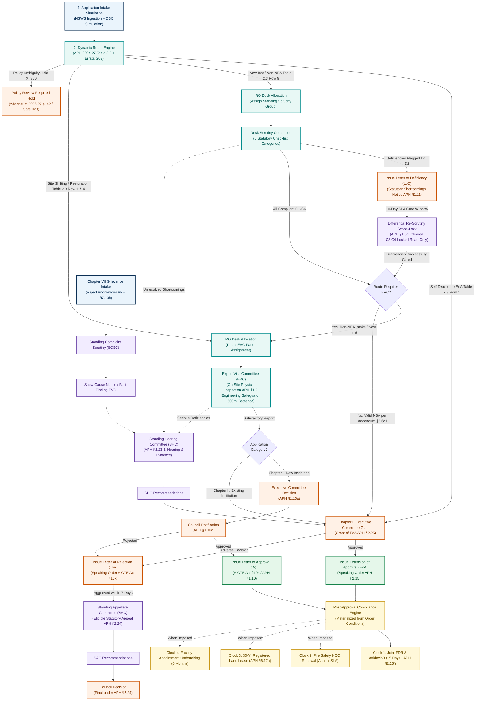

## 🗺️ Regulatory route diagrams

The following **ten original Mermaid diagrams (A–J)** preserve the route-specific logic and decision paths. Open only the route you need; the diagrams are collapsed to keep the README readable.

For category-to-diagram mappings and tests, see the [Route-to-Diagram Matrix](./docs/workflows/ROUTE_TO_DIAGRAM_MATRIX.md).

<details>
<summary><strong>🏛️ Diagram A · New technical institution (Chapter I)</strong></summary>

APH Chapter I §§1.8–1.10: document scrutiny, physical EVC, Executive Committee consideration, and Council ratification.

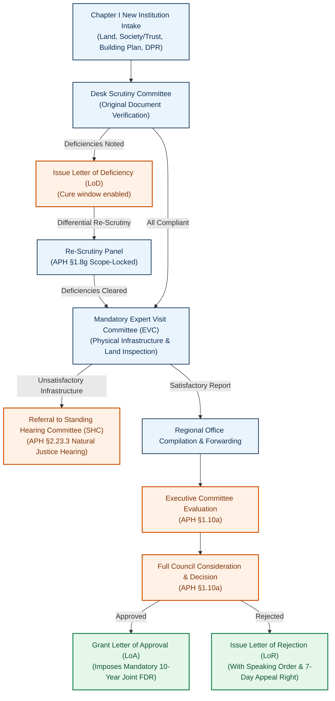

</details>

<details>
<summary><strong>🔁 Diagram B · Self-disclosure EoA</strong></summary>

APH §2.4, Chapter II Table 2.3 Row 1: an eligible existing institution can follow the streamlined route.

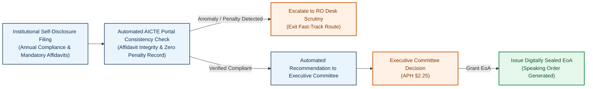

</details>

<details>
<summary><strong>📋 Diagram C · Scrutiny-only routes</strong></summary>

Table 2.3 Rows 2, 4, 8, 9-NBA, 10, 12, 15–20: scrutiny without an EVC when applicable.

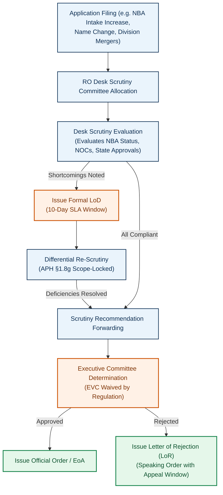

</details>

<details>
<summary><strong>🔎 Diagram D · Scrutiny followed by EVC</strong></summary>

Rows 3, 5, 9-Non-NBA, 6, 11, 13, 21: document scrutiny and then a required inspection.

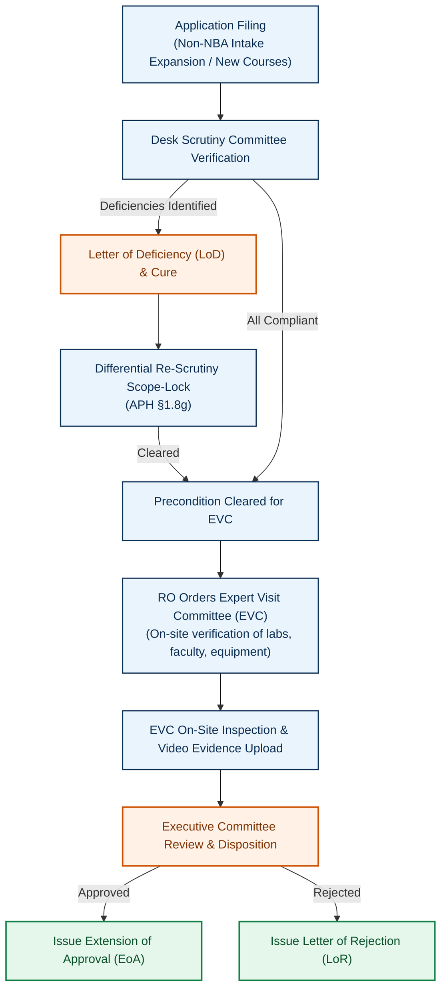

</details>

<details>
<summary><strong>📍 Diagram E · Direct or category-specific EVC</strong></summary>

Site shifting (Row 14) or restoration of intake (Row 7): a visit is central to evaluation.

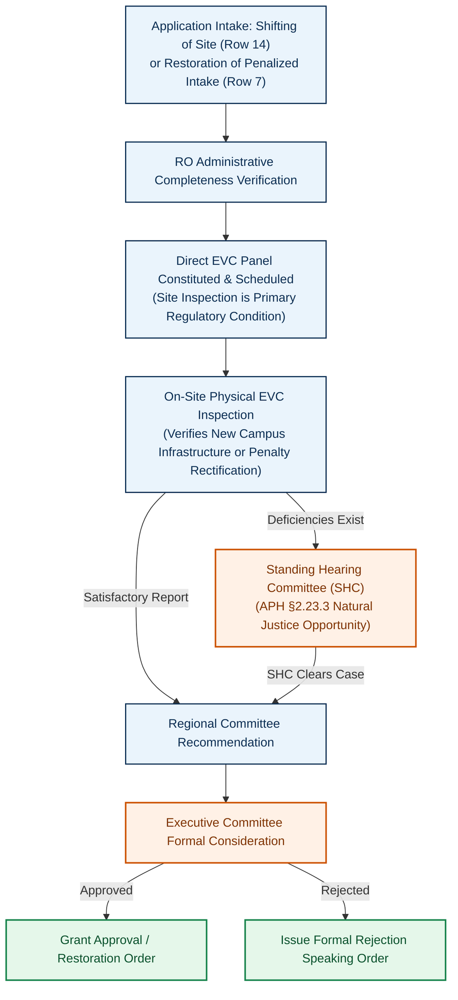

</details>

<details>
<summary><strong>🔒 Diagram F · Deficiency and differential re-scrutiny</strong></summary>

APH §1.8(g): cleared items are locked; only deficiencies are re-examined.

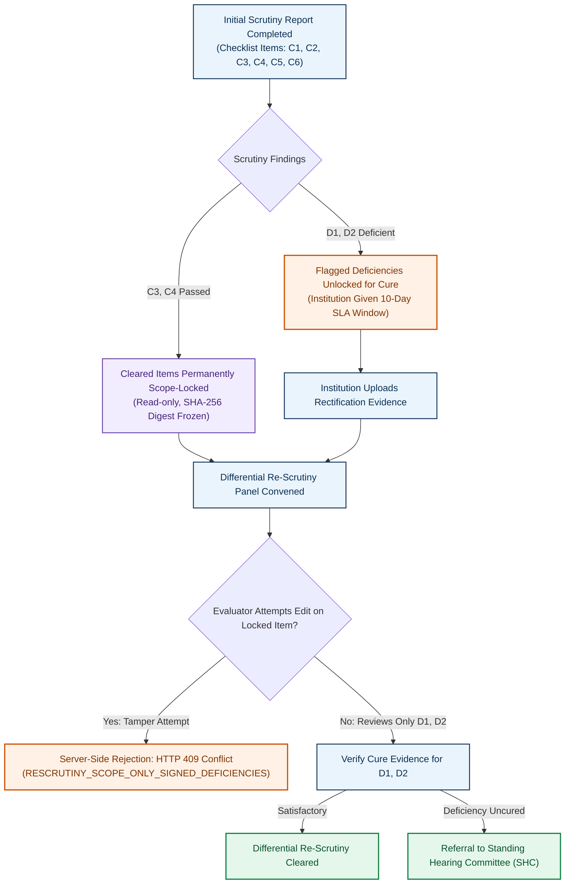

</details>

<details>
<summary><strong>👥 Diagram G · Standing Hearing Committee (SHC)</strong></summary>

APH §2.23.3: opportunity to address unresolved shortcomings before a decision.

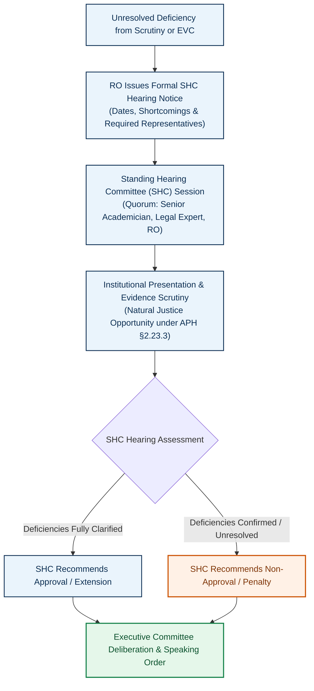

</details>

<details>
<summary><strong>⚖️ Diagram H · Standing Appellate Committee (SAC)</strong></summary>

APH §§1.11 and 2.24: appeal handling with a seven-day filing window.

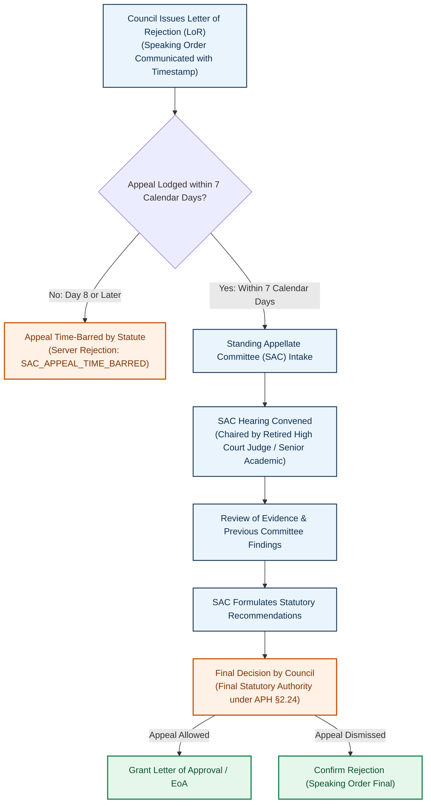

</details>

<details>
<summary><strong>✉️ Diagram I · Complaints and grievances</strong></summary>

APH Chapter VII §7.10: identity screening, fact finding, and any applicable Council action.

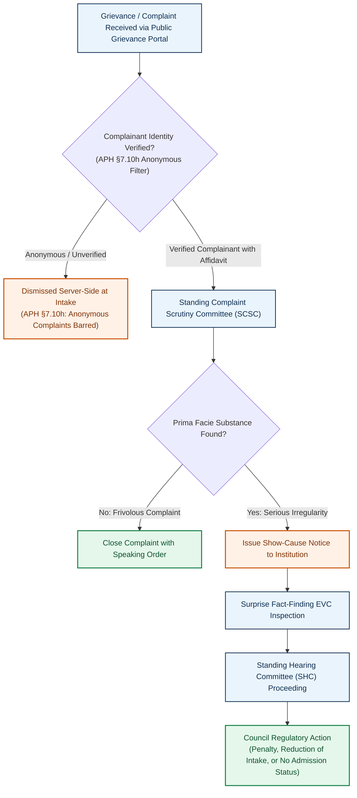

</details>

<details>
<summary><strong>📅 Diagram J · Post-approval compliance</strong></summary>

Order-linked obligations: Joint FDR, Fire NOC, land-lease validity, and faculty undertakings.

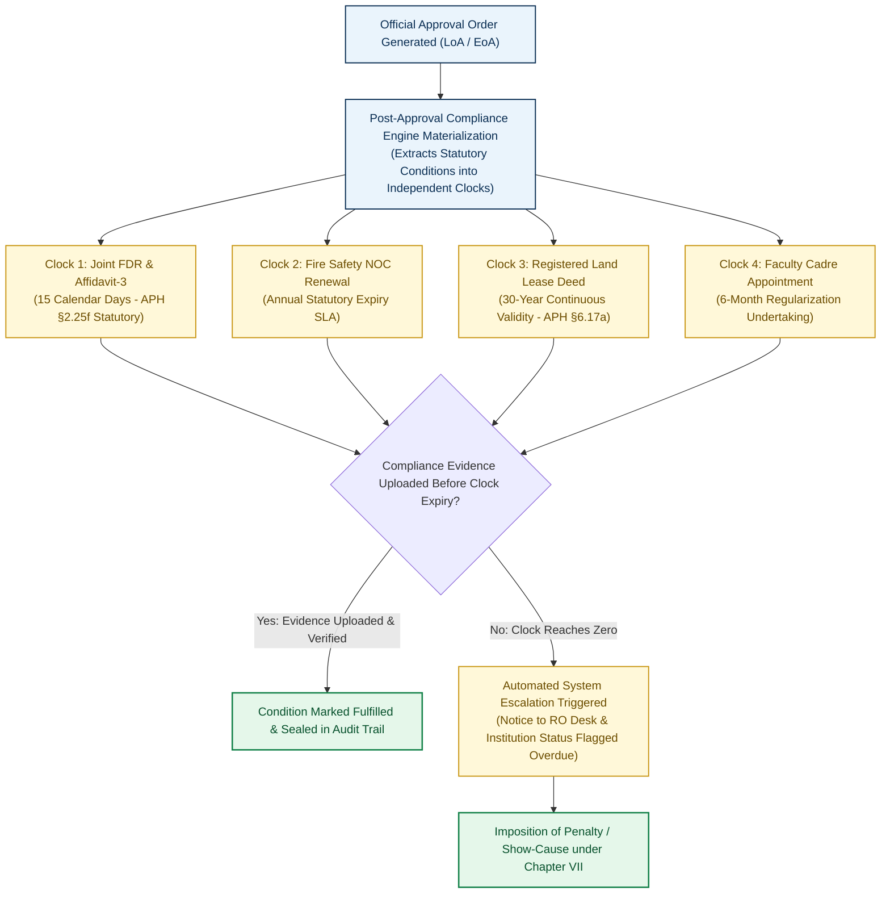

</details>

## 👥 Six role-based workspaces

Each role sees only the cases and actions it is permitted to access. The listed addresses are **demonstration accounts**, not official government accounts; the source README lists `password123` for the demo environment.

| Workspace | Demo account | Main tasks and safeguards |
|---|---|---|
| 🏫 **Institution / Applicant** | `principal@coep.ac.in` or `principal@pdimtr.ac.in` | Applications, intake simulation, deficiency responses, compliance tracking. Access limited to the institution; confidential review notes remain hidden. |
| 🔍 **Desk Scrutiny Reviewer** | `scrutiny.reviewer@aicte.gov.in` | Assigned queue, document checks, deficiency findings, and report sign-off. Cannot reopen cleared items or issue approval orders. |
| 📍 **Expert Visit Committee** | `evc.chair@aicte.gov.in` | Scheduled visits, simulated location/video evidence, facility checklist, and signed inspection report. Assigned panels only. |
| 🗃️ **Regional Office** | `ro.officer@aicte.gov.in` | Workload allocation, committee assignments, SHC hearings, and escalations. Assignment capacity and hearing quorum are checked. |
| ⚖️ **Approval Bureau / Council** | `bureau.approval@aicte.gov.in` | Decision docket, speaking orders, SAC appeals, and document release. Final decisions require authorized human action. |
| 🛠️ **Policy Administration** | `admin@aicte.gov.in` | National statistics, rule versions, conflict simulation, and audit history. Rule changes require a recorded rationale. |

## 🎬 Five-minute demo walkthrough

1. 🏫 **Institution:** Open `APP-2026-COEP`; review status, five sample notices, and the rule explanation for its NBA-based inspection waiver. Applicant views exclude internal deliberations.
2. 🔍 **Scrutiny:** Open `APP-2026-GIITS` and see how cleared items (`C3`, `C4`) stay locked while flagged deficiencies can be addressed.
3. 📍 **EVC:** Inspect the GIITS visit checklist, simulated coordinates, and 30-minute video evidence. Submit the report; the case moves to `decision_pending`, not automatic approval.
4. ⚖️ **Approval Bureau:** Review `APP-2026-PDIMTR`, prepare an EoA document, inspect its HMAC-SHA256 demonstration seal and watermark, then view the resulting obligations.
5. 🛠️ **Policy Admin:** Explore six KPI cards, six charts labeled as demonstration data, and the versioned rules and conflict sandbox.

## 🧱 Technology at a glance

| Layer | Technology | Purpose |
|---|---|---|
| Frontend | React 19, TypeScript 5.8, Tailwind CSS, Vite 6, Lucide | Fast, role-specific interface |
| Backend | Node.js 20/22, Express, REST APIs | Routes, permissions, and workflow operations |
| Storage | MongoDB Atlas and transactional in-memory engine | Persistent case records with in-memory demo support; source describes 11 critical domain models |
| Responsiveness | In-flight request deduplication, actor-scoped six-second read cache | Reduce duplicate requests and improve navigation |
| Security | HttpOnly cookies, SHA-256 evidence hashes, HMAC-SHA256 seals | Access separation and tamper-evident records |
| Verification | Vitest, Supertest, strict TypeScript | Source reports 388 tests across 35 suites and 38 deliverable regression checks |

## 🚀 Run locally

**Prerequisites:** Node.js 20 or 22 LTS and npm 9+. The built-in demonstration memory mode does not require local MongoDB configuration.

```bash
git clone https://github.com/Mayuresh-1306/SIH-2026-AICTE.git SIH-26-AICTE
cd SIH-26-AICTE
npm install
npx tsc --noEmit
npm test
npm run build
npm run dev
```

Open **http://localhost:3000** or use the [hosted prototype](https://niyamsetu-aicte.onrender.com).

## 🧪 Testing and safeguards

The uploaded README reports **388 passing tests in 35 suites** (recorded run: 14.22 seconds). This is a source-reported result, not a fresh verification of the current repository. Key suites cover:

| Area | Source test file | Reported tests |
|---|---|---:|
| Institution notifications and separation | `tests/acceptance/coep_notifications_verification.test.ts` | 3 |
| Cross-institution escalation access | `tests/security/escalation_tenant_isolation.test.ts` | 7 |
| SHC/SAC role separation and quorum | `tests/acceptance/shc_sac_role_separation.test.ts` | 5 |
| Routing, request, and docket latency | `tests/performance/load_benchmarks.test.ts` | 5 |
| Persistence, repeat scheduling, appeal/grievance guards, demo reset | `tests/production_persistence_idempotency.test.ts` | 10 |
| Full deliverables regression | `tests/regression_retrofit_all_deliverables.test.ts` | 38 |
| Rule-based routing | `tests/policy/routing.test.ts` | 37 |
| Decision authority and orders | `tests/decisions/core.test.ts` | 34 |
| Authentication, cookies, roles, and throttling | `tests/security/auth.test.ts` | 18 |

The source also reports benchmark targets/results of **NSWS transitions under 35 ms, route evaluation under 10 ms, and docket loads under 10 ms**, as well as tab switching under 1 ms. Consult the [performance verification](./docs/performance/PERFORMANCE_VERIFICATION.md) for supporting context.

## 🔐 Prototype scope and limitations

> [!IMPORTANT]
> **Demonstration prototype — not an official AICTE production service.** Government integrations, signing, inspections, and outgoing notices are simulated as described below.


- **NSWS and portal intake:** The three-step onboarding and `/api/v1/nsws/prefill` interface use simulated integration data; no live government systems are connected.
- **DSC signing:** Class-3 USB-token/emBridge checks are emulated; they are not live NIC or eMudhra PKI signing.
- **EVC visits:** The 500 m geofence, GPS readings, and timestamped 30-minute video flow are simulated demonstration controls.
- **Notifications:** The transactional outbox shows in-app alerts and simulated SMS/email delivery, separated by recipient and institution.
- **Decision PDFs:** LoA/EoA files carry an HMAC-SHA256 demonstration seal and **`NON-PRODUCTION PROTOTYPE — SIH 2026 DEMONSTRATION`** watermark; they are not official approval certificates.

Rules and obligations remain conditional on the applicable case and order. Ambiguous policies are flagged for authorized review rather than resolved automatically.

## 📚 Supporting documentation

| Document | Covers |
|---|---|
| [Route-to-diagram matrix](./docs/workflows/ROUTE_TO_DIAGRAM_MATRIX.md) | Table 2.3 category mappings, Diagrams A–J, and tests |
| [Workflow overview](./docs/workflows/README.md) | Modular route architecture |
| [Statutory source register](./docs/regulatory/SOURCE_REGISTER.md) | AICTE Act 1987, APH 2024–27, Addendum G02 |
| [Rule mapping matrix](./docs/regulatory/RULE_MAPPING_MATRIX.md) | Seventeen core rules mapped to code |
| [Unverified or conflicting rules](./docs/regulatory/UNVERIFIED_OR_CONFLICTING_RULES.md) | `X=360`, ELP 50%, and hibernation holds |
| [Performance verification](./docs/performance/PERFORMANCE_VERIFICATION.md) | Benchmarks, caching, request deduplication |
| [SIH requirement matrix](./docs/PS_COMPLIANCE_MATRIX.md) | 36 requirements: source reports 34 verified and 2 simulated |
| [Chapter I — New institutions](./docs/workflows/01_chapter_i_new_institution.md) | Establishment process |
| [Chapter II — Self-disclosure](./docs/workflows/02_chapter_ii_self_disclosure_eoa.md) | Annual EoA path |
| [Chapter II — Scrutiny and EVC](./docs/workflows/03_chapter_ii_scrutiny_and_evc_routes.md) | Intake, waivers, site shifts, scope-lock |
| [SHC hearing workflow](./docs/workflows/05_shc_compliance.md) | Shortcomings hearings and separation |
| [SAC appeals workflow](./docs/workflows/06_chapter_specific_appeals.md) | Seven-day appeal handling |
| [Post-approval compliance](./docs/workflows/08_post_approval_compliance.md) | FDR, affidavits, statutory-body notices, four clocks |

**Regulatory basis:** APH 2024–27 and AY 2026–27 Addendum Errata G02. [AICTE official site](https://www.aicte-india.org).
