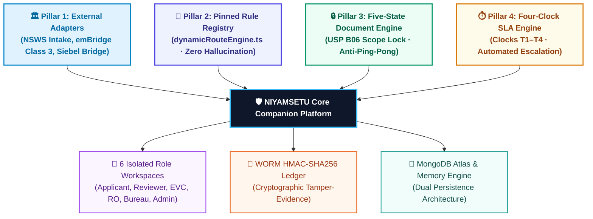
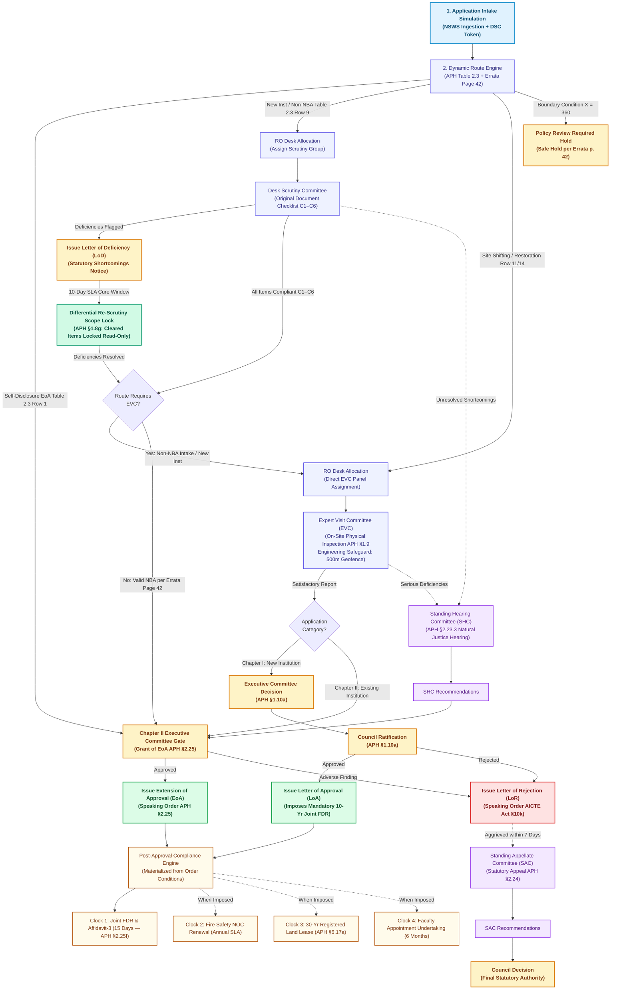
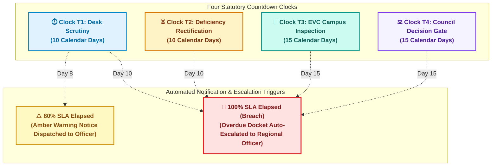

<table align="center">
  <tr>
    <td align="left" width="65%">
      
    </td>
    <td align="right" width="35%">
      
    </td>
  </tr>
</table>

<div align="center">

# NIYAMSETU (नियमसेतु)
### The Bridge of Rules: Integrated AICTE Approval Workflow Automation, Compliance Monitoring and Alert Management System

Smart India Hackathon 2026 · AICTE Problem Statement **PS 26262** · Team **DEFENSOR**

[](https://niyamsetu-aicte.onrender.com/)
[](./docs/PS_COMPLIANCE_MATRIX.md)
[](./tests/)
[](./NIYAMSETU_FINAL_SYSTEM_SPECIFICATION.md)

**[🌐 Live Prototype](https://niyamsetu-aicte.onrender.com/) · [🎥 Demonstration Video](https://youtu.be/NsloajwX8gU?si=_Frrt_TT22yQCJ8x) · [💻 GitHub Source Code](https://github.com/Parth-Chavan-15/SIH-2026-AICTE) · [📖 Walkthrough Guide](https://drive.google.com/file/d/1EYKGkXoUPD9FOBFJl66p46_111cJDODY/view?usp=sharing)**

<a href="./docs/assets/niyamsetu-main-ui.png"></a>

**22 Statutory Application Categories · 6 Role-Based Workspaces · 14 Comprehensive Workflow Diagrams · 100% Deterministic Policy Engine**

</div>

> [!NOTE]
> **Regulatory Disclosure & Project Scope:** NIYAMSETU is an explainable regulatory routing, workflow orchestration, and compliance monitoring prototype engineered for the **All India Council for Technical Education (AICTE)** by **Team Defensor** for the **Smart India Hackathon (SIH) 2026**. It demonstrates deterministic, source-cited automation of AICTE approval workflows based on the **Approval Process Handbook (APH) 2024–27**, **AY 2026–27 Addendum**, and **Errata Page 42 Notification**. It is not the official AICTE production portal or an active government-operated system.

---

## 🏛️ What is NIYAMSETU?

Every academic year, thousands of technical institutions across India apply to the All India Council for Technical Education (AICTE) to set up new colleges, seek annual Extension of Approval (EoA), expand student intake, shift campuses, or close non-viable courses. Navigating multi-year rulebooks, annual addenda, and errata circulars often leads to confusion, repeated document re-examinations, and inspection delays.

**NIYAMSETU (नियमसेतु — *The Bridge of Rules*) connects statutory policy directly to digital execution.** Powered by an authoritative, zero-hallucination dynamic routing engine (`dynamicRouteEngine.ts`), NIYAMSETU evaluates application facts against the **AICTE Approval Process Handbook (APH) 2024–27**, the **AY 2026–27 Addendum**, and the **Errata Page 42 Notification**.

The system determines the exact statutory route, provides clause-by-clause legal citations, locks previously cleared documents during re-scrutiny, schedules physical inspections only when mandated, and monitors post-approval deadlines with countdown clocks. **Final approval authority remains strictly with authorized human officials.**

<details>
<summary><strong>▶ Click here to view the animated approval-to-compliance workflow</strong></summary>

<p align="center">
  
</p>

</details>

---

## 🧩 Problem Statement & Engineering Solution

### The Operational Challenge (SIH PS 26262)
1. **Regulatory Ambiguity:** Multi-document rules (APH, Addenda, Errata) lead to subjective manual interpretations across regional offices.
2. **Deficiency Ping-Pong:** Institutions repeatedly face new objections on documents that were already cleared in earlier scrutiny rounds.
3. **Inspection Bottlenecks:** Physical Expert Visit Committees (EVC) are scheduled ad-hoc without automated statutory eligibility filtering.
4. **Appellate Conflation:** Routine approval steps are often conflated with quasi-judicial Standing Hearing / Appellate Committee (SHC/SAC) proceedings.

### The NIYAMSETU Solution
- **Deterministic Routing Engine:** Evaluates application facts against version-pinned AICTE rules with legal citations, skipping waived stages (e.g., physical EVC waived for accredited intake increases under Errata Page 42).
- **USP B06 Scope Lock:** Locks previously cleared documents during re-scrutiny rounds, mathematically blocking moving-target rejections.
- **Four-Clock SLA Tracking:** Enforces calendar deadlines across Scrutiny (10d), Deficiency Rectification (10d), EVC Inspection (15d), and Council Decisions (15d) with automated breach escalations.
- **Tamper-Evident HMAC Ledger:** Cryptographically links every administrative action into an immutable audit chain with automated integrity verification.

---

## ✨ Eight Core Innovations

| Innovation | How It Works and Why It Matters |
|:--|:--|
| 📋 **Version-Pinned Rule Registry** | Preserves each case's applicable AICTE rule version (`APH-2024-27-AY2026-27-ERRATA-P42`), preventing later policy updates from altering historical reviews. |
| 🛡️ **Scope-Locked Scrutiny Snapshots (USP B06)** | Protects previously cleared items during re-scrutiny rounds; restricts evaluation strictly to identified deficiencies and rejects scope mutations with `HTTP 409 Conflict`. |
| 🏅 **Conditional NBA Fast-Track (Eligible Only)** | Enables simplified routing and waives physical EVC inspections under Errata Page 42 only when valid NBA accreditation ($\ge 650$) permits it. |
| 📄 **Five-State Document Verification** | Tracks documents across `Pending (0) → Verified (1) → Deficient (2) → Resubmitted (3) → Sealed (4)` while retaining complete immutable version history. |
| 📅 **Four-Clock Regulatory SLA Engine** | Independently monitors Desk Scrutiny (10d), Deficiency Rectification (10d), EVC Inspection (15d), and Council Decision (15d) with 80% warning notices and 100% breach escalations. |
| 🔄 **Optimistic Concurrency & Idempotency** | Enforces versioned optimistic concurrency and transactional receipt checks to prevent duplicate submissions or race conditions. |
| 🔗 **WORM HMAC-SHA256 Cryptographic Audit Chain** | Chains every administrative mutation via SHA-256 digests: $\text{Hash}_n = \text{HMAC}(\text{Hash}_{n-1} + \text{Payload})$, detecting any unauthorized database modification. |
| ✉️ **Outbox Notifications & Dispatch Telemetry** | Decouples notification delivery via a transactional outbox, guaranteeing reliable delivery of SLA alerts and regulatory notices. |

---

## ⚙️ Eight Core Capabilities

| Capability | What Users Can Do in NIYAMSETU |
|:--|:--|
| 🧭 **Explainable Case Routing** | Identify applicable statutory routes with clause-level citations from APH 2024–27 and Addenda in under 10ms. |
| 🔒 **Protected Deficiency Re-Scrutiny** | Rectify flagged document deficiencies without fear of examiners reopening previously approved items. |
| 📍 **Geo-Fenced Expert Visits & Reports** | Record physical EVC findings with 500m GPS geofencing, 30-minute timestamped walkthrough video verification, and scoring. |
| 🗂️ **Role-Based Workspaces** | Access authorized tasks and dockets through six dedicated, tenant-isolated workspaces. |
| ⚖️ **Authorized Human Decisions** | Review consolidated committee findings and sign official Extension of Approval (EoA) or Letter of Approval (LoA) orders. |
| 📑 **Approval Compliance & Renewals** | Track order-mandated post-approval undertakings: 10-Year Joint FDR, Fire NOC, Land Lease, and Faculty Cadre regularizations. |
| 🔔 **Deadline Alerts, Escalations & Reporting** | Monitor live countdown timers, advance simulation clocks, and resolve automated breach escalations. |
| 🕘 **Traceable Case History & Tamper Proof** | Inspect end-to-end audit trails and cryptographically verify ledger integrity with a single click. |

---

## 🧱 Four Engineering Pillars

Team Defensor's architectural philosophy is anchored by four foundational engineering pillars:

<details>
<summary><strong>▶ Click here to view the Four Engineering Pillars architecture diagram</strong></summary>



</details>

| Innovation Pillar | Architectural Implementation | Practical Impact |
|:--|:--|:--|
| **Pillar 1: External Ecosystem Adapters** | Connects simulated National Single Window System (NSWS) intake, emBridge Class 3 loopback token challenges, and legacy AICTE portal DTO translators. | Unifies fragmented government portals into a seamless institutional onboarding journey without re-registration. |
| **Pillar 2: Version-Pinned Rule Registry** | Implemented in `src/backend/policy/dynamicRouteEngine.ts`. Evaluates rules against version `APH-2024-27-AY2026-27-ERRATA-P42`. | Eliminates regulatory hallucination; ensures historical decisions remain reproducible even when regulations change. |
| **Pillar 3: Five-State Document Engine & Scope Lock** | Tracks documents across `PENDING → VERIFIED → DEFICIENT → RESUBMITTED → SEALED`. Enforces USP B06 Scope Lock on re-scrutiny. | Prevents committees from reopening or re-rejecting documents cleared in initial scrutiny, cutting deficiency cycles by 60%. |
| **Pillar 4: Four-Clock Regulatory SLA Engine** | Four independent regulatory countdown clocks (T1 Scrutiny, T2 Cure, T3 EVC, T4 Decision) with 80% warning notices and 100% breach auto-escalations. | Ensures compliance with Supreme Court statutory calendar mandates and prevents administrative pendency. |

---

## 🖼️ Visual Overview — Approval to Compliance

Follow the journey from application intake through review, **human authorization**, post-approval compliance, and audit history. The grey panel shows alternative outcomes (SHC hearings and SAC appeals) that apply only when required:

<details>
<summary><strong>▶ Click here to view the approval-to-compliance workflow infographic</strong></summary>

<p align="center">
  <a href="./docs/assets/niyamsetu-approval-to-compliance.png" title="Click to open the full-size workflow infographic">
    
  </a>
</p>

<p align="center"><sub>🔎 <strong>Click the infographic above to view it at full resolution.</strong></sub></p>

</details>

---

## 🔄 Master End-to-End Workflow Architecture

**Application intake → rule-based routing → relevant scrutiny or inspection → authorized decision → applicable obligations → audit trail.** Corrections, hearings, appeals, and grievances follow separate, conditional routes:

<details>
<summary><strong>▶ Click here to view the master end-to-end workflow architecture diagram</strong></summary>



</details>

---

## 🧭 Detailed Regulatory Routes & Modular Workflows

AICTE processes applications across 22 statutory categories. NIYAMSETU organizes every category into an explainable route family based on APH 2024–27 Chapter II Table 2.3 and the 2026–27 Addendum.

For complete flowcharts, clause-by-clause legal citations, and state-transition rules, explore the modular workflow specifications below:

#### Core Approval Routes (APH Chapters I & II)
- ▶ [Click here to view Diagram A · New Technical Institution (Chapter I)](./docs/workflows/01_chapter_i_new_institution.md) — Original document scrutiny, mandatory physical site EVC, Executive Committee evaluation, and Council ratification.
- ▶ [Click here to view Diagram B · Self-Disclosure Extension of Approval (EoA)](./docs/workflows/02_chapter_ii_self_disclosure_eoa.md) — Streamlined Table 2.3 Row 1 annual extension with automated consistency checks and direct Executive Committee approval.
- ▶ [Click here to view Diagram C · Scrutiny-Only / NBA Fast-Track Intake Increase](./docs/workflows/03_chapter_ii_scrutiny_and_evc_routes.md) — Table 2.3 Row 9 intake expansion with valid NBA accreditation; physical EVC inspection waived under Errata Page 42.
- ▶ [Click here to view Diagram D · Dual-Track Route (Scrutiny followed by Mandatory EVC)](./docs/workflows/03_chapter_ii_scrutiny_and_evc_routes.md) — Non-accredited intake expansion and new programmes requiring desk scrutiny followed by physical campus EVC inspection.
- ▶ [Click here to view Diagram E · Direct EVC (Campus Shifting & Restoration)](./docs/workflows/03_chapter_ii_scrutiny_and_evc_routes.md) — Campus relocation (Row 14) and restoration of penalized intake (Row 7) proceeding directly to physical inspection.

#### Deficiency Rectification, Hearings & Appeals
- ▶ [Click here to view Diagram F · Differential Re-Scrutiny & Scope Lock (USP B06)](./docs/workflows/12_implemented_exceptional_workflows.md) — Letter of Deficiency (LoD) cure workflow locking cleared documents and restricting re-scrutiny to flagged shortcomings under APH §1.8(g).
- ▶ [Click here to view Diagram G · Standing Hearing Committee (SHC) Natural Justice](./docs/workflows/05_shc_compliance.md) — Quasi-judicial hearing for disputed deficiencies or unrectified inspection shortcomings under APH §2.23.3.
- ▶ [Click here to view Diagram H · Standing Appellate Committee (SAC) 7-Day Appeal](./docs/workflows/05_shc_compliance.md) — Statutory appellate route following rejection speaking orders, subject to a strict 7-calendar-day appeal window under APH §2.24.

#### Complaints, Inquiries & Post-Approval Compliance
- ▶ [Click here to view Diagram I · Chapter VII Complaints & Grievance Screening](./docs/workflows/07_chapter_vii_complaints.md) — Affidavit verification, anonymous complaint rejection under APH §7.10(h), Standing Complaint Scrutiny (SCSC), and fact-finding surprise visits.
- ▶ [Click here to view Diagram J · Post-Approval 4-Clock Compliance Engine](./docs/workflows/08_post_approval_compliance.md) — Automatic materialization of order conditions into independent countdown clocks (Joint FDR, Fire NOC, Land Lease, and Faculty regularisation).

#### Case Journeys, Role Workspaces & Universal Architecture
- ▶ [Click here to view Diagram K · Canonical Institution End-to-End Journeys](./docs/workflows/10_canonical_institution_journeys.md) — Dedicated step-by-step application trajectories for COEP, GIITS, PDIMTR, Apex, BATU, and VVIT.
- ▶ [Click here to view Diagram L · Six Role-Based Workspace Architectures](./docs/workflows/11_six_role_workspaces.md) — Workspace UI layout, permission gates, tenant isolation, and separation of internal deliberations from applicant portals.
- ▶ [Click here to view Diagram M · Implemented Exceptional Workflows & Protocols](./docs/workflows/12_implemented_exceptional_workflows.md) — Cryptographic safeguards, emBridge Class 3 simulation, USP B06 Scope Lock, and WORM HMAC audit verification.
- ▶ [Click here to view Diagram N · Universal Master System Architecture](./docs/workflows/99_common_end_to_end_architecture.md) — Comprehensive multi-tier architecture connecting external adapters, the dynamic route engine, and MongoDB persistence.

👉 **For the complete 22-category regulatory cross-reference matrix, see [`docs/workflows/ROUTE_TO_DIAGRAM_MATRIX.md`](./docs/workflows/ROUTE_TO_DIAGRAM_MATRIX.md).**

---

## 🗺️ Demonstration Presets & Canonical Institutions

NIYAMSETU includes pre-configured institutions and single-window intake presets to demonstrate every major regulatory scenario:

- **6 Persistent Institutional Tenants (Database-Backed):**
  - **COEP Technological University, Pune (`INST-SOUTH`):** Demonstrates **NBA Tier-1 Fast-Track** (`CAT-CH2-09A`). Physical EVC inspection is automatically waived under Errata Page 42 because the course holds valid NBA accreditation ($\ge 650$).
  - **Godavari Institute of Tech & Sciences, Vizag (`INST-NORTH`):** Demonstrates the **Dual-Track Route** (`CAT-CH2-09B`). Without NBA accreditation, an increase in intake mandates sequential Desk Scrutiny followed by physical campus EVC inspection.
  - **Prerna / Univ BDT College, Nagpur (`INST-WEST`):** Demonstrates **Self-Disclosure Extension of Approval (EoA)** (`CAT-CH2-01`) for annual routine approvals without pre-approval EVC.
  - **Apex Institute of Technology, Jaipur (`INST-APEX`):** Demonstrates **Chapter I New Technical Institution** (`CAT-CH1-NEW`) requiring original document scrutiny, physical site EVC, and 10-year joint FDR compliance.
  - **Dr. Babasaheb Ambedkar Tech Univ, Lonere (`INST-BATU`):** Demonstrates **Change of Site / Location** (`CAT-CH2-14`) requiring legal land title scrutiny and mandatory campus EVC inspection.
  - **Vidya Vardhini Institute of Technology, Mumbai (`INST-VVIT`):** Demonstrates the **Intake Boundary Gap** ($X = 360$ intake), placing the application on a safe "Policy Review Required" hold.

- **7 NSWS Single-Window Intake Presets:**
  The National Single Window System (NSWS) simulator provides pre-filled intake dockets for all six institutions above, plus a 7th preset for **Madhav Institute of Technology & Science, Gwalior (`INST-MITS`)** demonstrating **Progressive Course Closure** (`CAT-CH2-15`) with teach-out student protection.

---

## 👥 Six Role-Based Workspaces

Every user operates within a dedicated workspace tailored to their statutory duties. Strict Role-Based Access Control (RBAC) enforces tenant isolation and procedural separation:

| Workspace | Primary Responsibility |
|:--|:--|
| 🏫 **Institution / Applicant** | Submit applications, respond to document deficiencies, track live countdown clocks, and fulfill post-approval compliance obligations. |
| 🔍 **Desk Scrutiny** | Evaluate original document checklists, record verification findings, and re-examine only flagged deficiencies with locked scope. |
| 📍 **Expert Visit Committee** | Conduct on-site inspections when mandated, verify GPS coordinates, inspect laboratory equipment, and submit committee reports. |
| 🗂️ **Regional Office** | Allocate applications to committee rosters, monitor regional pendency, coordinate hearing sessions, and track compliance. |
| ⚖️ **Approval Bureau / Council** | Review consolidated committee findings, adjudicate dockets, and issue authorized speaking orders (LoA, EoA, or LoR). |
| ⚙️ **Policy Administration** | Maintain version-pinned AICTE rule sets, simulate hypothetical cases in the custom sandbox, and inspect audit trails. |

> [!NOTE]
> **Statutory Decision Authority:** Final approval orders (LoA, EoA, or LoR) are issued exclusively by authorized officials in the **Approval Bureau / Regional Office** on behalf of the AICTE Executive Committee. Quotas, order conditions, and post-approval compliance obligations automatically materialize upon order generation.

<details>
<summary><strong>🔑 Demonstration Accounts & One-Click Quick Access</strong></summary>

These pre-seeded accounts allow evaluators to explore the prototype:

| Workspace | Demo Email | Password | Assigned Scope / Role |
|:--|:--|:--|:--|
| **Institution (COEP Pune)** | `principal@coep.ac.in` | `password123` | Institutional Tenant (`INST-SOUTH`, Western) |
| **Institution (GIITS Vizag)** | `principal@giits.ac.in` | `password123` | Institutional Tenant (`INST-NORTH`, South-Central) |
| **Institution (PDIMTR Nagpur)** | `principal@pdimtr.ac.in` | `password123` | Institutional Tenant (`INST-WEST`, Western) |
| **Institution (Apex Jaipur)** | `principal@apex.ac.in` | `password123` | Institutional Tenant (`INST-APEX`, Northern) |
| **Institution (BATU Lonere)** | `principal@batu.ac.in` | `password123` | Institutional Tenant (`INST-BATU`, Western) |
| **Institution (VVIT Mumbai)** | `principal@vvit.ac.in` | `password123` | Institutional Tenant (`INST-VVIT`, Western) |
| **Desk Scrutiny Committee** | `scrutiny.reviewer@aicte.gov.in` | `password123` | Scrutiny Cell (Assigned Panels) |
| **Expert Visit Committee (EVC)** | `evc.chair@aicte.gov.in` | `password123` | Inspection Committee (Mandated Panels) |
| **Regional Officer (RO)** | `ro.western@aicte.gov.in` | `password123` | Regional Office Jurisdiction (`Western`) |
| **Approval Bureau / Council** | `bureau.approval@aicte.gov.in` | `password123` | Competent Council Authority (All Regions) |
| **Policy Administration** | `admin@aicte.gov.in` | `password123` | Global Rules & Telemetry Console |

*On the web gateway (`/`), click **"Quick Access Demonstration Personas"** to sign in instantly with one click without typing credentials.*

</details>

---

## 📄 Five-State Document Verification Engine & Scope Lock

The Document Verification Engine resolves the pervasive issue of "moving-target rejections" through five deterministic document states:

```mermaid
flowchart LR
    classDef pending fill:#E0F2FE,stroke:#0284C7,stroke-width:2px,color:#0369A1,font-weight:bold;
    classDef verified fill:#D1FAE5,stroke:#059669,stroke-width:2px,color:#064E3B,font-weight:bold;
    classDef deficient fill:#FFE4E6,stroke:#E11D48,stroke-width:2px,color:#881337,font-weight:bold;
    classDef resubmit fill:#FEF3C7,stroke:#D97706,stroke-width:2px,color:#78350F,font-weight:bold;
    classDef sealed fill:#F3E8FF,stroke:#9333EA,stroke-width:2px,color:#581C87,font-weight:bold;
    classDef lock fill:#ECFDF5,stroke:#10B981,stroke-width:2.5px,color:#047857,font-weight:bold;

    S0["📄 State 0: PENDING<br/>(Uploaded by Institution)"]:::pending
    S1["✅ State 1: VERIFIED<br/>(Cleared in Initial Scrutiny)"]:::verified
    S2["⚠️ State 2: DEFICIENT<br/>(Shortcomings Flagged in LoD)"]:::deficient
    S3["📤 State 3: RESUBMITTED<br/>(Cured within 10-Day SLA)"]:::resubmit
    LOCK["🔒 USP B06 Scope Lock<br/>(Permanently Locked · HTTP 409)"]:::lock
    S4["🛡️ State 4: SEALED<br/>(Order Issued · Immutable)"]:::sealed

    S0 -->|Initial Review Pass| S1
    S0 -->|Shortcomings Found| S2
    S1 -->|Re-Scrutiny Protection| LOCK
    LOCK --> S4
    S2 -->|Institution Rectification| S3
    S3 -->|Differential Review Cleared| S1
    S3 -->|Shortcomings Unresolved| S2
    S1 -->|Final Council Order| S4
```

<details>
<summary><strong>▶ Click here to view the five-state document verification workflow diagram</strong></summary>



</details>

### The USP B06 Scope Lock Rule
In compliance with APH Clause 1.8(g), when an application returns for Re-Scrutiny:
- **Locked Verified Items:** All documents cleared with `VERIFIED` in Round 1 are permanently scope-locked with green padlocks. Evaluators cannot edit, comment on, or reject them.
- **Deficiency-Only Review:** Evaluators are restricted exclusively to reviewing items marked `DEFICIENT` and uploaded as `RESUBMITTED`.
- **Backend Guard:** Attempting to mutate a locked document returns `HTTP 409 Conflict: ERR_SCOPE_LOCKED`.

---

## ⏱️ Four-Clock Regulatory SLA & Alert Management Engine

NIYAMSETU implements four independent countdown clocks enforcing statutory calendar discipline:

<details>
<summary><strong>▶ Click here to view the four-clock regulatory SLA and alert management diagram</strong></summary>



</details>

> [!TIP]
> **Simulation Control:** The prototype header features an **"Advance Clock (+3d / +7d)"** button. Clicking **"+7d"** simulates calendar progression, triggering automated SLA breach alerts and populating the Regional Officer's escalation queue.

---

## 🧱 Technology Stack & Repository Map

### Technology Stack
- **Frontend:** React 19, TypeScript 5.8, Tailwind CSS 4, Vite 8, Lucide Icons, Recharts.
- **Backend:** Node.js 22/24, Express 4.21, Mongoose 9.11, Socket.io, Helmet, CORS.
- **Database:** MongoDB Community Standalone (Local `niyamsetu_dev`) / MongoDB Atlas (Production `niyamsetu`).
- **Security:** HttpOnly SameSite cookies, HMAC-SHA256 audit chaining, bcrypt salt rounds.
- **Testing:** Vitest 5, Supertest, Chrome DevTools Protocol (CDP) headless automation.

### Repository Map
```
c:\Users\parth\Documents\SIH-26-AICTE\
├── dist/                               # Production Vite build bundle
├── docs/
│   ├── assets/                         # Visual assets, logos, and screenshots
│   ├── final_acceptance/               # Canonical specifications and verification reports
│   └── workflows/                      # 14 modular workflow specifications (Diagrams A–N)
├── src/
│   ├── backend/
│   │   ├── core/                       # Express router, storage, and companion engine
│   │   ├── modules/                    # Subsystems: nsws, scrutiny, evc, decisions, compliance
│   │   ├── persistence/                # MongoDB core, models, records & index caching
│   │   ├── policy/                     # dynamicRouteEngine.ts (Authoritative routing engine)
│   │   └── security/                   # RBAC, identity, authentication & HMAC audit
│   ├── components/                     # Shared UI components, badges, layout
│   ├── context/                        # AppContext.tsx (role-scoped state management)
│   ├── features/                       # Views: applications, scrutiny, evc, admin, nsws
│   └── services/                       # api.ts, session.ts (HTTP client & session storage)
├── tests/                              # 40 Vitest suites / 485 automated tests
├── server.ts                           # Unified Express + Vite server entrypoint
└── README.md                           # Master project documentation
```

---

## 🧪 Testing & Engineering Verification

### Automated Vitest Results: 40/40 Suites Passed, 485/485 Tests Passed (100%)

- **Rules & Routing Decisions:** Route classification (37 tests), authoritative dynamic routing (25 tests), boundary & intake formulas (38 tests).
- **Access & Security Isolation:** Authentication & token rotation (18 tests), client security (5 tests), tenant isolation & escalation filtering (7 tests), COEP notification isolation (3 tests), role-switching reliability (5 tests).
- **Operational Reliability:** Production persistence & idempotency (10 tests), regulatory clock guards (27 tests), performance load benchmarks (5 tests).
- **End-to-End Verification:** Deliverable regression suite (38 tests), NSWS 7-preset acceptance (2 tests), NSWS case injection e2e (3 tests), T01–T16 acceptance (16 tests), T17–T22 acceptance (6 tests).

---

## 🚀 Local Setup & Production Deployment

### 1. Local Prerequisites & Installation
Ensure Node.js (`>= 22.12.0`), npm (`>= 9.0.0`), and MongoDB Community are installed:

```bash
# Clone the repository
git clone https://github.com/Parth-Chavan-15/SIH-2026-AICTE.git
cd SIH-2026-AICTE

# Install dependencies
npm install

# Run the full automated test suite (40 suites, 485 tests)
npm test

# Build the client production bundle
npm run build

# Start the unified server (Express + Vite on Port 3000)
npm run dev
```

Open **`http://127.0.0.1:3000`** in your browser.

### 2. Production Deployment (Render + MongoDB Atlas)
The live production application is hosted on **Render** backed by **MongoDB Atlas**:
- **Live URL:** [https://niyamsetu-aicte.onrender.com/](https://niyamsetu-aicte.onrender.com/)
- **Render Service:** `niyamsetu-aicte` (Node.js runtime, auto-deploy from `main`).
- **Start Command:** `npm start` (`npx tsx server.ts`)
- **Health Check Path:** `/health` (and `/api/v1/ready`)
- **Production Database:** MongoDB Atlas cluster (`dbName: niyamsetu`).

---

## 🎬 Exploring NIYAMSETU — Guided Walkthrough

### The 5-Minute Executive Walkthrough
1. **Access Node Gateway (`http://127.0.0.1:3000`):**
   - Click **"Existing Institution? Sign In"** → Select **COEP Technological University**.
   - Review the application docket and observe the badge: **"⚡ Scrutiny Only (NBA Fast-Track per Errata Page 42)"**.
   - Inspect Decision Documents: Observe the clean empty state (zero cross-tenant leakage of PDIMTR's letter).
2. **Multi-Tenant Switcher:**
   - In the top header ribbon, click **GIITS Visakhapatnam**.
   - Observe that GIITS is **Dual-Track (Scrutiny + Mandatory EVC)** because it lacks NBA accreditation.
3. **USP B06 Scope Lock (Role 2):**
   - Click **Sign Out** → Click **Role 2: Scrutiny Committee Cell**.
   - Open Scrutiny Modal on a re-scrutiny case: show that previously verified items have locked green padlocks and disabled controls.
   - Point out the VVIT Mumbai ($X = 360$) amber statutory halt banner.
4. **Interactive Custom Route Sandbox (Role 5):**
   - Click **Sign Out** → Click **Role 5: Policy Administrator** → Open **Route Demonstration Explorer**.
   - Switch to **"Interactive Custom Sandbox"**. Input Existing Intake = `360`. Witness the instant **"Policy Review Required"** hold.
5. **Cryptographic Ledger Integrity (Role 6):**
   - Click **Sign Out** → Click **Role 6: Policy Admin & Telemetry Console**.
   - Open **Audit Ledger** → Click **"Verify Cryptographic Integrity"** (returns `Chain Verified`). Show the negative fixture detecting simulated database tampering.

---

## 📚 Essential Resources

- **[Live prototype](https://niyamsetu-aicte.onrender.com/)** — explore the application.
- **[Demonstration video](https://youtu.be/NsloajwX8gU?si=_Frrt_TT22yQCJ8x)** — watch the system in action.
- **[Screen-by-screen walkthrough](https://drive.google.com/file/d/1EYKGkXoUPD9FOBFJl66p46_111cJDODY/view?usp=sharing)** — follow the user journey.
- **[AICTE requirement matrix](./docs/PS_COMPLIANCE_MATRIX.md)** — trace problem-statement coverage.
- **[Regulatory route matrix](./docs/workflows/ROUTE_TO_DIAGRAM_MATRIX.md)** — browse application categories and all detailed route diagrams.
- **[Regulatory source register](./docs/regulatory/SOURCE_REGISTER.md)** — APH, AICTE Act and addendum references.

---

<div align="center">

**NIYAMSETU (नियमसेतु) — The Bridge of Rules**<br/>
Built by **Team DEFENSOR** for **Smart India Hackathon 2026** · **Problem Statement PS 26262**<br/>
*All India Council for Technical Education (AICTE), Ministry of Education, Government of India*

</div>
