<table align="center">
  <tr>
    <td align="left" width="65%">
      
    </td>
    <td align="right" width="35%">
      
    </td>
  </tr>
</table>

<div align="center">

# NIYAMSETU (नियमसेतु)

**A clearer way to manage AICTE approvals and post-approval compliance.**

Smart India Hackathon 2026 · AICTE Problem Statement **26262** · Team **DEFENSOR**

[](https://niyamsetu-aicte.onrender.com)
[](./docs/PS_COMPLIANCE_MATRIX.md)
[](./tests/)

**[🌐 Live demo](https://niyamsetu-aicte.onrender.com) · [🎥 Demo video](https://youtu.be/NsloajwX8gU?si=_Frrt_TT22yQCJ8x) · [💻 Source code](https://github.com/Parth-Chavan-15/SIH-2026-AICTE) · [📖 User guide](https://drive.google.com/file/d/1EYKGkXoUPD9FOBFJl66p46_111cJDODY/view?usp=sharing)**

<a href="./docs/assets/niyamsetu-main-ui.png"></a>

**22 application categories · 6 role-based workspaces · 11 expandable workflow diagrams**

</div>

---

## 🏛️ What is NiyamSetu?

Technical institutions need AICTE approval for new colleges, annual extensions, intake changes and other activities. Applications can involve separate portals, document reviews, campus visits, decisions and later compliance checks.

**NiyamSetu connects these activities in one traceable workflow.** It selects the applicable route using the AICTE Approval Process Handbook (APH) 2024–27 and the 2026–27 Addendum Errata G02, explains each step, and tracks follow-up obligations. **Final approval remains with authorized officials.**

## ✨ Innovation & Uniqueness

| Innovation | How it works and why it matters |
|:--|:--|
| 📋 **Version-Pinned Rule Registry** | Each application keeps a record of the AICTE rule version used to determine its route. Later rule updates do not silently change an ongoing case, and reviewers can see the relevant rule references. |
| 🛡️ **Scope-Locked Scrutiny Snapshots** | When deficiencies are corrected, previously cleared checklist items remain protected and read-only. Reviewers examine only the items identified for re-scrutiny, reducing repeated checks and protecting earlier findings. |
| 🏅 **Conditional NBA Fast-Track (Eligible Only)** | NBA accreditation can support a simpler route only when the applicable rules and eligibility conditions allow it. The system checks the case-specific conditions instead of automatically waiving scrutiny or inspection. |
| 📄 **Five-State Document Verification** | Documents progress through **Submitted, Observed, Independently Verified, Rejected,** or **Superseded** states. Earlier versions remain recorded so reviewers can trace what was submitted, checked and replaced. |
| 📅 **Four-Category Deadline Engine** | Tracks academic cutoffs, event-based deadlines, document validity and internal officer targets. Relevant reminders help institutions and officials act on upcoming obligations and overdue work. |
| 🔄 **Optimistic Concurrency Protection** | The system checks whether a case changed after a user opened it. An outdated or conflicting update is rejected rather than silently overwriting another officer's work. |
| 🔗 **SHA-256 Tamper-Evident Audit Chain** | Cryptographic hashes link recorded actions and evidence to help reveal unexpected changes in the case history. This supports integrity checks and accountability without claiming that tampering is impossible. |
| ✉️ **Outbox Notifications & Dispatch Tracking** | Case events create traceable notification records that can be followed through dispatch. Institutions and officers can review the communication history alongside the actions that prompted each notice. |

### ⚙️ Core Capabilities

| Capability | What users can do |
|:--|:--|
| 🧭 **Explainable Case Routing** | Identify the applicable approval route and view the reason behind it, including the relevant rule reference. This makes the next steps clearer to institutions and reviewers. |
| 🔒 **Protected Deficiency Re-Scrutiny** | Submit and review corrections only for recorded deficiencies. Previously cleared evidence stays protected, so the full application need not be checked again unnecessarily. |
| 📍 **Conditional Expert Visits & Reports** | When the rules require a visit, EVC members record inspection observations, supporting evidence and findings. Applications that do not require an inspection follow their applicable route. |
| 🗂️ **Role-Based Dashboards** | Six workspaces show the cases, responsibilities and actions relevant to each user. Role and institution permissions limit access to authorized information and operations. |
| ⚖️ **Authorized Human Decisions** | Competent authorities review the case dossier, committee recommendations and required checks before recording a decision. Software supports the review but does not approve applications independently. |
| 📑 **Approval Compliance & Renewals** | Connect approved cases to applicable conditions, renewal requirements and supporting documents. Institutions and officers can follow obligations after the approval order. |
| 🔔 **Deadline Alerts, Escalation & Reporting** | Monitor upcoming due dates, overdue activities and pending work. Reminders, escalation records and reports help users identify actions that need attention. |
| 🕘 **Traceable Case History** | Follow the history of applications, scrutiny, decisions, document changes, notices and compliance actions in one case record. This supports clear handoffs and later review. |

## 🖼️ Visual overview — approval to compliance

Follow the journey from application intake through review, **human authorization**, post-approval compliance and audit history. The grey panel shows alternative outcomes that apply only when required.

<p align="center">
  <a href="./docs/assets/niyamsetu-approval-to-compliance.png" title="Click to open the full-size workflow infographic">
    
  </a>
</p>

<p align="center"><sub>🔎 <strong>Click the infographic to view it at full size.</strong></sub></p>

## 🔄 Complete workflow architecture

**Application intake → rule-based routing → relevant scrutiny or inspection → authorized decision → applicable obligations → audit trail.** Corrections, hearings, appeals and grievances follow separate, conditional routes.

Open the interactive diagram below for the complete decision flow, including exceptions and regulatory references. Its light colors are intended to be legible on GitHub.

<details>
<summary><strong>▶ Click here to view the complete workflow architecture (interactive diagram)</strong></summary>

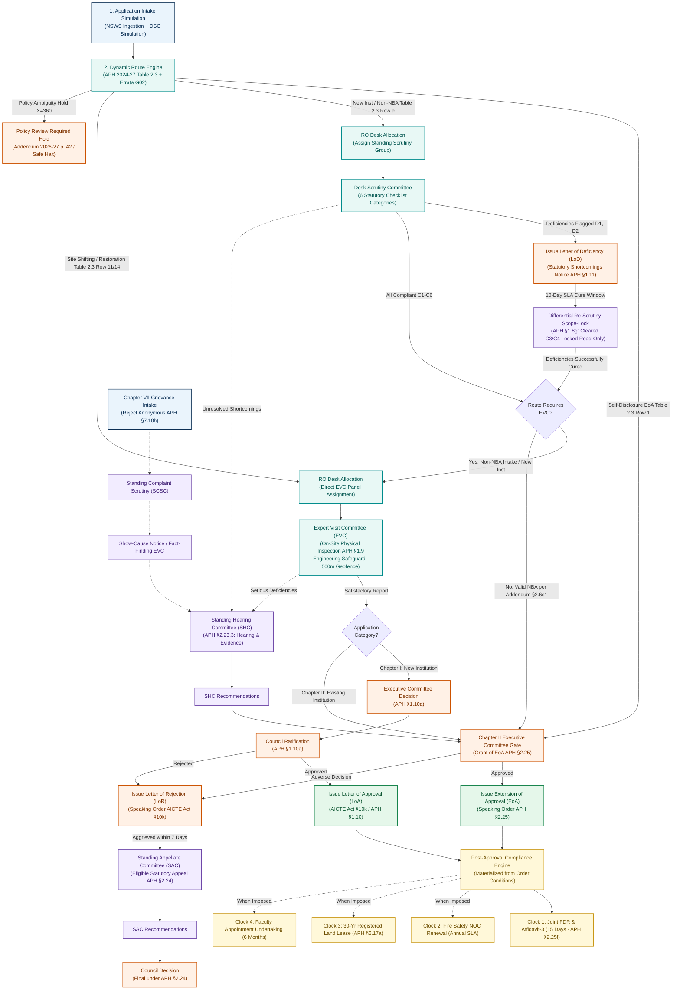

</details>

## 🧭 Detailed regulatory routes

**10 focused diagrams (A–J)** cover the major application routes, appeals, grievances, re-scrutiny and post-approval obligations. ▶ **Click a diagram title below to expand its flowchart.** Click it again to collapse.

For the full regulatory mapping, refer to the [route-to-diagram matrix](./docs/workflows/ROUTE_TO_DIAGRAM_MATRIX.md).

<details>
<summary><strong>▶ Click here to view Diagram A · New technical institution (Chapter I)</strong></summary>

APH Chapter I §§1.8–1.10: document scrutiny, physical EVC, Executive Committee consideration, and Council ratification.

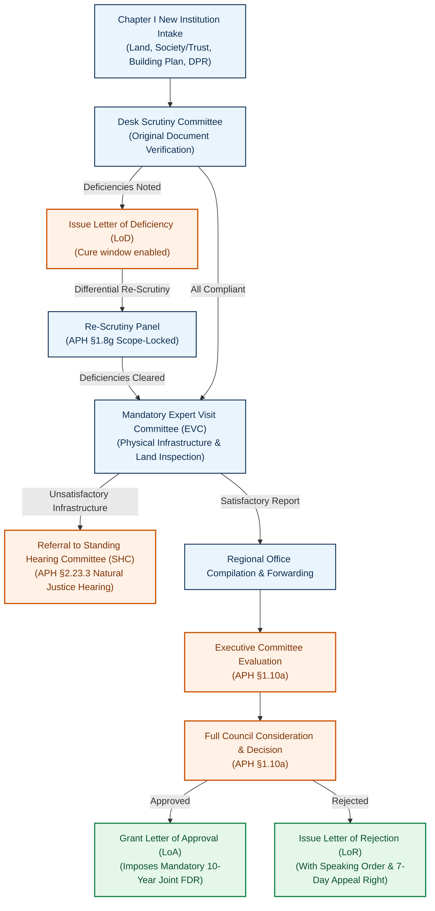

</details>

<details>
<summary><strong>▶ Click here to view Diagram B · Self-disclosure EoA</strong></summary>

APH §2.4, Chapter II Table 2.3 Row 1: an eligible existing institution can follow the streamlined route.

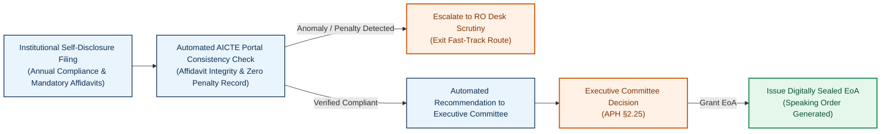

</details>

<details>
<summary><strong>▶ Click here to view Diagram C · Scrutiny-only routes</strong></summary>

Table 2.3 Rows 2, 4, 8, 9-NBA, 10, 12, 15–20: scrutiny without an EVC when applicable.

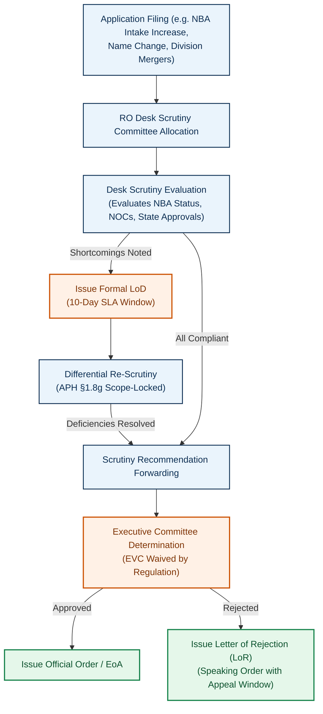

</details>

<details>
<summary><strong>▶ Click here to view Diagram D · Scrutiny followed by EVC</strong></summary>

Rows 3, 5, 9-Non-NBA, 6, 11, 13, 21: document scrutiny and then a required inspection.

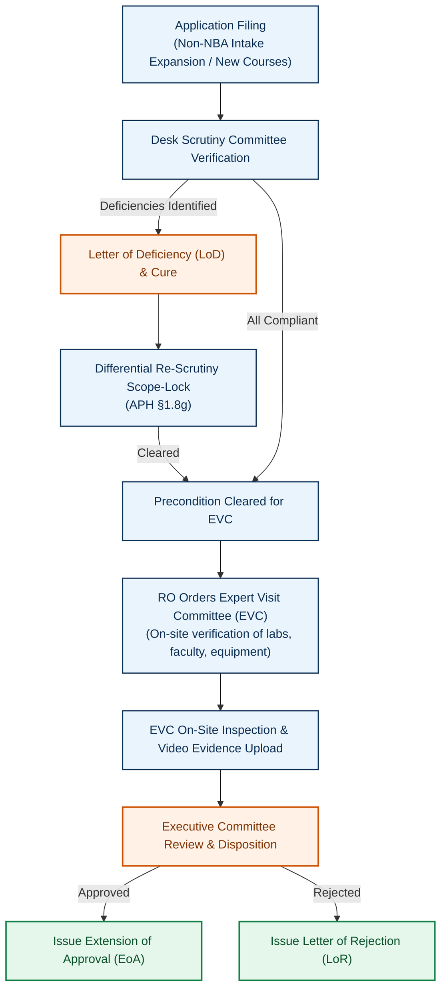

</details>

<details>
<summary><strong>▶ Click here to view Diagram E · Direct or category-specific EVC</strong></summary>

Site shifting (Row 14) or restoration of intake (Row 7): a visit is central to evaluation.

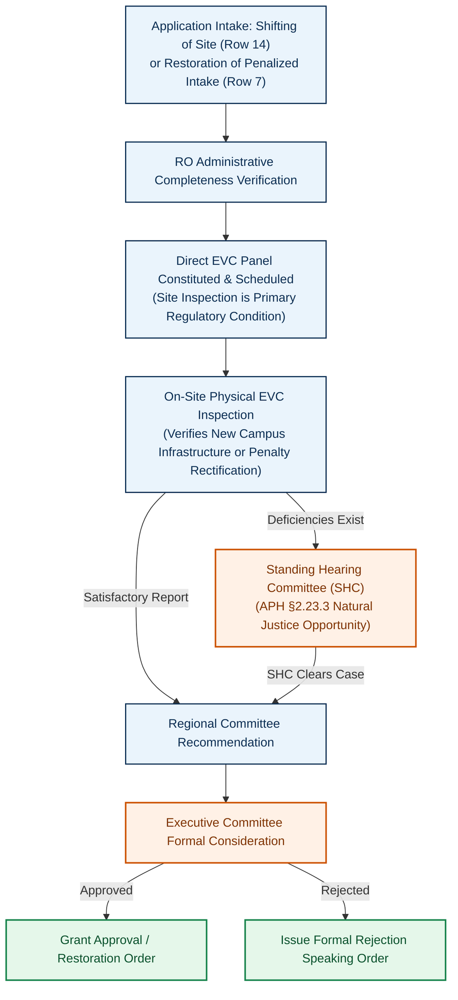

</details>

<details>
<summary><strong>▶ Click here to view Diagram F · Deficiency and differential re-scrutiny</strong></summary>

APH §1.8(g): cleared items are locked; only deficiencies are re-examined.

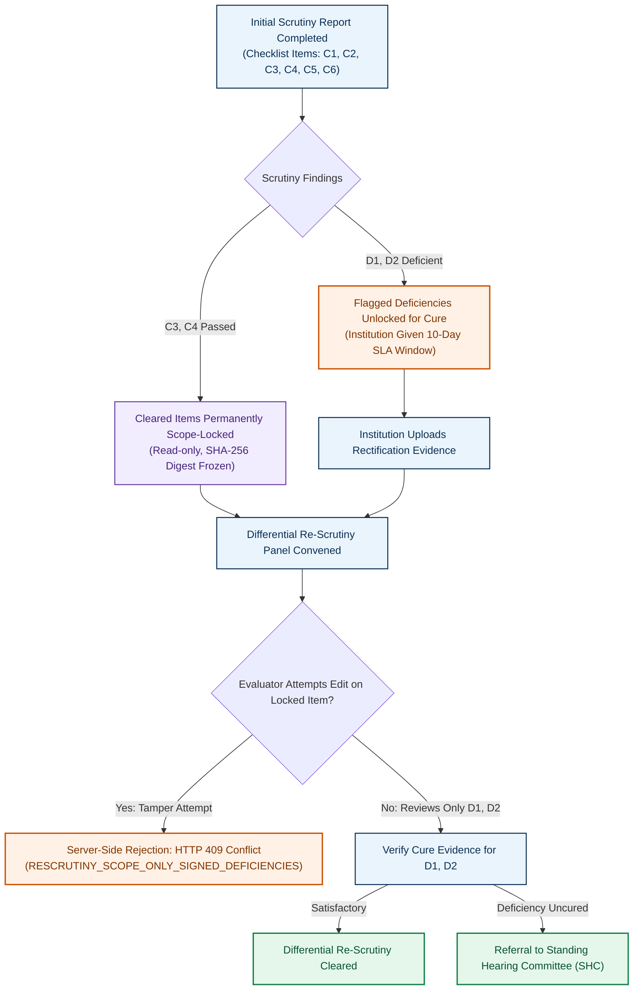

</details>

<details>
<summary><strong>▶ Click here to view Diagram G · Standing Hearing Committee (SHC)</strong></summary>

APH §2.23.3: opportunity to address unresolved shortcomings before a decision.

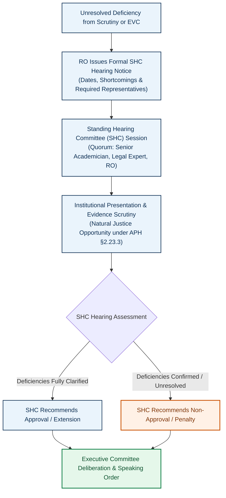

</details>

<details>
<summary><strong>▶ Click here to view Diagram H · Standing Appellate Committee (SAC)</strong></summary>

APH §§1.11 and 2.24: appeal handling with a seven-day filing window.

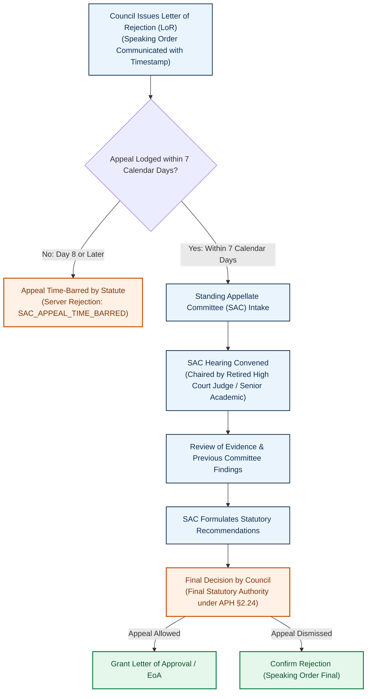

</details>

<details>
<summary><strong>▶ Click here to view Diagram I · Complaints and grievances</strong></summary>

APH Chapter VII §7.10: identity screening, fact finding, and any applicable Council action.

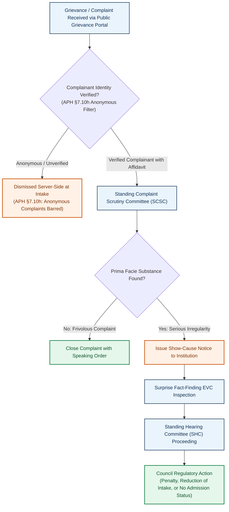

</details>

<details>
<summary><strong>▶ Click here to view Diagram J · Post-approval compliance</strong></summary>

Order-linked obligations: Joint FDR, Fire NOC, land-lease validity, and faculty undertakings.

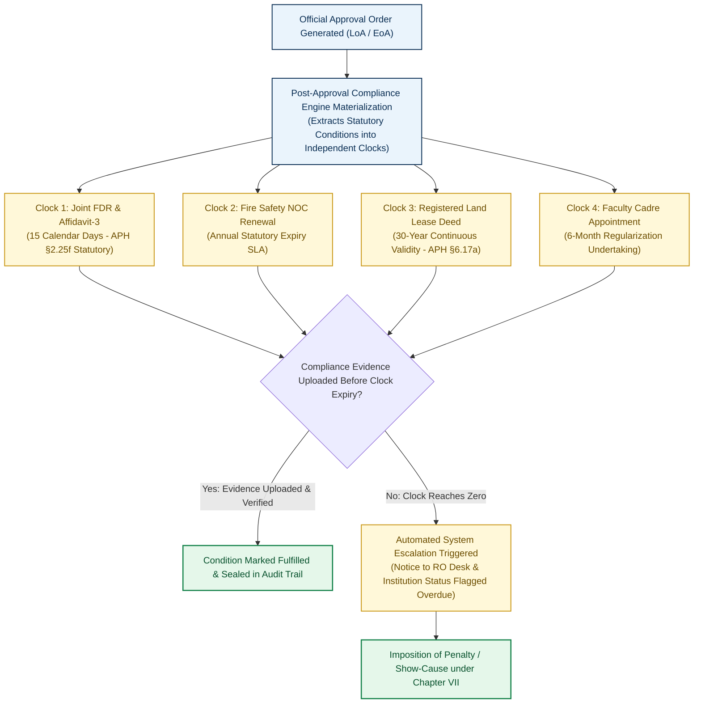

</details>


## 👥 Six role-based workspaces

Every user sees only the cases and actions allowed for their role.

| Workspace | Main responsibility |
|:--|:--|
| 🏫 **Institution / Applicant** | Submit applications, respond to deficiencies, view orders and track obligations. |
| 🔍 **Desk Scrutiny** | Check documents, record findings and review only permitted corrections. |
| 📍 **Expert Visit Committee** | Record campus inspections, evidence and committee recommendations. |
| 🗂️ **Regional Office** | Assign committees, monitor pending cases, coordinate hearings and check compliance. |
| ⚖️ **Approval Bureau / Council** | Review dossiers, issue authorized decisions and handle appeals. |
| ⚙️ **Policy Administration** | Maintain versioned rules, view statistics and inspect audit records. |

<details>
<summary><strong>🔑 Show demonstration accounts</strong></summary>

These are sample accounts for exploring the prototype, not official government accounts. The uploaded README lists demo password **`password123`**.

| Role | Email |
|:--|:--|
| Institution | `principal@coep.ac.in` / `principal@pdimtr.ac.in` |
| Scrutiny | `scrutiny.reviewer@aicte.gov.in` |
| EVC | `evc.chair@aicte.gov.in` |
| Regional Office | `ro.officer@aicte.gov.in` |
| Approval Bureau | `bureau.approval@aicte.gov.in` |
| Policy Admin | `admin@aicte.gov.in` |

</details>

## 🚀 Run locally

**Requirements:** Node.js 20 or 22 LTS and npm 9+. The source README describes a built-in memory mode for local demonstration.

```bash
git clone https://github.com/Parth-Chavan-15/SIH-2026-AICTE.git SIH-26-AICTE
cd SIH-26-AICTE
npm install
npx tsc --noEmit
npm test
npm run build
npm run dev
```

Open **http://localhost:3000** or visit the **[live prototype](https://niyamsetu-aicte.onrender.com)**.

## 🎬 Five-minute guided demo

1. **🏫 Institution / Applicant — `APP-2026-COEP`:** Open the institution workspace to check application status, notices, pending actions and the explanation for its inspection waiver. See how applicants understand their route and respond to permitted deficiencies.
2. **🔍 Desk Scrutiny — `APP-2026-GIITS`:** Open the scrutiny checklist to examine recorded deficiencies and previously cleared items. See how reviewers check only the permitted corrections while earlier clearances remain read-only.
3. **📍 Expert Visit Committee — GIITS inspection:** Explore the visit checklist, sample location information, video evidence and committee findings. See how inspection evidence is recorded when the selected regulatory route requires an EVC visit.
4. **🗂️ Regional Office — case coordination:** Explore the Regional Office workspace to inspect assigned cases, pending reviews and committee handoffs where available. See how officers coordinate progress and follow up on cases awaiting action.
5. **⚖️ Approval Bureau / Competent Authority — `APP-2026-PDIMTR`:** Review the case dossier and committee recommendations, then inspect the authorized decision flow and watermarked demonstration EoA. See how approval conditions become follow-up obligations without automatic approval.
6. **⚙️ Policy Administration — rule oversight:** Explore the rule registry, version history, statistics and conflict checks. See how authorized administrators inspect rule references and maintain a traceable policy history.

## 🧱 Technology stack

| Layer | Technology |
|:--|:--|
| **Frontend** | React 19, TypeScript 5.8, Tailwind CSS, Vite 6, Lucide |
| **Backend** | Node.js 20/22, Express, REST APIs |
| **Data** | MongoDB Atlas and transactional in-memory engine |
| **Performance** | Request deduplication and actor-scoped six-second read cache |
| **Security** | HttpOnly cookies, SHA-256 evidence hashes, HMAC-SHA256 demo seals |
| **Testing** | Vitest, Supertest and strict TypeScript |

## 🧪 Testing and engineering checks

**Source-reported results:** **388 passing tests** across **35 suites**, including **38 deliverable regression checks**. These figures come from the provided README; they are not a new test run.

- **Rules and decisions:** Route classification (37 tests), decision authority and order generation (34 tests).
- **Access and isolation:** Authentication (18), institution separation (7) and role-specific hearing controls (5).
- **Operational reliability:** Persistence and deadline safeguards (10), notifications (3) and performance checks (5).
- **End-to-end verification:** Deliverable regression suite (38 tests).

For individual test files and the complete test results, see the [test directory](./tests/) and [performance verification](./docs/performance/PERFORMANCE_VERIFICATION.md).

## 📚 Essential resources

- **[Live prototype](https://niyamsetu-aicte.onrender.com)** — explore the application.
- **[Demonstration video](https://youtu.be/NsloajwX8gU?si=_Frrt_TT22yQCJ8x)** — watch the system in action.
- **[Screen-by-screen walkthrough](https://drive.google.com/file/d/1EYKGkXoUPD9FOBFJl66p46_111cJDODY/view?usp=sharing)** — follow the user journey.
- **[AICTE requirement matrix](./docs/PS_COMPLIANCE_MATRIX.md)** — trace problem-statement coverage.
- **[Regulatory route matrix](./docs/workflows/ROUTE_TO_DIAGRAM_MATRIX.md)** — browse application categories and all ten detailed route diagrams.
- **[Regulatory source register](./docs/regulatory/SOURCE_REGISTER.md)** — APH, AICTE Act and addendum references.

<p align="center"><sub>Built by <strong>Team DEFENSOR</strong> for Smart India Hackathon 2026 · AICTE PS 26262</sub></p>
