<table align="center">
  <tr>
    <td align="left" width="65%">
      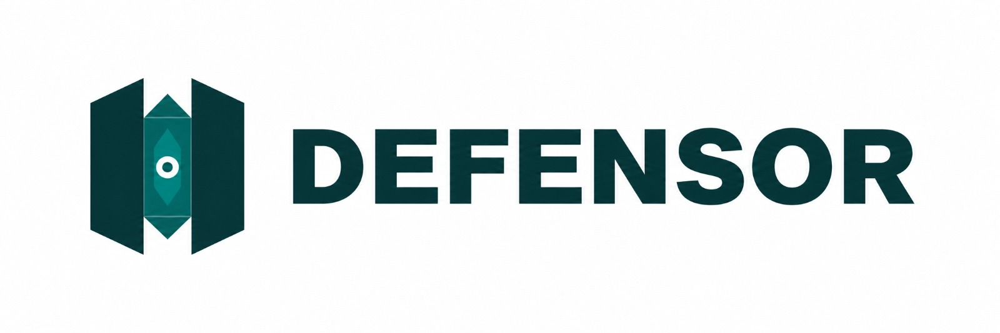
    </td>
    <td align="right" width="35%">
      
    </td>
  </tr>
</table>

<div align="center">

# NIYAMSETU (नियमसेतु)
### The Bridge of Rules: Integrated AICTE Approval Workflow Automation, Compliance Monitoring and Alert Management System

Smart India Hackathon 2026 · AICTE Problem Statement **PS 26262** · Team **DEFENSOR**

[](https://niyamsetu-aicte.onrender.com/)

<br/>

<a href="./docs/assets/niyamsetu-main-ui.png">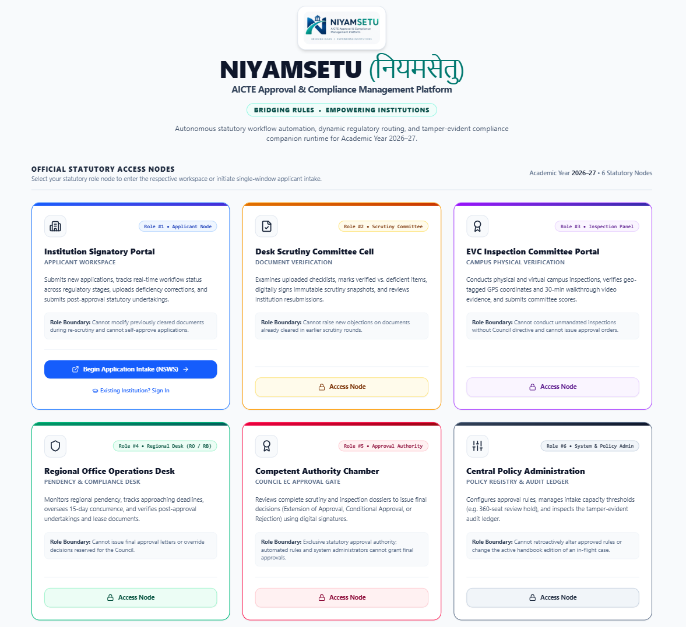</a>

**22 Statutory Application Categories · 6 Role-Based Workspaces · 14 Comprehensive Workflow Diagrams**

</div>

---

## 🏛️ What is NIYAMSETU? — Problem Statement & Solution

**NIYAMSETU (नियमसेतु — *The Bridge of Rules*) is an integrated digital platform built for the All India Council for Technical Education (AICTE)** to automate, streamline, and monitor approval workflows, institutional compliance, and statutory deadlines for technical education institutions across India.

Every academic year, thousands of institutions apply to AICTE for approvals under the Approval Process Handbook (APH), including setting up new institutions, extending annual approvals (EoA), expanding intake, and shifting campuses. Approvals often involve time-bound compliance undertakings, such as registered land lease deeds, building safety certificates, and financial security deposits.

Under **AICTE Problem Statement PS 26262**, the Council requires an integrated, secure, and configurable digital platform that:
- **Automates application routing** across applicable stages (Scrutiny only, Scrutiny + EVC, Direct EVC, and Council review) based on configurable rules.
- **Provides real-time dashboards** displaying application status, stage-wise pendency, processing timelines, and workload distribution across regions and committees.
- **Streamlines EVC scheduling** and tracks completion timelines, geo-coordinates, and physical verification evidence.
- **Monitors time-bound undertakings** and tracks the validity and renewal of prescribed documents.
- **Dispatches automated notifications**, advance deadline reminders, and escalations for pending or overdue actions to institutions and authorized officials.
- **Maintains complete digital audit trails** of application movement, observations, and decisions, while preserving secure access control and human decision authority.

<details>
<summary><strong>▶ Click here to view the animated approval-to-compliance workflow</strong></summary>

<p align="center">
  
</p>

</details>

### The NIYAMSETU Engineering Solution

NIYAMSETU addresses PS 26262 through four structured engineering pillars, translating statutory rules into automated, predictable digital workflows while keeping final approval authority strictly with authorized human officials:

<details>
<summary><strong>▶ Click here to view the Four Engineering Pillars architecture diagram</strong></summary>

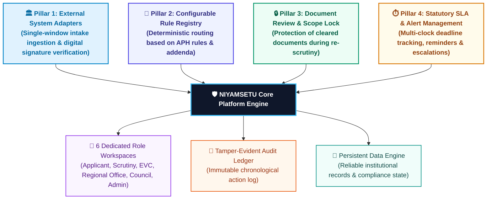

</details>

1. **External System Adapters:** Connects institutional intake through single-window application adapters, validates digital signatures, and standardizes data exchange across portals without duplicate entry.
2. **Configurable Rule Registry:** Maps application parameters directly to APH regulations and addenda, automatically determining the exact statutory route and legal citations without ambiguity.
3. **Document Review & Scope Lock:** Enforces a structured document lifecycle that permanently locks previously cleared documents read-only during re-scrutiny, preventing repetitive objections on already verified items.
4. **Statutory SLA & Alert Management:** Tracks countdown timers across scrutiny, deficiency cure, inspection, and decision stages, triggering advance reminder alerts and escalating overdue dockets to Regional Officers.

---

## ⚙️ Core Platform Features

| Feature | Description |
| :--- | :--- |
| 🧭 **Deterministic Regulatory Routing** | Maps application parameters directly to the exact statutory route (Scrutiny only, Scrutiny + EVC, Direct EVC, or direct Council review), eliminating subjective manual routing. |
| 🛡️ **Protected Deficiency Re-Scrutiny** | Restricts re-scrutiny strictly to items flagged in a Letter of Deficiency (LoD), keeping previously cleared documents locked against new objections. |
| 📍 **Automated EVC Scheduling & Physical Verification** | Coordinates mandated on-site inspections and captures committee findings alongside GPS geofencing and walkthrough evidence. |
| ⏱️ **Four-Clock Statutory SLA Monitoring** | Tracks statutory deadlines across Scrutiny (10d), Deficiency Rectification (10d), EVC Inspection (15d), and Council Decisions (15d). |
| 📑 **Post-Approval Compliance Tracking** | Materializes order conditions into active compliance clocks for mandatory undertakings like 10-Year Joint FDRs, Fire Safety NOCs, and registered land leases. |
| 👥 **Six Dedicated Role Workspaces** | Provides role-isolated interfaces tailored for Institutions, Scrutiny Committees, EVC Panels, Regional Offices, Approval Bureau / Council, and Administrators. |
| ⚖️ **Authorized Human Decisions** | Compiles automated rule evaluations and case dockets while reserving final approval, conditional grant, and rejection speaking orders for authorized officials. |
| 🔗 **Tamper-Evident Audit Trail** | Records every stage movement, committee observation, and administrative decision in a chronologically verifiable audit log. |

## ✨ Eight Core Innovations

| Innovation | Description |
| :--- | :--- |
| 📋 **Version-Pinned Rule Registry** | Pins the applicable AICTE Approval Process Handbook (APH) rule version at submission, ensuring subsequent policy updates never alter historical evaluations. |
| 🛡️ **Scope-Locked Scrutiny Snapshots** | Enforces read-only state locks on cleared checklist items at the database layer, programmatically confining re-scrutiny to notified shortcomings. |
| 🏅 **Conditional NBA Fast-Track Routing** | Automatically waives pre-approval physical inspections under AICTE errata circulars when eligible programmes hold valid NBA accreditation. |
| 📄 **Five-State Document Verification** | Transitions records through five explicit states (`Pending`, `Verified`, `Deficient`, `Resubmitted`, `Sealed`) with an immutable version history. |
| 📅 **Four-Clock Statutory SLA Engine** | Runs decoupled state-machine timers across all four statutory stages, automating advance warning alerts and overdue regional escalations. |
| 🔄 **Concurrency & Idempotency Safeguards** | Prevents duplicate submissions, race conditions, and conflicting simultaneous reviews across distributed committee evaluations. |
| 🔗 **Cryptographic Tamper-Evident Audit Trail** | Cryptographically chains every administrative action and stage transition into an append-only ledger that immediately exposes unauthorized record mutations. |
| ✉️ **Reliable Outbox Notification Dispatch** | Guarantees fault-tolerant delivery of deadline alerts, LoD notices, and formal orders via an asynchronous transactional outbox queue. |

---

## 🖼️ Visual Overview — Approval to Compliance

Follow the end-to-end journey from application intake through scrutiny, inspection, **human decision authorization**, post-approval compliance tracking, and audit logging. The grey side panel illustrates exceptional hearing (SHC) and appellate (SAC) routes, which activate only when required:

<details open>
<summary><strong>▶ Click here to view the approval-to-compliance workflow infographic</strong></summary>

<p align="center">
  <a href="./docs/assets/niyamsetu-approval-to-compliance.png" title="Click to view the full-size workflow infographic">
    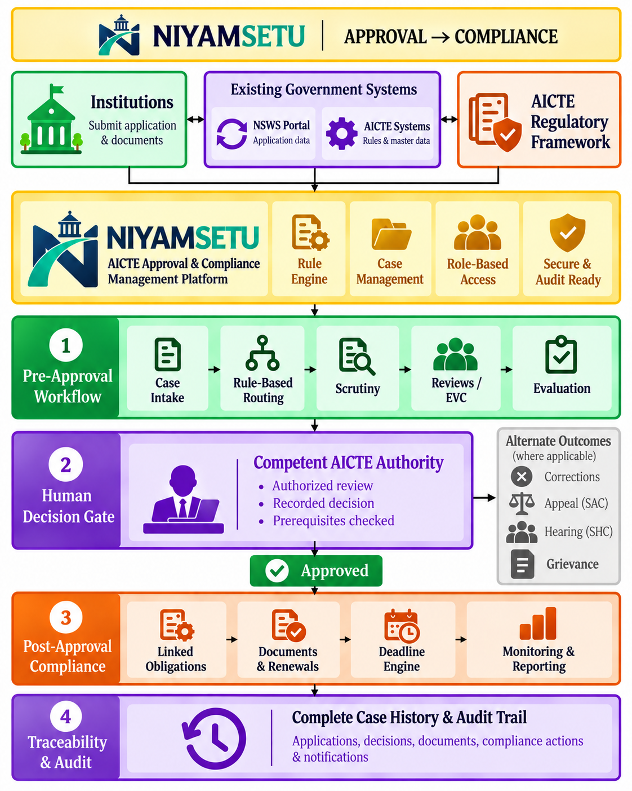
  </a>
</p>

<p align="center"><sub>🔎 <strong>Click the infographic above to view it at full resolution.</strong></sub></p>

</details>

---

## 🔄 Master End-to-End Workflow Architecture

**Application intake → rule-based routing → relevant scrutiny or inspection → authorized decision → compliance tracking → audit trail.** Rectification, hearings, appeals, and complaints follow dedicated conditional routes:

<details>
<summary><strong>▶ Click here to view the master end-to-end workflow architecture diagram</strong></summary>

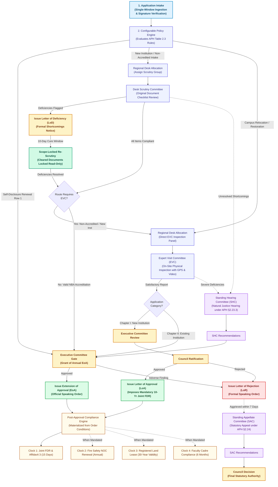

</details>

---

## 🧭 Detailed Regulatory Routes & Modular Workflows

AICTE processes applications across 22 statutory categories. NIYAMSETU organizes every category into an explainable route family based on APH Chapter II Table 2.3 and relevant addenda.

Click any entry below to expand and view the full workflow diagram directly inside this document:

#### Core Approval Routes (APH Chapters I & II)

<details>
<summary><strong>▶ Click here to view Diagram A · New Technical Institution (Chapter I)</strong></summary>

Comprehensive workflow for setting up new institutions, covering document scrutiny, mandatory physical campus inspection, Executive Committee review, Council ratification, 10-year Joint FDR compliance, and the 7-day appellate window.

*Detailed documentation: [`01_chapter_i_new_institution.md`](./docs/workflows/01_chapter_i_new_institution.md)*

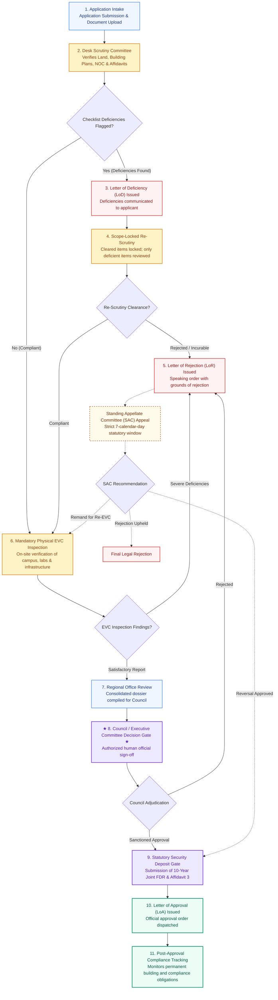

</details>

<details>
<summary><strong>▶ Click here to view Diagram B · Self-Disclosure Extension of Approval (EoA)</strong></summary>

Streamlined annual renewal route for existing institutions under Table 2.3 Row 1. Pre-approval scrutiny and inspections are waived based on verified self-disclosure, proceeding directly to Executive Committee approval.

*Detailed documentation: [`02_chapter_ii_self_disclosure_eoa.md`](./docs/workflows/02_chapter_ii_self_disclosure_eoa.md)*

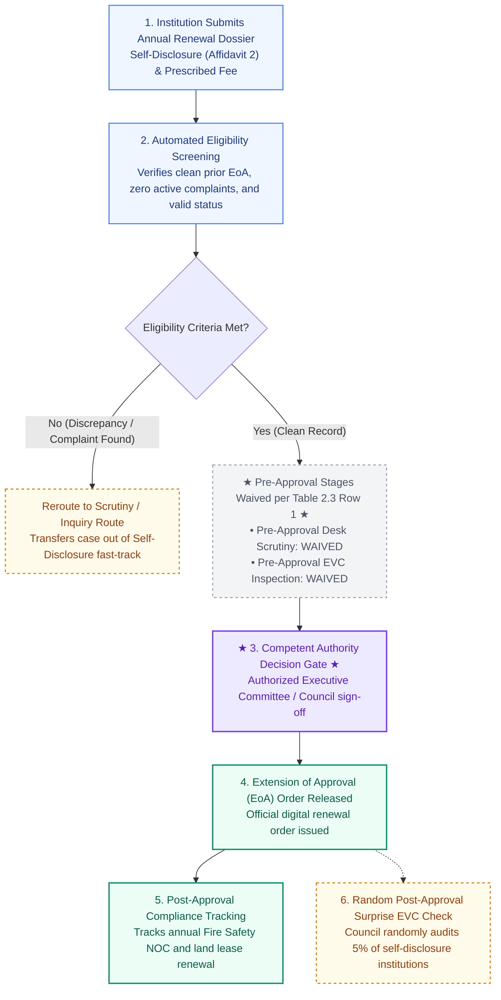

</details>

<details>
<summary><strong>▶ Click here to view Diagram C · Scrutiny-Only / NBA Fast-Track Intake Increase</strong></summary>

Fast-track intake expansion route for eligible accredited programmes under Table 2.3 Row 9 and Errata Page 42, where valid NBA accreditation waives physical EVC inspection.

*Detailed documentation: [`03_chapter_ii_scrutiny_and_evc_routes.md`](./docs/workflows/03_chapter_ii_scrutiny_and_evc_routes.md)*

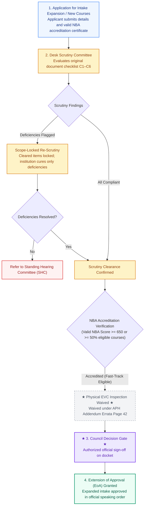

</details>

<details>
<summary><strong>▶ Click here to view Diagram D · Dual-Track Route (Scrutiny followed by Mandatory EVC)</strong></summary>

Dual-track route for non-accredited course expansions and new programmes requiring initial desk scrutiny followed by mandatory on-site EVC inspection.

*Detailed documentation: [`03_chapter_ii_scrutiny_and_evc_routes.md`](./docs/workflows/03_chapter_ii_scrutiny_and_evc_routes.md)*

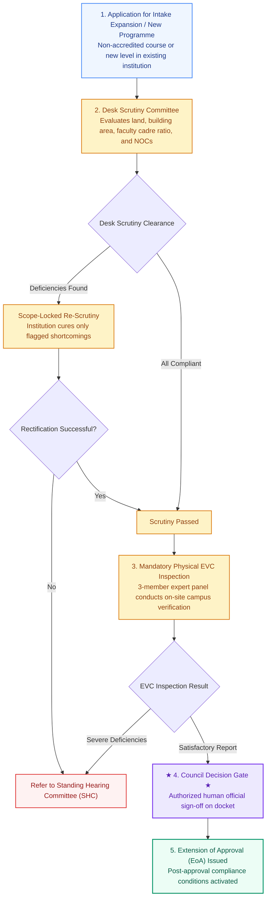

</details>

<details>
<summary><strong>▶ Click here to view Diagram E · Direct EVC (Campus Shifting & Restoration)</strong></summary>

Direct physical inspection route for campus relocations (Row 14) and restoration of penalized intake (Row 7), bypassing desk scrutiny to verify campus infrastructure on site.

*Detailed documentation: [`03_chapter_ii_scrutiny_and_evc_routes.md`](./docs/workflows/03_chapter_ii_scrutiny_and_evc_routes.md)*

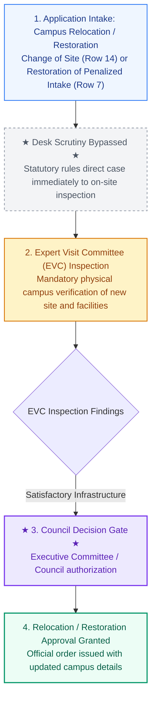

</details>

#### Deficiency Rectification, Hearings & Appeals

<details>
<summary><strong>▶ Click here to view Diagram F · Differential Re-Scrutiny & Scope Lock</strong></summary>

Statutory rectification workflow enforcing document protection. Cleared documents remain locked read-only, and re-scrutiny is restricted strictly to flagged deficiencies.

*Detailed documentation: [`12_implemented_exceptional_workflows.md`](./docs/workflows/12_implemented_exceptional_workflows.md)*

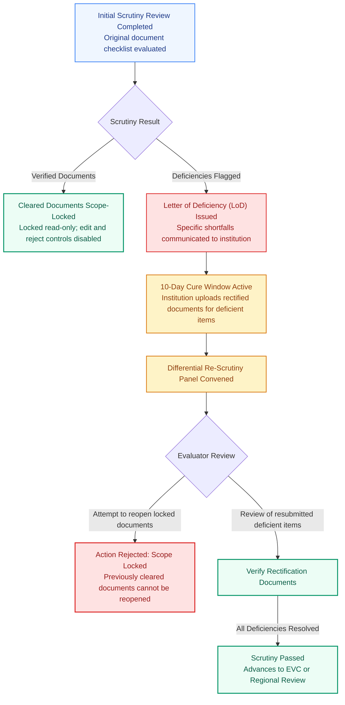

</details>

<details>
<summary><strong>▶ Click here to view Diagram G · Standing Hearing Committee (SHC) Natural Justice</strong></summary>

Quasi-judicial hearing route for disputed deficiencies or unrectified shortcomings, upholding principles of natural justice under APH §2.23.3 prior to a final Council decision.

*Detailed documentation: [`05_shc_compliance.md`](./docs/workflows/05_shc_compliance.md)*

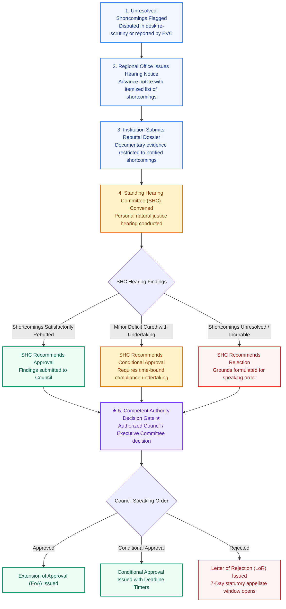

</details>

<details>
<summary><strong>▶ Click here to view Diagram H · Standing Appellate Committee (SAC) 7-Day Appeal</strong></summary>

Statutory appellate proceedings following a rejection speaking order, subject to a strict 7-calendar-day appeal window under APH §1.11 and §2.24.

*Detailed documentation: [`06_chapter_specific_appeals.md`](./docs/workflows/06_chapter_specific_appeals.md)*

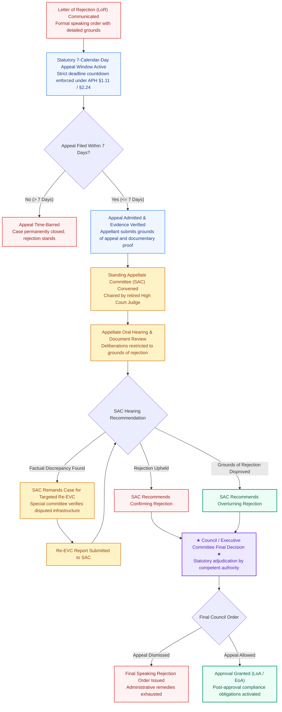

</details>

#### Complaints, Inquiries & Post-Approval Compliance

<details>
<summary><strong>▶ Click here to view Diagram I · Chapter VII Complaints & Grievance Screening</strong></summary>

Public grievance screening under Chapter VII, detailing identity and affidavit verification, summary dismissal of anonymous complaints (§7.10h), preliminary scrutiny, fact-finding surprise visits, and disciplinary penalties.

*Detailed documentation: [`07_chapter_vii_complaints.md`](./docs/workflows/07_chapter_vii_complaints.md)*

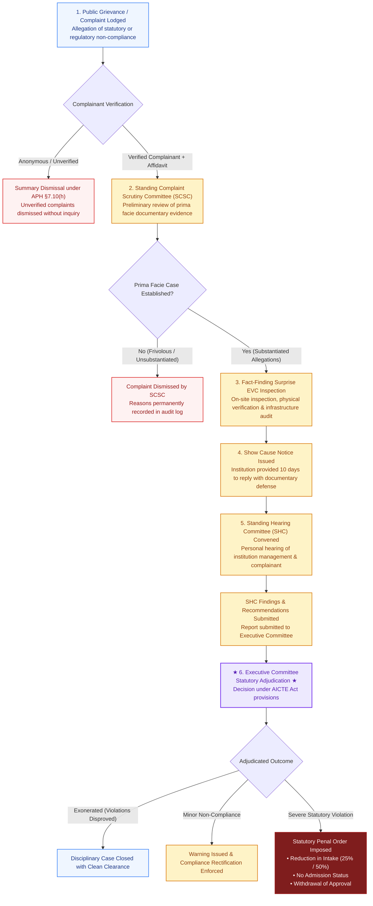

</details>

<details>
<summary><strong>▶ Click here to view Diagram J · Post-Approval Compliance Engine</strong></summary>

Automated monitoring of order conditions materialized into independent countdown clocks (10-Year Joint FDR, Fire Safety NOC, registered land lease, and mandatory committees).

*Detailed documentation: [`08_post_approval_compliance.md`](./docs/workflows/08_post_approval_compliance.md)*

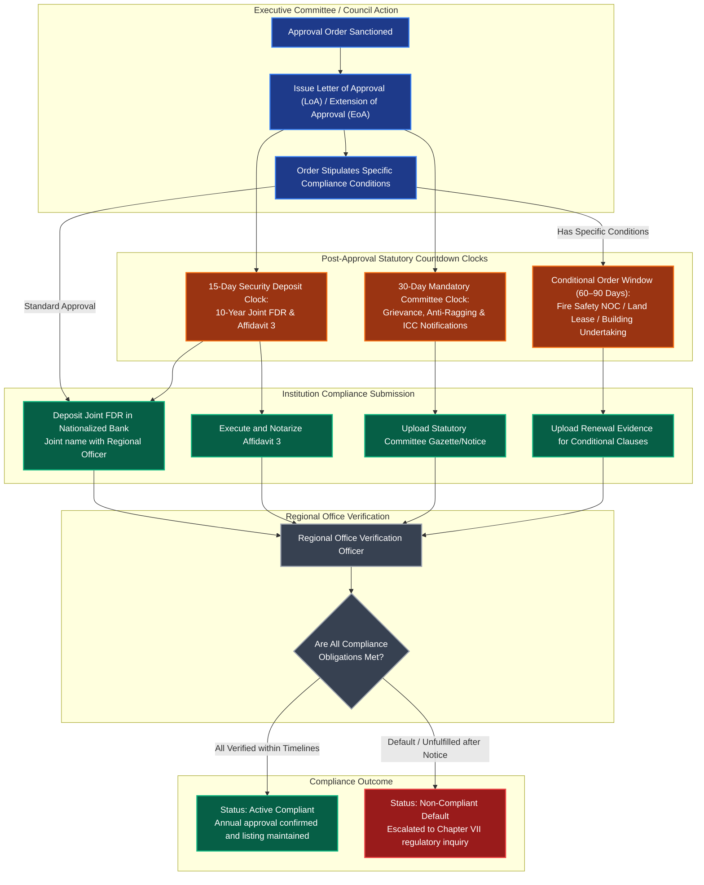

</details>

#### Case Journeys, Role Workspaces & Universal Architecture

<details>
<summary><strong>▶ Click here to view Diagram K · Canonical Institution End-to-End Journeys</strong></summary>

Step-by-step trajectories showing how different institutional archetypes (new technical institutions, self-disclosure extensions, NBA fast-track expansions, dual-track non-accredited courses, and campus relocations) traverse their statutory stages.

*Detailed documentation: [`10_canonical_institution_journeys.md`](./docs/workflows/10_canonical_institution_journeys.md)*

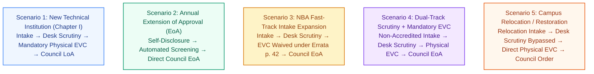

</details>

<details>
<summary><strong>▶ Click here to view Diagram L · Six Role-Based Workspace Architectures</strong></summary>

Role-based access model illustrating functional separation between Applicants, Desk Scrutiny Committees, Expert Visit Panels, Regional Officers, Council Authorities, and Policy Administrators.

*Detailed documentation: [`11_six_role_workspaces.md`](./docs/workflows/11_six_role_workspaces.md)*

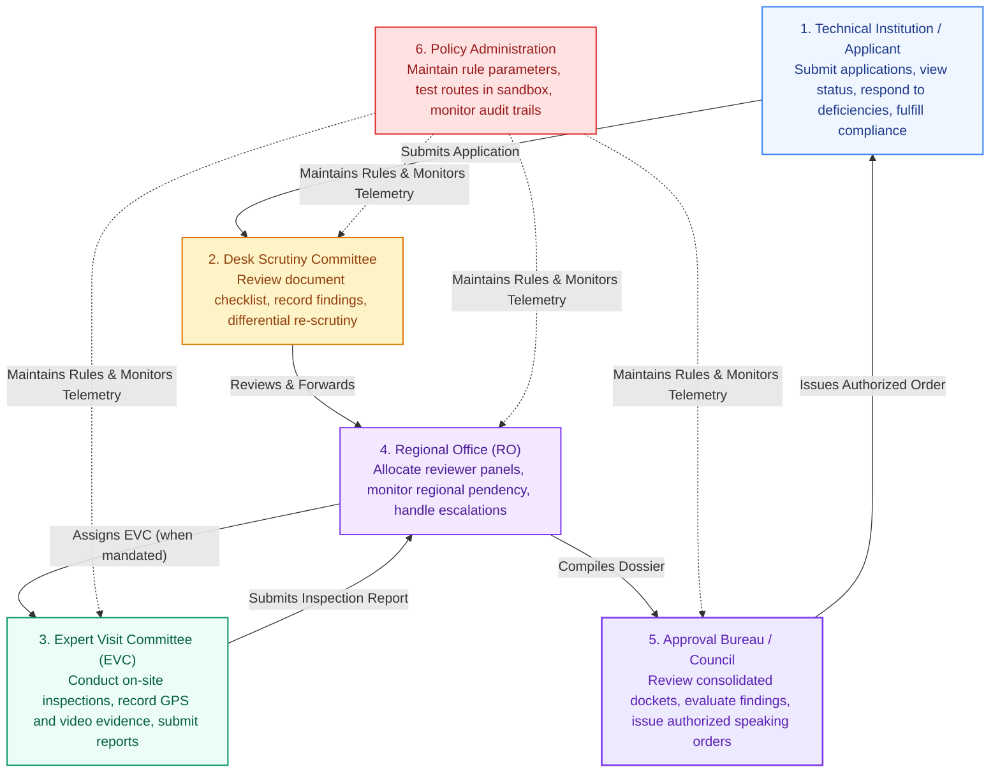

</details>

<details>
<summary><strong>▶ Click here to view Diagram M · Implemented Exceptional Workflows & Protocols</strong></summary>

Comprehensive safeguard protocols including digital signature verification, document protection during re-scrutiny, statutory countdown monitoring, and tamper-evident audit logging.

*Detailed documentation: [`12_implemented_exceptional_workflows.md`](./docs/workflows/12_implemented_exceptional_workflows.md)*

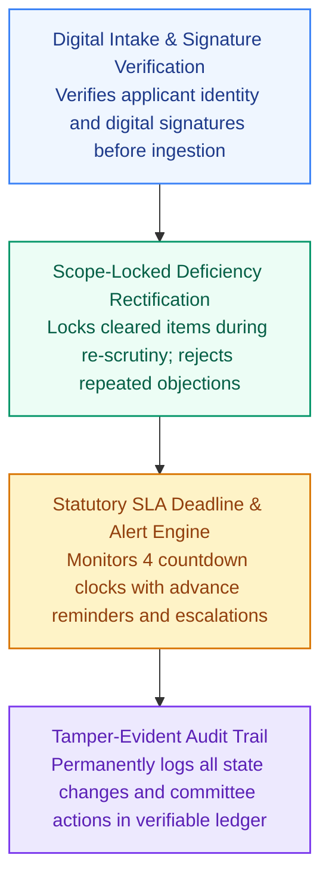

</details>

<details>
<summary><strong>▶ Click here to view Diagram N · Universal Master System Architecture</strong></summary>

Multi-tier system architecture detailing the relationships between client presentation layers, gateway routing, policy rules, deadline monitoring, compliance engines, and persistence.

*Detailed documentation: [`99_common_end_to_end_architecture.md`](./docs/workflows/99_common_end_to_end_architecture.md)*

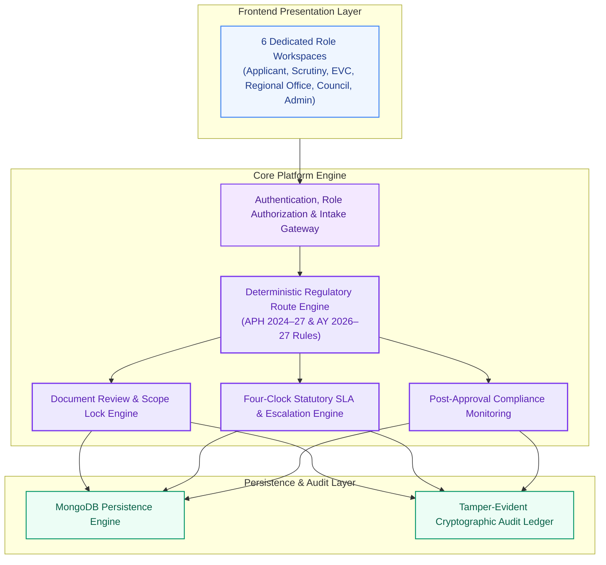

</details>

👉 **For the complete 22-category regulatory cross-reference matrix, see [`docs/workflows/ROUTE_TO_DIAGRAM_MATRIX.md`](./docs/workflows/ROUTE_TO_DIAGRAM_MATRIX.md).**

---

## 📄 Document Review and Deadline Tracking

### Structured Document Review & Scope Lock
The document review engine guides institutional evidence through five clear lifecycle states: `Pending (0) → Verified (1) → Deficient (2) → Resubmitted (3) → Sealed (4)`.

When deficiencies are identified during initial scrutiny, a Letter of Deficiency (LoD) details the exact shortcomings to the institution. To protect institutions from repeated objections on previously cleared submissions:
- **Locked Approved Documents:** Documents approved during earlier scrutiny rounds are permanently locked read-only. Reviewers cannot edit, comment on, or reject them.
- **Targeted Rectification:** Re-scrutiny is restricted strictly to reviewing resubmitted evidence for items flagged as deficient.
- **Server Enforcement:** Attempts to reopen or alter locked documents are automatically blocked.

<details>
<summary><strong>▶ Click here to view the document verification and scope lock workflow diagram</strong></summary>

```mermaid
flowchart LR
    classDef pending fill:#E0F2FE,stroke:#0284C7,stroke-width:2px,color:#0369A1,font-weight:bold;
    classDef verified fill:#D1FAE5,stroke:#059669,stroke-width:2px,color:#064E3B,font-weight:bold;
    classDef deficient fill:#FFE4E6,stroke:#E11D48,stroke-width:2px,color:#881337,font-weight:bold;
    classDef resubmit fill:#FEF3C7,stroke:#D97706,stroke-width:2px,color:#78350F,font-weight:bold;
    classDef sealed fill:#F3E8FF,stroke:#9333EA,stroke-width:2px,color:#581C87,font-weight:bold;
    classDef lock fill:#ECFDF5,stroke:#10B981,stroke-width:2.5px,color:#047857,font-weight:bold;

    S0["📄 State 0: PENDING<br/>(Uploaded by Institution)"]:::pending
    S1["✅ State 1: VERIFIED<br/>(Cleared in Initial Scrutiny)"]:::verified
    S2["⚠️ State 2: DEFICIENT<br/>(Shortcomings Flagged in LoD)"]:::deficient
    S3["📤 State 3: RESUBMITTED<br/>(Cured within 10-Day SLA)"]:::resubmit
    LOCK["🔒 Scope Lock Active<br/>(Permanently Locked Read-Only)"]:::lock
    S4["🛡️ State 4: SEALED<br/>(Order Issued · Immutable)"]:::sealed

    S0 -->|Initial Review Pass| S1
    S0 -->|Shortcomings Found| S2
    S1 -->|Re-Scrutiny Protection| LOCK
    LOCK --> S4
    S2 -->|Institution Rectification| S3
    S3 -->|Differential Review Cleared| S1
    S3 -->|Shortcomings Unresolved| S2
    S1 -->|Final Council Order| S4
```

</details>

### Four-Clock Regulatory SLA & Alert Management
NIYAMSETU actively tracks statutory processing timelines across four independent countdown clocks:
1. **Clock T1 (Desk Scrutiny):** 10 calendar days for initial document evaluation.
2. **Clock T2 (Deficiency Rectification):** 10 calendar days for institutions to cure notified shortcomings.
3. **Clock T3 (EVC Inspection):** 15 calendar days for scheduling and conducting physical campus visits.
4. **Clock T4 (Council Decision):** 15 calendar days for final adjudication and order issuance.

When a case reaches **80% of its allotted timeline**, an amber warning alert is dispatched to responsible officers. If a clock reaches **100% without completion**, the docket automatically escalates to the Regional Officer for immediate intervention.

<details>
<summary><strong>▶ Click here to view the regulatory deadline tracking and alert escalation diagram</strong></summary>

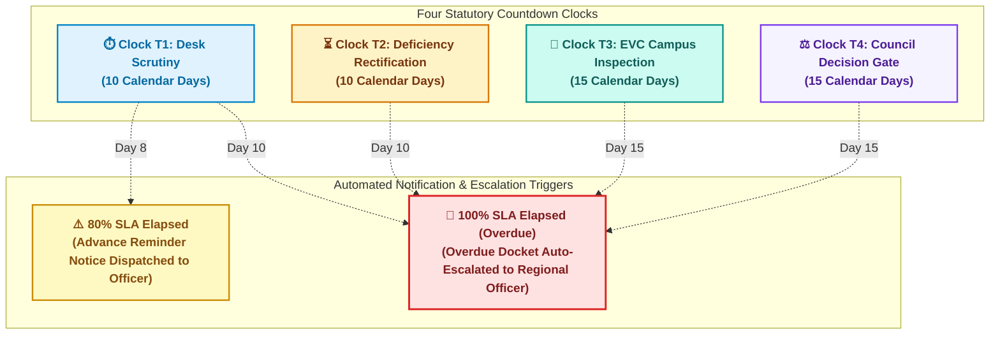

</details>

---

## 👥 Six Role-Based Workspaces

NIYAMSETU provides six dedicated workspaces with strict procedural boundaries and data isolation:

| Workspace | Primary Responsibilities & Functional Views |
| :--- | :--- |
| 🏫 **Institution / Applicant** | Submit statutory applications, upload required evidence and affidavits, cure notified deficiencies within the 10-day window, track live stage progress, and fulfill post-approval compliance obligations. |
| 🔍 **Desk Scrutiny Committee** | Verify document checklists against statutory norms, record clause-by-clause findings, issue Letters of Deficiency (LoD), and re-examine cured items with cleared documents locked. |
| 📍 **Expert Visit Committee (EVC)** | Access assigned physical inspection dockets, verify campus infrastructure with GPS coordinates and walkthrough video evidence, complete lab checklists, and submit finalized reports. |
| 🗂️ **Regional Office (RO)** | Monitor regional application pipelines and ageing metrics, allocate dockets to scrutiny groups and EVC panels, coordinate hearing schedules, and handle overdue escalations. |
| ⚖️ **Approval Bureau / Council** | Review consolidated regional dossiers and committee recommendations under the AICTE Act to issue authorized digital speaking orders (Letter of Approval, Extension of Approval, or Rejection). |
| ⚙️ **Policy Administration** | Configure AICTE regulatory rule parameters, test hypothetical application scenarios in the interactive routing sandbox, monitor system health, and inspect the audit ledger. |

---

## 🎬 Exploring NIYAMSETU — Platform Walkthrough

Visitors can explore the live prototype across its six dedicated workspaces:

- **Institution / Applicant Workspace:** Walk through the application intake process, inspect statutory route determinations and legal citations, access the deficiency cure interface, and track post-approval compliance countdown timers.
- **Desk Scrutiny Workspace:** Experience digital scrutiny checklists, record stage-wise verification findings, and observe how previously approved documents remain locked and protected during re-scrutiny.
- **Expert Visit Committee (EVC) Workspace:** View assigned inspection dockets, review campus location and GPS coordinates, inspect laboratory checklists, and submit on-site verification evidence with walkthrough media.
- **Regional Office Workspace:** Monitor the regional dashboard for active applications and stage-wise pendency, manage committee allocations for scrutiny and EVC panels, and review automated deadline escalations.
- **Approval Bureau / Council Workspace:** Review consolidated application dockets with committee findings and legal references, and issue authorized speaking orders (Letter of Approval, Extension of Approval, or Letter of Rejection).
- **Policy Administration Workspace:** Inspect configurable regulatory rule parameters, test hypothetical cases in the interactive routing sandbox, and review the tamper-evident chronological audit ledger.

---

## 🧱 Technology Stack & Repository Map

### Technology Stack

| Layer | Technologies & Tools |
|:--|:--|
| **Frontend** | React 19, TypeScript 5.8, Tailwind CSS 4, Vite 8, Lucide Icons, Recharts |
| **Backend** | Node.js 22/24, Express 4.21, Mongoose 9.11, Socket.io, Helmet, CORS |
| **Database** | MongoDB Community Standalone (Local development) / MongoDB Atlas (Production deployment) |
| **Security & Integrity** | HttpOnly SameSite session cookies, cryptographic audit chaining, role-based access control (RBAC) |
| **Testing & Quality Assurance** | Vitest 5, Supertest, headless automation suites |

### Repository Map

```
NIYAMSETU/
├── dist/                               # Production compiled client bundle
├── docs/
│   ├── assets/                         # Visual assets, logos, and workflow animations
│   ├── final_acceptance/               # System specifications and verification dossiers
│   ├── regulatory/                     # Regulatory source registers, APH handbooks, and citations
│   ├── workflows/                      # 14 modular workflow specifications (Diagrams A–N)
│   └── PS_COMPLIANCE_MATRIX.md         # Problem Statement PS 26262 compliance matrix
├── public/                             # Static web assets, icons, and web manifest
├── scripts/                            # Operational automation and verification scripts
├── src/
│   ├── backend/
│   │   ├── adapters/                   # Single-window intake and digital signature adapters
│   │   ├── core/                       # Express router, application cases, and platform engine
│   │   ├── middleware/                 # Authentication, role verification, and error handling
│   │   ├── models/                     # Mongoose data schemas and persistence models
│   │   ├── modules/                    # Scrutiny, EVC, decision authority, and compliance modules
│   │   ├── persistence/                # Database connection, transaction handling, and repository
│   │   ├── policy/                     # Regulatory rule engine & route classification
│   │   ├── routes/                     # REST API endpoint route definitions
│   │   └── security/                   # RBAC access control and cryptographic audit logger
│   ├── components/                     # Reusable UI components, navigation, and modal dialogues
│   ├── context/                        # React application context and role-scoped state
│   ├── features/                       # Dedicated role workspaces (Applicant, Scrutiny, EVC, RO, Council, Admin)
│   ├── services/                       # API client, HTTP communication, and session management
│   ├── types/                          # Domain TypeScript types and regulatory interfaces
│   └── utils/                          # Common utility functions, formatters, and helpers
├── tests/                              # 40 automated Vitest test suites (485 verified tests)
├── index.html                          # Single-page client application entrypoint
├── package.json                        # Project manifest, dependencies, and build scripts
├── render.yaml                         # Production cloud deployment configuration
├── server.ts                           # Unified Express server and Vite integration entrypoint
├── tsconfig.json                       # TypeScript compiler configuration
├── vite.config.ts                      # Vite build tool and bundler configuration
└── README.md                           # Master project documentation
```

---

## 🚀 Local Setup & Production Deployment

### 1. Local Prerequisites & Installation
Ensure Node.js (`>= 22.12.0`), npm (`>= 9.0.0`), and MongoDB are installed on your workstation:

```bash
# Clone the repository
git clone https://github.com/Parth-Chavan-15/SIH-2026-AICTE.git
cd SIH-2026-AICTE

# Install dependencies
npm install

# Run the full automated test suite (40 suites, 485 tests)
npm test

# Build the client production bundle
npm run build

# Start the unified server (Express + Vite on Port 3000)
npm run dev
```

Open **`http://127.0.0.1:3000`** in your web browser.

### 2. Production Deployment (Render + MongoDB Atlas)
The production application is hosted on **Render** backed by **MongoDB Atlas**:
- **Live URL:** [https://niyamsetu-aicte.onrender.com/](https://niyamsetu-aicte.onrender.com/)
- **Deployment Platform:** Render (Node.js web service with continuous deployment from the main branch).
- **Start Command:** `npm start` (`npx tsx server.ts`)
- **Health Check Endpoints:** `/health` and `/api/v1/ready`
- **Database Backend:** MongoDB Atlas dedicated cluster with automated index management.

---

## 🧪 Testing & Engineering Verification

### Automated Vitest Results: 40/40 Suites Passed, 485/485 Tests Passed (100%)

The codebase includes comprehensive test coverage verifying all functional areas:
- **Regulatory Rules & Routing Decisions:** Automated test suites verify classification across all 22 application categories, accreditation-based inspection waivers, and boundary conditions.
- **Access Control & Tenant Isolation:** Verifies role-based access restrictions, ensuring applicant institutions access only their own records while regional and national officers access appropriate jurisdictional scopes.
- **Operational Reliability & Clocks:** Verifies deadline calculations across all four statutory countdown clocks, automated warning alerts at 80% SLA elapsed, and escalation triggers upon breach.
- **Document Review Safeguards:** Verifies that previously cleared documents remain locked read-only during re-scrutiny rounds and that unauthorized modifications are rejected.
- **End-to-End Workflow Acceptance:** Full regression tests trace complete application lifecycles from intake to final Council order issuance and post-approval compliance tracking.

---

## 📚 Essential Resources

- **[Live prototype](https://niyamsetu-aicte.onrender.com/)** — explore the application.
- **[Demonstration video](https://youtu.be/NsloajwX8gU?si=_Frrt_TT22yQCJ8x)** — watch the system in action.
- **[Screen-by-screen walkthrough](https://drive.google.com/file/d/1EYKGkXoUPD9FOBFJl66p46_111cJDODY/view?usp=sharing)** — follow the user journey.
- **[AICTE requirement matrix](./docs/PS_COMPLIANCE_MATRIX.md)** — trace problem-statement coverage.
- **[Regulatory route matrix](./docs/workflows/ROUTE_TO_DIAGRAM_MATRIX.md)** — browse application categories and all detailed route diagrams.
- **[Regulatory source register](./docs/regulatory/SOURCE_REGISTER.md)** — APH, AICTE Act and addendum references.

---

<div align="center">

**NIYAMSETU (नियमसेतु) — The Bridge of Rules**<br/>
Built by **Team DEFENSOR** for **Smart India Hackathon 2026** · **Problem Statement PS 26262**<br/>
*All India Council for Technical Education (AICTE), Ministry of Education, Government of India*

</div>
