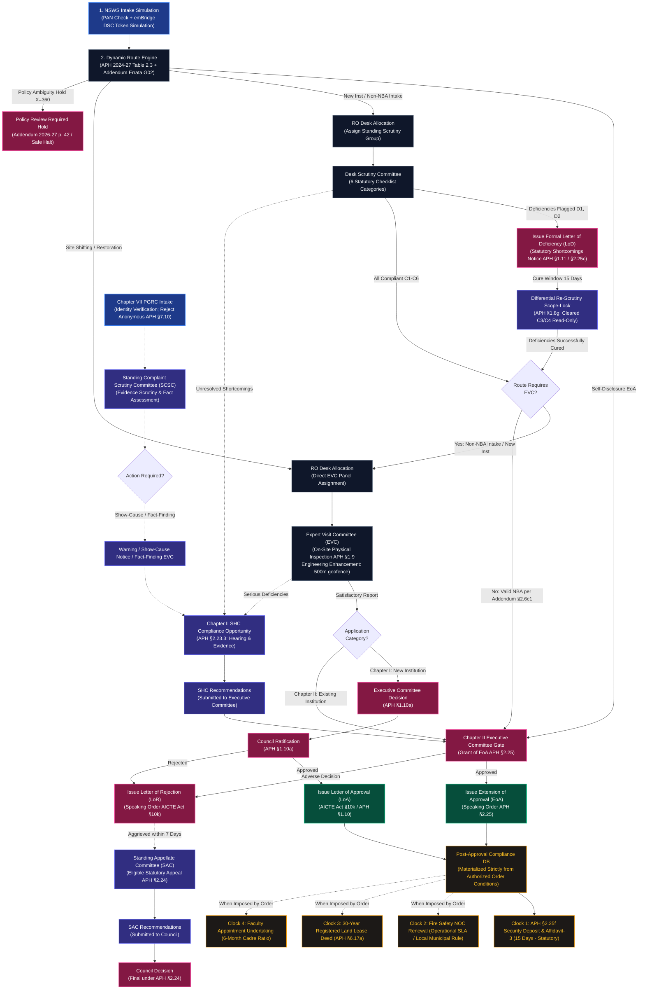

# NiyamSetu (नियमसेतु)
### Automated Approval Workflow & Regulatory Compliance Monitoring Platform for AICTE
**Smart India Hackathon 2026 | Problem Statement 26262 (AICTE Regulation Bureau) | Academic Year 2026–2027**

[](https://niyamsetu-aicte.onrender.com)
[](https://niyamsetu-aicte.onrender.com)
[-brightgreen.svg?style=flat-square)](./tests/regression_retrofit_all_deliverables.test.ts)
[](./docs/PS_COMPLIANCE_MATRIX.md)
[-brightgreen.svg?style=flat-square)](./tests/)
[-blue.svg?style=flat-square)](./tsconfig.json)
[](https://www.aicte-india.org)

---

## 🏛️ Executive Summary & Statutory Purpose

Every year, the **All India Council for Technical Education (AICTE)** governs technical education across India, processing approval applications from over **10,000 polytechnics, engineering institutions, and management colleges**. Approval categories span Setting up New Technical Institutions, Extension of Approval (EoA), Increase in Intake / Additional Courses, Introduction of Supernumerary Quotas, Change of Site / Location, and Restoration of Intake.

Managing these workflows historically involved manual handoffs between national intake portals, regional office desks, ad-hoc scrutiny panels, physical inspection committees, and post-approval compliance tracking.

**NiyamSetu (नियमसेतु)** is an enterprise-grade regulatory companion engine engineered for the AICTE Regulation Bureau to:
1. Provide a seamless, simulated **National Single Window System (NSWS) → AICTE** application intake pipeline with emBridge Class-3 USB token authentication.
2. Execute a **deterministic, source-grounded Dynamic Route Engine** anchored directly to APH 2024–27 Table 2.3 and AY 2026–27 Addendum Errata G02, failing safely to `review_required` on material policy ambiguities ($X=360$, ELP 50%, Hibernation).
3. Provide an active **Regional Office Operations Desk Allocation** console with workload tracking across standing Scrutiny and Expert Visit Committee (EVC) groups.
4. Support an **Existing AICTE Portal Scrutiny Report Ingestion Flow** with immutable report preservation and automated extraction mapping.
5. Enforce server-enforced **Differential Re-Scrutiny Scope-Locks (APH §1.8(g))** that permanently lock previously cleared items read-only against any modification.
6. Decouple **Standing Appellate Committee (SAC) appeals, Standing Hearing Committee (SHC) shortcomings hearings, and Chapter VII §7.10 Grievances** from the main application spine.
7. Provide a **Central Policy Administrator Workspace (Role 6)** featuring an Active Rules & Routing Registry, versioned draft editor, before/after diff visualizer, route sandbox, and regulatory conflict register.
8. Synthesize per-case **institute-specific decision documents (LoA/EoA/LoD/LoR)** with HMAC-SHA256 prototype integrity seals (server-keyed test secret), tamper detection, and order-backed compliance materialization.
9. Track post-approval obligations through an automated **4-clock deterministic timer engine**, isolating APH §2.25(f) security deposits from pre-approval scrutiny cure windows.

---

## 🔄 End-to-End Approval Lifecycle Architecture



---

## 📦 Audit of Mandatory Retrofit Deliverables

| Deliverable | Statutory Grounding | Code Implementation | Test Verification |
|---|---|---|---|
| **1. NSWS Intake Simulation** | National Single Window System integration guidelines | [`src/backend/modules/nsws/`](file:///c:/Users/parth/Documents/SIH-26-AICTE/src/backend/modules/nsws/)<br/>[`src/features/nsws/`](file:///c:/Users/parth/Documents/SIH-26-AICTE/src/features/nsws/) | `Deliverable 1` test in [`regression_retrofit_all_deliverables.test.ts`](file:///c:/Users/parth/Documents/SIH-26-AICTE/tests/regression_retrofit_all_deliverables.test.ts) |
| **2. Dynamic Route Engine** | APH 2024–27 Table 2.3, Chapter I §1.8–§1.9, Addendum 2026–27 §2.6(c)(1) | [`src/backend/policy/dynamicRouteEngine.ts`](file:///c:/Users/parth/Documents/SIH-26-AICTE/src/backend/policy/dynamicRouteEngine.ts) | `Deliverable 2` tests (3 scenarios: NBA waiver, non-NBA EVC, $X=360$ flag) |
| **3. RO Operations Desk Allocation** | Regional Office operational workload distribution norms | [`src/backend/modules/allocation/`](file:///c:/Users/parth/Documents/SIH-26-AICTE/src/backend/modules/allocation/)<br/>[`src/features/ro/`](file:///c:/Users/parth/Documents/SIH-26-AICTE/src/features/ro/) | `Deliverable 3` tests (Capacity checks, EVC precondition guard, audit trail) |
| **4. Existing Portal Report Ingestion** | AICTE Scrutiny Evaluation Report format (GIITS & MCET) | [`src/backend/modules/portalImport/`](file:///c:/Users/parth/Documents/SIH-26-AICTE/src/backend/modules/portalImport/)<br/>[`src/features/portalImport/`](file:///c:/Users/parth/Documents/SIH-26-AICTE/src/features/portalImport/) | `Deliverable 4` tests (Local demo fixtures, confidence mapping, scoped tasks) |
| **5. Re-Scrutiny Scope-Lock** | APH 2024–27 Chapter I Clause 1.8(g) | [`src/backend/modules/scrutiny/`](file:///c:/Users/parth/Documents/SIH-26-AICTE/src/backend/modules/scrutiny/) | `Deliverable 5` test (HTTP 409 Conflict upon editing cleared items) |
| **6. Decoupled SAC / SHC / Grievance** | APH §1.11, §2.23.3, §2.24, and Chapter VII §7.10 | [`src/backend/modules/appealsAndHearings/`](file:///c:/Users/parth/Documents/SIH-26-AICTE/src/backend/modules/appealsAndHearings/)<br/>[`src/features/appeals/`](file:///c:/Users/parth/Documents/SIH-26-AICTE/src/features/appeals/) | `Deliverable 6` tests (7-day SAC appeal window, anonymous grievance rejection) |
| **7. Active Rules & Routing Registry** | Role 6 Policy Administration & Versioning Norms | [`src/backend/modules/rulesRegistry/`](file:///c:/Users/parth/Documents/SIH-26-AICTE/src/backend/modules/rulesRegistry/)<br/>[`src/features/admin/ConfigRulesView.tsx`](file:///c:/Users/parth/Documents/SIH-26-AICTE/src/features/admin/ConfigRulesView.tsx) | `Deliverable 7` tests (Searchable active rules, diff editor, conflict register) |
| **8. Generated Decision Documents** | AICTE Act 1987 §10(k), Official Order Issuance | [`src/backend/modules/decisionDocuments/`](file:///c:/Users/parth/Documents/SIH-26-AICTE/src/backend/modules/decisionDocuments/)<br/>[`src/features/documents/`](file:///c:/Users/parth/Documents/SIH-26-AICTE/src/features/documents/) | `Deliverable 8` tests (Dynamic PDF rendering, demo digital signing, complianceDB sync) |
| **9. Timers & Regulatory Clocks** | APH §2.25(f) vs Deficiency Cure Distinction | [`src/backend/modules/compliance/`](file:///c:/Users/parth/Documents/SIH-26-AICTE/src/backend/modules/compliance/) | Acceptance tests T10–T12 & `m3_obligations_timers.test.ts` |
| **10. Removal of Mock Adapters** | Clean architecture; removal of API Setu, DTE, Siebel | [`src/backend/routes/adapterRoutes.ts`](file:///c:/Users/parth/Documents/SIH-26-AICTE/src/backend/routes/adapterRoutes.ts) | `Deliverable 10` tests (All 3 excised endpoints return HTTP 404) |
| **11. Regression Tests & Documentation** | Verification rigour & demonstration clarity | [`tests/regression_retrofit_all_deliverables.test.ts`](file:///c:/Users/parth/Documents/SIH-26-AICTE/tests/regression_retrofit_all_deliverables.test.ts) | 38/38 retrofit tests + 333 total repository tests passing natively across 28 test suites |

---

## 👥 The 6 Statutory User Personas

All accounts use the built-in demo password: **`password123`**

| Role ID | Persona Title | Email Account | Statutory Responsibilities in NiyamSetu |
|---|---|---|---|
| `institution` | **College Principal / Trust Signatory** | `principal@coep.ac.in`<br/>`principal@pdimtr.ac.in` | Onboards via NSWS simulation, tracks stage progression, cures flagged deficiencies ($D1, D2$) during 15-day windows, and uploads compliance renewal proofs. *Constitutional guard: Cannot edit cleared checklist items or self-approve.* |
| `reviewer` | **Desk Scrutiny Committee Expert** | `scrutiny.reviewer@aicte.gov.in` | University professors and empanelled subject experts. Evaluates applications across 6 statutory categories, flags deficiencies, and signs evaluation reports. *Constitutional guard: Cannot re-evaluate cleared items ($C3, C4$) on re-scrutiny.* |
| `evc` | **Expert Visit Committee Officer** | `evc.chair@aicte.gov.in` | Senior inspection experts. Coordinates on-site physical audits and confirms geo-coordinates and infrastructure. *Constitutional guard: Assigned only when mandated by Table 2.3.* |
| `regional_officer` | **Regional Officer (RO Western / SCRO)** | `ro.western@aicte.gov.in` | AICTE regional administrative officer. Manages committee workloads, assigns Scrutiny and EVC groups, reviews SLA metrics, and transmits completed proformas to HQ. |
| `bureau_officer` / `demo_authority` | **Approval Bureau Officer / Council Chair** | `bureau.approval@aicte.gov.in` | Executive Committee / Council representative. Reviews recommendations, records authorized decisions, generates official signed decision letters (LoA/EoA/LoD/LoR), and materializes compliance obligations. |
| `policy_admin` | **AICTE Regulation Bureau Policy Admin** | `admin@aicte.gov.in` | Policy custodian. Operates the Active Rules & Routing Registry, edits draft rules with before/after diffs, runs sandbox simulations, and maintains the conflict register. |

---

## 🏫 Canonical Seed Applications

| Application ID | Regional Office | Approval Category | Narrative & Regulatory Path |
|---|---|---|---|
| **College of Engineering Pune (COEP)**<br/>`APP-2026-COEP` | Western | Increase in Intake (NBA Accredited)<br/>B.Tech AI & Data Science | Sourced from Addendum 2026–27 §2.6(c)(1): High NBA score (680) waives physical EVC inspection. Evaluated strictly via Fast-Track Desk Scrutiny and advances directly to Executive Committee approval. |
| **GMR Institute of Technology (GIITS)**<br/>`APP-2026-GIITS` | South-Central | Increase in Intake (Non-NBA)<br/>Mechanical & Computing | Follows APH Table 2.3 Row 9: Non-NBA status requires sequential Desk Scrutiny followed by physical verification by EVC Panel Alpha before Council consideration. |
| **PDIMTR Nagpur**<br/>`APP-2026-PDIMTR` | Western | Extension of Approval (EoA)<br/>Self-Disclosure with Conditions | Chapter II §2.5: Pre-seeded with recorded conditional approval. Demonstrates decision document synthesis (EoA) and the 3 conditions in `complianceDB`: 30-year registered land lease deed, annual Fire Safety NOC renewal, and 6-month faculty appointment undertaking. |
| **Apex Institute of Technology**<br/>`APP-2026-APEX` | Northern | Increase in Intake<br/>Decoupled Governance Branch | Demonstrates decoupled appellate workflows: adverse rejection order triggers statutory appeal to the Standing Appellate Committee (SAC) within a 7-calendar-day window with appellant DSC token. |
| **BATU Lonere**<br/>`APP-2026-BATU` | Western | Change of Site / Location<br/>Break-in-EoA Restoration | Evaluates under APH Table 2.3 Row 11: Desk Scrutiny is **bypassed** in favor of immediate physical site verification by EVC Panel Beta. |

---

## 💾 Persistence Modes & Storage Architecture

NiyamSetu features a dual-mode persistence architecture designed for zero setup friction during hackathons and robust enterprise durability:

### 1. High-Fidelity Transactional In-Memory Storage Engine (Default)
- **Active when**: `MONGODB_URI` is unset or MongoDB is offline.
- **Engine**: Custom transactional memory adapter (`memoryAdapter.ts`) with optimistic version checks, isolated snapshot transactions, idempotency receipts, and SHA-256 audit chaining.
- **Persistence Boundary**: State resets to the canonical seed cases on server process termination. Ideal for deterministic evaluation, clean test runs, and self-contained demos.

### 2. Production MongoDB Store (Multi-Document Transactions)
- **Active when**: Connected to a MongoDB replica set via `MONGODB_URI`.
- **Collections Persisted**:
  - `applications`: Canonical cases, versions, facts, and state.
  - `institutions`: Institutional profiles and credentials.
  - `policy_revisions`: Active statutory rules and candidate drafts.
  - `core_audit`: Cryptographic audit log entries.
  - `core_decisions`: Recorded Executive Committee / Council decisions.
  - `core_outbox`: Reliable transactional outbox notifications.
  - `core_receipts`: Idempotency receipts.
- **Companion In-Memory Layers**: In the current prototype, generated document binary cache (`generatedDocumentsDB`) and dynamic compliance timers (`complianceDB`) reside in companion Node memory maps. Downstream calls to `/decision-docs/generate/:caseId` idempotently reconstruct documents from canonical MongoDB decisions if needed.

---

## 🔐 Security Boundaries & Cryptographic Disclosures

1. **HMAC-SHA256 Prototype Integrity Seal**: Decision document PDF seals are generated server-side using an HMAC-SHA256 signature keyed with `PROTOTYPE_SEAL_SECRET`. They demonstrate tamper detection and cryptographic integrity verification in a prototype sandbox. They are **not** embedded PAdES/PKCS#7 asymmetric digital signatures and do **not** carry sovereign legal certification.
2. **Same-Origin CSRF Protection**: All mutating HTTP endpoints (`POST`, `PUT`, `PATCH`, `DELETE`) require an `Origin` header matching `CLIENT_URL` or `RENDER_EXTERNAL_URL`. For local developer convenience, loopback aliases (`http://localhost:3000` and `http://127.0.0.1:3000`) on matching ports are supported.
3. **Session Authentication**: Issued via `HttpOnly`, `SameSite=Strict` cookies (`sih_demo_session`). Token digests are held in server memory; sessions expire after 15 minutes of inactivity.
4. **Scope Gates**: Institution principals are cryptographically scoped to their own institution IDs. Regional officers are scoped to their regional jurisdictions. Council chairs hold global scope.
5. **Simulated External Portals**: NSWS onboarding, emBridge Class-3 USB token interactions, and SMS/Email gateway alerts are simulated locally for testability without requiring sovereign government portal credentials.
6. **Engineering Safeguards**: The 500-meter EVC GPS geofence is an engineering enhancement to assist inspectors; APH §1.9 governs the physical on-site audit requirement. The 60-day Fire Safety NOC reminder is an operational SLA.

---

## ⚙️ Environment Variables Reference

| Variable | Required | Default | Description |
|---|---|---|---|
| `PORT` | Optional | `3000` | Port for Express HTTP server. Injected automatically by Render/Cloud platforms. |
| `HOST` | Optional | `127.0.0.1` (dev) / `0.0.0.0` (prod) | Network interface binding. Must be `0.0.0.0` inside Docker/Render. |
| `NODE_ENV` | Optional | `development` | Set to `production` for static asset serving and strict production security. |
| `MONGODB_URI` | Optional | `mongodb://127.0.0.1:27017/niyamsetu` | MongoDB connection URI. Replica set required for multi-document ACID transactions. |
| `CLIENT_URL` | Optional | `http://localhost:3000` | Allowed client origin for CORS and Same-Origin CSRF enforcement. |
| `RENDER_EXTERNAL_URL` | Optional | *(Render URL)* | Automatically set by Render. Overrides `CLIENT_URL` for same-origin checking. |
| `JWT_SECRET` | Optional | *(Demo Secret)* | HMAC secret for session authentication tokens. |
| `SESSION_SECRET` | Optional | *(Demo Secret)* | Session cookie signing secret. |
| `PROTOTYPE_SEAL_SECRET` | Optional | *(Built-in Nonprod)* | Server secret key used to compute HMAC-SHA256 decision document integrity seals. |

---

## 💻 Quick Start: Run Locally in Under 2 Minutes

The project requires **zero external database setup**. Its built-in transactional memory storage starts instantly out of the box.

### Prerequisites
- **Node.js**: v20 or v22 LTS
- **npm**: v9 or higher

### Commands (Copy & Paste)

```bash
# 1. Clone the repository
git clone https://github.com/Mayuresh-1306/SIH-2026-AICTE.git SIH-26-AICTE
cd SIH-26-AICTE

# 2. Install dependencies
npm install

# 3. Check TypeScript strictness (0 errors)
npx tsc --noEmit

# 4. Run automated regression & acceptance test suites
# Full retrofitted regression suite (38/38 passed)
npx vitest run tests/regression_retrofit_all_deliverables.test.ts

# Acceptance verification suites (22/22 passed)
npx vitest run tests/verification_t01_t16.test.ts tests/verification_t17_t22.test.ts

# Complete repository suite (333/333 passed across 28 files)
npx vitest run

# 5. Build and launch development server
npm run build
npm run dev
```

Open your browser to:  
👉 **`http://localhost:3000`**

### Live Production Deployment
Try the full application online without installing anything:  
🌐 **`https://niyamsetu-aicte.onrender.com`**

---

## 🧪 Automated Test Coverage (333 Tests / 28 Suites)

```
Test Files  28 passed (28)
     Tests  333 passed (333)
  Duration  12.05s (100% pass rate, 0 failed, 0 skipped)
```

- **`tests/regression_retrofit_all_deliverables.test.ts` (38 tests):** Verifies all 11 mandatory deliverables end-to-end, including decision preconditions, outcome alignment, HMAC-SHA256 integrity verification, no cross-case leakage, loopback origin matching, and boundary hold conditions.
- **`tests/appeals_and_hearings_api.test.ts` (6 tests):** Decoupled statutory appeals (SAC APH §1.11 / §2.24), compliance hearings (SHC APH §2.23.3), and Chapter VII grievances API routes and validation.
- **`tests/verification_t01_t16.test.ts` (16 tests):** Acceptance checks T01–T16 (tenant isolation, scrutiny scope-lock, human-only decisions, timer acceleration).
- **`tests/verification_t17_t22.test.ts` (6 tests):** Acceptance checks T17–T22 (authorized reverts, statutory notices, DSC signatures, compliance certificates).
- **`tests/policy/routing.test.ts` (37 tests):** Comprehensive route engine predicate tests across Table 2.3.
- **`tests/decisions/core.test.ts` (34 tests):** Decision transactions, authority guards, and speaking order verification.
- **`tests/security/auth.test.ts` (18 tests):** Session authentication, cookie security, RBAC scopes, and login attempt throttling.
- **`tests/core/http.test.ts` & `tests/core/commands.test.ts` (22 tests):** HTTP guards, transaction serialization, rollback semantics, and outbox isolation.

---

## 🛠️ Operational Troubleshooting & Hosting Runbook

### 1. Render Free-Tier Cold Starts (35–50s Latency)
- **Cause**: Render free instances spin down after 15 minutes of HTTP inactivity.
- **Resolution**: The first request may take 35–50 seconds to initialize the Node.js container and Vite engine. Subsequent requests respond in <50ms. Health checks at `/health` verify alive status.

### 2. Same-Origin Request Required (HTTP 403 Forbidden)
- **Cause**: CSRF protection checks the HTTP `Origin` header on state mutations (`POST`, `PUT`, `DELETE`).
- **Resolution**: In local development, access via `http://localhost:3000` or `http://127.0.0.1:3000`. On custom domains or Render deployments, ensure `CLIENT_URL` or `RENDER_EXTERNAL_URL` matches the deployed hostname exactly.

### 3. Memory Ceiling (512MB RAM on Free Tier)
- **Cause**: High concurrency during PDF rendering (`pdf-lib`) and 3D canvas rendering.
- **Resolution**: Document generation is streamed with base64 payload limits (10MB ceiling) and constant-time buffer allocations.

### 4. Database Seed & Recovery
- To re-seed MongoDB with canonical test institutions:
  ```bash
  npm run seed:mongo
  ```
- If MongoDB becomes unreachable, NiyamSetu automatically falls back to its internal transactional in-memory store without crashing or throwing unhandled errors.

---

## ⚖️ Regulatory Traceability & Primary Sources

- **Primary Statutory Authorities**: All routes, rules, and workflows are anchored to the **AICTE Act 1987**, **AICTE Approval Process Handbook (APH 2024–2027)**, and **AY 2026–27 Addendum with Corrigendum Errata G02**.
- **Member 6 Research Status**: As documented in the repository checklist, no separate research file explicitly labelled *"Member 6"* was found in the repository or attachments; its contents were not invented or assumed.
- **Simulation Transparency**: All simulated external integrations (NSWS onboarding, emBridge Class-3 DSC token validation, mock notification dispatch, and HMAC SHA-256 digital document signing) carry prominent non-production prototype disclosures and never claim live sovereign API connections.

---

## 👥 Smart India Hackathon 2026

- **Problem Statement 26262**: AICTE Regulation Bureau — NiyamSetu (नियमसेतु)
- **Academic Year**: 2026–2027
- **Tracked Remotes**:
  - `origin`: `https://github.com/Mayuresh-1306/SIH-2026-AICTE.git` (Tracked master)
  - `personal`: `https://github.com/Parth-Chavan-15/SIH-2026-AICTE.git` (Backup deployment mirror)
- **Live Deployment**: [https://niyamsetu-aicte.onrender.com](https://niyamsetu-aicte.onrender.com)
- **Status**: High-Fidelity Transactional Prototype with In-Memory & MongoDB Persistence Engines (AY 2026–27 | 333/333 Tests Passing)
