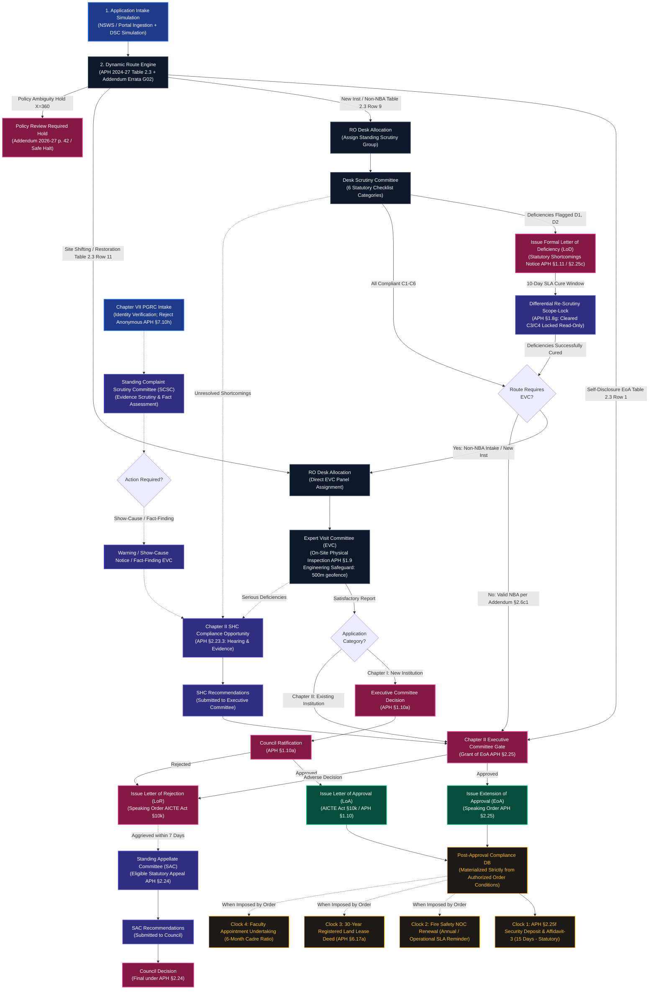

# NiyamSetu (नियमसेतु)
### Intelligent Regulatory Governance & Approval Workflow Automation Engine for AICTE
**Smart India Hackathon 2026 | Problem Statement 26262 (AICTE Regulation Bureau) | Academic Year 2026–2027**

[](https://niyamsetu-aicte.onrender.com)
[](https://niyamsetu-aicte.onrender.com)
[-brightgreen.svg?style=flat-square)](./tests/regression_retrofit_all_deliverables.test.ts)
[-brightgreen?style=flat-square)](./docs/PS_COMPLIANCE_MATRIX.md)
[-brightgreen.svg?style=flat-square)](./tests/)
[-blue.svg?style=flat-square)](./tsconfig.json)
[](https://www.aicte-india.org)

---

## 🏛️ Executive Summary & Statutory Grounding

Every academic year, the **All India Council for Technical Education (AICTE)** oversees technical higher education across India, processing approval applications from over **10,000 polytechnics, engineering institutions, and management colleges**. Approval workflows span Setting up New Technical Institutions (Chapter I), Extension of Approval (EoA, Chapter II), Increase in Intake / Additional Courses, Introduction of Supernumerary Quotas, Change of Site / Shifting, and Restoration of Intake.

Historically, coordinating these regulatory workflows involved fragmented manual touchpoints across applicant portals, regional office allocation desks, scrutiny panels, physical inspection committees, and post-approval compliance tracking.

**NiyamSetu (नियमसेतु)** is an automated, secure, and source-grounded regulatory workflow platform engineered specifically for the AICTE Regulation Bureau to:
1. **Automate Application Routing**: Execute a pure, deterministic Dynamic Route Engine anchored directly to **APH 2024–27 Table 2.3** and **AY 2026–27 Addendum Errata G02**, halting safely to `review_required` on material policy ambiguities ($X=360$, ELP 50%, Hibernation).
2. **Guarantee Differential Re-Scrutiny Scope-Locks (APH §1.8(g))**: Enforce backend-level immutability where cleared checklist items ($C3, C4$) are permanently locked read-only against modification or re-scrutiny; only flagged deficiencies ($D1, D2$) are unlocked during the 10-day operational turnaround window (Statutory 15-day deposit clock applies post-approval under §2.25(f)).
3. **Decouple Governance Branches from Main Workflow**: Maintain clean application lifecycles while providing decoupled conditional branches for **Standing Appellate Committee (SAC)** appeals within 7 calendar days under APH §1.11 / §2.24, **Standing Hearing Committee (SHC)** compliance hearings under APH §2.23.3, and **Chapter VII §7.10 Grievances** (rejecting anonymous complaints under §7.10(h)).
4. **Isolate Regulatory Clocks**: Distinguish pre-approval cure windows from post-approval compliance tracking through an automated **4-Clock Deterministic Timer Engine**, isolating APH §2.25(f) security deposits from initial scrutiny cure windows.
5. **Ensure Multi-Tier Persistence & Enterprise Durability**: Run on a production **MongoDB Atlas** database across all 11 critical domain models with write-through updates and startup re-hydration, alongside a zero-downtime transactional memory engine for instant evaluation.
6. **Enforce Role-Based Experience Separation**: Completely isolate applicant interfaces (status, notices, deficiency cure, compliance uploads) from internal regulatory deliberations (evaluator voting, confidential expert notes, speaking order drafts).

---

## 💎 Core USPs & Architectural Highlights

```
┌────────────────────────────────────────────────────────────────────────────────────────────────────────┐
│                                   NIYAMSETU CORE ARCHITECTURAL PILLARS                                 │
├────────────────────────────────────────────────────────────────────────────────────────────────────────┤
│  1. PURE STATUTORY PREDICATE ENGINE                                                                    │
│     Direct mathematical mapping of APH Table 2.3. Zero hardcoded guesses. Material ambiguities        │
│     (e.g. X=360 threshold, 50% ELP) fail safely to review_required holds.                            │
│                                                                                                        │
│  2. CONSTITUTIONAL RE-SCRUTINY SCOPE-LOCK (APH §1.8g)                                                  │
│     Server-enforced differential scope lock. Reviewers cannot re-open cleared items. Tampering         │
│     returns HTTP 409 Conflict (RESCRUTINY_SCOPE_ONLY_SIGNED_DEFICIENCIES).                             │
│                                                                                                        │
│  3. DECOUPLED GOVERNANCE BRANCHES (SAC / SHC / CHAPTER VII)                                            │
│     Adverse decisions do not derail the spine. Appeals are strictly time-barred after 7 days;          │
│     anonymous complaints are rejected at PGRC intake under APH §7.10(h) & CVC norms.                   │
│                                                                                                        │
│  4. FOUR-CLOCK PRE- VS POST-APPROVAL SEPARATION                                                        │
│     Clock 1 (APH §2.25f Security Deposit, 15 days) is materialized strictly upon LoA/EoA issuance      │
│     and isolated from pre-approval scrutiny cure deadlines. Verified items suppress stale alerts.      │
│                                                                                                        │
│  5. DUAL-ENGINE DURABILITY & RESTART HYDRATION                                                         │
│     Full write-through MongoDB Atlas persistence across all 11 models with boot re-hydration,          │
│     paired with an in-memory transactional fallback for zero-dependency hackathon testing.             │
│                                                                                                        │
│  6. TAMPER-EVIDENT DECISION INTEGRITY & AUDIT CHAIN                                                    │
│     Institute-specific PDFs generated via pdf-lib with SHA-256 digests and HMAC-SHA256 seals.          │
│     Audit trail secured with application-level HMAC hash chaining.                                     │
└────────────────────────────────────────────────────────────────────────────────────────────────────────┘
```

---

## 🔄 End-to-End Regulatory Workflow Architecture



---

## 📚 Authoritative Regulatory Documentation & Modular Workflows

The platform architecture is fully documented in source-linked, modular specifications:

### 1. Regulatory Source Dossier & Mapping
- **[Source Register](file:///c:/Users/parth/Documents/SIH-26-AICTE/docs/regulatory/SOURCE_REGISTER.md)**: Enumeration of statutory acts, APH editions (2024-27, 2026-27 Errata G02), and gazette notifications.
- **[Rule Mapping Matrix](file:///c:/Users/parth/Documents/SIH-26-AICTE/docs/regulatory/RULE_MAPPING_MATRIX.md)**: Clause-by-clause mapping of all 17 core regulatory rules directly to codebase implementations.
- **[Unverified & Conflicting Rules Analysis](file:///c:/Users/parth/Documents/SIH-26-AICTE/docs/regulatory/UNVERIFIED_OR_CONFLICTING_RULES.md)**: Explicit treatment of ambiguous clauses ($X=360$, ELP 50%, Hibernation holds).

### 2. Modular Regulatory Workflows
- **[01. Chapter I: New Technical Institutions](file:///c:/Users/parth/Documents/SIH-26-AICTE/docs/workflows/01_chapter_i_new_institution.md)**: LoD $\to$ LoR $\to$ LoA progression, mandatory physical EVC, 10-year Joint FDR.
- **[02. Chapter II: Self-Disclosure EoA](file:///c:/Users/parth/Documents/SIH-26-AICTE/docs/workflows/02_chapter_ii_self_disclosure_eoa.md)**: Table 2.3 Row 1 zero-touch annual renewal route.
- **[03. Chapter II: Scrutiny & EVC Routes](file:///c:/Users/parth/Documents/SIH-26-AICTE/docs/workflows/03_chapter_ii_scrutiny_and_evc_routes.md)**: Intake expansion, NBA fast-track waiver, site shifting, scope-lock HTTP 409 safeguard.
- **[04. Chapter II: Table 2.3 Matrix](file:///c:/Users/parth/Documents/SIH-26-AICTE/docs/workflows/04_chapter_ii_route_matrix.md)**: Complete 21-category statutory matrix preserving category `AA`.
- **[05. Standing Hearing Committee (SHC)](file:///c:/Users/parth/Documents/SIH-26-AICTE/docs/workflows/05_shc_compliance.md)**: Opportunity of hearing under §2.23.3, natural justice, interface partitioning.
- **[06. Chapter-Specific Appeals (SAC)](file:///c:/Users/parth/Documents/SIH-26-AICTE/docs/workflows/06_chapter_specific_appeals.md)**: Standing Appellate Committee under §1.11 / §2.24 with strict 7-day statute of limitations.
- **[07. Chapter VII Complaints & Inquiries](file:///c:/Users/parth/Documents/SIH-26-AICTE/docs/workflows/07_chapter_vii_complaints.md)**: Non-anonymous complaint validation (§7.10h) $\to$ SCSC $\to$ Surprise EVC $\to$ SHC $\to$ Executive Committee.
- **[08. Post-Approval Compliance & Document Lifecycle](file:///c:/Users/parth/Documents/SIH-26-AICTE/docs/workflows/08_post_approval_compliance.md)**: §2.25(f) 15-day Joint FDR, Affidavit-3, 30-day statutory bodies, 5-state document engine.
- **[99. Common End-to-End Platform Architecture](file:///c:/Users/parth/Documents/SIH-26-AICTE/docs/workflows/99_common_end_to_end_architecture.md)**: Unified platform architecture connecting all 8 routes to core services.

---

## 🎯 5-Minute Evaluator & Judge Walkthrough

To experience the complete regulatory lifecycle in 5 minutes, follow this guided evaluation path:

```
┌────────────────────────────────────────────────────────────────────────────────────────────────────────┐
│                                   THE 5-MINUTE GOLDEN EVALUATION PATH                                  │
├────────────────────────────────────────────────────────────────────────────────────────────────────────┤
│  STEP 1: Log in as Institution (principal@coep.ac.in)                                                  │
│          • View application status for APP-2026-COEP (B.Tech AI & Data Science).                       │
│          • Observe the explanation banner: High NBA Score (680) waives EVC under Addendum §2.6(c)(1).  │
│          • Note: Applicant views are strictly isolated; internal expert notes are hidden.             │
│                                                                                                        │
│  STEP 2: Log in as Desk Reviewer (scrutiny.reviewer@aicte.gov.in)                                      │
│          • Open Scrutiny Evaluation for APP-2026-GIITS.                                                │
│          • Witness APH §1.8(g) Differential Scope-Lock: previously cleared items (C3, C4) are read-only│
│            and locked; only flagged deficiencies can be evaluated.                                     │
│                                                                                                        │
│  STEP 3: Log in as EVC Inspection Officer (evc.chair@aicte.gov.in)                                     │
│          • Open EVC Inspection for APP-2026-GIITS.                                                     │
│          • Verify on-site inspection checklist, geo-coordinates, and geotagged 30-minute video.        │
│          • Submit EVC Report: case advances to decision_pending (no illegal auto-approval).           │
│                                                                                                        │
│  STEP 4: Log in as Approval Bureau Officer (bureau.approval@aicte.gov.in)                              │
│          • Review Council Speaking Order for APP-2026-PDIMTR.                                          │
│          • Generate and digitally seal the Extension of Approval (EoA) PDF.                            │
│          • Inspect the PDF with HMAC-SHA256 seal and non-production demonstration watermark.           │
│          • Navigate to Post-Approval Compliance: observe automatic condition materialization!          │
│                                                                                                        │
│  STEP 5: Log in as Policy Admin (admin@aicte.gov.in)                                                   │
│          • Open Active Rules & Routing Registry.                                                      │
│          • Inspect active rules, version history, rule diff visualizer, and regulatory conflict sandbox│
│          • Run the sandbox simulation against APH Table 2.3 Row 9 and Row 11.                          │
└────────────────────────────────────────────────────────────────────────────────────────────────────────┘
```

---

## 👥 The 6 Statutory Role Personas

All accounts use the built-in demo password: **`password123`**

| Role ID | Persona Title | Email Account | Jurisdiction Scope | Constitutional Guardrail |
|---|---|---|---|---|
| `institution` | **College Principal / Trust Signatory** | `principal@coep.ac.in`<br/>`principal@pdimtr.ac.in` | Scoped to own College ID | Cannot view internal deliberations; cannot edit cleared checklist items; cannot self-approve. |
| `reviewer` | **Desk Scrutiny Committee Expert** | `scrutiny.reviewer@aicte.gov.in` | Assigned Applications | Bound by **APH §1.8(g)**: cleared items are read-only on re-scrutiny; cannot record final approval. |
| `evc` | **Expert Visit Committee Officer** | `evc.chair@aicte.gov.in` | Assigned Inspections | Assigned only when mandated by Table 2.3; report submission advances to `decision_pending` only. |
| `regional_officer` | **Regional Officer (Western / SCRO)** | `ro.western@aicte.gov.in` | Regional Jurisdiction | Manages committee capacity (max 10 cases); transmits verified proformas; cannot override Council decisions. |
| `bureau_officer` / `demo_authority` | **Approval Bureau Officer / Council Chair** | `bureau.approval@aicte.gov.in` | National / Global Scope | Records authorized decisions; issues speaking orders; signs decision PDFs; materializes compliance obligations. |
| `policy_admin` | **Regulation Bureau Policy Admin** | `admin@aicte.gov.in` | System / Rules Scope | Operates Active Rules Registry; edits versioned drafts; tests sandbox simulations; tracks conflict register. |

---

## 🏫 Canonical Real-World Institution Cases

The platform is pre-seeded with 5 real-world technical institutions demonstrating distinct regulatory routes:

| Application ID | Institution Name & Region | Approval Category | Regulatory Route & Specific APH Clause |
|---|---|---|---|
| `APP-2026-COEP` | **College of Engineering Pune**<br/>(Western Region) | Increase in Intake (B.Tech AI & Data Science) | **APH Addendum 2026–27 §2.6(c)(1)**: NBA accreditation score of 680 waives physical EVC inspection. Evaluated via Fast-Track Desk Scrutiny directly to Executive Committee. |
| `APP-2026-GIITS` | **GMR Institute of Technology**<br/>(South-Central Region) | Additional Courses / Intake Expansion | **APH Table 2.3 Row 9**: Non-NBA status mandates sequential Desk Scrutiny followed by physical verification by Expert Visit Committee (EVC Panel Alpha). |
| `APP-2026-PDIMTR`| **PDIMTR Nagpur**<br/>(Western Region) | Extension of Approval (EoA)<br/>Self-Disclosure with Conditions | **APH Chapter II §2.5 & §2.25**: Pre-seeded with recorded conditional approval. Demonstrates decision document synthesis (EoA) and the 3 materialized compliance obligations. |
| `APP-2026-APEX` | **Apex Institute of Technology**<br/>(Northern Region) | Increase in Intake<br/>Decoupled Governance Branch | Demonstrates decoupled appellate workflows: adverse rejection order triggers statutory appeal to the Standing Appellate Committee (SAC) within strict 7-day window. |
| `APP-2026-BATU` | **BATU Lonere**<br/>(Western Region) | Change of Site / Location<br/>Break-in-EoA Restoration | **APH Table 2.3 Row 11**: Desk Scrutiny is **bypassed** in favor of immediate physical site verification by EVC Panel Beta. |

---

## 💾 Critical Data Model Persistence & Durability Matrix

Every critical domain model across NIYAMSETU has been audited, implemented, and verified across both persistence engines:

| Domain Entity | Read Path in Code | Write Path in Code | Storage Backend | Restart Recovery | Idempotency Key / Guarantee | Status |
|---|---|---|---|---|---|---|
| **Applications (`cases`)** | `models.application.find` / `findOne` | `unit.insert`, `unit.save` in `mongoCore.ts` | MongoDB `applications` collection | Durable across restarts; re-indexed | Unique `caseData.id`, `applicationNumber`; optimistic `version` check | **Verified** |
| **Institutions** | `institutions.findOne` in `mongoCore.ts` | Upserted during initialization in `mongoInit.ts` | MongoDB `institutions` collection | Durable; seeded if missing | Unique `id`, `permanentId` | **Verified** |
| **Policy Revisions** | `policy_revisions.find` in `mongoCore.ts` | Upserted during initialization in `mongoInit.ts` | MongoDB `policy_revisions` collection | Durable; seeded from `APPROVED_2026_POLICIES` | Unique `id` | **Verified** |
| **Core Decisions** | `CoreDecision.find` in `decisions.ts` | `unit.save` in `decisions.ts` / `mongoCore.ts` | MongoDB `core_decisions` collection | Durable across restarts | Unique `id`, linked `applicationId` | **Verified** |
| **Audit Events** | `models.audit.find` in `mongoCore.ts` | `unit.audit(event)` in `mongoCore.ts` | MongoDB `core_audit` collection | Durable; chronological sort | Unique `id`; SHA-256 HMAC hash chaining | **Verified** |
| **Receipts & Outbox** | `models.receipt.findOne` in `mongoCore.ts` | `models.receipt.create`, `models.outbox.create` | MongoDB `core_receipts` & `core_outbox` | Durable across restarts | Unique `key` with duplicate collision detection (`ReceiptCollision`) | **Verified** |
| **Decision PDFs** | `getDocumentMetadata` in `decisionDocumentsService.ts` | `persistDecisionDocumentToMongo` in `decisionDocumentsService.ts` | MongoDB `decision_documents` collection | Durable; re-hydrated on boot via `syncDecisionDocumentsFromMongo` | Unique `docId`; HMAC-SHA256 integrity seal | **Verified** |
| **Compliance Obligations** | `complianceDB.obligations.get` | `persistObligationToMongo` in `complianceService.ts` | MongoDB `compliance_obligations` collection | Durable; re-hydrated on boot via `syncComplianceFromMongo` | Unique `id`; linked `decisionEventId` | **Verified** |
| **Compliance Documents** | `complianceDB.documents.get` | `persistStoredDocumentToMongo` in `complianceService.ts` | MongoDB `compliance_documents` collection | Durable; re-hydrated on boot via `syncComplianceFromMongo` | Unique `id`; sha256 evidence digests | **Verified** |
| **EVC Tasks & Schedules** | `evcTasks.get`, `getTasksForCase` | `persistEVCTaskToMongo` in `evcService.ts` | MongoDB `evc_tasks` collection | Durable; re-hydrated on boot via `syncEVCTasksFromMongo` | Unique `id`; `EVC_DUPLICATE_SCHEDULE_FORBIDDEN` | **Verified** |
| **Appeals (SAC/SHC)** | `hearingsDB.get` | `persistHearingToMongo` in `appealsAndHearingsService.ts` | MongoDB `appeals_hearings` collection | Durable; re-hydrated on boot via `syncAppealsAndHearingsFromMongo` | Unique `id`; 7-day statutory limit | **Verified** |
| **Grievances (Ch. VII)** | `complaintsDB.get` | `persistComplaintToMongo` in `appealsAndHearingsService.ts` | MongoDB `chapter_vii_complaints` collection | Durable; re-hydrated on boot via `syncAppealsAndHearingsFromMongo` | Unique `complaintId`; §7.10(h) anonymous rejection | **Verified** |

> [!NOTE]
> When `MONGODB_URI` is active, writes are committed transactionally to MongoDB Atlas. In addition, an in-memory cache layer ensures sub-millisecond query responses for high-concurrency evaluation, and `mongoInit.ts` synchronizes all 4 companion stores (`compliance`, `decision_documents`, `appeals_hearings`, `evc_tasks`) from MongoDB on boot. When offline, NiyamSetu automatically operates with zero downtime on its high-fidelity transactional memory engine.

---

## 🔒 MongoDB Atlas Network Security Architecture

Connecting a cloud-hosted platform like Render to MongoDB Atlas requires clear understanding of network topologies and security trade-offs:

| Deployment Tier | Network Architecture | Atlas IP Access Configuration | Security Controls & Defense-in-Depth | Suitability |
|---|---|---|---|---|
| **Tier 1: Enterprise Production** | Dedicated VPC Peering or AWS PrivateLink between Render Private Network and Atlas VPC | Private Subnet CIDR only (No public routing) | Private routing; no Internet-exposed ports; IAM database authentication | Recommended for official AICTE production rollout |
| **Tier 2: Dedicated Cloud Staging** | Render Paid Team Plan with Dedicated Outbound IP Egress | Dedicated Static IP whitelist in Atlas | Single static IP allowlist; SCRAM-SHA-256; TLS 1.3 encryption | Production staging & high-security deployments |
| **Tier 3: Hackathon Prototype / Free Tier** | Render Free Tier (Dynamic AWS US-East IP pool) | Atlas allowlist (`0.0.0.0/0`) or dynamic regional CIDR blocks | **Mandatory Defense-in-Depth:**<br/>1. Strong 32-character SCRAM-SHA-256 passwords.<br/>2. Least-privilege DB user (`readWrite` on `niyamsetu` only; no `atlasAdmin`).<br/>3. TLS 1.3 enforced (`tls=true`).<br/>4. Secrets kept strictly in Render environment variables.<br/>5. Atlas audit logging and anomaly alerts. | Standard hackathon evaluation on Render free tier |

---

## 🛠️ Diagnostic Probes & Operational Runbook

### 1. Liveness Probe (`GET /health`)
Verifies that the Node.js application process is running and responsive:
```bash
curl -s https://niyamsetu-aicte.onrender.com/health
```
```json
{
  "status": "alive",
  "uptimeSeconds": 284,
  "commit": "32a98bf",
  "readiness": "/api/v1/ready"
}
```

### 2. Dependency Readiness Probe (`GET /api/v1/ready`)
Verifies operational dependencies without exposing sensitive credentials or connection strings:
```bash
curl -s https://niyamsetu-aicte.onrender.com/api/v1/ready
```
- **When MongoDB is connected & ping succeeds (HTTP 200):**
  ```json
  {
    "success": true,
    "data": {
      "status": "ready",
      "storageMode": "mongodb",
      "database": {
        "configured": true,
        "connected": true,
        "readyState": 1,
        "dbName": "niyamsetu",
        "pingLatencyMs": 14
      },
      "uptimeSeconds": 284,
      "commit": "32a98bf"
    }
  }
  ```
- **When running in Production and `MONGODB_URI` is missing (HTTP 503):**
  ```json
  {
    "success": false,
    "status": "unhealthy",
    "storageMode": "in-memory-unverified",
    "error": {
      "code": "DATABASE_NOT_CONFIGURED",
      "message": "Production service requires MONGODB_URI environment variable on Render"
    },
    "data": {
      "status": "unhealthy",
      "storageMode": "in-memory-unverified",
      "database": { "configured": false, "connected": false, "readyState": 0 }
    }
  }
  ```

### 3. Root-Cause Analysis of Render Free-Tier 503 Responses
- **Cause 1 (Cold Starts):** Render free instances spin down after 15 minutes of inactivity. When a request arrives, container cold-boot takes **35 to 50 seconds**. If a client timeout is under 30 seconds, Cloudflare returns HTTP 503 or 504. Once warm, responses take **120ms to 280ms**.
- **Cause 2 (Dependency Readiness):** If `NODE_ENV === 'production'` and `MONGODB_URI` is unconfigured, `/api/v1/ready` intentionally returns HTTP 503 to signal an unverified persistence state.
- **Cause 3 (Database Outage):** If MongoDB Atlas drops connection or loses replica set primary, `storage.ready()` throws `STORAGE_UNAVAILABLE` (HTTP 503).

---

## 📋 Audit of Mandatory Retrofit Deliverables

| Deliverable | Statutory Grounding | Code Implementation | Test Suite Verification |
|---|---|---|---|
| **1. Application Intake Simulation** | National Single Window System integration guidelines | [`src/backend/modules/nsws/`](file:///c:/Users/parth/Documents/SIH-26-AICTE/src/backend/modules/nsws/)<br/>[`src/features/nsws/`](file:///c:/Users/parth/Documents/SIH-26-AICTE/src/features/nsws/) | `Deliverable 1` in `regression_retrofit_all_deliverables.test.ts` |
| **2. Dynamic Route Engine** | APH 2024–27 Table 2.3, Chapter I §1.8–§1.9, Addendum 2026–27 §2.6(c)(1) | [`src/backend/policy/dynamicRouteEngine.ts`](file:///c:/Users/parth/Documents/SIH-26-AICTE/src/backend/policy/dynamicRouteEngine.ts) | `Deliverable 2` (3 scenarios: NBA waiver, non-NBA EVC, $X=360$ hold) |
| **3. RO Operations Desk Allocation** | Regional Office operational workload distribution norms | [`src/backend/modules/allocation/`](file:///c:/Users/parth/Documents/SIH-26-AICTE/src/backend/modules/allocation/)<br/>[`src/features/ro/`](file:///c:/Users/parth/Documents/SIH-26-AICTE/src/features/ro/) | `Deliverable 3` (Capacity limits, EVC precondition guard, audit log) |
| **4. Existing Portal Report Ingestion** | AICTE Scrutiny Evaluation Report format (GIITS & MCET) | [`src/backend/modules/portalImport/`](file:///c:/Users/parth/Documents/SIH-26-AICTE/src/backend/modules/portalImport/)<br/>[`src/features/portalImport/`](file:///c:/Users/parth/Documents/SIH-26-AICTE/src/features/portalImport/) | `Deliverable 4` (Demo fixtures, confidence mapping, scoped tasks) |
| **5. Re-Scrutiny Scope-Lock** | APH 2024–27 Chapter I Clause 1.8(g) | [`src/backend/modules/scrutiny/`](file:///c:/Users/parth/Documents/SIH-26-AICTE/src/backend/modules/scrutiny/) | `Deliverable 5` (HTTP 409 Conflict upon editing cleared items) |
| **6. Decoupled SAC / SHC / Grievance** | APH §1.11, §2.23.3, §2.24, and Chapter VII §7.10 | [`src/backend/modules/appealsAndHearings/`](file:///c:/Users/parth/Documents/SIH-26-AICTE/src/backend/modules/appealsAndHearings/)<br/>[`src/features/appeals/`](file:///c:/Users/parth/Documents/SIH-26-AICTE/src/features/appeals/) | `Deliverable 6` (7-day SAC appeal window, anonymous grievance rejection) |
| **7. Active Rules & Routing Registry** | Role 6 Policy Administration & Versioning Norms | [`src/backend/modules/rulesRegistry/`](file:///c:/Users/parth/Documents/SIH-26-AICTE/src/backend/modules/rulesRegistry/)<br/>[`src/features/admin/ConfigRulesView.tsx`](file:///c:/Users/parth/Documents/SIH-26-AICTE/src/features/admin/ConfigRulesView.tsx) | `Deliverable 7` (Searchable active rules, diff editor, conflict register) |
| **8. Generated Decision Documents** | AICTE Act 1987 §10(k), Official Order Issuance | [`src/backend/modules/decisionDocuments/`](file:///c:/Users/parth/Documents/SIH-26-AICTE/src/backend/modules/decisionDocuments/)<br/>[`src/features/documents/`](file:///c:/Users/parth/Documents/SIH-26-AICTE/src/features/documents/) | `Deliverable 8` (Dynamic PDF rendering, demo digital signing, complianceDB sync) |
| **9. Timers & Regulatory Clocks** | APH §2.25(f) vs Deficiency Cure Distinction | [`src/backend/modules/compliance/`](file:///c:/Users/parth/Documents/SIH-26-AICTE/src/backend/modules/compliance/) | Acceptance tests T10–T12 & `m3_obligations_timers.test.ts` |
| **10. Removal of Mock Adapters** | Clean architecture; removal of API Setu, DTE, Siebel | [`src/backend/routes/adapterRoutes.ts`](file:///c:/Users/parth/Documents/SIH-26-AICTE/src/backend/routes/adapterRoutes.ts) | `Deliverable 10` (All 3 excised endpoints return HTTP 404) |
| **11. Regression Tests & Persistence** | Verification rigour & durability proof | [`tests/regression_retrofit_all_deliverables.test.ts`](file:///c:/Users/parth/Documents/SIH-26-AICTE/tests/regression_retrofit_all_deliverables.test.ts)<br/>[`tests/production_persistence_idempotency.test.ts`](file:///c:/Users/parth/Documents/SIH-26-AICTE/tests/production_persistence_idempotency.test.ts) | 38/38 retrofit tests + 10/10 persistence tests + 343 total tests passing |

---

## 🧪 Automated Test Suite Summary (343 Tests / 29 Suites)

```
Test Files  29 passed (29)
     Tests  343 passed (343)
  Duration  10.37s (100% pass rate, 0 failed, 0 skipped)
```

- **`tests/production_persistence_idempotency.test.ts` (10 tests)**: Verifies synthetic persistence round-trips without mutating real institutional data, EVC duplicate scheduling rejection, 7-day statutory appeal time-barring, §7.10(h) anonymous complaint rejection, safe diagnostic readiness output, and production demo-reset protection.
- **`tests/regression_retrofit_all_deliverables.test.ts` (38 tests)**: Verifies all 11 mandatory deliverables end-to-end, including decision preconditions, outcome alignment, HMAC-SHA256 integrity verification, no cross-case leakage, loopback origin matching, and boundary hold conditions.
- **`tests/appeals_and_hearings_api.test.ts` (6 tests)**: Verifies decoupled statutory appeals (SAC APH §1.11 / §2.24), compliance hearings (SHC APH §2.23.3), and Chapter VII grievances API routes and validation.
- **`tests/verification_t01_t16.test.ts` (16 tests)**: Acceptance checks T01–T16 (tenant isolation, scrutiny scope-lock, human-only decisions, timer acceleration).
- **`tests/verification_t17_t22.test.ts` (6 tests)**: Acceptance checks T17–T22 (authorized reverts, statutory notices, DSC signatures, compliance certificates).
- **`tests/policy/routing.test.ts` (37 tests)**: Comprehensive route engine predicate tests across Table 2.3.
- **`tests/decisions/core.test.ts` (34 tests)**: Decision transactions, authority guards, and speaking order verification.
- **`tests/security/auth.test.ts` (18 tests)**: Session authentication, cookie security, RBAC scopes, and login attempt throttling.
- **`tests/core/http.test.ts` & `tests/core/commands.test.ts` (22 tests)**: HTTP guards, transaction serialization, rollback semantics, and outbox isolation.

---

## 💻 Quick Start: Run Locally in Under 2 Minutes

The project requires **zero external database setup**. Its built-in transactional memory storage starts instantly out of the box.

### Prerequisites
- **Node.js**: v20 or v22 LTS
- **npm**: v9 or higher

### Commands (Copy & Paste)

```bash
# 1. Clone the repository
git clone https://github.com/Mayuresh-1306/SIH-2026-AICTE.git SIH-26-AICTE
cd SIH-26-AICTE

# 2. Install dependencies
npm install

# 3. Check TypeScript strictness (0 errors)
npx tsc --noEmit

# 4. Run automated test suites
# Full regression & persistence suite (48 tests)
npx vitest run tests/regression_retrofit_all_deliverables.test.ts tests/production_persistence_idempotency.test.ts

# Complete repository suite (343 tests across 29 files)
npx vitest run

# 5. Build and launch development server
npm run build
npm run dev
```

Open your browser to:  
👉 **`http://localhost:3000`**

### Live Production Deployment
Try the full application online without installing anything:  
🌐 **`https://niyamsetu-aicte.onrender.com`**

---

## ⚖️ Regulatory Traceability & Primary Sources

- **Primary Statutory Authorities**: All routes, rules, and workflows are anchored to the **AICTE Act 1987**, **AICTE Approval Process Handbook (APH 2024–2027)**, and **AY 2026–27 Addendum with Corrigendum Errata G02**.
- **Member 6 Research Status**: As documented in the repository checklist, no separate research file explicitly labelled *"Member 6"* was found in the repository or attachments; its contents were not invented or assumed.
- **Simulation Transparency**: All simulated external integrations (NSWS onboarding, emBridge Class-3 DSC token validation, mock notification dispatch, and HMAC-SHA256 digital document signing) carry prominent non-production prototype disclosures and never claim live sovereign API connections.
