<table align="center">
  <tr>
    <td align="center" width="30%">
      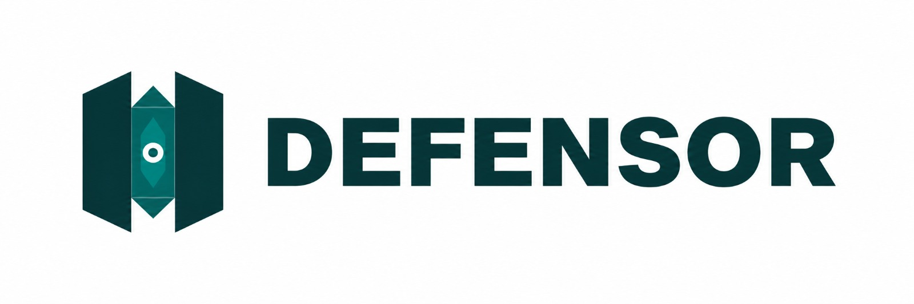
    </td>
    <td align="center" width="48%">
      <h1>NIYAMSETU</h1>
      <strong>नियमसेतु</strong><br />
      <sub>AICTE Approval &amp; Compliance Platform</sub>
    </td>
    <td align="center" width="22%">
      
    </td>
  </tr>
</table>

<div align="center">


**Clearer routes. Controlled reviews. Accountable decisions.**

*Smart India Hackathon 2026 · AICTE Problem Statement 26262 · Team DEFENSOR*

[](https://niyamsetu-aicte.onrender.com)
[](https://youtu.be/NsloajwX8gU?si=_Frrt_TT22yQCJ8x)
[](./docs/PS_COMPLIANCE_MATRIX.md)

**[🌐 Launch prototype](https://niyamsetu-aicte.onrender.com) · [▶ Watch demonstration](https://youtu.be/NsloajwX8gU?si=_Frrt_TT22yQCJ8x) · [📖 Explore user guide](https://drive.google.com/file/d/1EYKGkXoUPD9FOBFJl66p46_111cJDODY/view?usp=sharing)**

`22 application categories` · `6 role-based workspaces` · `11 expandable Mermaid diagrams`


</div>

---

## 🏛️ What is NiyamSetu?

Technical institutions need AICTE approval for new colleges, annual extensions, intake changes and other activities. Applications can require different reviews, inspections, documents, decisions and later compliance checks.

**NiyamSetu brings the approval-to-compliance journey into one traceable workflow.** Version-aware rules propose an applicable processing route with a **“Why this route?”** explanation. Role-specific workspaces organize evidence, permitted corrections, official decisions and follow-up obligations. **Authorized officials—not software—make the final regulatory decisions.**

## ✨ Four ideas at the heart of NiyamSetu

| Innovation | What it means for users |
|:--|:--|
| 🧭 **Explainable routing** | Uses versioned rules to identify a route and explain why it applies. Unclear policies can pause for human review. |
| 🔒 **Protected re-scrutiny** | Limits rechecks to flagged deficiencies while keeping previously cleared items read-only. |
| ⚖️ **Human decision gate** | Supports competent authorities with a consolidated case record while preserving their decision-making responsibility. |
| 📅 **Continuous compliance** | Connects approval conditions with renewals, documents, deadline reminders and case history. |

**Supporting capabilities:** 22-category routing · simulated NSWS/DSC intake · evidence integrity checks · conditional EVC visits · permission-controlled corrections · appeals and alerts · four categories of post-approval obligations · guided demonstration cases.

## 🖥️ Inside the prototype

A view of the NiyamSetu applicant workspace, including case status, route, responsibility and pending actions.

<p align="center">
  <a href="./docs/assets/niyamsetu-main-ui.png" title="Click for full-size NiyamSetu interface screenshot">
    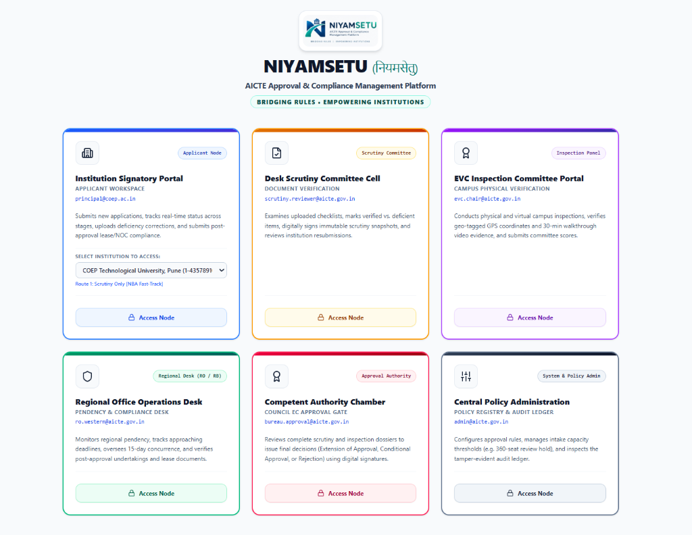
  </a>
</p>
<p align="center"><sub>🔎 Click the screenshot to inspect the full-size application interface.</sub></p>

## 🎬 Watch NiyamSetu in action

Explore the prototype walkthrough, then try the live application using the guided scenario below.

<p align="center">
  <a href="https://youtu.be/NsloajwX8gU?si=_Frrt_TT22yQCJ8x" title="Watch NiyamSetu prototype demonstration on YouTube">
    
  </a>
</p>

<p align="center"><strong><a href="https://youtu.be/NsloajwX8gU?si=_Frrt_TT22yQCJ8x">▶ Click here to watch the complete prototype demonstration</a></strong></p>

## 🖼️ From approval to compliance

See how application intake, rule-based review, authorized decisions, post-approval obligations and audit records fit together. Corrections, hearings and appeals appear only when applicable.

<p align="center">
  <a href="./docs/assets/niyamsetu-approval-to-compliance.png" title="Click to open the full-size approval-to-compliance infographic">
    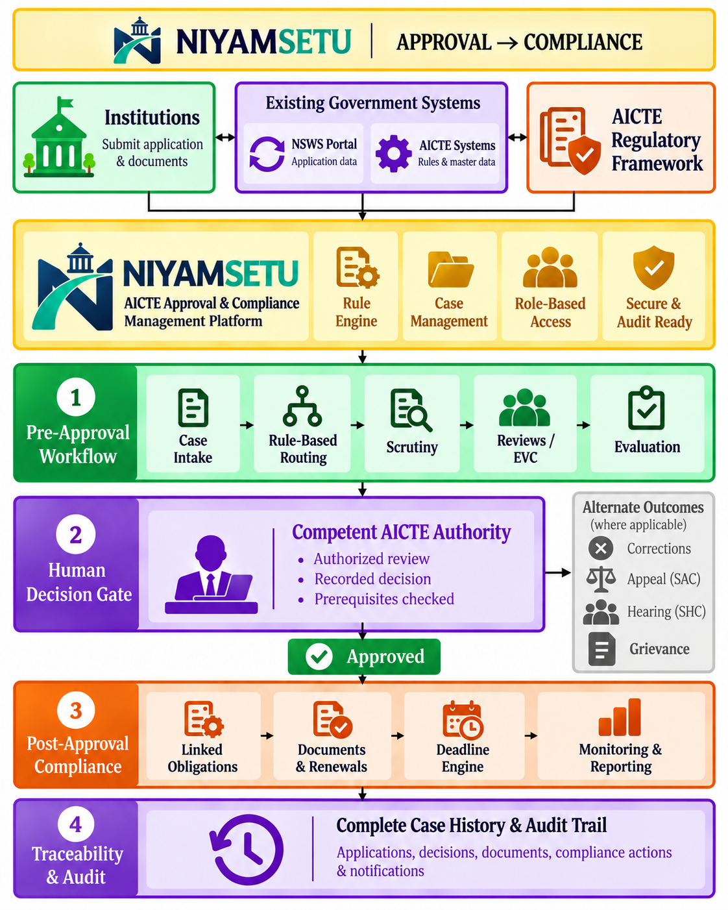
  </a>
</p>
<p align="center"><sub>🔎 Click the infographic to view the full workflow at its original resolution.</sub></p>

---

## 🔄 Complete workflow architecture

**Application intake → rule-based routing → relevant scrutiny or inspection → authorized decision → applicable obligations → audit trail.** Corrections, hearings, appeals and grievances follow separate, conditional routes.

Select the expandable architecture below to inspect the decision flow, conditional branches, and recorded obligations.

<details>
<summary><strong>▶ Click here to view the complete workflow architecture (interactive diagram)</strong></summary>

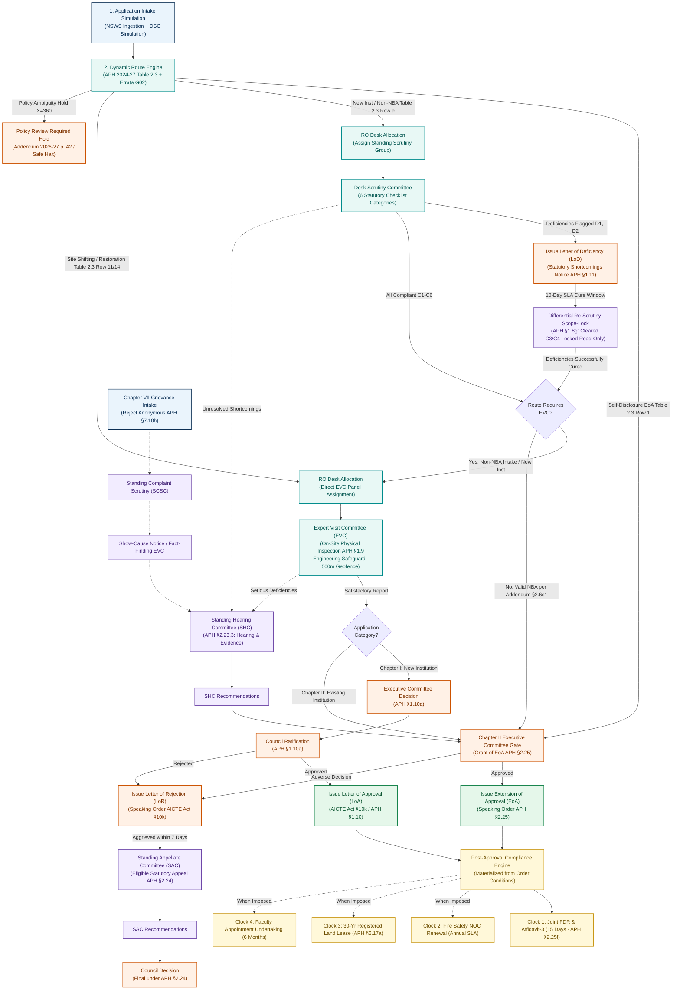

</details>

## 🧭 Explore 10 regulatory routes

**Select any of the 10 expandable diagrams (A–J)** to explore an application route, re-scrutiny, hearing, appeal, grievance, or compliance workflow. Select again to collapse.

For the full regulatory mapping, see the [route-to-diagram matrix](./docs/workflows/ROUTE_TO_DIAGRAM_MATRIX.md).

<details>
<summary><strong>▶ Click here to view Diagram A · New technical institution (Chapter I)</strong></summary>

APH Chapter I §§1.8–1.10: document scrutiny, physical EVC, Executive Committee consideration, and Council ratification.

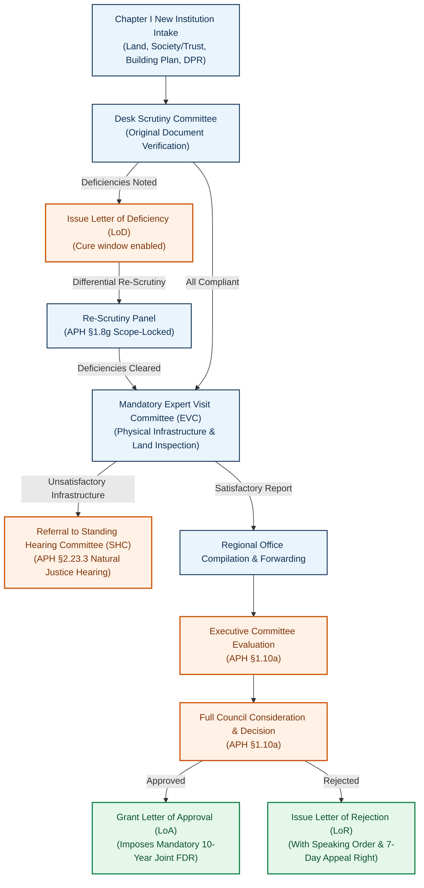

</details>

<details>
<summary><strong>▶ Click here to view Diagram B · Self-disclosure EoA</strong></summary>

APH §2.4, Chapter II Table 2.3 Row 1: an eligible existing institution can follow the streamlined route.

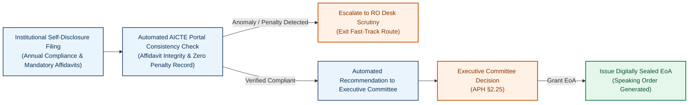

</details>

<details>
<summary><strong>▶ Click here to view Diagram C · Scrutiny-only routes</strong></summary>

Table 2.3 Rows 2, 4, 8, 9-NBA, 10, 12, 15–20: scrutiny without an EVC when applicable.

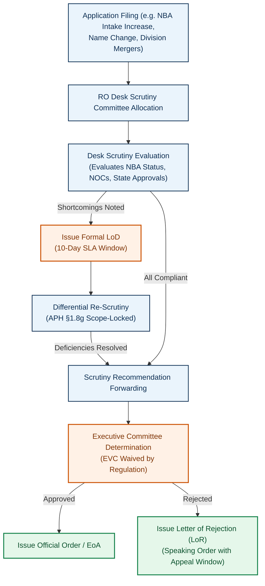

</details>

<details>
<summary><strong>▶ Click here to view Diagram D · Scrutiny followed by EVC</strong></summary>

Rows 3, 5, 9-Non-NBA, 6, 11, 13, 21: document scrutiny and then a required inspection.

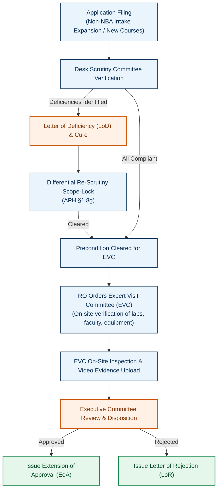

</details>

<details>
<summary><strong>▶ Click here to view Diagram E · Direct or category-specific EVC</strong></summary>

Site shifting (Row 14) or restoration of intake (Row 7): a visit is central to evaluation.

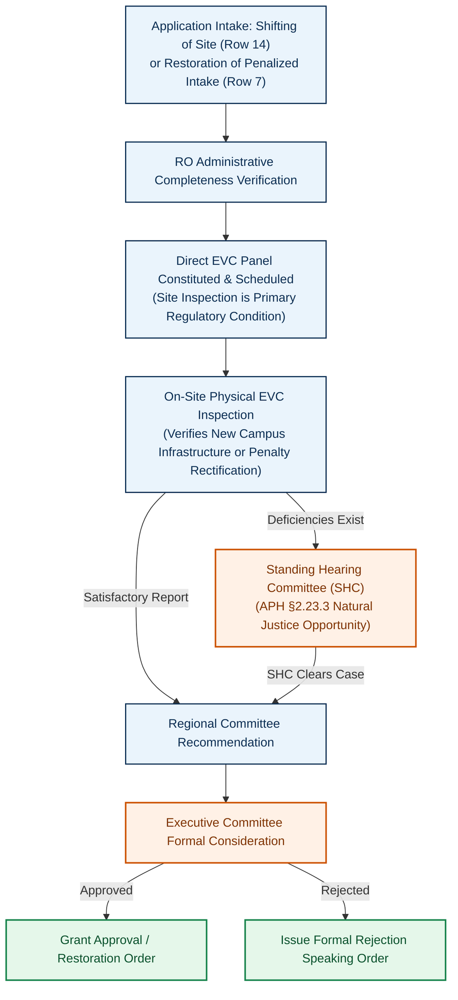

</details>

<details>
<summary><strong>▶ Click here to view Diagram F · Deficiency and differential re-scrutiny</strong></summary>

APH §1.8(g): cleared items are locked; only deficiencies are re-examined.

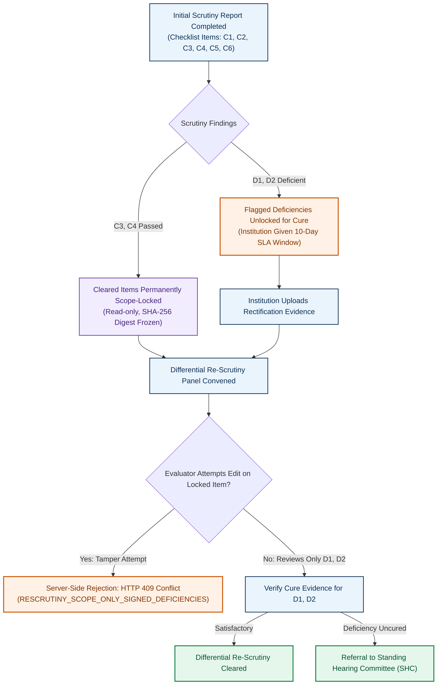

</details>

<details>
<summary><strong>▶ Click here to view Diagram G · Standing Hearing Committee (SHC)</strong></summary>

APH §2.23.3: opportunity to address unresolved shortcomings before a decision.

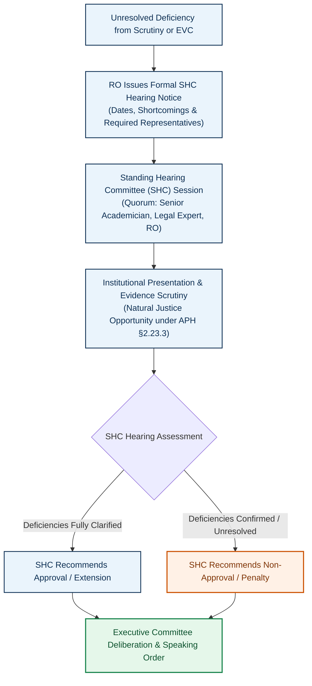

</details>

<details>
<summary><strong>▶ Click here to view Diagram H · Standing Appellate Committee (SAC)</strong></summary>

APH §§1.11 and 2.24: appeal handling with a seven-day filing window.

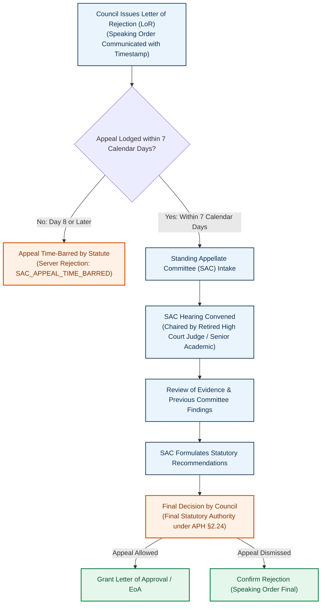

</details>

<details>
<summary><strong>▶ Click here to view Diagram I · Complaints and grievances</strong></summary>

APH Chapter VII §7.10: identity screening, fact finding, and any applicable Council action.

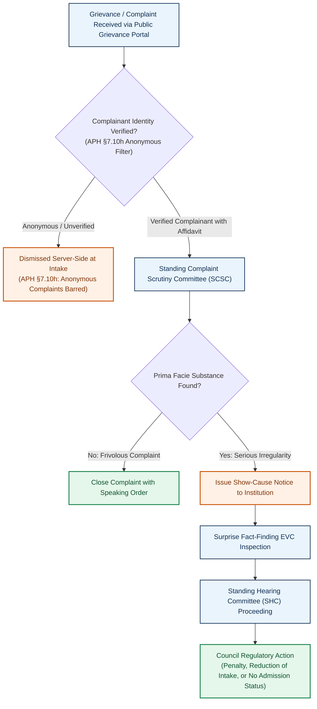

</details>

<details>
<summary><strong>▶ Click here to view Diagram J · Post-approval compliance</strong></summary>

Order-linked obligations: Joint FDR, Fire NOC, land-lease validity, and faculty undertakings.

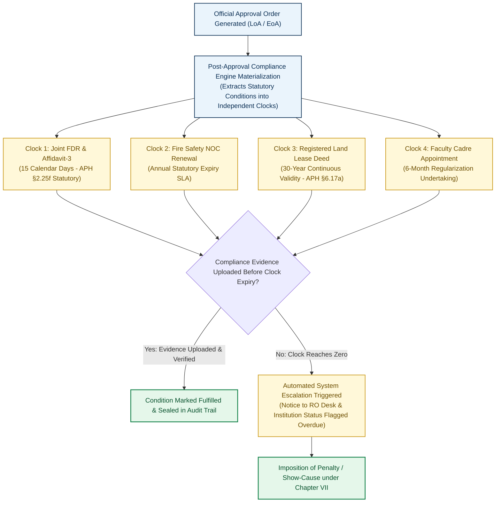

</details>

## 👥 Six workspaces. One connected workflow.

Each participant sees only the information and actions assigned to their role.

| Workspace | Main responsibility |
|:--|:--|
| 🏫 **Institution / Applicant** | Submit applications, respond to deficiencies, view orders and track obligations. |
| 🔍 **Desk Scrutiny** | Review documents, record findings and verify permitted corrections. |
| 📍 **Expert Visit Committee** | Record inspection observations, supporting evidence and recommendations. |
| 🗂️ **Regional Office** | Coordinate committees, monitor pendency, manage stage handoffs and oversee compliance. |
| ⚖️ **Approval Bureau / Council** | Review dossiers, record authorized decisions and manage applicable appeals. |
| ⚙️ **Policy Administration** | Manage versioned rules, monitor trends and inspect audit records. |

<details>
<summary><strong>🔑 Click to view demonstration accounts (sample data only)</strong></summary>

The accounts below are provided in the source README for exploring the prototype. They are demonstration identities, not official government accounts.

| Role | Demonstration email |
|:--|:--|
| Institution | `principal@coep.ac.in` / `principal@pdimtr.ac.in` |
| Scrutiny | `scrutiny.reviewer@aicte.gov.in` |
| EVC | `evc.chair@aicte.gov.in` |
| Regional Office | `ro.officer@aicte.gov.in` |
| Approval Bureau | `bureau.approval@aicte.gov.in` |
| Policy Admin | `admin@aicte.gov.in` |

Demonstration password listed in the supplied README: `password123`.

</details>

## 🧭 Explore the five-minute guided demo

1. **Institution:** Open `APP-2026-COEP` to inspect application status, notices and an explained inspection waiver.
2. **Scrutiny:** Open `APP-2026-GIITS` to inspect locked checklist clearances during re-scrutiny.
3. **EVC:** Review the GIITS inspection checklist, demonstration location information and video evidence; submit findings.
4. **Approval Bureau:** Inspect `APP-2026-PDIMTR`, generate a watermarked demonstration EoA and view follow-up obligations.
5. **Policy Administration:** Explore national statistics, versioned rules, historical changes and conflict checks.

## 🧱 Technology stack

| Area | Technologies and methods |
|:--|:--|
| **Frontend** | React 19 · TypeScript 5.8 · Tailwind CSS · Vite 6 · Lucide |
| **Backend** | Node.js 20/22 · Express · REST APIs |
| **Data** | MongoDB Atlas · transactional in-memory engine |
| **Performance** | Request deduplication · actor-scoped six-second read cache |
| **Security** | HttpOnly cookies · SHA-256 evidence hashes · HMAC-SHA256 demonstration seals |
| **Testing** | Vitest · Supertest · strict TypeScript |

## 🚀 Run NiyamSetu locally

**Prerequisites:** Node.js 20 or 22 LTS and npm 9+. The supplied README describes a built-in memory mode for local demonstration.

```bash
git clone https://github.com/Parth-Chavan-15/SIH-2026-AICTE.git SIH-26-AICTE
cd SIH-26-AICTE
npm install
npx tsc --noEmit
npm test
npm run build
npm run dev
```

Open **http://localhost:3000** or use the **[hosted prototype](https://niyamsetu-aicte.onrender.com)**.

## 🧪 Engineering verification

**Reported in the supplied README:** 388 passing tests across 35 suites, including 38 deliverable regression checks. These are **source-reported results**, not the result of a new test run.

- **Rules and decisions:** Route classification (37 tests); decision authority and order generation (34).
- **Access and isolation:** Authentication (18); institution separation (7); role-specific hearing controls (5).
- **Operational checks:** Persistence and deadline safeguards (10); notifications (3); performance checks (5).
- **Regression:** Deliverable regression suite (38 tests).

Evidence and supporting detail: [test directory](./tests/) · [performance verification](./docs/performance/PERFORMANCE_VERIFICATION.md).

---

## 📚 Essential resources

**[🌐 Live prototype](https://niyamsetu-aicte.onrender.com)** · **[▶ Demonstration video](https://youtu.be/NsloajwX8gU?si=_Frrt_TT22yQCJ8x)** · **[📖 Complete user walkthrough](https://drive.google.com/file/d/1DhHsp4X29YwySjYHP3_wgb6FaZRK0XGC/view?usp=sharing)**

**Technical evidence:** [AICTE requirement matrix](./docs/PS_COMPLIANCE_MATRIX.md) · [Regulatory route matrix](./docs/workflows/ROUTE_TO_DIAGRAM_MATRIX.md) · [Source register](./docs/regulatory/SOURCE_REGISTER.md)

---

<div align="center">

**Built by Team DEFENSOR** · Smart India Hackathon 2026 · AICTE PS 26262

*NIYAMSETU — Connecting regulatory decisions, institutional obligations, and accountable governance.*

</div>
