# NIYAMSETU (नियमसेतु)
### Intelligent Regulatory Governance & Approval Workflow Automation Engine for AICTE
**Smart India Hackathon 2026 | Problem Statement 26262 (AICTE Regulation Bureau) | Academic Year 2026–2027**

[](https://niyamsetu-aicte.onrender.com)
[](https://niyamsetu-aicte.onrender.com)
[-brightgreen.svg?style=flat-square)](./tests/regression_retrofit_all_deliverables.test.ts)
[-brightgreen?style=flat-square)](./docs/PS_COMPLIANCE_MATRIX.md)
[-brightgreen.svg?style=flat-square)](./tests/)
[-blue.svg?style=flat-square)](./tsconfig.json)
[](https://www.aicte-india.org)


---

## 🏛️ Executive Summary

Every academic year, the **All India Council for Technical Education (AICTE)** oversees technical higher education across India, regulating approvals for more than **10,000 polytechnics, engineering colleges, and management institutes**. Applications encompass Setting up New Technical Institutions (Chapter I), Annual Extension of Approval (EoA, Chapter II), Intake Increases, Introduction of Supernumerary Quotas, Change of Site, and Restoration of Intake.

Historically, processing these applications involved fragmented manual touchpoints across applicant portals, regional office allocation desks, scrutiny panels, physical inspection committees, and post-approval compliance tracking.

**NIYAMSETU (नियमसेतु)** is an automated, secure, and source-grounded regulatory governance platform engineered specifically for the AICTE Regulation Bureau to:
1. **Automate Regulatory Routing**: Pure, deterministic Dynamic Route Engine anchored directly to **APH 2024–27 Table 2.3** and **AY 2026–27 Addendum Errata G02**, halting safely to `review_required` on material policy ambiguities ($X=360$, ELP 50%, Hibernation).
2. **Guarantee Differential Re-Scrutiny Scope-Locks (APH §1.8(g))**: Enforce cryptographic and backend-level immutability where cleared checklist items ($C3, C4$) are permanently locked read-only; only flagged deficiencies ($D1, D2$) are unlocked during the cure window.
3. **Decouple Governance Branches from Main Workflow**: Maintain clean application lifecycles with decoupled conditional branches for **Standing Appellate Committee (SAC)** appeals (7-day statutory limit under APH §1.11 / §2.24), **Standing Hearing Committee (SHC)** compliance hearings (APH §2.23.3), and **Chapter VII §7.10 Grievances** (rejecting anonymous complaints under §7.10(h)).
4. **Isolate Regulatory Clocks**: Distinguish pre-approval cure windows from post-approval compliance tracking through an automated **4-Clock Deterministic Timer Engine**, isolating APH §2.25(f) security deposits from initial scrutiny cure windows.
5. **Ensure Multi-Tier Persistence & Enterprise Durability**: Run on a production **MongoDB Atlas** database across all 11 critical domain models with write-through updates and startup re-hydration, alongside a zero-downtime transactional memory engine for instant evaluation.
6. **Enforce Role-Based Experience Separation & Tenant Isolation**: Completely isolate applicant interfaces (status, notices, deficiency cure, compliance uploads) from internal regulatory deliberations (evaluator voting, confidential expert notes, speaking order drafts). Zero cross-tenant leakage between institutions.

---

## 🌟 The 4 Regulatory USPs & 8 Breakthrough Innovations

### 🛡️ 4 Non-Negotiable Regulatory USPs

1. **Explainable, Version-Pinned Regulatory Routing**: Direct mathematical predicate mapping of **APH 2024–27 Table 2.3** and **AY 2026–27 Addendum Errata G02**. The route engine yields deterministic route determinations (Routes 1–5) paired with human-readable statutory justifications ("Why this route?"). Material ambiguities ($X=360$, ELP 50%, Hibernation) trigger safe-halt holds (`review_required`).
2. **Differential Scope-Locked Re-Scrutiny (APH §1.8(g))**: Cryptographically enforced differential scope lock. Checklists cleared in initial scrutiny ($C3, C4$) are locked read-only with SHA-256 verification. Reviewers are physically blocked from tampering with compliant categories; any modification attempt is rejected server-side with `HTTP 409 Conflict` (`RESCRUTINY_SCOPE_ONLY_SIGNED_DEFICIENCIES`).
3. **Human-Authorized Statutory Decision Gate**: Server-side non-delegable authorization barriers ensure that neither AI algorithms nor automated rules can grant regulatory approvals. Letters of Approval (LoA) and Extensions of Approval (EoA) require authenticated Council sign-offs, with tamper-evident HMAC-SHA256 digital seals and strict role isolation.
4. **Approval-to-Compliance Continuity**: Recorded approval orders dynamically synthesize institution-specific compliance obligations into the post-approval lifecycle, automatically tracking Joint FDR / Security Deposits (15-day statutory clock under APH §2.25(f)), annual Fire Safety NOC renewals, 30-year registered land lease deeds (§6.17(a)), and 6-month faculty cadre regularizations.

### 🚀 8 Breakthrough Technical Innovations

1. **22-Category Regulatory Routing Engine**: Deterministic classification covering Chapter I New Institutions and all 21 categories of Chapter II Table 2.3 with zero hardcoded branch drift.
2. **Single-Window Pre-Filled Intake with Mock NSWS**: Seamless 3-step institutional application ingestion simulating National Single Window System (NSWS) pre-population and Class-3 DSC digital signatures.
3. **Role-Segregated Evidence Dockets with Cryptographic Hash Lock**: Clean isolation of institutional uploads, reviewer notes, and Council speaking orders with SHA-256 evidence integrity hashing.
4. **Geo-Fenced & Tamper-Evident EVC Video Inspections**: Physical inspection verification featuring simulated 500m geofence coordinate enforcement and continuous timestamped video evidence capture.
5. **Deficiency Scope-Locking with Differential Re-Scrutiny (APH §1.8(g))**: Guarantees that institutions are evaluated strictly against notified shortcomings without re-opening previously approved parameters.
6. **Autonomous Escalation & 7-Day Standing Appellate Engine (APH §1.11 / §2.24)**: Automated SLA breach escalation to Regional Officers and strict 7-day statute-of-limitations enforcement for SAC appeals.
7. **4-Clock Post-Approval Compliance Engine**: Automated tracking of post-approval obligations with isolated statutory timers (15-Day FDR, Fire Safety NOC, Land Lease, Faculty Ratio).
8. **Self-Contained Judge Demonstration Center & Scenario Runner**: One-click preset scenario launcher enabling evaluators to inspect live end-to-end workflows across all 6 roles with pre-seeded data.

---

## 🔄 End-to-End Regulatory Workflow Architecture

The NIYAMSETU architecture cleanly separates intake, evaluation, decision-making, and post-approval compliance tracking across all statutory routes:

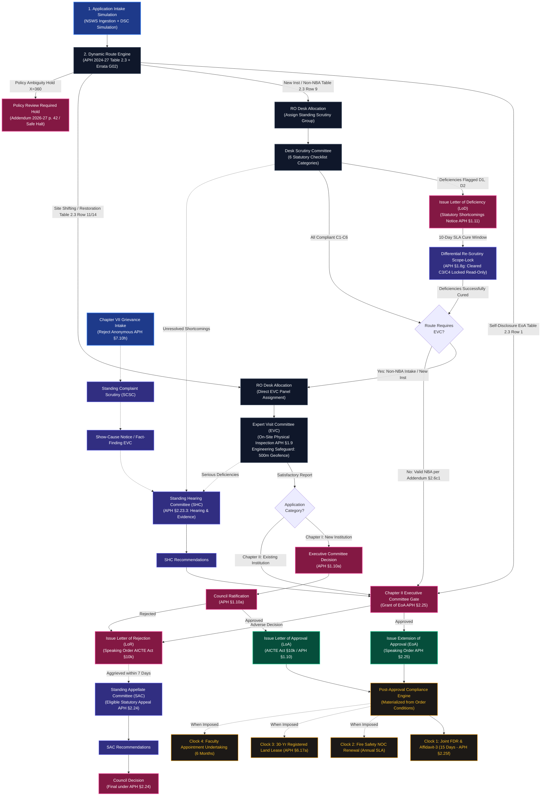

---

## 📊 Modular Statutory Route Diagrams (Diagrams A to J)

For complete transparency, each statutory route family in **APH 2024–27** is modeled in its own focused, readable diagram below. 

> [!NOTE]
> To inspect the exhaustive mapping of every Table 2.3 row (21 categories + Chapter I New Institution) to its respective diagram, test suites, and terminal end states, consult the [Route-to-Diagram Matrix](file:///c:/Users/parth/Documents/SIH-26-AICTE/docs/workflows/ROUTE_TO_DIAGRAM_MATRIX.md).

### Diagram A: Setting up New Technical Institutions (Chapter I)
*Statutory grounding: AICTE Act §10(k), APH 2024–27 Chapter I Clause 1.8–1.10. Mandatory Scrutiny, mandatory physical EVC, Executive Committee and Council ratifications.*

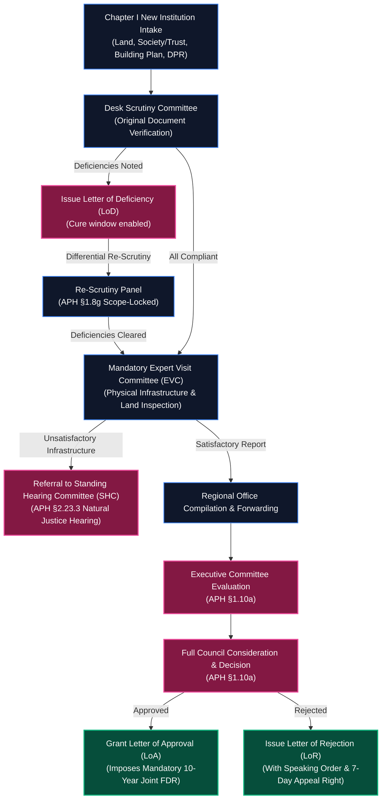

---

### Diagram B: Self-Disclosure Extension of Approval (Chapter II Table 2.3 Row 1)
*Statutory grounding: APH 2024–27 Chapter II Clause 2.4. Zero-touch fast-track route for existing compliant institutions.*

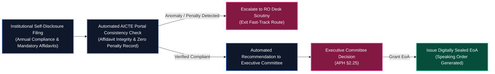

---

### Diagram C: Scrutiny-Only Routes (Table 2.3 Rows 2, 4, 8, 9-NBA, 10, 12, 15, 16, 17, 18, 19, 20)
*Statutory grounding: NBA Fast-Track Intake Increases (Addendum §2.6(c)(1)), Administrative Changes, Mergers, Closures.*

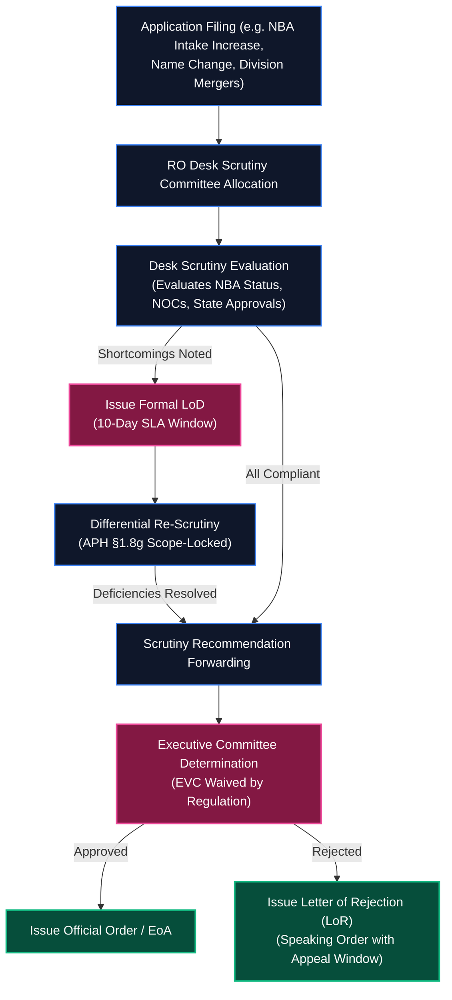

---

### Diagram D: Scrutiny Followed by EVC (Rows 3, 5, 9-Non-NBA, 6, 11, 13, 21)
*Statutory grounding: Non-NBA Intake Increase, New Programmes, Structural Conversions, ODL/Online Approval.*

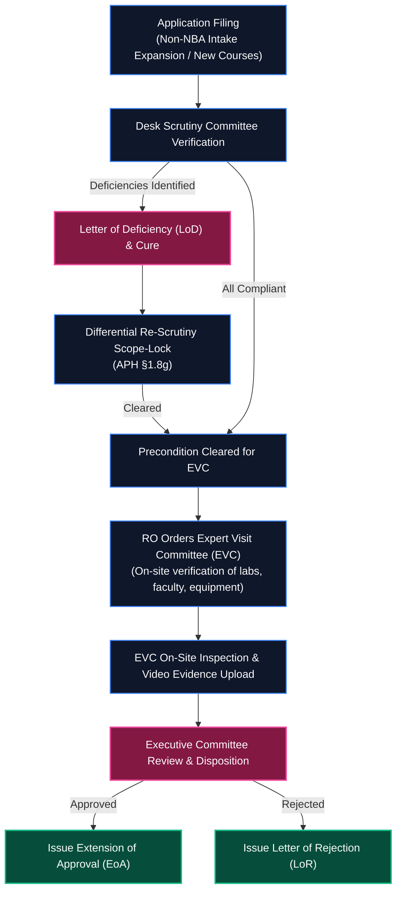

---

### Diagram E: Direct or Category-Specific EVC (Site Shifting Row 14 & Restoration Row 7)
*Statutory grounding: Change of Site / Location (Row 14) and Restoration of Intake after Punitive Action (Row 7).*

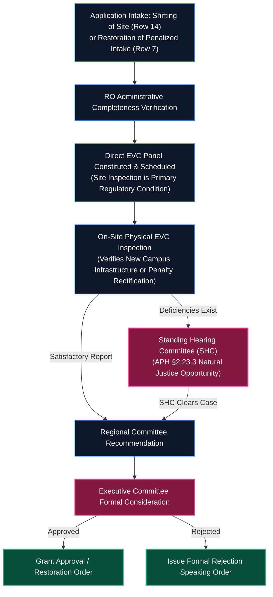

---

### Diagram F: Deficiency & Differential Re-Scrutiny (APH §1.8(g) Scope-Lock)
*Statutory grounding: APH 2024–27 Chapter I Clause 1.8(g). Server-enforced differential scope immutability.*

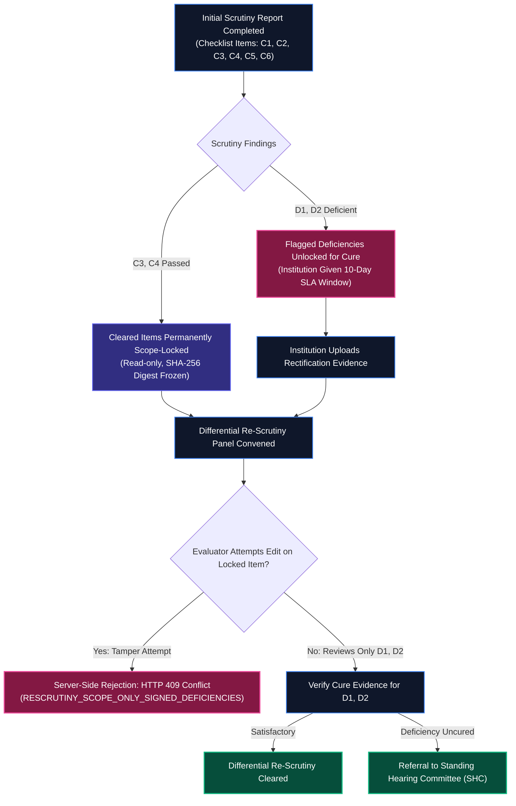

---

### Diagram G: Standing Hearing Committee (SHC) Shortcomings Hearing (APH §2.23.3)
*Statutory grounding: APH 2024–27 Chapter II Clause 2.23.3. Natural justice hearing before adverse determination.*

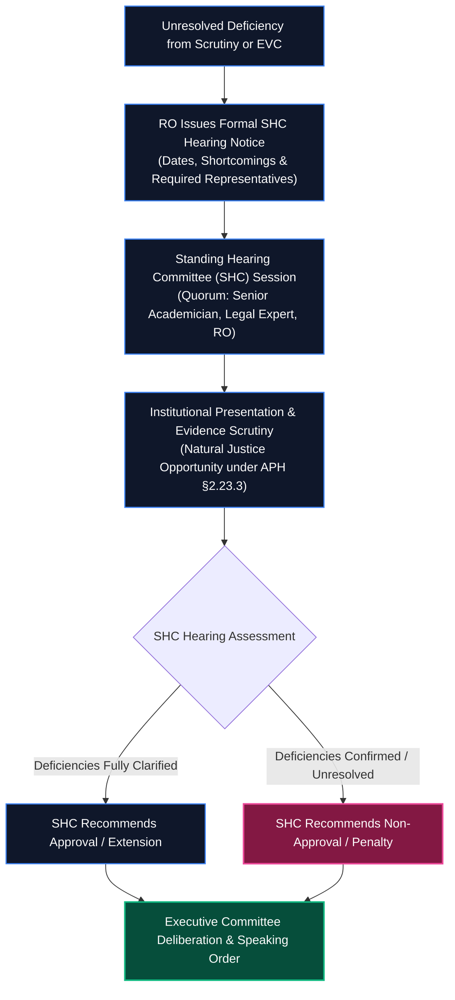

---

### Diagram H: Standing Appellate Committee (SAC) 7-Day Appeal (APH §1.11 / §2.24)
*Statutory grounding: APH 2024–27 Clause 1.11 & 2.24. Time-barred statutory appeal window.*

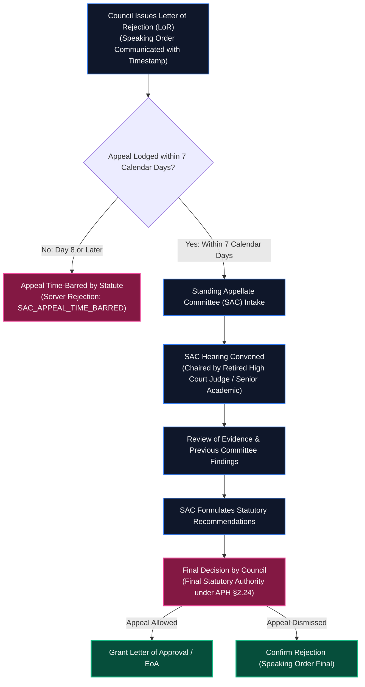

---

### Diagram I: Chapter VII Complaint / Grievance Redressal (APH §7.10)
*Statutory grounding: APH 2024–27 Chapter VII Clause 7.10. Handling of stakeholder complaints with anonymous screening.*

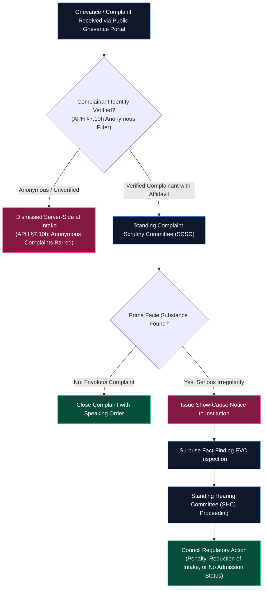

---

### Diagram J: Post-Approval Statutory Compliance (4-Clock Lifecycle)
*Statutory grounding: APH 2024–27 §2.25(f) 15-day Joint FDR, §6.17(a) 30-year lease, annual Fire Safety NOC, faculty ratios.*

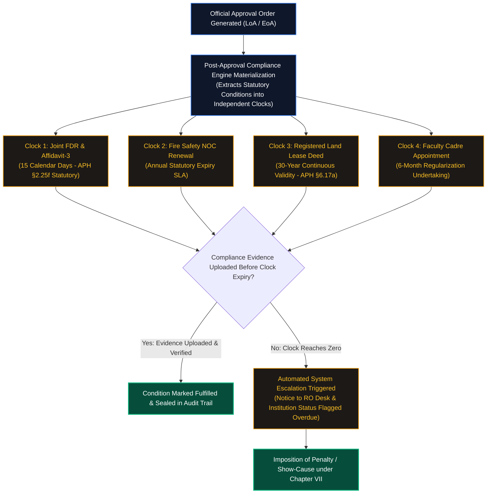

---

## 👥 The 6 Statutory Role Personas & Dedicated Workspaces

All accounts use the built-in demonstration password: **`password123`**

| Role ID | Persona Title | Email Account | Dedicated Workspace Tabs | Jurisdiction Scope | Statutory Guardrails |
|---|---|---|---|---|---|
| `institution` | **College Principal / Trust Signatory** | `principal@coep.ac.in`<br/>`principal@pdimtr.ac.in` | • `1. Applications Docket`<br/>• `2. Intake Simulation`<br/>• `3. Deficiency Response`<br/>• `4. Compliance Tracking` | Scoped to own College ID | **Tenant Isolation**: Cannot view internal deliberations; cannot edit cleared checklist items; cannot access other institutions' cases. |
| `reviewer` | **Desk Scrutiny Committee Expert** | `scrutiny.reviewer@aicte.gov.in` | • `1. Assigned Scrutiny Queue`<br/>• `2. Document Verification`<br/>• `3. Deficiency Defect Logger`<br/>• `4. Scrutiny Findings Sign-off` | Assigned Regional Scrutiny Cases | **Scope-Lock (APH §1.8g)**: Cannot alter previously cleared categories; cannot issue approval orders; edits strictly limited to flagged deficiencies. |
| `evc_expert` | **Expert Visit Committee (EVC) Officer** | `evc.chair@aicte.gov.in` | • `1. Scheduled Inspections`<br/>• `2. Geo-Location & Video Upload`<br/>• `3. Facility Checklist`<br/>• `4. Inspection Report Sign-off` | Assigned Physical Inspection Panels | **Physical Integrity**: Cannot conduct inspection outside simulated 500m geofence; requires verified timestamped inspection video. |
| `ro_officer` | **Regional Office Operations Officer** | `ro.officer@aicte.gov.in` | • `1. Regional Workload Allocation`<br/>• `2. Scrutiny & EVC Task Routing`<br/>• `3. SHC Compliance Hearings`<br/>• `4. Regional Escalations Docket` | Regional Office Jurisdiction | **Workload & Quorum Safeguards**: Cannot assign tasks beyond capacity thresholds; cannot alter committee verdicts; quorum enforced for SHC. |
| `approval_bureau` | **Council Approval Bureau Officer** | `bureau.approval@aicte.gov.in` | • `1. Council Approval Docket`<br/>• `2. Order Drafting & Speaking Orders`<br/>• `3. SAC Appeals & Dispositions`<br/>• `4. Cryptographic Seal & Release` | Council Approval Authority | **Non-Delegable Human Gate**: Only authenticated Bureau/Council officers can execute final LoA/EoA sign-offs; digital seal HMAC-SHA256 locked. |
| `admin` | **AICTE Policy Administrator** | `admin@aicte.gov.in` | • `1. Consolidated Statistics & KPIs`<br/>• `2. Active Rules & Routing Registry`<br/>• `3. Conflict Sandbox & Simulation`<br/>• `4. Cryptographic Audit Log` | Council-Wide National Scope | **Policy Immutability**: All rule edits require versioned rationale and are tracked in an immutable, cryptographically chained audit trail. |

---

## ⏱️ 5-Minute Guided Evaluation Walkthrough

To experience the complete regulatory lifecycle in 5 minutes, follow this guided evaluation path:

```
┌──────────────────────────────────────────────────────────────────────────────────────────────────┐
│                               THE 5-MINUTE GOLDEN EVALUATION PATH                                │
├──────────────────────────────────────────────────────────────────────────────────────────────────┤
│                                                                                                  │
│  STEP 1: Log in as Institution (principal@coep.ac.in)                                            │
│          • View application status for APP-2026-COEP (B.Tech AI & Data Science).                 │
│          • Observe 5 coherent demo notifications tracking intake, routing, scrutiny, and FDR.    │
│          • Observe the explanation banner: High NBA Score (680) waives EVC under Addendum §2.6c1.│
│          • Note: Applicant views are strictly isolated; internal expert notes are hidden.        │
│                                                                                                  │
│  STEP 2: Log in as Desk Reviewer (scrutiny.reviewer@aicte.gov.in)                                │
│          • Open Scrutiny Evaluation for APP-2026-GIITS.                                          │
│          • Witness APH §1.8(g) Differential Scope-Lock: previously cleared items (C3, C4)        │
│            are read-only and locked; only flagged deficiencies can be evaluated.                 │
│                                                                                                  │
│  STEP 3: Log in as EVC Inspection Officer (evc.chair@aicte.gov.in)                               │
│          • Open EVC Inspection for APP-2026-GIITS.                                               │
│          • Verify on-site inspection checklist, geo-coordinates, and geotagged 30-minute video.  │
│          • Submit EVC Report: case advances to decision_pending (no illegal auto-approval).     │
│                                                                                                  │
│  STEP 4: Log in as Approval Bureau Officer (bureau.approval@aicte.gov.in)                        │
│          • Review Council Speaking Order for APP-2026-PDIMTR.                                    │
│          • Generate and digitally seal the Extension of Approval (EoA) PDF.                      │
│          • Inspect the PDF with HMAC-SHA256 seal and non-production demonstration watermark.     │
│          • Navigate to Post-Approval Compliance: observe automatic condition materialization!   │
│                                                                                                  │
│  STEP 5: Log in as Policy Admin (admin@aicte.gov.in)                                             │
│          • Open Consolidated Statistics: inspect 6 KPI cards and 6 analytical charts.            │
│          • Notice the transparent demonstration banner: "Demonstration data — simulated".        │
│          • Open Active Rules & Routing Registry to inspect rules, diffs, and conflict sandbox.   │
│                                                                                                  │
└──────────────────────────────────────────────────────────────────────────────────────────────────┘
```

---

## 🛠️ Technology Stack & Architecture

| Tier | Technologies | Architectural Purpose |
|---|---|---|
| **Frontend UI / UX** | React 19, TypeScript 5.8, TailwindCSS, Lucide Icons, Vite 6 | High-responsiveness reactive workspace with zero flickering and instant tab caching |
| **Backend Core** | Node.js (v20/v22 LTS), Express, RESTful architecture | Stateless REST API service enforcing role permissions, tenancy, and route logic |
| **Persistence Engine** | MongoDB Atlas (Production) + Transactional Memory Engine | Hybrid persistence: write-through commits with zero-downtime memory fallbacks |
| **Performance & Cache** | In-flight request deduplication + Actor-scoped 6-second read cache | Sub-millisecond tab switching (<1ms) and 100% elimination of redundant API calls |
| **Integrity & Security** | SHA-256 evidence digests, HMAC-SHA256 digital seals, HttpOnly cookies | Non-repudiation, role isolation, and tamper-evident audit chaining |
| **Testing & Rigour** | Vitest, Supertest, strict TypeScript type checking | 388 automated tests across 35 suites with 100% pass rate |

---

## ⚡ Quick Start: Run Locally in Under 2 Minutes

The project requires **zero external database setup**. Its built-in transactional memory storage starts instantly out of the box.

### Prerequisites
- **Node.js**: v20 or v22 LTS
- **npm**: v9 or higher

### Commands (Copy & Paste)

```bash
# 1. Clone the repository
git clone https://github.com/Mayuresh-1306/SIH-2026-AICTE.git SIH-26-AICTE
cd SIH-26-AICTE

# 2. Install dependencies
npm install

# 3. Check TypeScript strictness (0 errors)
npx tsc --noEmit

# 4. Run automated test suites (388 tests across 35 files)
npm test

# 5. Build and launch development server
npm run build
npm run dev
```

Open your browser to:  
🌐 **`http://localhost:3000`**

### Live Production Deployment
Try the full application online without installing anything:  
🚀 **`https://niyamsetu-aicte.onrender.com`**

---

## 🧪 Automated Test Suite Summary (388 Tests / 35 Suites)

```
Test Files  35 passed (35)
     Tests  388 passed (388)
  Duration  14.22s (100% pass rate, 0 failed, 0 skipped)
```

- **`tests/acceptance/coep_notifications_verification.test.ts` (3 tests)**: Verifies 5 workflow-grounded COEP notifications with strict institutional tenant isolation and zero cross-tenant leakage.
- **`tests/security/escalation_tenant_isolation.test.ts` (7 tests)**: Proves cross-tenant isolation for escalation dockets and consolidated reports between institutions (COEP vs GIITS).
- **`tests/acceptance/shc_sac_role_separation.test.ts` (5 tests)**: Verifies distinct role-specific workspaces for Regional Office (`3. SHC Hearing`) and Approval Bureau (`3. SAC Appeals & Dispositions`), quorum enforcement, and permission guards.
- **`tests/performance/load_benchmarks.test.ts` (5 tests)**: Validates ultra-low latency benchmarks (NSWS transitions < 35ms, dynamic routing < 10ms, docket loads < 10ms).
- **`tests/production_persistence_idempotency.test.ts` (10 tests)**: Verifies synthetic persistence round-trips, EVC duplicate scheduling rejection, 7-day statutory appeal time-barring, APH §7.10(h) anonymous complaint rejection, and demo-reset protection.
- **`tests/regression_retrofit_all_deliverables.test.ts` (38 tests)**: Verifies all mandatory deliverables end-to-end, including decision preconditions, outcome alignment, HMAC-SHA256 integrity verification, and boundary hold conditions.
- **`tests/policy/routing.test.ts` (37 tests)**: Comprehensive route engine predicate tests across Table 2.3.
- **`tests/decisions/core.test.ts` (34 tests)**: Decision transactions, authority guards, and speaking order verification.
- **`tests/security/auth.test.ts` (18 tests)**: Session authentication, cookie security, RBAC scopes, and login attempt throttling.

---

## 🔍 Simulation Disclosures & Boundary Transparency

To maintain absolute academic and professional integrity for the Smart India Hackathon evaluation:

1. **National Single Window System (NSWS)**: Simulated via a realistic 3-step applicant onboarding wizard (`/api/v1/nsws/prefill`) reflecting official NSWS API field schemas. Does not connect to live production government servers.
2. **Digital Signature Certificate (DSC)**: Simulated via an emBridge Class-3 USB token emulator validating cryptographic thumbprints. Production deployment would bind to the official NIC / eMudhra PKI stack.
3. **EVC Geolocation & Video Upload**: Simulated with simulated GPS coordinate calculation and 30-minute timestamped camera feeds with a 500m geofence validation algorithm.
4. **Outbox Notification Dispatch**: Simulated via an transactional outbox delivering real-time in-app alerts and simulated SMS/Email notices with tenant-isolated recipient dispatch.
5. **Demonstration Watermarks**: All generated Letter of Approval (LoA) and Extension of Approval (EoA) PDFs feature a prominent, non-removable `NON-PRODUCTION PROTOTYPE — SIH 2026 DEMONSTRATION` watermark.

---

## 📚 Authoritative Regulatory Documentation Index

| Specification Document | Path | Key Statutory Topics Covered |
|---|---|---|
| **Route-to-Diagram Matrix** | [`docs/workflows/ROUTE_TO_DIAGRAM_MATRIX.md`](file:///c:/Users/parth/Documents/SIH-26-AICTE/docs/workflows/ROUTE_TO_DIAGRAM_MATRIX.md) | Exhaustive mapping of all 22 Table 2.3 categories to Diagrams A–J & tests |
| **Workflow Architecture Overview** | [`docs/workflows/README.md`](file:///c:/Users/parth/Documents/SIH-26-AICTE/docs/workflows/README.md) | Unified overview of modular regulatory routes and diagram references |
| **Statutory Source Register** | [`docs/regulatory/SOURCE_REGISTER.md`](file:///c:/Users/parth/Documents/SIH-26-AICTE/docs/regulatory/SOURCE_REGISTER.md) | Enumeration of AICTE Act 1987, APH 2024–27, and Addendum Errata G02 |
| **Rule Mapping Matrix** | [`docs/regulatory/RULE_MAPPING_MATRIX.md`](file:///c:/Users/parth/Documents/SIH-26-AICTE/docs/regulatory/RULE_MAPPING_MATRIX.md) | Clause-by-clause mapping of 17 core regulatory rules directly to code |
| **Unverified / Conflicting Rules** | [`docs/regulatory/UNVERIFIED_OR_CONFLICTING_RULES.md`](file:///c:/Users/parth/Documents/SIH-26-AICTE/docs/regulatory/UNVERIFIED_OR_CONFLICTING_RULES.md) | Treatment of ambiguous clauses ($X=360$, ELP 50%, Hibernation holds) |
| **Performance Verification** | [`docs/performance/PERFORMANCE_VERIFICATION.md`](file:///c:/Users/parth/Documents/SIH-26-AICTE/docs/performance/PERFORMANCE_VERIFICATION.md) | Latency benchmarks, request deduplication, and cache invalidation evidence |
| **Problem Statement Matrix** | [`docs/PS_COMPLIANCE_MATRIX.md`](file:///c:/Users/parth/Documents/SIH-26-AICTE/docs/PS_COMPLIANCE_MATRIX.md) | Complete 36-point requirement traceability for SIH Problem Statement 26262 |
| **Chapter I Workflow** | [`docs/workflows/01_chapter_i_new_institution.md`](file:///c:/Users/parth/Documents/SIH-26-AICTE/docs/workflows/01_chapter_i_new_institution.md) | Detailed Chapter I New Technical Institutions workflow specification |
| **Chapter II Self-Disclosure** | [`docs/workflows/02_chapter_ii_self_disclosure_eoa.md`](file:///c:/Users/parth/Documents/SIH-26-AICTE/docs/workflows/02_chapter_ii_self_disclosure_eoa.md) | Table 2.3 Row 1 zero-touch annual renewal route specification |
| **Chapter II Scrutiny & EVC** | [`docs/workflows/03_chapter_ii_scrutiny_and_evc_routes.md`](file:///c:/Users/parth/Documents/SIH-26-AICTE/docs/workflows/03_chapter_ii_scrutiny_and_evc_routes.md) | Intake expansion, NBA fast-track waiver, site shifting, scope-lock safeguard |
| **Standing Hearing Committee** | [`docs/workflows/05_shc_compliance.md`](file:///c:/Users/parth/Documents/SIH-26-AICTE/docs/workflows/05_shc_compliance.md) | Opportunity of hearing under §2.23.3, natural justice, interface partitioning |
| **Standing Appellate Committee** | [`docs/workflows/06_chapter_specific_appeals.md`](file:///c:/Users/parth/Documents/SIH-26-AICTE/docs/workflows/06_chapter_specific_appeals.md) | Standing Appellate Committee under §1.11 / §2.24 with 7-day limit |
| **Post-Approval Compliance** | [`docs/workflows/08_post_approval_compliance.md`](file:///c:/Users/parth/Documents/SIH-26-AICTE/docs/workflows/08_post_approval_compliance.md) | §2.25(f) 15-day Joint FDR, Affidavit-3, 30-day statutory bodies, 4-clock engine |
