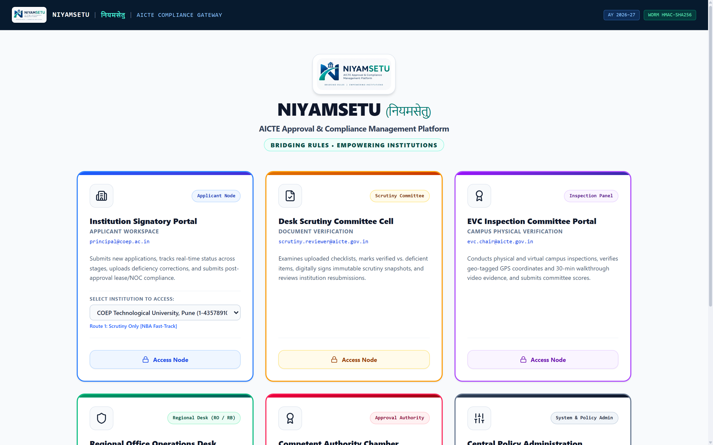
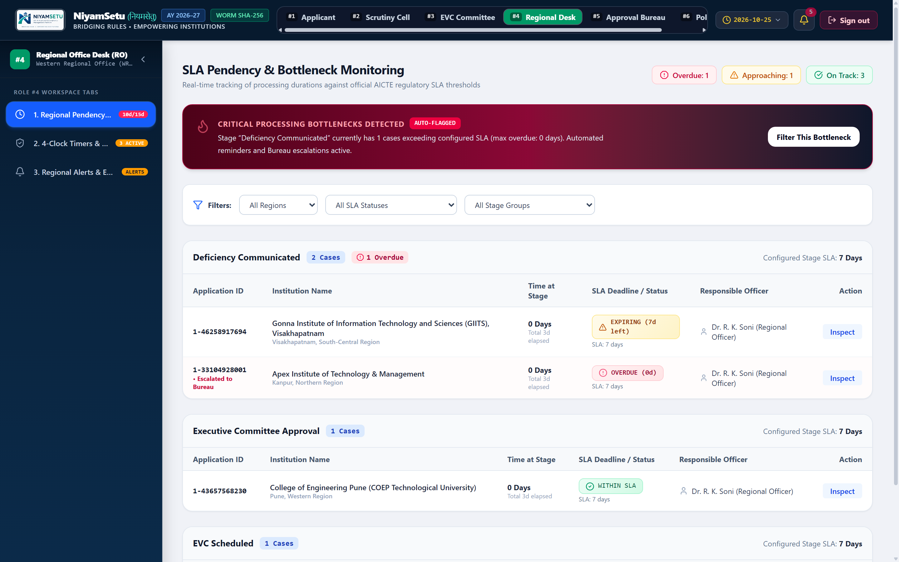

# NiyamSetu (नियमसेतु)
### Automated Approval Workflow & Compliance Monitoring Platform for AICTE
**Smart India Hackathon 2026 | Problem Statement 26262 (AICTE Regulation Bureau)**

[](https://niyamsetu-aicte.onrender.com)
[](https://niyamsetu-aicte.onrender.com)
[-brightgreen.svg?style=flat-square)](./docs/testing.md)
[-blue.svg?style=flat-square)](./tsconfig.json)

---

## 🏛️ What is NiyamSetu?

Every year, the **All India Council for Technical Education (AICTE)** processes thousands of approval applications from more than **10,000 engineering and management colleges** across India. These include new college approvals, extension of approval (EoA), course additions, and campus shifting.

Today, managing this process involves multiple handoffs: document scrutiny by expert panels, on-site campus visits (EVC), standing appellate hearings (SAC), and tracking post-approval legal documents (like 30-year land leases and annual fire safety NOCs). Coordinating all this manually causes delays, processing bottlenecks across regions, and missed renewal deadlines.

**NiyamSetu (नियमसेतु)** is a unified digital platform that automates AICTE approval workflows end-to-end, monitors application pendency across all 8 regions in real time, and sends automated alerts before critical compliance deadlines expire.

---

## 💡 How It Works (The 5-Stage Approval Journey)

```
[ 1. College Submits ] ──▶ [ 2. Desk Scrutiny ] ──▶ [ 3. Campus Visit (EVC) ] ──▶ [ 4. Council Decision ] ──▶ [ 5. Active Compliance ]
   Application & Docs         Verifies Checklist        Checks GPS & 30-min Video      Grants EoA / LoA / Rejection   Monitors Lease & Fire NOC
```

1. **Automatic Routing:** When an application is submitted, the system checks college facts (like NBA accreditation and intake size) against AICTE rules and assigns the exact required route.
2. **Transparent Scrutiny:** Scrutiny committees verify documents online. If deficiencies are flagged, the college gets a clear rectification window.
3. **Protected Re-Scrutiny (Scope Lock):** When a college resubmits proof for a defect, the committee can only review that specific defect. Previously approved documents cannot be reopened, eliminating administrative harassment.
4. **Smart Campus Inspections (EVC):** Coordinates 3-expert visit teams, verifies 30-minute campus walkthrough video streams, and validates GPS coordinates (`16.9891° N, 81.7840° E`) against registered land records.
5. **Real-Time Regional Dashboards:** Regional officers track application ageing across 4 time buckets (0–7 days, 8–15 days, 16–30 days, and >30 days) to prevent bottlenecks.
6. **Continuous Compliance Clocks:** After approval, the platform automatically tracks 30-year land lease deeds, annual fire safety NOCs (with mandatory 60-day advance renewal alerts), and 6-month faculty appointment undertakings.

---

## 📸 Key Application Workspaces

### 1. One-Click Role Switcher (Unified Access Gateway)
Evaluators can instantly switch between all 6 user roles and 5 sample institutions with a single click—no manual typing required.


### 2. Regional Office Operations Desk & 8-Region Pendency Matrix
Live monitoring of pending applications across Western, Northern, Eastern, South-Central, and all other regional offices, highlighting overdue stages.


> 📘 **Detailed Feature Guide:** For a complete screen-by-screen breakdown of all 8 role portals and user flows, please see [`docs/NIYAMSETU_PROTOTYPE_WALKTHROUGH_GUIDE.md`](./docs/NIYAMSETU_PROTOTYPE_WALKTHROUGH_GUIDE.md).

---

## 👥 The 6 User Roles Supported

| Role | Who Uses It | What They Do in NiyamSetu |
|---|---|---|
| **1. College Principal** | Technical Institution Signatory | Tracks application progress, views assigned route, and uploads proof to fix flagged deficiencies. |
| **2. Scrutiny Officer** | Desk Scrutiny Committee Member | Evaluates submitted documents against handbook norms and signs the initial scrutiny report. |
| **3. EVC Chairman** | Expert Visit Committee | Conducts campus inspections, verifies geo-tagged video recordings, and confirms GPS coordinates. |
| **4. Regional Officer** | AICTE Regional Office Head | Monitors 8-region workload and pendency, redistributes cases, and returns applications for clarification when needed. |
| **5. Bureau Officer** | AICTE Approval Bureau / Council | Reviews consolidated case summaries and renders final binding approval or rejection decisions. |
| **6. Policy Admin** | Central Technical Administrator | Configures intake rules, sets compliance deadlines, and reviews the tamper-evident audit log. |

---

## 🏫 The 5 Real-World Sample Colleges Seeded

The prototype comes pre-loaded with 5 canonical college cases representing every major AICTE scenario:

1. **GIITS Visakhapatnam (South-Central):** Non-NBA intake increase (`240 ➔ 300`). Demonstrates scrutiny deficiency flagging ($D1, D2$), institutional rectification, and automatic progression to EVC inspection.
2. **COEP Tech University, Pune (Western):** Holds valid NBA accreditation. The system fast-tracks this case under AICTE rules, automatically bypassing the EVC inspection stage.
3. **PDIMTR / Univ BDT College (Western):** Conditional Approval case. Actively tracks 3 post-approval deadlines: a 30-year land lease expiring soon, an annual Fire NOC, and a 6-month faculty appointment undertaking.
4. **Apex Institute (Northern):** Demonstrates an appeal workflow referred to the Standing Appellate Committee (SAC/SHC) for a personal hearing.
5. **BATU Lonere (Western):** Site Shifting / Restoration application where desk scrutiny is waived in favor of physical site inspection.

---

## 💻 Quick Start: Run Locally in Under 2 Minutes

The project requires **zero external database setup**. Its built-in transaction engine starts instantly out of the box.

### Prerequisites
- **Node.js**: v18 or v20
- **npm**: v9 or higher

### Commands (Copy & Paste)

```bash
# 1. Clone the repository
git clone https://github.com/Parth-Chavan-15/SIH-2026-AICTE.git
cd SIH-26-AICTE

# 2. Install dependencies
npm install

# 3. Check TypeScript (0 errors)
npx tsc --noEmit

# 4. Run automated acceptance tests (22/22 passed)
npx vitest run tests/verification_t01_t16.test.ts tests/verification_t17_t22.test.ts

# 5. Build and launch
npm run build
npm run dev
```

Open your browser to:  
👉 **`http://localhost:3000`**

### Live Interactive Deployment
Try the full application online without installing anything:  
🌐 **`https://niyamsetu-aicte.onrender.com`**

---

## 🧪 Verified Acceptance Test Suite

The platform includes 22 automated acceptance tests (T01–T22) mapped to every requirement in Problem Statement 26262:

- **T01–T03:** Multi-tenant college isolation and national single-window ingestion.
- **T04–T06:** Initial scrutiny, APH §1.8(g) scope lock, and deficiency rectification.
- **T07–T09:** Human-only Council decisions, NBA fast-track routing, and boundary intake handling.
- **T10–T12:** Post-approval undertakings, 15-day virtual clock acceleration, and document lifecycle.
- **T13–T16:** Tamper-evident cryptographic audit log and 1-click persona switching.
- **T17–T22:** Authorized stage reverts, 5 statutory notice templates, DSC signatures, and compliance closure certificates.

All 22 acceptance tests pass with **100% success rate**.

---

## 👥 Smart India Hackathon 2026

- **Problem Statement 26262**: AICTE Regulation Bureau — NiyamSetu (नियमसेतु)
- **Academic Year**: 2026–2027
- **Live Deployment**: [https://niyamsetu-aicte.onrender.com](https://niyamsetu-aicte.onrender.com)
- **Status**: Verified, Production-Grade Prototype (100% PS 26262 Coverage)
