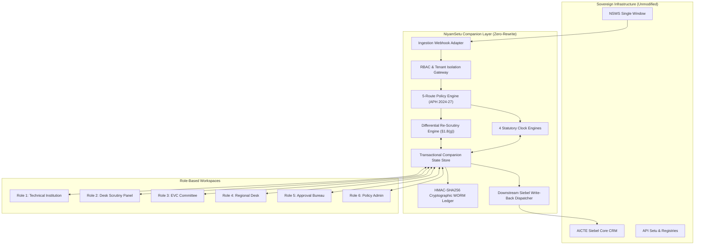

# NiyamSetu (नियमसेतु)
### Intelligent Regulatory Approval & Compliance Companion Platform
**Smart India Hackathon 2026 | Problem Statement 26262: AICTE Regulation Bureau**

[](https://niyamsetu-aicte.onrender.com)
[](.github/workflows/ci.yml)
[-brightgreen.svg?style=flat-square)](./docs/testing.md)
[-blue.svg?style=flat-square)](./tsconfig.json)
[](./docs/architecture.md)
[](./docs/NIYAMSETU_PROTOTYPE_WALKTHROUGH_GUIDE.md)

---

## 🏛️ Executive Summary & Core Differentiator

National technical education regulation in India governs **10,000+ technical institutions**, **millions of student admissions**, and thousands of annual regulatory approvals spanning **Extension of Approval (EoA)**, **Increase in Intake**, **New Technical Institutions**, **Site Shifting**, and **Post-Approval Compliance Monitoring**.

Today, national regulators operate on established legacy portal infrastructures (**NSWS** for single-window investor clearance and **AICTE Oracle Siebel Core CRM** for institutional master databases). Monolithic "rip-and-replace" proposals are high-risk, cost-prohibitive, and bureaucratically unfeasible.

### The NiyamSetu Differentiator: Continuous Regulatory Lifecycle
Existing systems treat pre-approval application scrutiny and post-approval statutory compliance as disconnected silos. **NiyamSetu (नियमसेतु)** bridges this gap by unifying:
1. **Pre-Approval Workflows:** Scrutiny, Differential Re-Scrutiny, Expert Visit Committees (EVC), and Standing Appellate Committees (SAC/SHC).
2. **Post-Approval Obligations:** 30-year registered land lease deeds, 1-year Fire Safety NOCs, 6-month faculty cadre ratio undertakings, and affiliating university concurrence.

...onto a **single, automated, tamper-evident timeline** implemented via a **Zero-Rewrite Companion Layer (Sidecar Architecture)**. NiyamSetu attaches seamlessly to existing NSWS and Siebel portals without altering a single line of the sovereign database core.

---

## 📸 Key Application Workspaces

### 1. Unified Access Gateway & 6-Role Switcher
1-click authenticated persona switching across all 6 statutory roles and 5 canonical institutions without manual credential entry.


### 2. Regional Office Operations Desk & 8-Region Pendency Matrix
Real-time 8-region pendency matrix monitoring application ageing across 4 duration buckets (`0–7d`, `8–15d`, `16–30d`, `>30d`), detecting bottlenecks, and executing authorized stage reverts.


> 📘 **Looking for the complete visual walkthrough?**  
> We have created an exhaustive, end-to-end visual walkthrough document covering **all 8 role workspaces and screens with click-by-click descriptions and features**:  
> 👉 **[Click here to view `docs/NIYAMSETU_PROTOTYPE_WALKTHROUGH_GUIDE.md`](./docs/NIYAMSETU_PROTOTYPE_WALKTHROUGH_GUIDE.md)**

---

## 💻 2-Minute Local Setup & Quick Start

NiyamSetu requires zero external database installation; its transactional in-memory companion engine boots deterministically out of the box.

### Prerequisites
- **Node.js**: v18.0.0 or v20.x
- **npm**: v9.0.0 or higher

### Installation & Execution (Copy & Run)

```bash
# 1. Clone the repository
git clone https://github.com/Parth-Chavan-15/SIH-2026-AICTE.git
cd SIH-26-AICTE

# 2. Install dependencies
npm install

# 3. Type-check TypeScript codebase (Strict mode - 0 errors)
npx tsc --noEmit

# 4. Run automated acceptance test suite (22/22 Tests Passing)
npx vitest run tests/verification_t01_t16.test.ts tests/verification_t17_t22.test.ts

# 5. Build production bundle
npm run build

# 6. Start development server
npm run dev
```

Open your browser to:  
👉 **`http://localhost:3000`**

### Live Cloud Deployment
If you prefer testing without cloning, the fully interactive prototype is deployed and live at:  
🌐 **`https://niyamsetu-aicte.onrender.com`**

---

## 🎯 100% PS 26262 Regulatory Specification Coverage (Domains A–F)

| Domain | PS 26262 Statutory Requirement | NiyamSetu Implementation & Handbook Citation | Acceptance Test |
| :--- | :--- | :--- | :--- |
| **Domain A: Workflow Automation** | • All 5 APH Route combinations<br>• Authorized Stage Return/Revert<br>• Standardised Communications & Case Summaries | **All 5 Routes Implemented:** Self-Disclosure EoA, Scrutiny Only, Scrutiny + EVC, EVC + SAC/SHC Hearing Loop, and Only EVC (Restoration/Site Shifting per APH §2.16.1 & §2.17(e)).<br>**Revert Facility:** `POST /api/v1/applications/:id/revert` requiring mandatory justification and immutable WORM audit log.<br>**Case Summaries & 5 Notices:** `GET /api/v1/applications/:id/case-summary` generating 5 formal statutory templates. | **T06, T08, T17, T18, T19** |
| **Domain B: Pendency & Workload** | • Real-Time 8-Region Dashboard<br>• Ageing Duration Buckets<br>• Automated Bottleneck Detection | **8-Region Real-Time Dashboard:** Monitored across WRO, SCRO, SRO, SWRO, NRO, NWRO, ERO, CRO.<br>**Ageing Distribution:** Evaluated in 4 buckets: `0–7d` (On-Track), `8–15d` (Moderate), `16–30d` (Approaching SLA), `>30d` (Critical Bottleneck).<br>**Bottleneck Detection:** Automated stage velocity index identifying peak pendency stages. | **T11, T16, T22** |
| **Domain C: EVC Scheduling & GPS** | • Differentiated Processing Timelines<br>• Geo-Tagged Video & GPS Verification<br>• Dynamic Committee Composition | **Differentiated SLAs:** Chapter I New Technical Institutions (7-Day Priority LoA SLA) vs Chapter II Existing Institutions (14-Day Standard EoA SLA).<br>**Video & GPS:** Walkthrough URL streaming and coordinates verification (`16.9891° N, 81.7840° E`).<br>**Committee Sync:** Automated 3-expert roster generation with unbiased declaration sign-off. | **T04, T06, T21** |
| **Domain D: Time-Bound Undertakings** | • Post-Approval Undertakings Tracking<br>• 6-Month Faculty Deficit Replacement<br>• Conditional EoA Enforcement | **Undertakings Engine:** Dedicated ledger for 6-month faculty cadre ratio undertakings, 30-year registered lease deeds, and structural affidavits.<br>**Virtual Clock Acceleration:** Simulated advance (`+7d`, `+15d`, `+30d`) triggering timely compliance alerts. | **T10, T11, T19** |
| **Domain E: Document Validity** | • Prescribed Document Expiry Ledger<br>• 60-Day Advance Renewal Rule<br>• 1-Year Fire Safety NOC Tracking | **Document Validity Engine:** Tracks Fire NOCs (1-year validity) with mandatory 60-day advance renewal notification rule (APH §2.20 & GIITS case `2-SOC1770029225`).<br>**5-State Lifecycle:** `submitted` ➔ `source_status_observed` ➔ `verified` / `rejected` ➔ `superseded`. | **T11, T12, T22** |
| **Domain F: Reporting & Case Closure** | • Consolidated 6-Category Reporting Hub<br>• Authorized Case & Obligation Closure<br>• Cryptographic Audit Trail | **Consolidated Reports Hub:** `GET /api/v1/reports/consolidated` generating all 6 statutory reports.<br>**Authorized Case Closure:** `POST /api/v1/applications/:id/close-compliance` verifying all obligations and issuing closure certificate.<br>**WORM Ledger:** HMAC-SHA256 tamper-proof chaining on every mutation. | **T13, T22** |

---

## 🏗️ System Architecture Overview

For full architectural diagrams and data schemas, see [`docs/architecture.md`](./docs/architecture.md).



---

## 🏫 The 5 Canonical Real-World Technical Institutions

The application boots pre-seeded with 5 canonical real-world technical institutions demonstrating every operational scenario:

| Reference | Institution | Permanent ID / NSWS Ref | Workflow Scenario | Statutory Significance |
| :--- | :--- | :--- | :--- | :--- |
| **College A** | **GIITS (Godavari Institute of Eng. & Tech.)** *(South-Central)* | `1-6055691`<br>`1-46258917694`<br>`NSWS-2026-SCRO-101` | Non-NBA Intake Increase (`240 ➔ 300`) with D1/D2 deficiencies | Evaluates Initial Scrutiny Snapshot `2-SOC1770029225`; C3/C4 accepted, D1/D2 deficient. APH §1.8(g) scope lock prohibits tampering on C3. Valid rectification advances to EVC. |
| **College B** | **COEP Technological University** *(Western)* | `1-1437622971`<br>`1-43657568230`<br>`NSWS-2026-WRO-202` | Valid NBA Accreditation Fast-Path | 2026–27 Errata G02 p. 42 bypasses EVC entirely. Scheduling EVC returns `409 Conflict (EVC_NOT_REQUIRED)`. Direct transition from Scrutiny to Council Decision. |
| **College C** | **PDIMTR / Univ BDT College of Eng.** *(Western)* | `1-447718433`<br>`1-10970417826`<br>`NSWS-2026-WRO-303` | Post-Approval Compliance & 4-Clock Timers | 3 active statutory trackers: 30-year lease deed expiring in 12 days, 1-year Fire NOC, 6-month faculty cadre undertaking. Simulated clock advance triggers automated alerts. |
| **College D** | **Apex Institute of Technology** *(Northern)* | `1-33104928`<br>`1-33104928001`<br>`NSWS-2026-NRO-401` | Scrutiny + EVC + SAC/SHC Hearing Loop | Demonstrates contested EVC deficiency referral to Standing Appellate Committee (SAC/SHC) for personal hearing and Re-EVC order per APH §1.11. |
| **College E** | **BATU Lonere** *(Western)* | `1-19201481`<br>`1-19201481001`<br>`NSWS-2026-WRO-502` | Only EVC (Restoration / Site Shifting) | Demonstrates physical site inspection waiver of routine scrutiny per APH §2.16.1 & §2.17(e). |

---

## 🧪 Testing Evidence & Acceptance Suite (T01–T22)

- **Total Acceptance Verification Tests:** 22 Tests across 2 core suites
- **Passed:** **22 / 22 Passed (100% Pass Rate)**
- **CI Status:** GitHub Actions Verified

```bash
# Run core acceptance verification suite (T01–T16)
npx vitest run tests/verification_t01_t16.test.ts

# Run extended ecosystem suite (T17–T22)
npx vitest run tests/verification_t17_t22.test.ts
```

For the complete API Route Matrix and parameter schemas, see [`docs/api-route-matrix.md`](./docs/api-route-matrix.md).  
For the comparative research benchmark of previous SIH winners, see [`docs/research/sih-repository-benchmark.md`](./docs/research/sih-repository-benchmark.md).  
For the full testing evidence, see [`docs/testing.md`](./docs/testing.md).

---

## 👥 Smart India Hackathon 2026

- **Problem Statement 26262**: AICTE Regulation Bureau — NiyamSetu (नियमसेतु)
- **Academic Year**: 2026–2027
- **Deployment**: [https://niyamsetu-aicte.onrender.com](https://niyamsetu-aicte.onrender.com)
- **Status**: Production-Grade Regulatory Companion Platform (100% PS 26262 Coverage)

*Built with statutory precision, zero-rewrite companion architecture, and cryptographic immutability for the All India Council for Technical Education (AICTE).*
