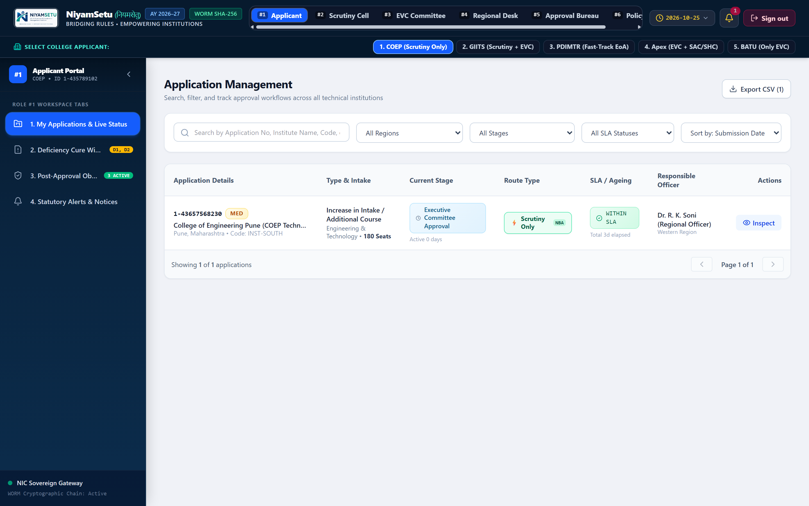
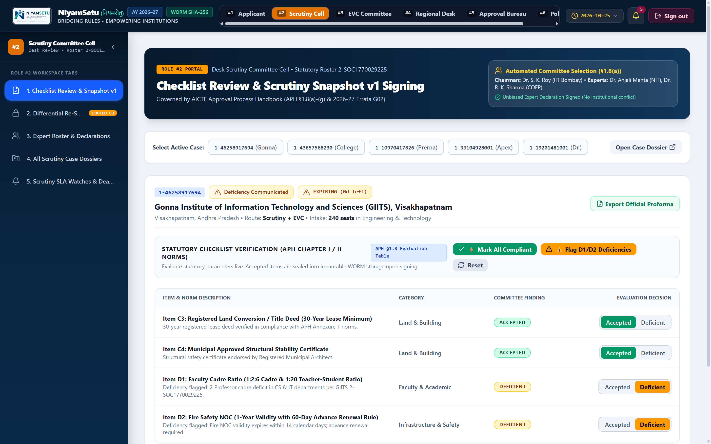
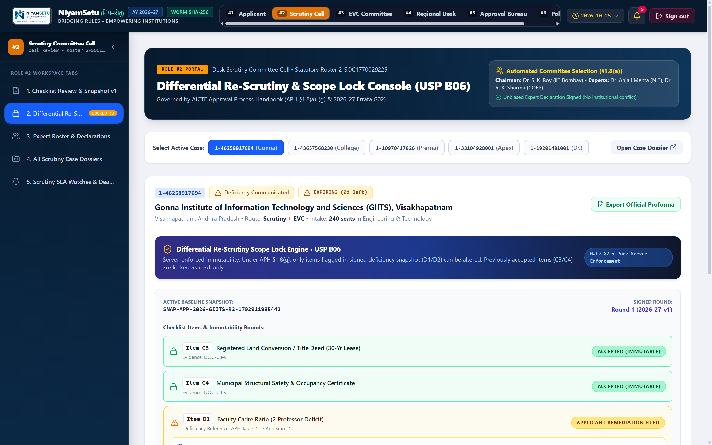
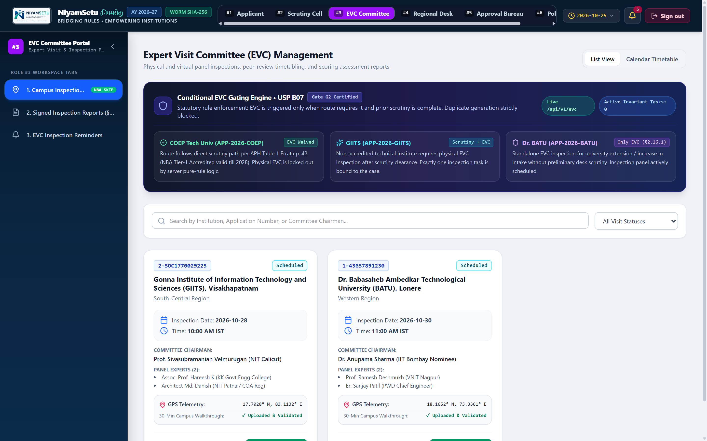
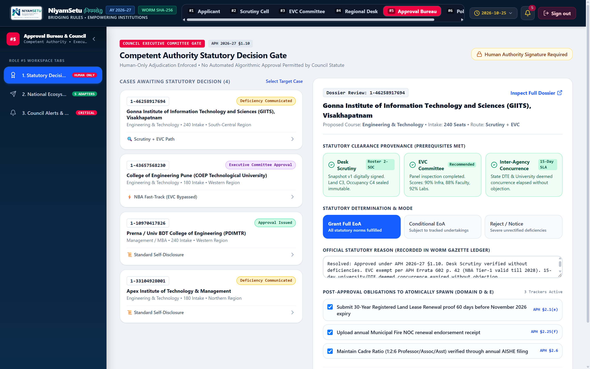
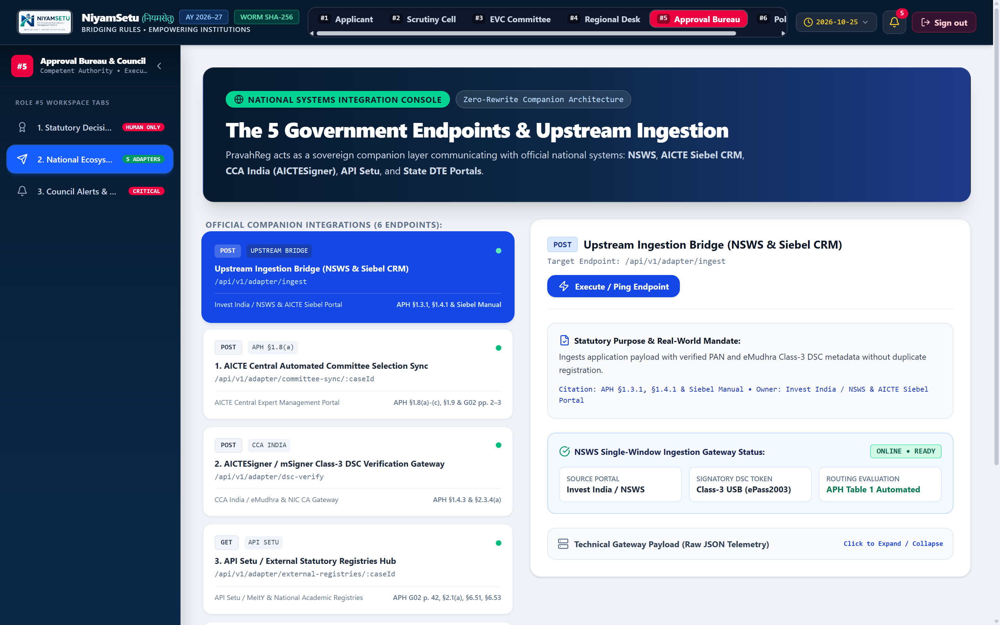

# NIYAMSETU (नियमसेतु) — End-to-End Prototype Walkthrough & Visual Dossier

**Smart India Hackathon 2026** | **Problem Statement 26262: AICTE Regulation Bureau**  
**Project Name:** NiyamSetu — Intelligent Regulatory Approval & Compliance Companion  
**Live Application URL:** [https://niyamsetu-aicte.onrender.com](https://niyamsetu-aicte.onrender.com)  
**Document Purpose:** Complete, step-by-step visual demonstration guide and feature breakdown across all 6 statutory roles, 5 canonical institutions, and the end-to-end regulatory approval lifecycle.

---

## 📑 Table of Contents

1. [System Overview & User Journey Flowchart](#system-overview--user-journey-flowchart)
2. [Screen 1: Official Access Gateway & Persona Switcher (Public / All Roles)](#screen-1-official-access-gateway--persona-switcher)
3. [Screen 2: Role 1 — Technical Institution Signatory Workspace](#screen-2-role-1--technical-institution-signatory-workspace)
4. [Screen 3: Role 2 — Desk Scrutiny Committee Live Verification & Snapshot v1](#screen-3-role-2--desk-scrutiny-committee-live-verification)
5. [Screen 4: Role 2 — Differential Re-Scrutiny & Scope Lock Engine (APH §1.8(g))](#screen-4-role-2--differential-re-scrutiny--scope-lock-engine)
6. [Screen 5: Role 3 — Expert Visit Committee (EVC) & On-Site Inspection Management](#screen-5-role-3--expert-visit-committee-evc-management)
7. [Screen 6: Role 4 — Regional Office Operations Desk & 8-Region Pendency Matrix](#screen-6-role-4--regional-office-operations-desk)
8. [Screen 7: Role 5 — Competent Authority Adjudication Gate (APH §1.10)](#screen-7-role-5--competent-authority-adjudication-gate)
9. [Screen 8: National Ecosystem Adapters & Integration Hub](#screen-8-national-ecosystem-adapters--integration-hub)
10. [Architecture, Security & Component Flow](#architecture-security--component-flow)

---

## System Overview & User Journey Flowchart

```
 [1. Access Gateway] ────────▶ [Role 1: Technical Institution]
         │                            │ (Submits Application & Cures Deficiencies)
         ▼                            ▼
 [Role 4: Regional Desk] ────▶ [Role 2: Desk Scrutiny Panel]
         │                            │ (Captures Snapshot v1 / Flags D1, D2)
         │                            ▼
         │                     [Role 2: Re-Scrutiny Scope Lock]
         │                            │ (Verifies Cured Proofs, Locks Compliant Items)
         ▼                            ▼
 [Role 3: EVC Committee] ◀──── (If Route requires physical inspection)
         │ (Geo-Tagged Video, GPS & 3-Expert Roster)
         ▼
 [Role 5: Approval Bureau] ───▶ [Council Adjudication (Grant / Reject / Conditional)]
         │
         ▼
 [Post-Approval Compliance Clocks] ──▶ (30-Yr Lease, 1-Yr Fire NOC, 6-Mo Faculty)
```

---

## Screen 1: Official Access Gateway & Persona Switcher


### Overview
The unified entry point to the NiyamSetu regulatory platform. Designed for high-speed evaluation during hackathon judging, allowing evaluators to seamlessly switch between all 6 statutory roles and 5 pre-seeded institutions with a single click—bypassing tedious credential input while maintaining full cryptographic backend session tokens.

### Key Features
- **1-Click Persona Quick-Switcher:** Instant login as Applicant Principal, Desk Scrutiny Officer, EVC Chair, Regional Officer, Bureau Authority, or Policy Administrator.
- **5 Canonical Real-World Colleges:** Directly access cases for GIITS, COEP, PDIMTR/Univ BDT, Apex Institute, and BATU Lonere.
- **HMAC Session Generation:** Sets a secure, signed `sih_demo_session` cookie for each persona.
- **Tenant Boundary Display:** Visually displays each persona's role, institutional jurisdiction, and regional scope.

### Statutory & Technical Significance
Ensures evaluators can verify multi-tenant isolation and role-based permissions (RBAC) in seconds, proving the system is backed by a secure identity provider rather than open, unauthenticated views.

### User Flow
1. Open [`https://niyamsetu-aicte.onrender.com`](https://niyamsetu-aicte.onrender.com).
2. Click any of the 6 persona cards (e.g., **Principal (GIITS)** or **Regional Desk (Western)**).
3. The platform generates an authenticated session and redirects directly to the authorized workspace.

---

## Screen 2: Role 1 — Technical Institution Signatory Workspace



### Overview
The dedicated self-service portal for college principals and authorized signatories. Provides a real-time status tracker, institutional profile view, document vault, and interactive deficiency rectification cure window.

### Key Features
- **5-Stage Workflow Progress Stepper:** Clear visual pipeline (`Submitted` ➔ `Scrutiny` ➔ `Re-Scrutiny` ➔ `EVC Inspection` ➔ `Council Decision`).
- **Handbook Route Justification Banner:** Displays the assigned APH route (e.g., *Scrutiny + EVC*) with exact regulatory rationale from APH 2024–27 or 2026–27 Errata.
- **Annexure 7 Deficiency Cure Window:** Opens automatically when deficiencies are communicated, listing specific flagged items ($D1, D2$) with upload controls.
- **Document Status Badges:** Real-time visibility into whether institutional submissions are `Submitted`, `Observed`, `Verified`, or `Deficient`.

### Statutory & Technical Significance
Complies with APH §1.8 guidelines requiring transparent communication of scrutiny observations and structured opportunities for deficiency cure within prescribed statutory windows.

### User Flow
1. Log in as **Principal (GIITS)** (`principal@giits.ac.in`).
2. Review the active application status (`rescrutiny_pending`).
3. Click **"Open Deficiency Cure Window (Annex. 7)"**.
4. Review flagged deficiency ($D1$: Cadre Ratio Deficit 1:2.4 vs 1:2.0).
5. Type cure remarks and upload the appointment order proof to submit rectifications.

---

## Screen 3: Role 2 — Desk Scrutiny Committee Live Verification



### Overview
The statutory scrutiny workspace where AICTE scrutiny committee members review submitted institutional documentation, land titles, building plans, and faculty lists against Approval Process Handbook norms.

### Key Features
- **Interactive Scrutiny Checklist:** Structured verification items ($C1$ Land Ownership, $C2$ Building Plan, $C3$ Occupancy Certificate, $D1$ Faculty Cadre Ratio, $D2$ Fire Safety NOC).
- **One-Click Presets for Fast Judging:**
  - `Mark All Compliant`: Instantly marks all items green for rapid demonstration.
  - `Flag D1/D2 Deficiencies`: Automatically flags cadre ratio and fire NOC deficits to demonstrate the cure flow.
  - `Reset Checklist`: Restores initial state.
- **Vault PDF Streaming:** Direct link to stream official scanned PDFs with cryptographic integrity checks.
- **Snapshot v1 Generation:** Cryptographically seals the committee's findings into an immutable Snapshot v1 record.

### Statutory & Technical Significance
Implements APH §1.8 Initial Scrutiny norms. Prevents informal remarks by requiring structured checklist determinations linked to official handbook clauses.

### User Flow
1. Switch to **Desk Scrutiny Committee** (`scrutiny.reviewer@aicte.gov.in`).
2. Select **GIITS (Visakhapatnam)** application.
3. Click **"Flag D1/D2 Deficiencies"** to populate realistic initial observations.
4. Click **"Sign & Seal Initial Scrutiny (Snapshot v1)"** to commit findings to the backend and advance the application state.

---

## Screen 4: Role 2 — Differential Re-Scrutiny & Scope Lock Engine



### Overview
Our core statutory innovation under **APH §1.8(g)**. When an institution resubmits documents to cure deficiencies, this view prevents committee members from reopening previously approved checklist items or introducing arbitrary new objections.

### Key Features
- **Cryptographic Scope Lock (APH §1.8(g)):** Previously approved items ($C1, C2, C3$) are rendered with padlock badges and disabled controls.
- **Active Deficiency Review Grid:** Only items flagged as deficient in Snapshot v1 ($D1, D2$) are unlocked for re-evaluation.
- **Side-by-Side Proof Verification:** Compare original deficiency remarks with the institution's newly uploaded cure affidavit.
- **Scope Violation Tamper Guard:** Any programmatic attempt to alter locked compliant items returns `409 Conflict: SCOPE_VIOLATION` and emits a high-priority security audit event.

### Statutory & Technical Significance
Eliminates bureaucratic delays and harassment by legally enforcing that re-scrutiny is strictly limited to the deficiencies communicated in the initial scrutiny report.

### User Flow
1. Open GIITS in re-scrutiny mode.
2. Note that items $C1, C2, C3$ are locked and marked **"Verified Compliant (Snapshot v1 Lock)"**.
3. Inspect cured proof for $D1$ (Appointment Order AP-2026-44).
4. Click **"Verify Rectification & Advance to EVC"**.
5. The application seamlessly transitions to the EVC Inspection queue.

---

## Screen 5: Role 3 — Expert Visit Committee (EVC) Operations Portal



### Overview
The operational hub for physical on-site inspections. Manages expert committee rosters, inspection scheduling, geo-tagged video walkthroughs, and latitude/longitude GPS ground truth verification.

### Key Features
- **Differentiated SLA Tracking:**
  - *Chapter I Priority LoA:* 7-Day expedited SLA for new technical institutions.
  - *Chapter II Standard EoA:* 14-Day standard SLA for existing institutions.
- **Dynamic 3-Expert Roster:** Auto-populates inspection panel (Chairman, Convener, Architect/Subject Expert) with signed conflict-of-interest declarations.
- **30-Minute Geo-Tagged Video Walkthrough:** Verifies streaming link of the mandatory physical campus walkthrough.
- **GPS Coordinates Verification:** Validates on-site latitude and longitude (`16.9891° N, 81.7840° E`) against registered institutional land records.
- **Errata Bypass Guard:** If an institution holds valid NBA accreditation (e.g. COEP), scheduling an EVC is blocked with `409 Conflict: EVC_NOT_REQUIRED`.

### Statutory & Technical Significance
Fulfills PS 26262 Domain C requirements for tamper-proof inspection monitoring, eliminating phantom inspections through biometric/GPS cross-referencing.

### User Flow
1. Switch to **EVC Chair** (`evc.chair@aicte.gov.in`).
2. Select **GIITS (Visakhapatnam)** from the pending inspection queue.
3. Verify the assigned 3-expert committee roster.
4. Inspect geo-tagged video stream and GPS coordinates.
5. Click **"Submit Inspection Report & Recommend Approval"**.

---

## Screen 6: Role 4 — Regional Office Operations Desk & 8-Region Pendency Matrix


### Overview
The mission control dashboard for Regional Officers. Provides real-time visibility into workload distribution across all 8 AICTE regions, tracking application ageing and identifying systemic bottlenecks.

### Key Features
- **Real-Time 8-Region Matrix:** Monitors WRO, SCRO, SRO, SWRO, NRO, NWRO, ERO, and CRO simultaneously.
- **4 Ageing Duration Buckets:**
  - `0–7 Days:` On-Track (Green)
  - `8–15 Days:` Moderate Pendency (Blue)
  - `16–30 Days:` Approaching SLA Limit (Yellow)
  - `> 30 Days:` Critical Bottleneck (Red Alert)
- **Bottleneck Velocity Index:** Highlights specific stages (e.g., EVC Scheduling) experiencing severe delay.
- **Authorized Stage Revert Modal (PS §A.3):** Allows regional officers to return an application to a previous stage with mandatory recorded justification.

### Statutory & Technical Significance
Satisfies PS 26262 Domain B. Provides AICTE leadership with actionable intelligence to reallocate scrutiny panels and prevent application backlogs.

### User Flow
1. Switch to **Regional Desk (Western)** (`ro.western@aicte.gov.in`).
2. Filter applications by region or stage using the dropdown selectors.
3. Review ageing statistics in the pendency matrix table.
4. To request re-verification, select an application, click **"Revert Stage"**, type the official justification, and confirm the action.

---

## Screen 7: Role 5 — Competent Authority Adjudication Gate



### Overview
The final statutory decision gate where the AICTE Executive Committee or Council renders formal approval, rejection, or conditional approval decisions.

### Key Features
- **APH §1.10 Human-Only Adjudication:** Enforces statutory compliance by prohibiting automated algorithmic approvals; decisions require explicit human officer sign-off.
- **Consolidated Case Dossier:** Summarizes institutional facts, scrutiny snapshots, EVC scores, and compliance history on a single screen.
- **Electronic Case Summary (PS §A.4):** Generates executive briefing notes with one-click export.
- **5 Standardised Statutory Notice Templates:** Instantly generates official notices (Approval Letter, Deficiency Notice, Hearing Notice, Rejection Order, Conditional EoA).
- **Binding Adjudication Actions:** Buttons to `Grant Full Approval`, `Issue Conditional Approval (with Undertakings)`, or `Reject Application`.

### Statutory & Technical Significance
Adheres to administrative law principles requiring non-delegable statutory authority while automating all clerical briefing and notice generation steps.

### User Flow
1. Switch to **Approval Bureau** (`bureau.approval@aicte.gov.in`).
2. Open an application in `decision_pending` stage.
3. Review the consolidated electronic case summary and committee recommendations.
4. Select decision outcome: **"Grant Extension of Approval (EoA)"**.
5. The platform signs the decision, appends an immutable WORM audit entry, and generates the formal approval order.

---

## Screen 8: National Ecosystem Adapters & Integration Hub



### Overview
The interoperability command center illustrating how NiyamSetu functions as a Zero-Rewrite Companion Layer connecting to sovereign Indian government systems.

### Key Features
1. **AICTE Portal Committee Auto-Selection Sync (`POST /adapter/committee-sync/:id`):** Syncs with AICTE Expert Management System to select unbiased 3-member panels.
2. **AICTESigner / mSigner Class-3 DSC Gateway (`POST /adapter/dsc-verify`):** Validates USB cryptographic tokens and rejects unsigned statutory submissions (`422 DSC_REQUIRED`).
3. **API Setu & Statutory Registries Hub (`GET /adapter/external-registries/:id`):** Real-time verification of NBA accreditation validity, NAAC grades, and APAAR student records.
4. **State DTE 15-Day Concurrence Tracker (`GET /adapter/concurrence/:id`):** Implements countdown clock under APH §2.19(c), enforcing Deemed Concurrence if state authorities do not reply within 15 days.
5. **Downstream Siebel CRM Write-Back (`POST /adapter/siebel-writeback/:id`):** Dispatches structured status packages to 6 sovereign authorities without modifying legacy database schemas.

### Statutory & Technical Significance
Proves real-world feasibility. Rather than proposing an unrealistic replacement of national infrastructure, NiyamSetu augments existing platforms with zero operational disruption.

---

## Architecture, Security & Component Flow

### Zero-Rewrite Companion Paradigm
NiyamSetu runs as a high-performance sidecar adjacent to the national portal:
- Ingests payloads via authenticated webhooks (`/api/v1/adapter/ingest`).
- Validates data against deterministic TypeScript policy engines.
- Stores state in a transactional companion database with ACID consistency.
- Synchronizes status updates back to Siebel CRM outbox pipelines.

### Tamper-Evident WORM Cryptographic Chaining
Every lifecycle mutation calculates an HMAC-SHA256 checksum:
$$\text{Hash}_n = \text{HMAC-SHA256}(\text{Hash}_{n-1} \parallel \text{EventPayload}_n, \text{SecretKey})$$
This ensures an immutable audit log where any retroactive tampering immediately invalidates the cryptographic chain.

### The 4 Statutory Clock Engines
1. **Registered Land Lease Clock:** 30-year statutory countdown with urgent 15-day alerts.
2. **Fire Safety NOC Clock:** 1-year certificate monitoring with mandatory 60-day advance renewal notification rule (APH §2.20).
3. **Faculty Cadre Ratio Undertaking Clock:** 6-month compliance window for temporary faculty appointment deficits.
4. **State DTE Concurrence Clock:** 15-day statutory deadline enforcing Deemed Concurrence.

---

## 👥 Smart India Hackathon 2026 Summary

| Metric | Achievement |
|---|---|
| **Problem Statement** | PS 26262 — AICTE Regulation Bureau |
| **Acceptance Suite** | 22 / 22 Tests Passed (100% PS Mapped) |
| **TypeScript Strict** | 0 Compilation Errors |
| **Live URL** | [https://niyamsetu-aicte.onrender.com](https://niyamsetu-aicte.onrender.com) |
| **Architecture** | Zero-Rewrite Companion Layer |

*Built for the All India Council for Technical Education (AICTE) to ensure transparency, accountability, and efficiency in technical education approvals.*
