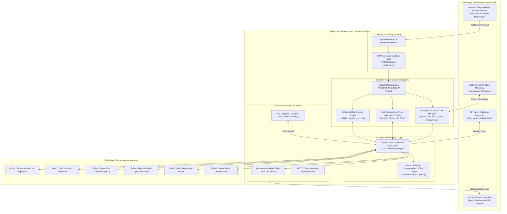
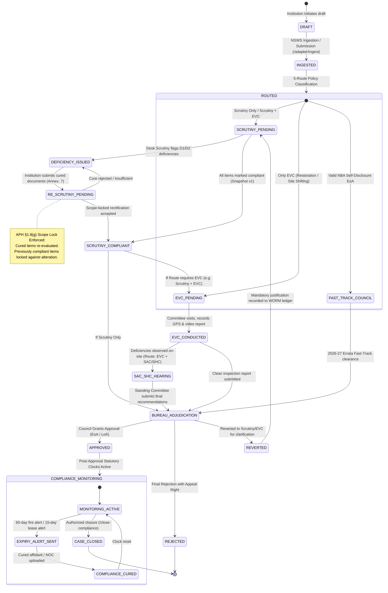
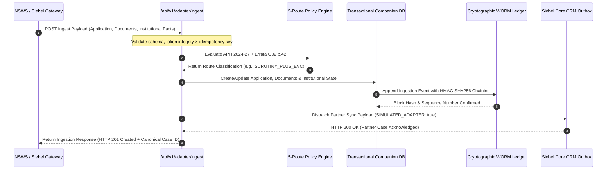

# NiyamSetu (नियमसेतु) — Architecture & Technical Design Specification

**Platform:** AICTE Regulatory Approval & Compliance Companion Layer  
**Problem Statement:** Smart India Hackathon 2026 | PS 26262 (AICTE Regulation Bureau)  
**Applicable Statutes:** AICTE Approval Process Handbook (APH 2024–27) & APH 2026–27 Errata (G02 p. 42)

---

## 1. Architectural Paradigm: The Zero-Rewrite Companion Layer

National regulatory platforms in India (such as **NSWS** for National Single Window System and **Oracle Siebel Core CRM** for institutional master databases) manage millions of records across 10,000+ technical institutions. Monolithic replacements of such sovereign systems face immense bureaucratic, logistical, and technical hurdles.

**NiyamSetu** solves this fundamental engineering challenge through a **Zero-Rewrite Companion Layer (Sidecar Architecture)**. Rather than displacing existing core databases, NiyamSetu operates as an intelligent high-throughput intermediary that:
1. **Ingests** structured application payloads from NSWS and Siebel via standard webhook adapters (`/api/v1/adapter/ingest`).
2. **Executes** deterministic statutory validation rules, dynamic 5-route classification, and time-bound compliance tracking.
3. **Synchronizes** approvals, status updates, deficiency notices, and inspection schedules back into the master system via bi-directional write-back pipelines (`/api/v1/adapter/siebel-writeback`).

---

## 2. End-to-End Application Lifecycle State Machine

The approval lifecycle enforces rigorous statutory transitions. Transitions between stages require authorized role signatures, cryptographic audit logging, and automated deficiency locks.

---

## 3. Ingestion & Adapter Sequence Flow

When an institution applies via the national single window (NSWS) or Siebel CRM, NiyamSetu handles the payload synchronously while decoupling audit persistence and partner notification.

---

## 4. Entity-Relationship Data Model

The data architecture provides strong relational integrity and strict typing across technical education entities, scrutiny snapshots, inspection records, and statutory compliance trackers.

```mermaid
erDiagram
    APPLICATION ||--o{ DOCUMENT : "contains prescribed"
    APPLICATION ||--|| INSTITUTIONAL_FACT : "defines factual metrics"
    APPLICATION ||--o{ SCRUTINY_SNAPSHOT : "evaluated under"
    APPLICATION ||--o{ EVC_INSPECTION : "scheduled for"
    APPLICATION ||--o{ COMPLIANCE_OBLIGATION : "governed by"
    APPLICATION ||--o{ AUDIT_EVENT : "chronicles"
    
    APPLICATION {
        string id PK "Canonical App ID (e.g., APP-2026-001)"
        string instituteName "Institution Name"
        string permanentId "AICTE Permanent ID (1-XXXXXXXX)"
        string nswsRefNumber "NSWS Tracking Reference"
        string applicationType "EoA | New_Inst | Intake_Increase"
        string currentStage "INGESTED | SCRUTINY | EVC | BUREAU"
        string routeClassification "SCRUTINY_ONLY | SCRUTINY_EVC | etc."
        string status "PENDING | APPROVED | REJECTED | REVERTED"
        string assignedRegion "WRO | SCRO | SRO | CRO | etc."
        timestamp createdAt "Submission Timestamp"
        timestamp updatedAt "Last Stage Transition Time"
    }

    INSTITUTIONAL_FACT {
        string id PK
        string applicationId FK
        int currentIntake "Current Approved Intake"
        int requestedIntake "Proposed Sanctioned Intake"
        boolean hasNbaAccreditation "NBA Validity Flag"
        string nbaExpiryDate "Accreditation Expiry"
        float studentFacultyRatio "Cadre Ratio (e.g. 1:15)"
        float builtUpAreaSqM "Total Approved Built-up Area"
        boolean hasAutonomousStatus "UGC Autonomous Flag"
    }

    DOCUMENT {
        string id PK
        string applicationId FK
        string documentType "LAND_LEASE | FIRE_NOC | OCCUPANCY | AFFIDAVIT"
        string documentName "File Label"
        string vaultUrl "PDF Stream Endpoint"
        string lifecycleState "submitted | observed | verified | rejected"
        string sha256Digest "Cryptographic File Checksum"
        date validityEndDate "Statutory Expiration Date"
    }

    SCRUTINY_SNAPSHOT {
        string id PK
        string applicationId FK
        int snapshotVersion "v1 (Initial) | v2 (Re-Scrutiny)"
        string scrutinyOfficerId "Officer Identifier"
        json checklistDecisions "Map of Checklist Item IDs to COMPLIANT | DEFICIENT"
        json deficiencyRemarks "Deficiency Justifications"
        boolean isScopeLocked "APH §1.8(g) Immutable Lock Flag"
        timestamp snapshotTimestamp
    }

    EVC_INSPECTION {
        string id PK
        string applicationId FK
        string inspectionType "CHAPTER_I (7d SLA) | CHAPTER_II (14d SLA)"
        string scheduledDate "Inspection Date"
        string committeeRoster "Chairman, Convener, Subject Expert"
        string videoWalkthroughUrl "30-min Geo-Tagged Walkthrough Link"
        string gpsCoordinates "Latitude, Longitude (e.g. 16.9891 N, 81.7840 E)"
        string overallRecommendation "RECOMMENDED | NOT_RECOMMENDED"
    }

    COMPLIANCE_OBLIGATION {
        string id PK
        string applicationId FK
        string obligationType "CADRE_RATIO | FIRE_NOC | LEASE_RENEWAL"
        string description "Obligation Summary"
        int prescribedWindowDays "Window (e.g. 180 days for faculty)"
        date deadlineDate "Statutory Expiry Deadline"
        string status "ACTIVE | WARNING_SENT | CURED | BREACHED | CLOSED"
        string cureProofDocId "Document ID of Proof"
    }

    AUDIT_EVENT {
        string id PK
        string applicationId FK
        string actorRole "PRINCIPAL | RO | EVC_CHAIR | BUREAU"
        string actionType "INGEST | STAGE_MOVE | REVERT | SCOPE_LOCK"
        string previousState "Old Status/Stage"
        string newState "New Status/Stage"
        string details "Explanatory Details"
        string prevBlockHash "HMAC Chained Hash"
        string blockHash "Current Block HMAC-SHA256"
        timestamp timestamp "WORM Immutable Timestamp"
    }
```

---

## 5. Core Statutory Subsystems

### 5.1 The Dynamic Route Determination Engine & Table 2.3 Matrix
Evaluates institute facts against the **AICTE Approval Process Handbook (APH 2024–27 Table 2.3)** and **APH 2026–27 Errata (p. 42, G02)** across all 21 statutory categories (preserving category `AA`):
1. **Self-Disclosure Fast-Track EoA (Table 2.3 Row 1):** High-performing institutions with unexpired NBA accreditation and clean compliance records bypass Scrutiny and EVC committees directly to Executive Committee Adjudication (`docs/workflows/02_chapter_ii_self_disclosure_eoa.md`).
2. **Scrutiny Only (Table 2.3 Rows 2, 4, 13, 14, 15):** Routine Extension of Approval (EoA), Change in Name, Reduction in Intake, and Closure applications without infrastructure expansion.
3. **Scrutiny + EVC (Table 2.3 Rows 3, 5, 6, 7, 8, 9, 10, 12, 16):** Non-NBA intake expansion, New Programmes, Extended Campus, or composite infrastructure changes requiring physical or online inspection.
4. **Direct Physical EVC (Table 2.3 Row 11):** Punitive restoration or land/site shifting applications per APH §2.16.1 & §2.17(e) where preliminary desk scrutiny is waived in lieu of mandatory physical site inspection.
5. **Decoupled Governance Branches:**
   - **Standing Hearing Committee (SHC):** Natural justice hearings under §2.23.3 for persistent shortcomings (`docs/workflows/05_shc_compliance.md`).
   - **Standing Appellate Committee (SAC):** Strict 7-calendar-day statute of limitations under §1.11 & §2.24 (`docs/workflows/06_chapter_specific_appeals.md`).
   - **Chapter VII Inquiries:** Penal route triggered by non-anonymous verified complaints (`docs/workflows/07_chapter_vii_complaints.md`).

*For full route specifications, see the 9 modular workflow documents in `docs/workflows/` and the exhaustive 21-category matrix in `docs/workflows/04_chapter_ii_route_matrix.md`.*

### 5.2 Differential Re-Scrutiny & Scope Lock Engine (APH §1.8(g))
Under statutory clause APH §1.8(g), when an institution submits rectifications for flagged deficiencies during a re-scrutiny session:
- The Re-Scrutiny Committee is **legally restricted to verifying only the previously flagged deficient items**.
- All items verified as compliant in Snapshot v1 are **cryptographically locked**.
- Attempting to revoke compliance or introduce new arbitrary deficiencies on previously cleared items returns `HTTP 409 Conflict: SCOPE_VIOLATION` with an immutable audit event.

### 5.3 Deterministic Multi-Clock Engine (Statutory vs Operational Separation)
NIYAMSETU strictly disambiguates pre-approval and post-approval timelines:
1. **Appellate Clock (7 Calendar Days - Statutory):** Strict statute of limitations for preferring an appeal before SAC against rejection speaking orders under APH §1.11 / §2.24.
2. **Deficiency Turnaround Clock (10 Days - Operational SLA):** Internal operational turnaround SLA for institutions to re-upload rectified evidence under Annexure 7 deficiency intimation.
3. **Security Deposit & Affidavit-3 Clock (15 Calendar Days - Statutory):** Post-approval timeline under APH §2.25(f) for submitting Joint FDR and Affidavit-3 in the name of the AICTE Regional Officer and Society/Trust.
4. **State DTE / Affiliating University Concurrence Clock (15 Calendar Days - Statutory):** Countdown under APH §2.19(c), enforcing deemed concurrence upon expiry.
5. **Post-Approval Obligation Clocks:** 30-day statutory committees notifications (SGRC, ICC, Anti-Ragging), 1-year Fire NOC 60-day advance renewal notification alerts (APH §2.20), and 30-year registered land lease deed countdowns (`docs/workflows/08_post_approval_compliance.md`).

### 5.4 Tamper-Evident WORM Cryptographic Audit Ledger
Every state transition, committee observation, stage revert, and cure submission appends an immutable block to the WORM ledger. Each block calculates an HMAC-SHA256 hash using the previous block's hash as salt:
$$\text{BlockHash}_n = \text{HMAC-SHA256}(\text{BlockHash}_{n-1} \parallel \text{Payload}_n, \text{SecretKey})$$
Any retroactive modification of in-memory logs or database records breaks the cryptographic chain, surfacing immediate tampering alerts.

---

## 6. Security, RBAC & Multi-Tenant Isolation

1. **Role-Based Access Control (RBAC):** Strictly enforces 6 distinct personas:
   - `PRINCIPAL` (Role 1): Institutional signatory, restricted exclusively to own institution's cases.
   - `SCRUTINY_OFFICER` (Role 2): Verifies checklists, signs Snapshot v1, and executes scope-locked re-scrutiny.
   - `EVC_CHAIR` (Role 3): Conducts on-site inspections, verifies GPS coordinates, scores infrastructure.
   - `REGIONAL_OFFICER` (Role 4): Monitors 8-region pendency, manages workload distribution, executes stage reverts.
   - `BUREAU_OFFICER` (Role 5): Final competent authority decision gate; human-only adjudication per APH §1.10.
   - `ADMIN` (Role 6): Configures statutory rules and inspects cryptographic WORM ledger.
2. **Tenant Isolation Shield:** Enforced at the gateway middleware layer. Requests to `/api/v1/applications/:id` verify that the authenticated principal's institutional Permanent ID matches the target application. Unauthorized access returns `HTTP 403 Forbidden` and emits a high-priority security audit event.
3. **Statutory Non-Repudiation:** Supported via Class-3 Digital Signature Certificate (DSC) verification (`/api/v1/adapter/dsc-verify`), enforcing USB e-token cryptographic validation on all statutory submissions.
