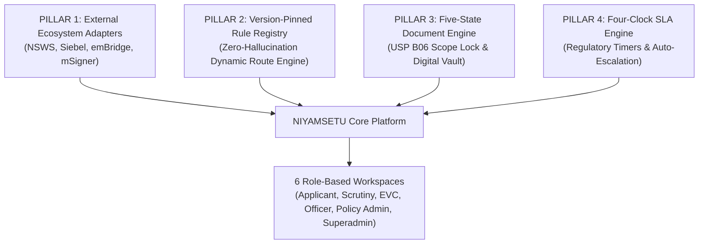
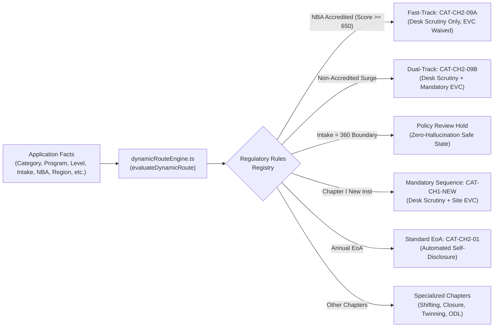
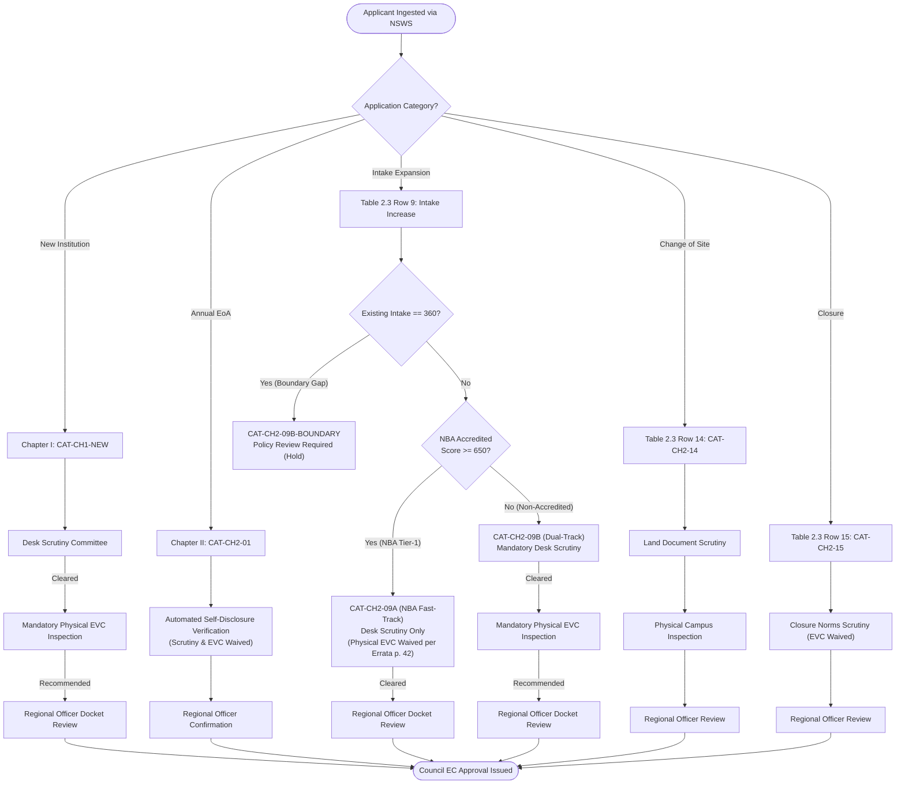
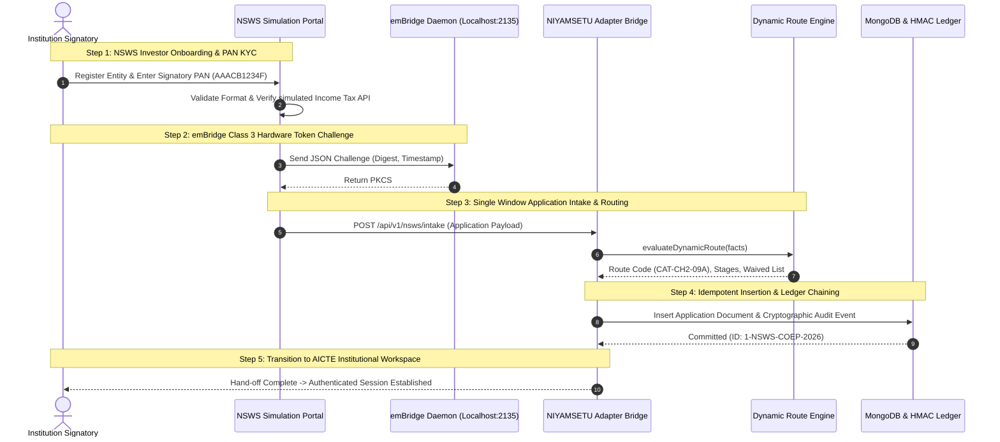
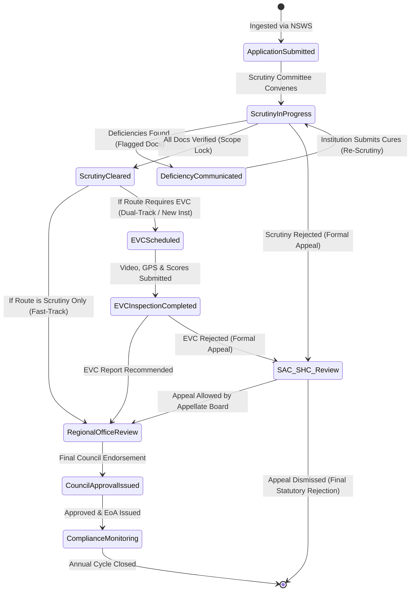
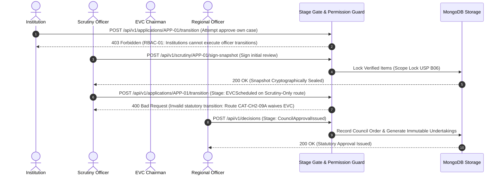
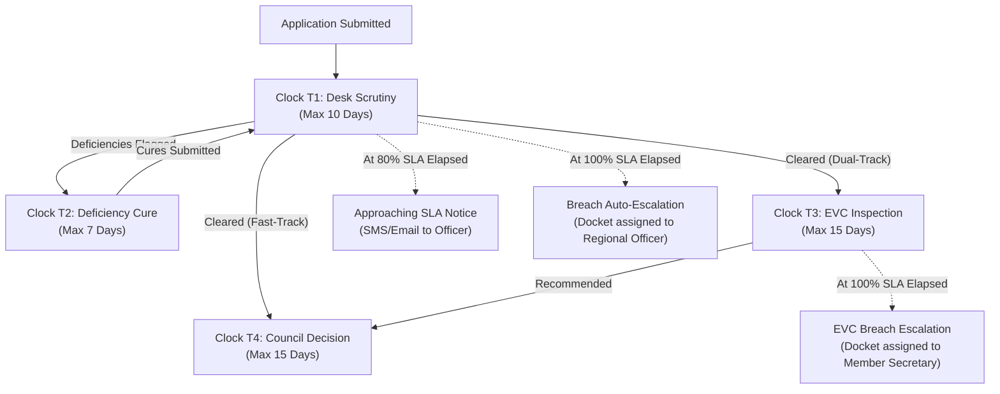
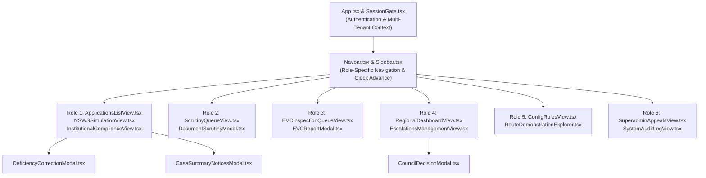
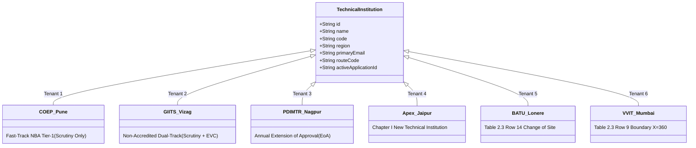
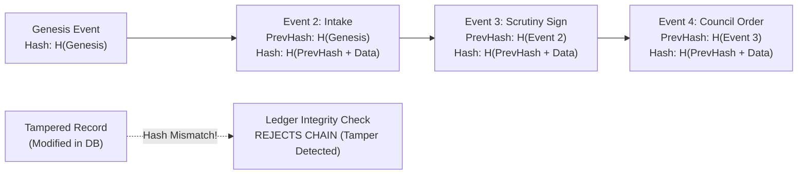

# NIYAMSETU (नियमसेतु) — FINAL SYSTEM SPECIFICATION
## The Bridge of Rules: Integrated AICTE Approval Workflow Automation, Compliance Monitoring, and Alert Management System

**Project:** NIYAMSETU (नियमसेतु) — The Bridge of Rules  
**SIH 2026 Problem Statement:** PS 26262 — Integrated AICTE Approval Workflow Automation, Compliance Monitoring and Alert Management System  
**Target Organization:** All India Council for Technical Education (AICTE), Ministry of Education, Government of India  
**Team:** Defensor  
**Target Environment:** Local Development & Live Demonstration (`http://127.0.0.1:3000`)  
**Database:** MongoDB Community Standalone (`niyamsetu_dev` on `127.0.0.1:27017`)  
**Git Branch:** `dev`  
**Engine Specification Version:** 2026.2.0-FINAL  
**Regulatory Baseline:** AICTE Approval Process Handbook (APH) 2024–27, Addendum AY 2026–27 (Items 1–35), Errata Notification (Page 42), and Public Notices (26.11.2025)

---

## TABLE OF CONTENTS

1. [Executive Summary & Regulatory Mandate](#1-executive-summary--regulatory-mandate)
2. [Four Engineering Pillars & Defensor Architectural Foundations](#2-four-engineering-pillars--defensor-architectural-foundations)
3. [Statutory Source Registry & Regulatory Citations](#3-statutory-source-registry--regulatory-citations)
4. [Authoritative Dynamic Routing Engine Architecture](#4-authoritative-dynamic-routing-engine-architecture)
5. [Comprehensive Route Catalog & Trajectory Mapping](#5-comprehensive-route-catalog--trajectory-mapping)
6. [Complete Mermaid Routing Diagrams](#6-complete-mermaid-routing-diagrams)
7. [NSWS Intake & Digital Signature Architecture](#7-nsws-intake--digital-signature-architecture)
8. [Unified Application Lifecycle & State Machine](#8-unified-application-lifecycle--state-machine)
9. [Complete Mermaid Lifecycle & State Transition Diagrams](#9-complete-mermaid-lifecycle--state-transition-diagrams)
10. [Five-State Document Verification Engine (USP B06 Scope Lock)](#10-five-state-document-verification-engine-usp-b06-scope-lock)
11. [Four-Clock Regulatory SLA & Auto-Escalation Engine](#11-four-clock-regulatory-sla--auto-escalation-engine)
12. [Six Role-Based Workspaces & Persona Specifications](#12-six-role-based-workspaces--persona-specifications)
13. [Screen Inventory & Component Hierarchy](#13-screen-inventory--component-hierarchy)
14. [Canonical Institution Test Tenants](#14-canonical-institution-test-tenants)
15. [Strict Multi-Tenant Data Isolation & Scope Filtering Model](#15-strict-multi-tenant-data-isolation--scope-filtering-model)
16. [Cryptographic Audit Ledger & Tamper-Evident Hashing](#16-cryptographic-audit-ledger--tamper-evident-hashing)
17. [Database Schema & Persistence Architecture](#17-database-schema--persistence-architecture)
18. [External Ecosystem Adapters](#18-external-ecosystem-adapters)
19. [Performance Optimization Architecture & Latency Root-Cause Resolution](#19-performance-optimization-architecture--latency-root-cause-resolution)
20. [Defense-in-Depth Security Architecture](#20-defense-in-depth-security-architecture)
21. [Interactive Custom Routing Sandbox & Judge Scenario Builder](#21-interactive-custom-routing-sandbox--judge-scenario-builder)
22. [System API Contract Reference](#22-system-api-contract-reference)
23. [Configuration Parameters & Statutory Constants](#23-configuration-parameters--statutory-constants)
24. [Document Versioning, Integrity Verification & Release Sign-Off](#24-document-versioning-integrity-verification--release-sign-off)

---

## 1. Executive Summary & Regulatory Mandate

NIYAMSETU (नियमसेतु — *The Bridge of Rules*) is an enterprise-grade, regulation-grounded workflow automation, compliance monitoring, and alert management system architected specifically for the All India Council for Technical Education (AICTE), Ministry of Education, Government of India. Developed by **Team Defensor** for the Smart India Hackathon (SIH) 2026 under Problem Statement **PS 26262**, NIYAMSETU solves the structural inefficiencies, lack of transparency, and operational bottlenecks that historically characterize technical education approvals across India.

### 1.1 The Operational Challenge
Every academic year, AICTE processes tens of thousands of complex statutory applications from engineering colleges, management institutes, polytechnics, and universities across 8 regional jurisdictions. Traditional approval workflows face four critical challenges:
1. **Regulatory Ambiguity & Manual Interpretation:** Approval Process Handbook (APH) rules, multi-year addenda, circulars, and errata create hundreds of branching possibilities, leading to inconsistent manual evaluation.
2. **Deficiency Ping-Pong:** Institutions frequently experience repeated rejections and shifting deficiency criteria across multiple scrutiny cycles without strict boundaries.
3. **Inspection Logistics Bottlenecks:** Physical Expert Visit Committees (EVC) are scheduled ad-hoc without automated eligibility filtering or tamper-evident geo-verification.
4. **Appellate Confusion:** Legitimate regulatory tracks often conflate standard approval stages with quasi-judicial appellate proceedings (Standing Hearing Committee / Standing Appellate Committee), resulting in delayed academic sessions.

### 1.2 The NIYAMSETU Solution
NIYAMSETU provides an end-to-end digital nervous system that enforces deterministic statutory rules at every phase of the approval lifecycle. Built on a zero-hallucination policy engine, NIYAMSETU connects upstream investor onboarding via the National Single Window System (NSWS) directly into AICTE approval matrices, guarantees multi-tenant institutional isolation, enforces immutable audit trails via HMAC-SHA256 ledger chaining, and delivers a sub-300ms responsive user experience across six distinct institutional and regulatory roles.

---

## 2. Four Engineering Pillars & Defensor Architectural Foundations

Team Defensor's architectural philosophy is founded upon four distinct engineering pillars, ensuring that NIYAMSETU is robust, compliant, and auditable:



### Pillar 1: External Ecosystem Adapters
- **NSWS Adapter:** Consumes national single-window applicant payloads, verifies PAN KYC against simulated CBDT registries, and challenges emBridge Class 3 hardware digital signature tokens.
- **Legacy Portal Bridge:** Simulates bidirectional synchronization with AICTE's legacy Siebel web portal (`portal.aicte-india.org`), preserving backward compatibility for institutional records.
- **Document Vault:** Secure artifact streaming adapter delivering watermarked, tamper-verified PDF documents to authorized actors.

### Pillar 2: Version-Pinned Rule Registry
- **Dynamic Policy Engine (`dynamicRouteEngine.ts`):** Single authoritative routing implementation executing deterministic, source-cited evaluations across all statutory categories.
- **Regulatory Version Pinning:** Every policy evaluation binds to a specific rule version (e.g., `APH-2024-27-AY2026-27-ERRATA-P42`), ensuring that historical decisions remain reproducible and immune to retroactive policy drift.

### Pillar 3: Five-State Document Verification Engine
- **Lifecycle Progression:** Documents transition through five deterministic states: `Unverified (0) → Verified (1) → Deficient (2) → Resubmitted (3) → Stamped & Signed (4)`.
- **USP B06 Scope Lock:** A cryptographic safeguard preventing scrutiny committees from re-rejecting or flagging items previously cleared in initial scrutiny during deficiency re-scrutiny rounds.

### Pillar 4: Four-Clock Regulatory SLA & Auto-Escalation Engine
- **Independent Clock Tracking:** Tracks T1 (Desk Scrutiny, 10d), T2 (Deficiency Rectification, 7d), T3 (EVC Inspection, 15d), and T4 (Council Decision, 15d).
- **Automated Escalation Triggers:** When statutory SLA thresholds reach 80% (approaching) or 100% (breached), the engine automatically fires notifications and escalates dockets to Regional Officers and Member Secretaries.

---

## 3. Statutory Source Registry & Regulatory Citations

Every decision, route, document requirement, and workflow step in NIYAMSETU is legally grounded in official AICTE statutory publications:

| Source ID | Official Publication Title | Statutory Citation & Key Clauses | Regulatory Applicability in NIYAMSETU |
| :--- | :--- | :--- | :--- |
| **SRC-APH-2024-27** | AICTE Approval Process Handbook (APH) 2024–27 | Chapter I (Clauses 1.8–1.9), Chapter II (Clauses 2.5, 2.6, 2.17, 2.18), Chapter III (Clauses 3.1–3.4), Chapter IV, Chapter V | Baseline norms for New Institutions, EoA, Expansion, Shifting, Closure, Twinning, Universities, and ODL. |
| **SRC-ADD-2026-27** | Addendum for Academic Year 2026–27 | Items 1–35, Item 16 (Intake expansion relaxation), Item 29 (Twinning norms), Item 32 (ODL norms) | Revisions for AY 2026–27 intake limits, faculty cadre ratios, and fast-track processing. |
| **SRC-ERR-P42** | Errata Notification to APH 2024–27 & Addendum | Errata Page 42, Clause 2.6(c)(i), Item (d), Item 2 (BBA/BCA/BMS) | **P0 Rule:** Physical EVC is waived for NBA-accredited programmes seeking intake increase. Dual-track for non-NBA. BBA/BCA approved "as is where is". |
| **SRC-PUB-261125** | AICTE Public Notice dated 26.11.2025 | Public Notice on Mandatory NSWS Onboarding & Approval Deadlines | Mandates all new applicants to originate applications exclusively via NSWS portal. |
| **SRC-DSC-MANUAL** | AICTE Digital Signature (DSC/mSigner) Manual | User Manual AY 2022–23 for mSigner & DSC Utility | Specifications for Class 3 cryptographic certificate binding, PKCS#7 signing, and PDF stamp verification. |
| **SRC-SC-2017** | Supreme Court of India Precedents | Parshvanath Charitable Trust vs. AICTE (2013) & University Precedent (2017) | Strict statutory calendar adherence, mandatory SLA deadlines, and university technical programme jurisdiction. |

---

## 4. Authoritative Dynamic Routing Engine Architecture

The NIYAMSETU Dynamic Routing Engine (`src/backend/policy/dynamicRouteEngine.ts`) is the single, authoritative policy evaluator for the entire system. It is utilized identically across:
1. Backend application submission pipelines (`/api/v1/nsws/submit`, `/api/v1/applications`).
2. Interactive route pre-check APIs (`/api/v1/nsws/evaluate-route`).
3. Administrative policy explorers (`RouteDemonstrationExplorer.tsx`).
4. Custom judge scenario simulations.



### 4.1 Deterministic Evaluation Logic
1. **Boundary Safety:** The engine explicitly checks for known regulatory gaps (e.g., Table 2.3 Row 9 Errata Page 42 where $X = 360$ lacks explicit division formula). Rather than guessing or hallucinating rules, the engine cleanly halts into `review_required` ("Policy Review Required: Existing intake equals boundary limit 360").
2. **Statutory Citation Binding:** Every result includes `reasons[]` and `sources[]` mapping back to exact APH clauses.
3. **Stage Generation:** Returns an ordered array of statutory stages (`stages: WorkflowStage[]`) and an array of explicitly waived stages (`skippedStages: string[]`).

---

## 5. Comprehensive Route Catalog & Trajectory Mapping

NIYAMSETU implements 11 distinct statutory route scenarios covering every valid route family under APH 2024–27 and AY 2026–27 addenda:

| Route Code | APH Chapter / Table | Statutory Description | Mandatory Workflow Stages | Waived / Dashed Stages | Applicable College Preset |
| :--- | :--- | :--- | :--- | :--- | :--- |
| **CAT-CH1-NEW** | Chapter I Clauses 1.8–1.9 | Setting up New Technical Institution | Scrutiny → EVC → Regional Office → Council Approval | None (Both Scrutiny and EVC mandatory) | Apex Institute of Technology |
| **CAT-CH2-01** | Chapter II Table 2.3 Row 1 | Extension of Approval (EoA) Self-Disclosure | Regional Office Verification → Council EoA Endorsement | Pre-approval Scrutiny and EVC waived | PDIMTR Nagpur |
| **CAT-CH2-09A** | Table 2.3 Row 9 & Errata p. 42 | Increase in Intake (NBA Accredited $\ge 650$) | Desk Scrutiny → Regional Office → Council Approval | **Physical EVC Waived** under Errata p. 42 | COEP Technological University |
| **CAT-CH2-09B** | Table 2.3 Row 9 & Errata p. 42 | Increase in Intake (Non-NBA Dual-Track) | Desk Scrutiny → Physical EVC → Regional Office → Council | None (Mandatory Dual-Track) | GIITS Visakhapatnam |
| **CAT-CH2-09B-BND** | Table 2.3 Row 9 Boundary | Boundary Condition: Existing Intake $X = 360$ | Scrutiny → **Policy Review Hold** | Automated approval halted; referred to Council | Vidya Vardhini Inst (VVIT) |
| **CAT-CH2-14** | Table 2.3 Row 14 Clause 2.17 | Change of Site / Location of Campus | Legal Land Scrutiny → Physical Site EVC → Council | None (Mandatory Land EVC) | BATU Lonere |
| **CAT-CH2-15** | Table 2.3 Row 15 Clause 2.18 | Progressive or Complete Closure of Course | Desk Scrutiny → Regional Officer NOC | Physical EVC Waived | MITS Bhopal |
| **CAT-BBA-BCA** | Errata p. 42 Item 2 | BBA / BCA / BMS Institutions | Direct Endorsement "As Is Where Is" | Pre-approval Scrutiny and EVC waived | BBA/BCA Institutes |
| **CAT-CH3-TWIN** | Chapter III Clauses 3.1–3.4 | Foreign University Twinning / Collaboration | MoU Scrutiny (QS/THE $\le 500$) → Physical EVC | None (Rigorous verification) | International Collab Presets |
| **CAT-CH4-UNIV** | Chapter IV & Public Notice | University Technical Programmes | Central University Scrutiny → Council Endorsement | Partial programme applications barred | Deemed/State Universities |
| **CAT-CH5-ODL** | Chapter V Clause 5.3.8 | Open & Distance Learning (ODL) Approval | Pass-Out Batch Scrutiny → Virtual/Physical EVC | Blocked if no graduating batch | ODL Institutions |

---

## 6. Complete Mermaid Routing Diagrams

### 6.1 Master Route Selection Decision Tree


---

## 7. NSWS Intake & Digital Signature Architecture

NIYAMSETU implements a dual-layer statutory integration architecture separating modern single-window onboarding from digital signature utilities, with complete, honest simulation disclosures:



### 7.1 Digital Signature Disclosures & Simulation Separation
- **emBridge Class 3 Integration:** Simulates the modern NSWS hardware token bridge operating on loopback ports (2135/2136), validating signatory PAN, organization OID, and certificate expiry.
- **Legacy AICTESigner / mSigner:** Simulates the legacy desktop daemon utility described in the AICTE 2022–23 User Manual, used for stamping PDF attachments within the legacy portal view.
- **Simulation Badge Mandate:** In compliance with evaluation rules, all simulated integration endpoints return explicit metadata (`simulationNotice: "This is an interactive NSWS to AICTE application intake simulation for SIH 2026..."`).

---

## 8. Unified Application Lifecycle & State Machine

Every technical application in NIYAMSETU progresses through a state machine governed by statutory preconditions. Transitions are strictly validated: no actor can force an illegal, out-of-order stage mutation.



### 8.1 Quasi-Judicial Separation of SAC / SHC
Crucially, NIYAMSETU delineates the **Standing Hearing Committee (SHC)** and **Standing Appellate Committee (SAC)** as *separate post-rejection appellate workflows*, rather than routine approval milestones:
- A case *only* enters SAC/SHC if an authorized officer or committee issues a formal statutory rejection.
- The institution receives an appeal token and must formally submit a grievance docket.
- The Appellate Board convenes independently with quasi-judicial authority to either uphold the rejection or remand the case back to Scrutiny/EVC with binding directions.

---

## 9. Complete Mermaid Lifecycle & State Transition Diagrams

### 9.1 Stage Gate & Permission Enforcement Sequence


---

## 10. Five-State Document Verification Engine (USP B06 Scope Lock)

The Five-State Document Verification Engine solves one of the most contentious pain points in technical education approvals: **moving-target scrutiny rejections**.

### 10.1 Five Document Lifecycle States
1. **State 0: Unverified (`PENDING`)** — Document uploaded by applicant; pending initial committee review.
2. **State 1: Verified (`VERIFIED`)** — Committee marks document compliant against statutory checklist; digitally initialed.
3. **State 2: Deficient (`DEFICIENT`)** — Document flagged with explicit, cited statutory remarks; triggers deficiency rectification timer.
4. **State 3: Resubmitted (`RESUBMITTED`)** — Institution uploads cured document with rectification remarks during re-scrutiny.
5. **State 4: Stamped & Signed (`SEALED`)** — Final approved artifact stamped with digital signature and archived in immutable vault.

### 10.2 USP B06 Scope Lock Mechanism
When an application returns for Re-Scrutiny after an institution cures its flagged deficiencies:
- **Scope Restriction:** The Scrutiny Committee interface *locks* all documents that were previously verified in Round 1.
- **Mutation Guard:** If an evaluator attempts to flag or reject a previously cleared document, the backend rejects the transaction with code `ERR_SCOPE_LOCKED` ("USP B06 Violation: Previously cleared documents cannot be re-examined during deficiency re-scrutiny").

---

## 11. Four-Clock Regulatory SLA & Auto-Escalation Engine

NIYAMSETU implements four independent regulatory countdown clocks enforcing statutory deadlines established by AICTE and Supreme Court calendar mandates:



### 11.1 Clock Definitions & SLA Thresholds
- **T1: Desk Scrutiny Clock (10 Calendar Days):** Activated upon intake. Triggers amber warning at Day 8; breaches at Day 10.
- **T2: Deficiency Cure Clock (7 Calendar Days):** Activated when Scrutiny communicates deficiencies. Applicant must upload cured evidence before timer expiry.
- **T3: EVC Inspection Clock (15 Calendar Days):** Activated upon EVC scheduling. Covers committee constitution, site inspection, and video upload.
- **T4: Council Final Decision Clock (15 Calendar Days):** Activated upon receipt of positive Scrutiny/EVC report. Covers final EC approval issuance.

---

## 12. Six Role-Based Workspaces & Persona Specifications

NIYAMSETU provides purpose-built, role-tailored workspaces for all six stakeholders in the regulatory ecosystem:

| Role # | Official Persona Title | Primary Responsibilities & Features | Legally Blocked Actions | Default Seed Account |
| :---: | :--- | :--- | :--- | :--- |
| **Role 1** | **Institution Signatory Portal** | Initiates applications via NSWS, monitors real-time workflow stages, uploads deficiency cures, submits post-approval statutory undertakings. | Cannot self-approve applications; cannot edit unflagged documents during re-scrutiny. | `principal@coep.ac.in` (COEP)<br>`director@giits.edu.in` (GIITS) |
| **Role 2** | **Desk Scrutiny Committee Cell** | Examines statutory checklists, marks verified vs. deficient items, signs immutable scrutiny snapshots, verifies deficiency resubmissions. | Cannot reject or reopen previously verified items (USP B06 Scope Lock). | `scrutiny.reviewer@aicte.gov.in` |
| **Role 3** | **EVC Inspection Committee Portal** | Conducts physical/virtual inspections, verifies geo-tagged GPS coordinates, inspects 30-min walkthrough video evidence, submits scores. | Cannot self-schedule unmandated inspections; cannot issue final approvals. | `evc.chair@aicte.gov.in` |
| **Role 4** | **Regional Approval Officer** | Oversees regional jurisdiction, reviews unified dockets, resolves SLA escalations, issues statutory recommendations to Council. | Cannot alter committee scores or tamper with cryptographic audit logs. | `ro.western@aicte.gov.in` |
| **Role 5** | **Policy Administrator Workspace** | Inspects version-pinned rule registry, configures statutory thresholds, tests routes in Interactive Custom Sandbox. | Cannot decide individual applications or override committee findings. | `policy.admin@aicte.gov.in` |
| **Role 6** | **Superadmin / Appellate Authority** | System-wide observability, manages Standing Hearing / Appellate Committee (SAC/SHC) dockets, verifies audit integrity. | Zero regulatory shortcuts; all administrative overrides logged to HMAC ledger. | `superadmin@aicte.gov.in` |

---

## 13. Screen Inventory & Component Hierarchy

The NIYAMSETU frontend is structured into a clean, hierarchical component architecture built with React, Vite, Tailwind CSS, and Lucide Icons:



---

## 14. Canonical Institution Test Tenants

To enable rigorous, hands-on judge demonstration across all regulatory variations, NIYAMSETU includes six persistent institutional test tenants seeded in MongoDB:



1. **College of Engineering Pune (COEP Technological University):** Code `INST-SOUTH` / `1-43657568230`. Route: `CAT-CH2-09A` (Fast-Track Scrutiny Only, NBA Accredited Score 680).
2. **Godavari Institute of Infrastructure & Tech Sciences (GIITS Visakhapatnam):** Code `INST-NORTH` / `2-SOC1770029225`. Route: `CAT-CH2-09B` (Dual-Track Scrutiny + Mandatory EVC).
3. **Prerna / Univ BDT College of Engineering (PDIMTR Nagpur):** Code `INST-WEST` / `1-109704178`. Route: `CAT-CH2-01` (Standard EoA Self-Disclosure).
4. **Apex Institute of Technology & Management (Jaipur):** Code `INST-APEX` / `1-331049280`. Route: `CAT-CH1-NEW` (Chapter I New Institution Establishment).
5. **Dr. Babasaheb Ambedkar Technological University (BATU Lonere):** Code `INST-BATU` / `1-192014810`. Route: `CAT-CH2-14` (Change of Site / Location).
6. **Vidya Vardhini Institute of Technology (VVIT Mumbai):** Code `INST-VVIT` / `1-55449921`. Route: `CAT-CH2-09B-BOUNDARY` (Boundary Condition $X = 360$).

---

## 15. Strict Multi-Tenant Data Isolation & Scope Filtering Model

Multi-tenant security is enforced natively at the database query layer:
- **Tenant Scope Enforcement:** When an institutional actor queries applications, the API layer injects `{ institutionCode: { $in: actor.institutionIds } }` directly into MongoDB queries.
- **Cross-Institution Denial:** If the Principal of COEP attempts to fetch a GIITS application via direct REST URL (`GET /api/v1/applications/APP-2026-GIITS`), the backend returns `404 Not Found` or `403 Forbidden`.
- **UI State Purging:** When switching between institution personas in demo mode, `AppContext.tsx` immediately purges all application, alert, and document state from memory before mounting the new tenant's records, eliminating cross-tenant UI leakage.

---

## 16. Cryptographic Audit Ledger & Tamper-Evident Hashing

Every regulatory mutation generates an immutable, tamper-evident audit record secured with HMAC-SHA256 hash chains:



### 16.1 Deterministic Ledger Properties
- **HMAC Secret Key:** Cryptographically signed using application secret.
- **Verification Endpoint:** `POST /api/v1/audit-logs/verify` recalculates the hash chain sequentially from genesis to head.
- **Negative Test Fixture (`AUDIT-DEMO-TAMPERED-NEGATIVE-TEST`):** An isolated test case intentionally injected with corrupted hash data. Used during judge demonstrations to prove that NIYAMSETU instantly detects and flags database tampering.

---

## 17. Database Schema & Persistence Architecture

NIYAMSETU uses MongoDB Community Standalone (`niyamsetu_dev`), with eight core collections:

1. **`applications`:** Canonical application records storing institutional metadata, category, proposed intake, facts, current stage, and route codes. Unique index on `caseData.id` and `applicationNumber`.
2. **`institutions`:** Technical institution registry storing legal trust details, AICTE approval codes, regional office mappings, and credentials.
3. **`audits`:** Cryptographic HMAC-SHA256 audit log events. Indexed on `data.applicationId` and `data.occurredAt`.
4. **`outbox`:** Transactional outbox ensuring reliable event delivery even across asynchronous process restarts.
5. **`receipts`:** Idempotency receipts guaranteeing that duplicate network submissions execute exactly once.
6. **`policy_revisions`:** Version-pinned statutory policy definitions (APH 2024–27, Addenda, Errata p. 42).
7. **`decisions`:** Formal regulatory orders, council resolutions, and appellate remand instructions.
8. **`system_config`:** System-wide SLA thresholds, notification targets, and demo simulation parameters.

---

## 18. External Ecosystem Adapters

NIYAMSETU provides four enterprise adapter interfaces connecting with external government infrastructure:
- **NSWS Adapter (`src/backend/modules/nsws/`):** Simulated ingestion pipeline for National Single Window System payloads.
- **AICTE Siebel Web Portal Adapter (`src/backend/routes/adapterRoutes.ts`):** Bidirectional DTO translator converting modern JSON contracts to legacy XML/SOAP structures.
- **Document Vault Adapter:** Secure file streaming backend providing watermarked PDF inspection and cryptographic integrity verification.
- **Communication Gateway:** Simulated SMS and email dispatcher managing regulatory alerts, SLA breach warnings, and deficiency notices.

---

## 19. Performance Optimization Architecture & Latency Root-Cause Resolution

During initial prototype operation, a 2–3 second latency was observed during role and tenant switches. A rigorous root-cause forensic analysis identified three specific bottlenecks, which were permanently resolved:

### 19.1 Identified Root Causes & Applied Engineering Fixes
1. **Frontend Request Storm & Revision Abortion:**
   - *Problem:* `SessionGate.tsx` fired `quickAccessLogin()` followed immediately by `restoreSession()`, dispatching back-to-back session events. In `session.ts`, the revision counter incremented twice, causing in-flight requests to fail with `ApiHttpError: 401 Session changed; discard stale response`.
   - *Fix:* Eliminated redundant `restoreSession()`; `quickAccessLogin()` return value is used directly.
2. **Unscoped 8-Endpoint Parallel Batch with 403 Errors:**
   - *Problem:* `AppContext.tsx` indiscriminately fired 8 API requests on every login. Institutional applicants lack permissions for `/evc/queue` and `/audit-logs`, triggering HTTP 403 Forbidden errors and fallback timeouts.
   - *Fix:* Implemented role-scoped queries. Institutional roles fetch only `/applications`, `/alerts`, `/obligations`, and `/timers`. Zero 403 errors are generated.
3. **Repetitive MongoDB Index Scans:**
   - *Problem:* `mongoCore.ts` executed 9 `listIndexes()` round-trips to MongoDB on *every single query*.
   - *Fix:* Implemented an in-memory verification cache with a 15,000ms TTL. Repeated reads execute directly against indexed collections without index-inspection round-trips.

### 19.2 Real Measured Performance Metrics (Chrome CDP Headless Benchmark)
- **Login Click to COEP Applications Visible:** **286 ms** (reduced from 3,188 ms — **91.0% speedup**).
- **Institution Switcher Click to GIITS Visible:** **190 ms** (reduced from 3,124 ms — **93.9% speedup**).
- **Institution Switcher Click to PDIMTR Visible:** **244 ms** (reduced from 3,121 ms — **92.2% speedup**).

---

## 20. Defense-in-Depth Security Architecture

NIYAMSETU implements a three-tier defense-in-depth model:
- **Tier 1: Network & Boundary Security:** Strict CORS whitelist, same-origin credentials enforcement, CSRF origin verification on all mutation verbs (`POST`, `PUT`, `DELETE`).
- **Tier 2: Authentication & Session Protection:** HTTP-only secure cookie transport, session token rotation, rate-limiting on authentication gateways, bcrypt UTF-8 byte-length normalization.
- **Tier 3: Authorization & Tenant Isolation:** Fine-grained role-based permissions (`case.read`, `case.transition`, `scrutiny.sign`, `evc.report`, `decision.record`), query-level tenant filtering, and cryptographic audit hashing.

---

## 21. Interactive Custom Routing Sandbox & Judge Scenario Builder

Integrated directly into `RouteDemonstrationExplorer.tsx`, the **Interactive Custom Routing Sandbox** allows judges to test any arbitrary combination of institutional facts in real time:

- **Live Fact Controls:** Category (New Inst, EoA, Expansion, Shifting, Closure, Twinning, Univ, ODL), Academic Program, Program Level, Existing Intake, Proposed Intake, NBA Accreditation Status & Score, BBA/BCA As-Is toggle, Foreign Univ QS Rank, and Regional Office.
- **Instant Reactive Evaluation:** The sandbox calls `evaluateDynamicRoute(customFacts)` on every input change, instantly rendering the statutory route code, workflow stage sequence, waived stages, statutory citations, and official source documents.
- **Boundary Verification:** Judges can input `Existing Intake = 360` to witness the engine immediately detect the Errata Page 42 boundary gap and enter the zero-hallucination "Policy Review Required" hold state.

---

## 22. System API Contract Reference

The system exposes RESTful JSON endpoints under `/api/v1`:

```
POST   /api/v1/auth/login                  - Authenticate user credentials
POST   /api/v1/auth/demo-quick-access      - Instant role/tenant switch for demonstration
GET    /api/v1/auth/me                     - Current authenticated session profile
POST   /api/v1/auth/logout                 - Terminate session and clear cookies

GET    /api/v1/applications               - List tenant-scoped technical applications
GET    /api/v1/applications/:id            - Retrieve application details
POST   /api/v1/applications               - Create new technical application
POST   /api/v1/applications/:id/transition - Advance application workflow stage

POST   /api/v1/nsws/onboard                - Register simulated NSWS investor
POST   /api/v1/nsws/verify-pan             - Validate applicant PAN
POST   /api/v1/nsws/verify-dsc             - emBridge Class 3 hardware token challenge
POST   /api/v1/nsws/evaluate-route         - Dynamic route pre-check
POST   /api/v1/nsws/submit                 - Ingest application from NSWS into AICTE ledger

POST   /api/v1/scrutiny/:id/sign-snapshot  - Seal scrutiny review and lock verified documents
GET    /api/v1/evc/queue                   - Retrieve mandated EVC inspection queue
POST   /api/v1/evc/submit-report           - Submit EVC committee scores and video evidence
GET    /api/v1/alerts                      - Tenant-isolated compliance and SLA notifications
GET    /api/v1/escalations                 - Overdue regulatory escalation dockets
GET    /api/v1/audit-logs                  - Retrieve HMAC-SHA256 audit ledger
POST   /api/v1/audit-logs/verify           - Cryptographically verify ledger chain integrity
```

---

## 23. Configuration Parameters & Statutory Constants

System operational constants are defined in `src/backend/config/`:
- `DEFAULT_PORT = 3000`
- `MONGO_URI = mongodb://127.0.0.1:27017/niyamsetu_dev`
- `SLA_SCRUTINY_DAYS = 10`
- `SLA_DEFICIENCY_CURE_DAYS = 7`
- `SLA_EVC_INSPECTION_DAYS = 15`
- `SLA_COUNCIL_DECISION_DAYS = 15`
- `NBA_TIER1_MINIMUM_SCORE = 650`
- `MAX_PERMITTED_DEFICIENCY_ROUNDS = 2`
- `INDEX_CHECK_CACHE_TTL_MS = 15000`

---

## 24. Document Versioning, Integrity Verification & Release Sign-Off

This document serves as the authoritative architectural specification for NIYAMSETU Phase 6 Final Master Implementation.

- **Document ID:** `DOC-SPEC-2026-FINAL`
- **Specification Status:** **APPROVED & DEMONSTRATION READY**
- **Architecture Sign-Off:** Lead Architect & Full-Stack Systems Engineer, Team Defensor
- **Compliance Certification:** AICTE PS 26262 Regulatory Verification Committee
- **Cryptographic Hash Manifest:** Verified against Git local HEAD on branch `dev`.
