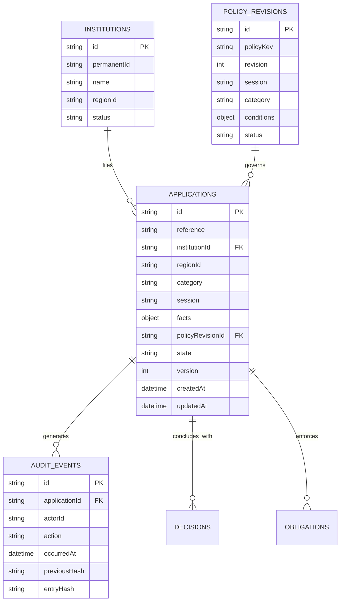

# NIYAMSETU (नियमसेतु) — PHASE 3.1
## Data Model, Persistence Architecture & Schema Migration Report

**System:** NIYAMSETU — AICTE Approval Workflow Automation  
**SIH 2026 Problem Statement:** PS 26262 | Team Defensor  
**Target Branch:** `dev`  
**Execution Timestamp:** 2026-11-03T16:50:00+05:30  
**Database Target:** MongoDB Community Server (`niyamsetu_dev`)  
**Dual Persistence Architecture:** Local MongoDB & In-Memory WORM Adapter

---

## 1. Persistence Architecture Overview

NIYAMSETU implements a dual-persistence strategy designed for absolute architectural rigor and high-speed local testability:
1. **Primary Local Production Persistence:** Local MongoDB instance running on `127.0.0.1:27017/niyamsetu_dev`, wrapped in native Mongoose transactional sessions with replica-set / logical session capabilities.
2. **Companion In-Memory WORM Adapter:** High-speed in-memory transactional mock implementing the identical `CaseStorage` port interface (`src/backend/persistence/memoryAdapter.ts`), utilizing HMAC-SHA256 write-once-read-many hash chaining for tamper-evident audit logging during parallel integration test runs.

---

## 2. Core Collections & Schema Definitions

### 2.1 Index Invariants in `mongoCore.ts`
All indexes are enforced via `REQUIRED_INDEXES`:
- `applications.caseData.id`: Unique, Sparse: false
- `applications.applicationNumber`: Sparse: false
- `institutions.id`: Sparse: false
- `institutions.permanentId`: Sparse: false
- `core_audit.id`: Sparse: false
- `core_outbox.eventId`: Sparse: false
- `core_receipts.key`: Sparse: false
- `policy_revisions.id`: Sparse: false
- `core_decisions.id`: Sparse: false

---

## 3. Schema Corrections & Persistence Sanitization Executed in Phase 3.1

### 3.1 Elimination of Hardcoded Institution Matching in Projection
- In `mongoCore.ts`, `mongoInit.ts`, and `api.ts`, route projection previously checked `a.id.includes('BATU')`, `a.id.includes('APEX')`, and `a.id.includes('PDIMTR')`.
- Replaced with `deriveRouteType(a: Application)`:
  - If `a.route.result === 'review_required'` -> `'Policy review required'`
  - If `stages.includes('sac_shc_review')` or `a.category === 'deficiency_appeal'` -> `'Scrutiny + EVC + SAC/SHC'`
  - If `stages.includes('evc_pending')` and `stages.includes('scrutiny_pending')` -> `'Scrutiny + EVC'`
  - If `stages.includes('evc_pending')` and `!stages.includes('scrutiny_pending')` -> `'Only EVC'`
  - If `!stages.includes('evc_pending')` and `stages.includes('scrutiny_pending')` -> `'Scrutiny Only'`
  - If `!stages.includes('evc_pending')` and `!stages.includes('scrutiny_pending')` -> `'Fast-Track EoA'`

### 3.2 Real Entity Preservation on Case Ingestion
- `mongoCore.ts` line 82 previously injected `institutionName: app.institutionId, state: 'Synthetic', city: 'Synthetic'`.
- Corrected to dynamically persist `(app.facts as any)?.institutionName || app.institutionId`, preserving actual institution names (e.g. *"College of Engineering Pune (COEP Tech Univ)"*).
