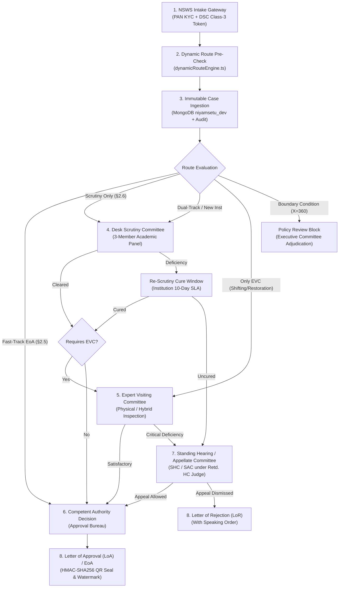

# NIYAMSETU (नियमसेतु) — PHASE 3.1
## End-to-End Workflow & Multi-Role Progression Matrix

**System:** NIYAMSETU — AICTE Approval Workflow Automation  
**SIH 2026 Problem Statement:** PS 26262 | Team Defensor  
**Target Branch:** `dev`  
**Execution Timestamp:** 2026-11-03T16:50:00+05:30  
**Verification Method:** Stage Transition Contracts & Multi-Role Permission Audit

---

## 1. Statutory Workflow Lifecycle Model

---

## 2. Multi-Role Responsibility & Permitted State Transitions

| Stage Name | Canonical State (`app.state`) | Authorized Role | Permitted Actions | Prerequisite Condition | Audit Event Emitted | Target Next State |
| :--- | :--- | :--- | :--- | :--- | :--- | :--- |
| **Application Intake** | `submitted` | Institution / NSWS Gateway | `submit` | PAN verified, DSC Class-3 token validated. | `APPLICATION_INGESTED_VIA_NSWS` | `submitted` |
| **Desk Scrutiny** | `scrutiny_pending` | Scrutiny Reviewer (`usr-scrutiny-reviewer`) | `start_scrutiny`, `verify_document`, `add_observation`, `complete_scrutiny` | Scrutiny roster declared; 3 committee members active. | `SCRUTINY_EVALUATION_COMPLETED` | `scrutiny_cleared` OR `rescrutiny_pending` |
| **Deficiency Cure** | `rescrutiny_pending` | Institution Principal (`usr-inst-coep`, etc.) | `upload_compliance_doc`, `submit_cure` | Deficiency notice issued within 7-day SLA window. | `DEFICIENCY_REMEDIATION_SUBMITTED` | `scrutiny_pending` (Re-Scrutiny) |
| **EVC Scheduling & Visit** | `evc_pending` | Regional Officer / EVC Chair (`usr-ro-western`, `usr-evc-chair`) | `schedule_evc`, `upload_geotagged_media`, `submit_evc_report` | Scrutiny cleared or direct EVC route mandated. | `EVC_INSPECTION_COMPLETED` | `evc_cleared` OR `decision_pending` |
| **Quasi-Judicial Hearing** | `sac_shc_review` | Standing Hearing / Appellate Committee | `record_hearing_minutes`, `recommend_relief`, `uphold_rejection` | Institution filed appeal within 10-day limitation. | `APPELLATE_ORDER_RECORDED` | `decision_pending` |
| **Executive Decision** | `decision_pending` | Competent Authority (`usr-bureau-hq`) | `issue_approval`, `issue_rejection`, `record_speaking_order` | All statutory route stages successfully cleared. | `DECISION_RECORDED_COMPETENT_AUTHORITY` | `approved` OR `rejected` |
| **Document Generation** | `approved` / `rejected` | Automated Cryptographic Service | `render_signed_pdf`, `embed_hmac_qr` | Final decision recorded and unalterable. | `DOCUMENT_SEALED_CRYPTOGRAPHICALLY` | Terminal State |
