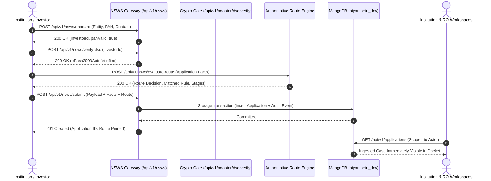

# NIYAMSETU (नियमसेतु) — PHASE 3.1
## NSWS Intake Gateway & Case Injection Technical Specification

**System:** NIYAMSETU — AICTE Approval Workflow Automation  
**SIH 2026 Problem Statement:** PS 26262 | Team Defensor  
**Target Branch:** `dev`  
**Execution Timestamp:** 2026-11-03T16:50:00+05:30  
**Implementation Source:** `src/backend/modules/nsws/`, `src/features/nsws/NSWSSimulationView.tsx`

---

## 1. Architectural Purpose & Pipeline Overview

In national production, all technical education institutions file applications through the **National Single Window System (NSWS)** gateway (as documented in `AICTE Approval Process & NSWS Portal Registration Guide.pdf`).

In NIYAMSETU, the NSWS simulation is engineered as a **functional application-intake and case-injection gateway** for the real local workflow.

Inbound applications submitted via the NSWS gateway:
1. Undergo simulated PAN KYC validation against Income Tax Department formats.
2. Require cryptographic DSC signature simulation using authorized Class-3 hardware tokens (`ePass2003Auto`).
3. Invoke the central authoritative routing engine (`dynamicRouteEngine.ts`) during pre-check.
4. Pin the exact regulatory policy revision (e.g. `AY-2026-27-V1` / `v2026.2-ERRATA`) and intake calculation formula.
5. Create and persist an immutable application record in local MongoDB `niyamsetu_dev` (and memory storage).
6. Emit an auditable transaction event (`APPLICATION_INGESTED_VIA_NSWS`).
7. Become immediately visible in the respective institution's portal docket and internal regulatory workspaces.

---

## 2. API Endpoint Specification



### 2.1 Step 1: Investor Onboarding & PAN KYC
- **Endpoint:** `POST /api/v1/nsws/onboard`
- **Payload:**
  ```json
  {
    "entityName": "College of Engineering Pune (COEP Tech Univ)",
    "entityType": "State University / Autonomous Institute",
    "contactPerson": "Dr. Anand Deshpande",
    "email": "principal@coep.ac.in",
    "mobile": "+91 98765 43210",
    "pan": "AAACB1234F"
  }
  ```
- **Response:** `200 OK` with `nswsReference` (`INV-xxx`) and `panValid: true`.

### 2.2 Step 2: DSC Verification via emBridge Simulation
- **Endpoint:** `POST /api/v1/nsws/verify-dsc`
- **Payload:** `{ "investorId": "INV-xxx" }`
- **Response:** `200 OK` confirming `ePass2003Auto USB Cryptographic Token` validation.

### 2.3 Step 3: Dynamic Route Pre-evaluation
- **Endpoint:** `POST /api/v1/nsws/evaluate-route`
- **Payload:** Application facts (category, program, level, intake, NBA status, area, region).
- **Processing:** Invokes `evaluateDynamicRoute(facts)` in `dynamicRouteEngine.ts`.
- **Response:** `200 OK` returning `routeDecision` with evaluated stages, statutory citations, and fast-track eligibility.

### 2.4 Step 4: Submission & Injection
- **Endpoint:** `POST /api/v1/nsws/submit`
- **Payload:** Complete submission payload with mapped institution ID and facts.
- **Persistence:** Executed inside `storage.transaction(async tx => { ... })`:
  - Inserts case into `applications` collection in MongoDB `niyamsetu_dev`.
  - Appends audit event `APPLICATION_INGESTED_VIA_NSWS` into `core_audit`.
- **Response:** `201 Created` with created application object.

---

## 3. Frontend Intake Modes in `NSWSSimulationView.tsx`

### Mode A: Canonical Presets (Guided Statutory Scenarios)
1. **COEP Pune:** Fast-Track / Scrutiny Only (NBA Tier-1, Table 2.3 Row 9 & Addendum Item 16).
2. **GIITS Tech:** Dual-Track Scrutiny + EVC (Non-NBA Surge, Table 2.3 Row 9).
3. **PDIMTR Management:** Fast-Track EoA Self-Disclosure (Zero Deficiency, Table 2.3 Row 1).
4. **Apex Institute:** Chapter I New Institution (Scrutiny + EVC + Land Concurrence).
5. **BATU Affiliate:** Course Rationalization / Progressive Closure (Desk Scrutiny Only, Table 2.3 Row 16).
6. **BATU Relocation:** Change of Site / Location (Physical EVC Mandated, Table 2.3 Row 3).
7. **VVIT Boundary X=360:** Division Boundary Check (Policy Review Required, Table 2.3 Row 9 Boundary).

### Mode B: Custom Manual Intake
Allows the evaluator to enter arbitrary institutional parameters:
- Institution Name, PAN, Signatory, Program (Engineering, Management, Pharmacy, Architecture, Applied Arts)
- Existing Intake, Proposed Intake, NBA Accreditation status and score
- Total Built-up Area ($m^2$), Region selection
- Direct real-time route evaluation and persistence into active queues.
