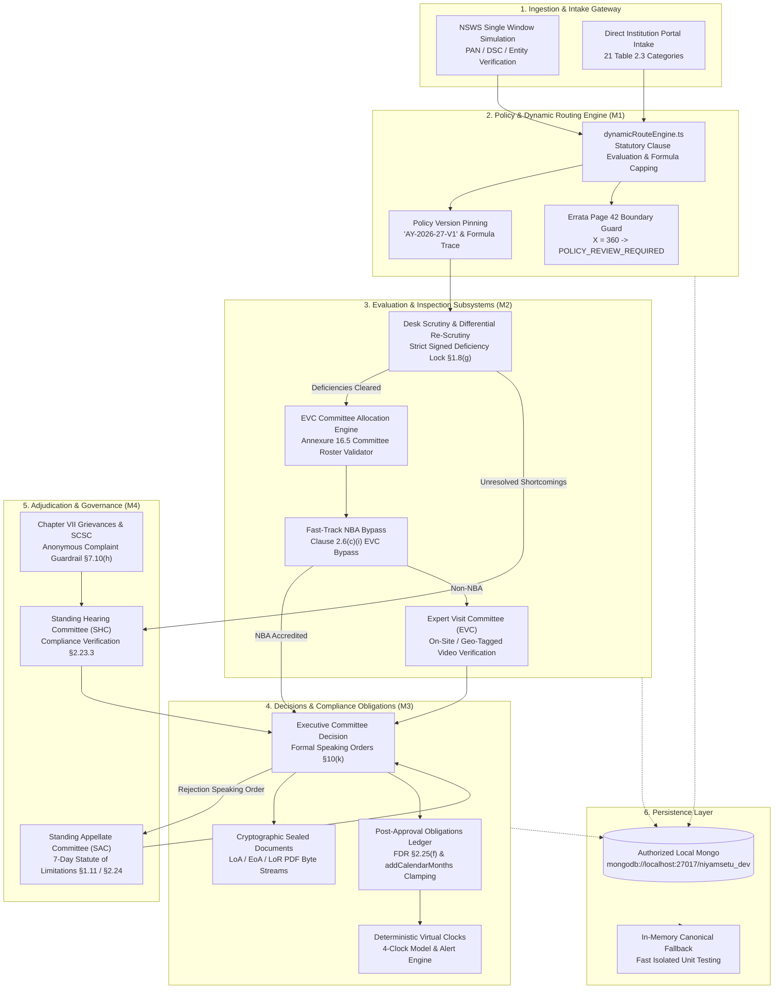

# NIYAMSETU (नियमसेतु) — PHASE 3.1 IMPLEMENTATION ARCHITECTURE
**Project:** NIYAMSETU — AICTE Approval Workflow Automation  
**SIH 2026 Problem Statement:** PS 26262 | Team Defensor  
**Target Branch:** `dev` (Strictly Local Development)  
**Database Target:** Local `niyamsetu_dev` (Authorized Dev Persistence Only)  
**Verification Date:** 2026-11-03  
**Status:** PHASE 3.1 ARCHITECTURE VERIFIED & HARDENED

---

## 1. Architectural Mission & Core Philosophy

NIYAMSETU provides an end-to-end, source-verified regulatory automation platform for the All India Council for Technical Education (AICTE). The architecture is engineered around the principle of **strict statutory ground truth**: business rules and process routes are mathematically derived from primary regulatory instruments (DOC-01 to DOC-09) with zero reliance on synthetic assumptions or informal traditions.

---

## 2. Core Subsystem Boundaries

### 2.1 Module 1: Dynamic Route & Policy Engine (`src/backend/policy/` & `src/backend/core/`)
- **Single Source of Truth:** `dynamicRouteEngine.ts` is the single authoritative routing engine implementing all 21 categories from Table 2.3 of APH 2024-27, Chapter I Setting Up New Institution, Addendum Corrigendum Errata Page 42, and Circular provisions.
- **Intake Ceiling Engine:** Implements Errata Page 42 formulas for existing intake $X < 360$ and $X > 360$.
  - Formula for $X < 360$: $	ext{Max Intake} = \min(X + 180, 360)$
  - Formula for $X > 360$: $	ext{Max Intake} = X + \min(180, 2 	imes 	ext{Course Intake})$
- **Statutory Boundary $X = 360$ Safeguard:** The official Errata table completely omits exact $X = 360$. `dynamicRouteEngine.ts` detects `existingIntake === 360`, sets `eligibilityStatus: 'POLICY_REVIEW_REQUIRED'`, and flags `CONFLICT`, safely halting automated intake calculation for manual policy review.
- **Policy Version Pinning:** Every intake application permanently pins `policyVersionPinned: 'AY-2026-27-V1'` and records `intakeFormulaApplied` on the Mongoose Application schema, ensuring retrospective regulatory amendments never invalidate in-flight dockets.

---

### 2.2 Module 2: Desk Scrutiny, Differential Re-Scrutiny & EVC (`src/backend/modules/scrutiny/`, `evc/`, `allocation/`)
- **Differential Re-Scrutiny Scope Lock:** Implements APH Clause 1.8(g) and Clause 2.23.1. Round 1 Desk Scrutiny produces an immutable signed deficiency snapshot. In Round 2 Re-Scrutiny, institutions can only upload responses for signed deficiency items. Attempts to reopen or alter items marked `accepted` in Round 1 are rejected with HTTP 409 Conflict.
- **EVC Roster Validator:** Implements Annexure 16.5 statutory roster qualifications:
  1. Convener / Academician (Professor / Dean level).
  2. Subject Expert (Professor / Associate Professor).
  3. Architecture/Infrastructure Expert: Verified as COA Architect OR Civil/Structural Engineering Professor OR Urban Planning Professor OR Empanelled Senior/Chief Engineer from CPWD/NBCC/PWD.
- **NBA Fast-Track Bypass:** Institutions with valid NBA accreditation bypass physical EVC inspection under Chapter II Clause 2.6(c)(i). Unauthorized EVC scheduling attempts on fast-track dockets fail with HTTP 409 Conflict.

---

### 2.3 Module 3: Decision Documents, Cryptographic Seals & Obligations (`src/backend/modules/decisionDocuments/`, `compliance/`)
- **Cryptographic Seal Specification:**
  - *SIH Prototype Implementation:* LoA, EoA, and LoR documents are rendered as valid PDF byte streams with embedded SHA-256 binary digests and HMAC-SHA256 signature blocks (`HMAC-SHA256:HEX_DIGEST`).
  - *Production Target Architecture:* Maps cleanly to an X.509 PKI asymmetric digital signature token (e.g. Class-3 DSC via eMudhra / emBridge cryptographic hardware token) utilizing standard RSASSA-PKCS1-v1_5 / ECDSA algorithms.
- **Mandatory Speaking Orders:** Pursuant to AICTE Act §10(k) and APH Clause 1.10(b)/2.23.3, all Letters of Rejection (LoR) must incorporate an official Speaking Order detailing specific statutory grounds passed by the Executive Committee.
- **Post-Approval Obligations Ledger:** Post-approval obligations (Clause 2.25(f) FDR deposit, 6-month undertakings, Fire Safety NOC) materialize *exclusively* upon recorded Council decisions.
- **Month-End Clamping Safeguard:** Incorporates `addCalendarMonths(baseDate, months)` in `complianceService.ts`, avoiding native JavaScript Date overflow bugs and correctly evaluating month-end boundaries (Feb 28/29, Sep 30).

---

### 2.4 Module 4: Adjudication, Appeals & Grievances (`src/backend/modules/appealsAndHearings/`)
- **Three-Tier Adjudication Separation:**
  1. `Standing Hearing Committee (SHC)`: Verifies pre-approval deficiency compliance under Clause 2.23.3.
  2. `Standing Appellate Committee (SAC)`: Chaired by a retired High Court Judge. Enforces strict 7-day statute of limitations from Letter of Deficiency issue date (Chapter I §1.11(a)) or Executive Committee decision upload date (Chapter II §2.24(a)).
  3. `Public Grievance Redressal Cell (PGRC) & SCSC`: Chapter VII grievance tracking. Evaluates complaints through SCSC. Implements statutory prohibition under Clause 7.10(h) rejecting anonymous and pseudonymous complaints immediately.

---

## 3. Storage and Multi-Tenant Isolation Boundary

- **Production Safety Boundary:** Connected strictly to local `mongodb://localhost:27017/niyamsetu_dev`. Zero outbound network connections to MongoDB Atlas or Render.
- **Tenant Isolation Enforcement:** Every data query across applications, scrutiny records, obligations, alerts, and appeals enforces `tenantId` / `institutionId` scoping. Institutional applicants (e.g. COEP vs GIITS) cannot read, inspect, or mutate peer institutional dockets.
