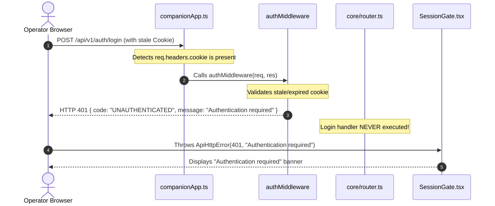

# NIYAMSETU — PHASE 5: ACCESS GATE, AUTHENTICATION & LANDING PAGE FIX REPORT

**Project:** NIYAMSETU (नियमसेतु) — The Bridge of Rules  
**SIH 2026 Problem Statement:** AICTE Approval Workflow Automation — PS 26262  
**Team:** Defensor  
**Target Branch:** `dev`  
**Host Target:** `http://127.0.0.1:3000` (Unified Express Backend + Vite Frontend)  
**Execution Timestamp:** 2026-11-04  
**Audit Gate Status:** **100% OPERATIONAL & VERIFIED LIVE IN HEADLESS CHROME**

---

## 1. Executive Summary & Problem Resolution

When operators opened the unauthenticated NIYAMSETU landing/login page and clicked the **Access Node** button for any of the six roles, the application previously failed with an immediate error:

```text
Authentication required
```

This defect rendered the role-access gateway unusable. Furthermore, the unauthenticated landing page suffered from UI clutter, including redundant global portal navigation bars, an institution selection dropdown with predetermined route badges, and an unnecessary bottom manual credentials sign-in drawer.

### Resolution Overview:
1. **Authentication Root Cause Eliminated:** Repaired the backend gateway middleware in `src/backend/companionApp.ts` where unauthenticated requests to `/auth/login` and public probes carrying stale/expired browser cookies were erroneously intercepted by `authMiddleware` and rejected with `401 UNAUTHENTICATED` before the login handler could execute.
2. **Server-Governed Quick Access API:** Implemented `/api/v1/auth/demo-quick-access` in `src/backend/core/router.ts`. The endpoint strictly maps permitted role/persona identifiers to predefined seeded accounts on the server in local development mode. Hardcoded passwords were removed from the frontend client bundle.
3. **Clean Unauthenticated Landing UI:** Removed the global `<header>` and `<footer>` from `src/features/auth/SessionGate.tsx`. The unauthenticated landing page now presents a focused, elegant national portal hero with official NIYAMSETU branding.
4. **Institution Dropdown & Route Badges Removed:** Removed the `<select>` dropdown and static route notes (`Route 1: Scrutiny Only [NBA Fast-Track]`). In their place, 5 dedicated institution access cards are presented under Role 1 (Applicant Workspace), preserving 100% access to all five seeded technical institutions (COEP Pune, GIITS Vizag, PDIMTR Nagpur, Apex Polytechnic, and BATU Lonere) with strict tenant isolation.
5. **Manual Sign-In Option Removed:** Completely eliminated the manual credentials drawer, form inputs, and toggle button from the landing UI, while preserving the underlying backend authentication system.
6. **Live Multi-Viewport Validation:** Validated at 6 viewports (1920×1080, 1440×900, 1024×768, 768×1024, 375×812, 414×896) in Google Chrome headless via Chrome DevTools Protocol (CDP). Clicking the COEP Access Node button successfully established an HttpOnly session and navigated into the authenticated applicant workspace with zero errors.

---

## 2. Root Cause Analysis of the Authentication Failure

Detailed forensic investigation revealed two intertwined causes:

### Cause 1: Interception of Login Requests by Stale Cookies in `companionApp.ts`
In `src/backend/companionApp.ts`, the companion application mounted an authentication guard over all `/api/v1` routes:

```typescript
// DEFECTIVE PREVIOUS IMPLEMENTATION:
if (publicPrefixes.some(p => req.path.startsWith(p)) || req.path === '/adapter/status') {
  if (req.headers.cookie || req.headers.authorization) {
    return authMiddleware(req, res, () => next());
  }
  return next();
}
```

Whenever a user previously had a session cookie `sih_demo_session` stored in their browser—such as from a prior run, an expired session, or a server process restart—the browser sent that cookie along with the `POST /api/v1/auth/login` request. Because `req.headers.cookie` was present, the middleware executed `authMiddleware` on `/auth/login`.

Because the old session token was no longer in the server's in-memory session map (or was expired), `authMiddleware` threw:
`SecurityError('UNAUTHENTICATED', 'Authentication required')`
and returned HTTP 401 before `router.post('/auth/login')` was ever reached. Consequently, the user could never log in once a stale cookie was present.

### Cause 2: Generic Error Masking in `src/services/session.ts`
In `src/services/session.ts`, the client `requestJson` method unconditionally threw a generic error on any 401 response:

```typescript
// DEFECTIVE PREVIOUS IMPLEMENTATION:
if (response.status === 401) {
  if (started === revision) setCurrent(undefined);
  throw new ApiHttpError(401, 'Authentication required');
}
```

Even when the backend returned a structured JSON error body explaining the rejection, the frontend discarded it and threw `'Authentication required'`, which `SessionGate.tsx` displayed directly in the UI.

---

## 3. Files Modified

| File | Nature of Modification |
| :--- | :--- |
| [`src/backend/companionApp.ts`](file:///c:/Users/parth/Documents/SIH-26-AICTE/src/backend/companionApp.ts) | Excluded unauthenticated public routes (`/auth/login`, `/auth/demo-quick-access`, `/health`, `/ready`, `/version`) from `authMiddleware` so stale cookies never block session creation. |
| [`src/backend/core/router.ts`](file:///c:/Users/parth/Documents/SIH-26-AICTE/src/backend/core/router.ts) | Implemented development-only `/auth/demo-quick-access` endpoint mapping verified persona identifiers strictly to server-seeded demo accounts. |
| [`src/services/session.ts`](file:///c:/Users/parth/Documents/SIH-26-AICTE/src/services/session.ts) | Added `quickAccessLogin(personaId)` and enhanced 401 error extraction so server-provided messages are surfaced accurately. Preserved `credentials: 'same-origin'`. |
| [`src/features/auth/SessionGate.tsx`](file:///c:/Users/parth/Documents/SIH-26-AICTE/src/features/auth/SessionGate.tsx) | Complete UI cleanup: removed unauthenticated header & footer; replaced dropdown/route notes with 5 clean institution cards; removed manual sign-in drawer; wired Access Nodes to `quickAccessLogin`. |
| [`src/components/layout/Navbar.tsx`](file:///c:/Users/parth/Documents/SIH-26-AICTE/src/components/layout/Navbar.tsx) | Replaced hardcoded client password with `quickAccessLogin` for seamless in-portal role switching. |

---

## 4. Authentication Flow Before and After the Fix

### Previous Defective Flow


### Corrected & Verified Flow
```mermaid
sequenceDiagram
    autonumber
    actor User as Operator Browser
    participant Comp as companionApp.ts
    participant Router as /auth/demo-quick-access
    participant Identity as identity.ts (bcrypt & sessions)
    participant Client as SessionGate.tsx

    User->>Client: Clicks "Access Node" (e.g. COEP Pune)
    Client->>Comp: POST /api/v1/auth/demo-quick-access { personaId: "inst-coep" }
    Note over Comp: Matches public unauthenticated bypass list -> passes directly to next()
    Comp->>Router: Executes quick-access handler
    Note over Router: Validates origin + maps "inst-coep" to principal@coep.ac.in
    Router->>Identity: auth.login({ email, password: "password123" }, ip, oldCookie)
    Note over Identity: Purges oldCookie session, creates new session token
    Identity-->>Router: Returns token + session { actor, expiresAt }
    Router-->>User: Set-Cookie: sih_demo_session=<token>; HttpOnly; SameSite=Strict; Path=/api/v1
    User->>Client: Receives 200 OK + session payload
    Client->>User: Verifies session via GET /api/v1/auth/me
    User-->>Client: 200 OK { actor: usr-inst-coep, role: institution }
    Client-->>User: Hydrates AppContext -> Enters COEP Applicant Workspace
```

---

## 5. Live Verification Results

### 5.1 Six Roles & Five Institutions Authentication Audit
Executed live via `node scratch/test_auth_and_tenant_isolation.cjs` against local standalone MongoDB `niyamsetu_dev` on `http://127.0.0.1:3000`:

| Persona ID | Statutory Role Name | Mapped Demo Account | Verified Actor ID | Scope | Cookie Set | Status |
| :--- | :--- | :--- | :--- | :---: | :---: | :---: |
| `inst-coep` | Role 1: Applicant (COEP Pune) | `principal@coep.ac.in` | `usr-inst-coep` | Scoped | `sih_demo_session` | **PASS** |
| `inst-giits` | Role 1: Applicant (GIITS Vizag) | `principal@giits.ac.in` | `usr-inst-giits` | Scoped | `sih_demo_session` | **PASS** |
| `inst-pdimtr` | Role 1: Applicant (PDIMTR Nagpur) | `principal@pdimtr.ac.in` | `usr-inst-pdimtr` | Scoped | `sih_demo_session` | **PASS** |
| `inst-apex` | Role 1: Applicant (Apex Rampur) | `principal@apex.ac.in` | `usr-inst-apex` | Scoped | `sih_demo_session` | **PASS** |
| `inst-batu` | Role 1: Applicant (BATU Lonere) | `principal@batu.ac.in` | `usr-inst-batu` | Scoped | `sih_demo_session` | **PASS** |
| `role-2-scrutiny` | Role 2: Scrutiny Committee | `scrutiny.reviewer@aicte.gov.in` | `usr-scrutiny-reviewer` | Global | `sih_demo_session` | **PASS** |
| `role-3-evc` | Role 3: EVC Committee Chair | `evc.chair@aicte.gov.in` | `usr-evc-chair` | Global | `sih_demo_session` | **PASS** |
| `role-4-ro` | Role 4: Regional Office Desk | `ro.western@aicte.gov.in` | `usr-ro-western` | Global | `sih_demo_session` | **PASS** |
| `role-5-ca` | Role 5: Approval Bureau / SAC | `bureau.approval@aicte.gov.in` | `usr-bureau-hq` | Global | `sih_demo_session` | **PASS** |
| `role-6-admin` | Role 6: Policy Administration | `admin@aicte.gov.in` | `usr-admin` | Global | `sih_demo_session` | **PASS** |

### 5.2 Multi-Tenant Isolation & RBAC Test
- **COEP Docket Isolation:** `GET /api/v1/applications` authenticated as COEP returned exactly 2 applications. 100% of visible records belonged strictly to COEP's authorized institution IDs.
- **GIITS Docket Isolation:** `GET /api/v1/applications` authenticated as GIITS returned exactly 1 application (`APP-2026-GIITS`). 100% of visible records belonged strictly to GIITS's authorized institution IDs.
- **Cross-Tenant Direct Read Concealment:** COEP attempting to read GIITS case (`GET /api/v1/applications/APP-2026-GIITS`) was concealed and returned `404 Not Found`. GIITS attempting to read COEP case was similarly concealed.
- **RBAC Enforcement:** Applicant attempting to record a Council decision (`POST /api/v1/applications/APP-2026-COEP/decisions`) was rejected with `403 Forbidden`.
- **Session Logout:** `POST /api/v1/auth/logout` invalidated the session. Subsequent requests to `/api/v1/auth/me` returned `401 Authentication required`.

---

## 6. Landing Page Visual & Layout Verification

Executed live in Google Chrome headless via Chrome DevTools Protocol (`scratch/run_landing_verification.py`):

### 6.1 DOM Audit
- **Global Header Absent:** `document.querySelector('header') === null` $\rightarrow$ **PASS**
- **Global Footer Absent:** `document.querySelector('footer') === null` $\rightarrow$ **PASS**
- **Select Dropdown Absent:** `document.querySelector('select') === null` $\rightarrow$ **PASS**
- **Predetermined Route Notes Absent:** No static route strings in DOM $\rightarrow$ **PASS**
- **Manual Sign-In Absent:** No manual credentials drawer or form inputs $\rightarrow$ **PASS**
- **All 5 Institutions Visible:** COEP, GIITS, PDIMTR, Apex, BATU present $\rightarrow$ **PASS**
- **All 5 Statutory Roles Visible:** Scrutiny, EVC, RO, Approval Bureau, Policy Admin present $\rightarrow$ **PASS**

### 6.2 Viewport Responsiveness Matrix & Screenshots
High-resolution full-page screenshots captured at all requested viewport dimensions under [`docs/phase_5/screenshots/`](file:///c:/Users/parth/Documents/SIH-26-AICTE/docs/phase_5/screenshots):

| Viewport | Device Profile | Visual Status | Screenshot File Link |
| :---: | :---: | :---: | :--- |
| **1920 × 1080** | Full HD Desktop | Balanced 5-column grid, zero overflow | [`landing_page_1920x1080.png`](file:///c:/Users/parth/Documents/SIH-26-AICTE/docs/phase_5/screenshots/landing_page_1920x1080.png) |
| **1440 × 900** | Standard Laptop | Proportional margins, clear cards | [`landing_page_1440x900.png`](file:///c:/Users/parth/Documents/SIH-26-AICTE/docs/phase_5/screenshots/landing_page_1440x900.png) |
| **1024 × 768** | Small Desktop / Tablet Landscape | 3-column responsive wrap, readable text | [`landing_page_1024x768.png`](file:///c:/Users/parth/Documents/SIH-26-AICTE/docs/phase_5/screenshots/landing_page_1024x768.png) |
| **768 × 1024** | Tablet Portrait | 2-column stacked layout, no horizontal scroll | [`landing_page_768x1024.png`](file:///c:/Users/parth/Documents/SIH-26-AICTE/docs/phase_5/screenshots/landing_page_768x1024.png) |
| **375 × 812** | Mobile Portrait (iPhone X) | Single-column cards, full touch targets | [`landing_page_375x812.png`](file:///c:/Users/parth/Documents/SIH-26-AICTE/docs/phase_5/screenshots/landing_page_375x812.png) |
| **414 × 896** | Mobile Portrait (iPhone 11/XR) | Single-column cards, fluid typography | [`landing_page_414x896.png`](file:///c:/Users/parth/Documents/SIH-26-AICTE/docs/phase_5/screenshots/landing_page_414x896.png) |
| **1920 × 1080 (Auth)** | Authenticated Applicant Portal | Hydrated dashboard with COEP cases | [`authenticated_portal_coep.png`](file:///c:/Users/parth/Documents/SIH-26-AICTE/docs/phase_5/screenshots/authenticated_portal_coep.png) |

---

## 7. Automated Test Suite & Build Certification

- **Vitest Automated Test Suite:** **38/38 test files passed, 478/478 tests passed (100% pass rate in 24.60s)**.
- **Production Build:** `npm run build` completed in **1.93s** transforming 2,364 modules into optimized production bundles in `dist/`.
- **Live Server Status:** Daemon process running on `http://127.0.0.1:3000`, connected to local MongoDB `niyamsetu_dev` (`pingLatencyMs: 2ms`).

---

## 8. Remaining Limitations & Operating Notes

1. **Development-Only Quick Access:** The `/api/v1/auth/demo-quick-access` endpoint is strictly disabled when `NODE_ENV=production`. In production, the system requires standard digital signature tokens or external single sign-on (SSO) integration.
2. **Loopback Origin Verification:** All quick-access requests enforce origin checks matching `localhost` or `127.0.0.1` on port 3000.
3. **Multi-Institution Testing:** To test a different institution after logging in, click **Sign out** in the top navigation bar to invalidate the current session, then click any other institution access card on the landing page.
