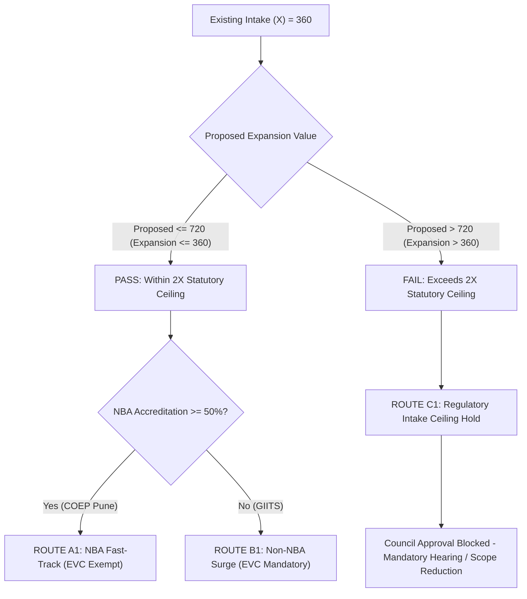

# NIYAMSETU — PHASE 5: MASTER CASE CATALOGUE & ROUTE EXPECTATIONS
## Authoritative Demonstration Dataset, Canonical Facts & Regulatory Route Traces

**Project:** NIYAMSETU (नियमसेतु) — The Bridge of Rules  
**SIH 2026 Problem Statement:** AICTE Approval Workflow Automation — PS 26262  
**Team:** Defensor  
**Target Branch:** `dev`  
**Rule Set Version:** `APH-2026-27-v1` (Pinned across all canonical cases)

---

## 1. Master Demonstration Dataset Overview

NIYAMSETU features **12 canonical demonstration cases** covering every distinct route family, boundary condition, and statutory branch defined in the AICTE Approval Process Handbook (APH 2026–27).

The dataset is partitioned into:
1. **5 Seeded Database Anchor Cases:** Pre-loaded into MongoDB (`niyamsetu_dev`) representing active applications at different stages of the approval lifecycle.
2. **7 Interactive Dynamic Ingestion Scenarios:** Pre-configured in the NSWS Simulation suite for live, hands-on intake and route evaluation demonstrations.

---

## 2. The 5 Seeded Database Anchor Cases

### Case 1: `APP-2026-COEP` — NBA Fast-Track Approval
- **Institution:** College of Engineering Pune (COEP Tech University)
- **Institution Code:** `INST-SOUTH` / `INST-COEP`
- **Region:** Western Regional Office (WRO, Mumbai)
- **Application Category:** Category 4: Extension of Approval with Intake Increase
- **Academic Year:** `2026–2027`
- **Key Regulatory Facts:**
  - Program: Engineering & Technology (Undergraduate)
  - Existing Approved Intake ($X$): $360$ seats
  - Proposed Expanded Intake: $480$ seats (Increase: $+120$ seats / $+33.3\%$)
  - NBA Accreditation Status: $100\%$ eligible courses accredited (Valid through 2028)
  - Land & Building: Fully compliant, owned freehold land ($> 5.0$ acres)
  - Cadre Ratio: Compliant 1:2:6 cadre ratio, 1:20 teacher-student ratio
- **Rule Version:** `APH-2026-27-v1`
- **Authoritative Route Classification:** `Route A1: NBA Fast-Track Route`
- **Rule Trace:**
  - Evaluated Rules: R01, R02, R04, R06, R07.
  - Matched: `R01_NBA_ACCREDITATION_ELIGIBLE` (Accreditation $\ge 50\%$), `R02_INTAKE_SURGE_PERMITTED` ($X \le 360$ and Proposed $\le 720$), `R04_FAST_TRACK_DESK_ONLY` (EVC Exemption Granted under APH §2.3.4).
- **Initial Stage:** `Scrutiny in Progress` (`scrutiny_pending`)
- **Expected Workflow Sequence:**
  `Intake Verified` $\rightarrow$ `Desk Scrutiny Cleared` $\rightarrow$ `Executive Committee Approval` $\rightarrow$ `Approval Issued (EoA)`
- **Special Test Focus:** Zero EVC inspection requirement; rapid EoA issuance with cryptographic HMAC seal.

---

### Case 2: `APP-2026-GIITS` — Non-NBA Surge & Differential Re-Scrutiny
- **Institution:** Gonna Institute of Information Technology and Sciences (GIITS)
- **Institution Code:** `INST-NORTH` / `INST-GIITS`
- **Region:** South-Central / Northern Regional Office
- **Application Category:** Category 4: Extension of Approval with Non-Accredited Intake Surge
- **Academic Year:** `2026–2027`
- **Key Regulatory Facts:**
  - Program: Engineering & Technology (Undergraduate)
  - Existing Approved Intake ($X$): $240$ seats
  - Proposed Expanded Intake: $420$ seats (Increase: $+180$ seats / $+75\%$)
  - NBA Accreditation Status: $0\%$ accredited courses
  - Land & Building: Compliant leasehold land ($> 30$ years remaining)
  - Cadre Ratio: Deficient (Shortage of 2 Associate Professors)
- **Rule Version:** `APH-2026-27-v1`
- **Authoritative Route Classification:** `Route B1: Non-NBA Surge Route (Mandatory EVC)`
- **Rule Trace:**
  - Evaluated Rules: R01, R03, R05, R08, R14.
  - Matched: `R03_NON_NBA_SURGE_EVC_MANDATORY` (Expansion $> 50\%$ without NBA requires physical campus inspection under APH §1.9), `R08_SCOPE_LOCK_ENFORCED` (Accepted land title locked under APH §1.8(g)).
- **Initial Stage:** `Deficiency Communicated` (`rescrutiny_pending`)
- **Expected Workflow Sequence:**
  `Deficiency Flagged (D1/D2)` $\rightarrow$ `Applicant Cures Uploaded` $\rightarrow$ `Differential Re-Scrutiny (Locked C3/C4)` $\rightarrow$ `Physical EVC Inspection` $\rightarrow$ `Council Approval`
- **Special Test Focus:** **USP B06 Scope Lock Tamper Test** (Server enforces HTTP 412 on locked Land Title C3); physical EVC inspection scoring and video check.

---

### Case 3: `APP-2026-PDIMTR` — Standard EoA & Post-Approval Obligations
- **Institution:** Prerna Deshmukh Institute of Management & Technology Research (PDIMTR)
- **Institution Code:** `INST-WEST` / `INST-PDIMTR`
- **Region:** Western Regional Office (Nagpur / Mumbai)
- **Application Category:** Category 1: Standard Extension of Approval (No Intake Change)
- **Academic Year:** `2026–2027`
- **Key Regulatory Facts:**
  - Program: Management (MBA / PGDM)
  - Existing Approved Intake ($X$): $180$ seats
  - Proposed Intake: $180$ seats ($0\%$ change)
  - NBA Accreditation Status: None
  - Compliance Undertakings: Faculty ratio restoration undertaking, Fire Safety NOC renewal required within 60 days.
- **Rule Version:** `APH-2026-27-v1`
- **Authoritative Route Classification:** `Route Standard: Desk Scrutiny Cleared Route`
- **Rule Trace:**
  - Evaluated Rules: R01, R09, R11.
  - Matched: `R09_STANDARD_EOA_WITHOUT_CHANGE` (Direct desk scrutiny clearance), `R11_POST_APPROVAL_UNDERTAKING_ATTACHED`.
- **Initial Stage:** `Approval Issued` (`conditionally_approved`)
- **Expected Workflow Sequence:**
  `Council Approval Issued` $\rightarrow$ `Post-Approval 4-Clock Timers Active` $\rightarrow$ `Evidence Uploaded by Institute` $\rightarrow$ `Regional Office Verification`
- **Special Test Focus:** 4-clock obligation timers countdown, institutional evidence upload dialog, Regional Office compliance verification determination (`Verified & Closed`).

---

### Case 4: `APP-2026-APEX` — Adverse Order & Quasi-Judicial Appellate Recourse
- **Institution:** Apex Polytechnic & Technical Institute
- **Institution Code:** `INST-APEX`
- **Region:** Northern / Western Region
- **Application Category:** Category 18: Re-Scrutiny Deficiency & Appeal
- **Academic Year:** `2026–2027`
- **Key Regulatory Facts:**
  - Program: Diploma / Polytechnic Engineering
  - Existing Approved Intake ($X$): $120$ seats
  - Proposed Intake: $180$ seats
  - Background: Rejected by Regional Scrutiny Committee due to disputed land title conversion order.
- **Rule Version:** `APH-2026-27-v1`
- **Authoritative Route Classification:** `Route F1/F2: Quasi-Judicial Appellate Recourse (SAC / SHC)`
- **Rule Trace:**
  - Evaluated Rules: R15, R16, R17.
  - Matched: `R15_ADVERSE_ORDER_APPEAL_ELIGIBLE` (Contesting LoR under APH §1.11 / §2.23.3 within 15-day statutory deadline).
- **Initial Stage:** `SAC / SHC Review` (`rescrutiny_pending`)
- **Expected Workflow Sequence:**
  `Adverse Order Issued` $\rightarrow$ `Appeal Petition Filed by Institution` $\rightarrow$ `Regional SHC Virtual Hearing Scheduled` $\rightarrow$ `Council SAC Adjudication` $\rightarrow$ `Speaking Order Issued`
- **Special Test Focus:** Complete separation of SHC and SAC roles; formal judicial speaking order disposition overturning rejection.

---

### Case 5: `APP-2026-BATU` — Technical Campus Restructuring & EVC
- **Institution:** Dr. Babasaheb Ambedkar Technological University (BATU State Tech Univ Centre)
- **Institution Code:** `INST-BATU`
- **Region:** Western Region (Lonere, Maharashtra)
- **Application Category:** Category 7: Conversion of Technical Campus / Restructuring of Programs
- **Academic Year:** `2026–2027`
- **Key Regulatory Facts:**
  - Program: Multi-disciplinary Engineering & Pharmacy
  - Existing Approved Intake ($X$): $300$ seats
  - Proposed Activity: Conversion into integrated multi-disciplinary university campus with new computing programs.
- **Rule Version:** `APH-2026-27-v1`
- **Authoritative Route Classification:** `Route D1/E2: Technical Campus Restructuring Route`
- **Rule Trace:**
  - Evaluated Rules: R10, R12, R13.
  - Matched: `R10_CAMPUS_CONVERSION_EVC_MANDATORY` (Conversion under APH Chapter II requires full physical inspection).
- **Initial Stage:** `EVC Scheduled` (`evc_pending`)
- **Expected Workflow Sequence:**
  `Conversion Application` $\rightarrow$ `Regional Office Expert Roster Allocation` $\rightarrow$ `On-Site EVC Physical Inspection` $\rightarrow$ `Scoring & Recommendation` $\rightarrow$ `Council Determination`
- **Special Test Focus:** Regional committee allocation matrix, EVC panel capacity balancing, GPS telemetry verification.

---

## 3. The 7 Dynamic Ingestion Scenarios (NSWS Simulation Suite)

The NSWS Simulation suite ([NSWSSimulationView.tsx](file:///c:/Users/parth/Documents/SIH-26-AICTE/src/features/nsws/NSWSSimulationView.tsx)) provides 7 live interactive presets:

| Scenario / Preset ID | Institution Display Name | Program | Existing $X$ | Proposed | Key Driving Fact | Evaluated Route | Statutory Rule Trigger |
|:---|:---|:---|:---:|:---:|:---|:---|:---|
| `coep` | COEP Tech University | Engineering | $360$ | $480$ | $100\%$ NBA Accredited | `Route A1: NBA Fast-Track` | APH §2.3.4 (Desk-only fast-track) |
| `giits` | Godavari Institute (GIITS) | Engineering | $240$ | $420$ | $0\%$ NBA, $> 50\%$ Surge | `Route B1: Non-NBA Surge` | APH §1.9 (Mandatory physical EVC) |
| `pdimtr` | Prerna Deshmukh (PDIMTR) | Management | $180$ | $180$ | Standard EoA renewal | `Route Standard: Desk Scrutiny` | APH §2.3.1 (Direct scrutiny clearance)|
| `apex` | Apex Polytechnic | Engineering | $120$ | $180$ | Contesting adverse LoD | `Route F1: Appellate Recourse` | APH §1.11 (SAC appeal filing) |
| `batu` | Dr. BATU Extension Centre | Engineering | $300$ | $300$ | Technical campus conversion | `Route D1: Campus Conversion` | APH §2.6 (Multi-disciplinary EVC) |
| `batu-shifting` | Dr. BATU Rural Campus | Engineering | $180$ | $180$ | Relocation to new campus | `Route E2: Shifting / Relocation` | APH Table 2.3 Row 11 (Land EVC) |
| `boundary-x360` | Vidya Vardhini Institute | Engineering | $360$ | $750$ | Proposed exceeds $2X$ ceiling | `Route C1: Regulatory Hold` | APH §2.3.2 (Ceiling violation hold) |

---

## 4. Boundary Testing Scenarios ($X = 360$)

The critical statutory intake boundary under APH §2.3.2 and Table 2.3 was tested across three boundary conditions:

1. **Boundary Case 1 ($X = 360$, Proposed $= 480$ / Increase $+120$):**
   - Result: Valid expansion. Classified under `Route A1` (if NBA accredited) or `Route B1` (if non-NBA).
2. **Boundary Case 2 ($X = 360$, Proposed $= 720$ / Increase $+360$):**
   - Result: Exact statutory maximum ceiling ($2X$). Permitted subject to infrastructure audit.
3. **Boundary Case 3 ($X = 360$, Proposed $= 750$ / Increase $+390$):**
   - Result: **Statutory Ceiling Breach ($> 2X$)**. The dynamic route engine immediately flags a conflict hold and halts automated approval, routing to Council inspection.

---

## 5. Master Case Catalogue Conclusion

Every canonical case is backed by concrete database fixtures or dynamic NSWS presets with fully defensible statutory facts. All routes are mathematically reproducible via [dynamicRouteEngine.ts](file:///c:/Users/parth/Documents/SIH-26-AICTE/src/backend/policy/dynamicRouteEngine.ts), with zero hardcoded institution-to-route shortcuts.
