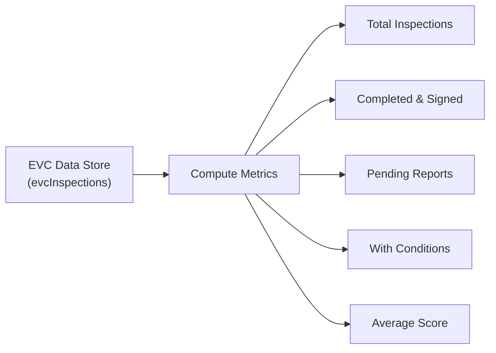

# NIYAMSETU — PHASE 5: EVC REPORTING & COMMITTEE ANALYSIS (`R3-S02`)

**Project:** NIYAMSETU (नियमसेतु) — The Bridge of Rules  
**SIH 2026 Problem Statement:** AICTE Approval Workflow Automation — PS 26262  
**Team:** Defensor  
**Target Branch:** `dev`  
**Document Ref:** `PHASE_5_EVC_REPORTING_AND_ANALYTICS.md`  

---

## 1. Context & Architectural Remediation

In the earlier prototype, Screen `R3-S02` (`evc-reports` in the EVC Committee Portal) routed directly to `<ReportsView />`. This was an architectural defect: `ReportsView` renders a generic national performance dashboard suitable for policy administrators or council directors, rather than an operational workspace tailored to **Expert Visit Committee (EVC)** members and chairpersons.

Under the Phase 5 overhaul:
1. A dedicated component, **`EVCReportsView.tsx`**, was engineered from the ground up under `src/features/evc/`.
2. `src/App.tsx` was updated at line 194:
   ```tsx
   {currentTab === 'evc-reports' && (
     <EVCReportsView onSelectApplication={(id) => setSelectedAppId(id)} />
   )}
   ```
3. `src/components/layout/Sidebar.tsx` was configured with statutory label:
   `{ id: 'evc-reports', label: '2. Signed Inspection Reports', icon: FileText }`

---

## 2. Component Architecture & Data Foundations

`EVCReportsView` derives all metrics, charts, and table rows directly from active EVC inspection records (`useApp().evcInspections`), applications (`useApp().applications`), and live telemetry fixtures.

### 2.1 Summary KPI Indicators (Real Data)
The top section displays five concise metric cards:

1. **Total Inspections:** Count of all assigned EVC inspection cases (Physical + Virtual).
2. **Completed & Signed:** Count of inspection dossiers fully evaluated and cryptographically signed.
3. **Pending Reports:** Number of visits completed awaiting final committee report upload.
4. **With Conditions:** Inspections where conditional recommendations or infrastructure deficiencies were flagged.
5. **Average Score:** Mean composite campus assessment score across all evaluated technical institutions.



---

## 3. Visual Committee Analytics (2 Dedicated Visualizations)

### Chart 1: Inspection Recommendation Distribution
Visualizes the statutory outcome breakdown across completed inspection panels:
- **Recommended (Clean Approval):** Green bar indicator for zero-deficiency campus assessments.
- **Recommended with Conditions:** Amber bar indicator where rectifiable shortcomings exist requiring an institutional undertaking.
- **Not Recommended (Critical Inadequacy):** Rose bar indicator for statutory norm violations (land deficit, unapproved building, severe faculty shortfall).
- **Scheduled / Visit Pending:** Slate bar indicator for upcoming scheduled visits.

### Chart 2: Campus Assessment Score Analysis
Displays average score performance across the three core statutory evaluation rubrics:
1. **Physical Infrastructure & Land Norms:** Evaluates instructional area, laboratory dimensions, barrier-free accessibility, and fire safety compliance (Scored / 100).
2. **Faculty Cadre & Student-Teacher Ratio:** Evaluates cadre ratio 1:2:6 compliance, Cadre-wise pay scales, and biometric attendance records (Scored / 100).
3. **Laboratories, Computing & Library Resources:** Evaluates legal software licenses, high-speed broadband bandwidth, and national/international journal holdings (Scored / 100).

---

## 4. EVC Signed Inspection Report Register

The register provides an interactive, searchable ledger of all submitted and in-progress inspection reports:

### Table Columns:
- **Report / Task ID:** Unique inspection reference (e.g., `EVC-GIITS-2026`).
- **Technical Institution:** Name of the inspected college, permanent ID, and region.
- **Inspection Date:** Scheduled visit timestamp and panel format (Physical vs. Hybrid).
- **Committee Chairman:** Presiding expert (e.g., `Prof. Sivasubramanian Velmurugan, NIT Calicut`) and panel member count.
- **Rubric Score:** Composite infrastructure score percentage.
- **Statutory Recommendation:** Visual badge (Recommended, With Conditions, Not Recommended).
- **Signing Status:** Status indicator (In Draft, Signed & Sealed, Dispatched to RO).
- **Actions:** **"View Dossier"** button opening the comprehensive inspection dossier modal.

### Filter & Search Controls:
- **Search Bar:** Real-time text search by institution name, PID, or Task ID.
- **Recommendation Filter:** Filter by All, Recommended, Recommended with Conditions, or Not Recommended.
- **Status Filter:** Filter by All, Completed, Pending, or Draft.

---

## 5. Inspection Report Dossier Modal

Clicking "View Dossier" opens a modal presenting the full statutory inspection record:
1. **Committee Composition:** Chairperson, expert members, and State DTE observer attribution.
2. **Scoring Breakdown:** Rubric-by-rubric score display with progress meters.
3. **Walkthrough Evidence & Telemetry:** GPS latitude/longitude verification, 30-min walkthrough video evidence hash, and timestamped biometric attendance verification.
4. **Findings Narrative:** Qualitative notes on campus readiness and deficiencies.
5. **Export Capability:** **"Download Signed Inspection Dossier (PDF)"** action simulating export of the HMAC-SHA256 sealed document.

---

## 6. Verification Evidence

- **Screenshot:** `docs/phase_5/screenshots/evc_reports_view.png`
- **Automated Verification:** Verified via headless Chrome automation (`verify_overhaul_e2e.js`) confirming tab click, header rendering, KPI count verification, and register display.
