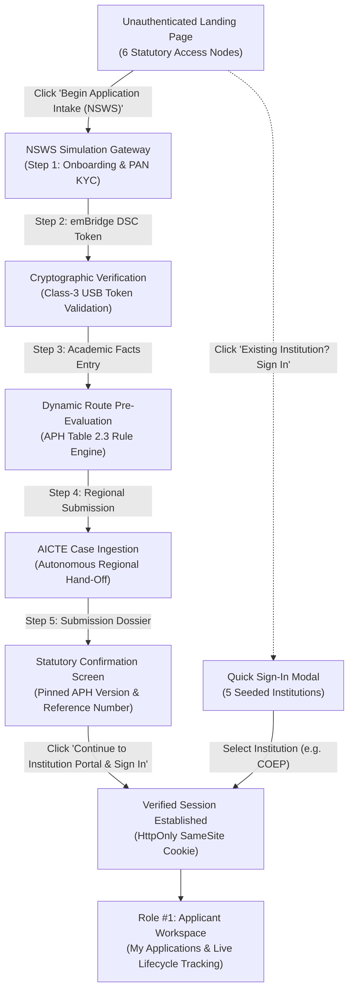

# NIYAMSETU — PHASE 5: INSTITUTIONAL ACCESS JOURNEY & NSWS-FIRST INTAKE

**Project:** NIYAMSETU (नियमसेतु) — The Bridge of Rules  
**SIH 2026 Problem Statement:** AICTE Approval Workflow Automation — PS 26262  
**Team:** Defensor  
**Target Branch:** `dev`  
**Document Ref:** `PHASE_5_INSTITUTIONAL_ACCESS_AND_NSWS_JOURNEY.md`  

---

## 1. Executive Summary & Purpose

Under the statutory AICTE Approval Process Handbook (APH 2024–2027) and the Government of India single-window mandate, technical education institutions do not submit initial approval applications directly to internal back-office queues. Instead, applications originate at the **National Single Window System (NSWS)**, where corporate identity (PAN KYC) and legal authority (Class-3 Digital Signature Certificate tokens via emBridge) are verified prior to ingestion into the AICTE companion platform.

The NIYAMSETU prototype overhaul re-architects the applicant access journey from a legacy direct sign-in pattern into a source-traceable, NSWS-first statutory intake lifecycle.

---

## 2. End-to-End Institutional User Journey

### Stage 1: Landing Page Access Gate
- The unauthenticated landing page (`http://127.0.0.1:3000`) displays a symmetrical 6-role statutory grid without noisy institution cards or route notes.
- Card #1 represents **Role #1: Institution Signatory Portal (Applicant Workspace)** with a prominent call-to-action:
  **"Begin Application Intake (NSWS) →"**
- A discreet secondary option, **"Existing Institution? Sign In"**, provides a modal-based shortcut for operators wishing to sign in directly as an existing institution without repeating intake.

### Stage 2: NSWS Single-Window Registration & KYC (Step 1)
- Navigates to the unauthenticated NSWS simulation interface with a dedicated top bar:
  - `← Back to Gateway`
  - `National Single Window System (NSWS) — Statutory Ingestion Gateway`
  - `Sign In to Existing Institution Account`
- The applicant can select from canonical benchmark technical colleges or enter custom identity facts:
  - Trust / Entity PAN (5 letters, 4 digits, 1 letter format validation)
  - Authorized Signatory Name & Mobile Number
  - Official Institutional Email Address
  - Simulated OTP Verification (`123456`)
- Endpoint: `POST /api/v1/nsws/onboard`

### Stage 3: Class-3 DSC Token Verification via emBridge (Step 2)
- Simulates hardware cryptographic token authentication mandated by CCA India guidelines.
- Validates token serial number (e.g., `EP2003-8841-A99B`) and binds the authorized signatory's digital signature to the intake envelope.
- Endpoint: `POST /api/v1/nsws/verify-dsc`

### Stage 4: Academic Program Norms & Dynamic Route Check (Step 3 & 4)
- Collects academic facts: Category, Program, Level, Existing Intake, Proposed Intake, NBA Accreditation Status & Score, Built-Up Area, and Region.
- Invokes the central dynamic routing engine (`POST /api/v1/nsws/evaluate-route`) to determine mandated stages (e.g., Fast-Track Scrutiny Only vs. Dual-Track Scrutiny + Physical EVC).
- Primary Source Traceability: Cites specific APH 2024–27 clauses and Errata Page 42 rules.
- Action Button: **"Submit Application to AICTE (Autonomous Regional Hand-Off)"** (`POST /api/v1/nsws/submit`).

### Stage 5: Statutory Confirmation & Pinned Case Dossier (Step 5)
- Displays an authoritative, two-column confirmation dossier containing:
  - **Application Reference Number (PID):** e.g., `1-NSWS51158081`
  - **Institution Name:** Full registered institution name
  - **Academic Year:** `AY 2026–27`
  - **Application Category:** Formatted statutory category (e.g., `Increase in Intake`)
  - **Submission Status:** `Submitted / Scrutiny Pending`
  - **Calculated Route & Mandated Stages:** e.g., `Fast-Track / Scrutiny Only`
  - **Pinned Handbook Version:** `APH-2024-27-V2`
  - **Submission Timestamp:** Formatted Indian Standard Time (IST)
- CTAs available:
  1. **"Continue to Institution Portal & Sign In →"** (Primary)
  2. **"Sign In as Another Seeded Institution"** (Secondary Modal)
  3. **"Start Another NSWS Simulation"** (Reset)

### Stage 6: Seamless Authenticated Transition
- Clicking the primary CTA executes `quickAccessLogin(selectedPresetId, email)`:
  - Exchanges applicant credentials for an authentic `sih_demo_session` HttpOnly SameSite cookie via `POST /api/v1/auth/demo-quick-access`.
  - Verifies session state via `GET /api/v1/auth/me`.
  - Mounts `<AppProvider>` and `<MainLayout>` directly into Role #1: **Applicant Portal**, landing on `My Applications & Live Lifecycle Tracking` (`inst-apps`).
  - The newly submitted application is immediately visible with its immutable dynamic route snapshot and real-time status.

---

## 3. Seeded Technical Institutions Catalogue

The platform supports 5 canonical seeded technical institutions, each configured for specific regulatory demonstration routes:

| Institution Key | Institution Name | Permanent ID (Code) | Region | Signatory Email | Canonical Route |
| :---: | :--- | :---: | :---: | :---: | :--- |
| `coep` / `inst-coep` | COEP Technological University, Pune | `1-435789102` | Western | `principal@coep.ac.in` | **Fast-Track / Scrutiny Only** (NBA Tier-1 Score ≥ 650, EVC Waived per Errata p. 42) |
| `giits` / `inst-giits` | Gonna Institute of Info Tech & Sciences | `1-462589176` | South-Central | `principal@giits.ac.in` | **Dual-Track (Scrutiny + Physical EVC)** (Intake increase without NBA accreditation) |
| `pdimtr` / `inst-pdimtr` | Prerna / Univ BDT College of Engg | `1-109704178` | Western | `principal@pdimtr.ac.in` | **Fast-Track EoA Endorsement** (Annual self-disclosure renewal) |
| `apex` / `inst-apex` | Apex Institute of Tech & Management | `1-331049280` | Northern | `principal@apex.ac.in` | **Chapter I Scrutiny + Physical EVC** (New Institution establishment) |
| `batu` / `inst-batu` | Dr. Babasaheb Ambedkar Tech Univ | `1-192014810` | Western | `principal@batu.ac.in` | **Desk Scrutiny Only** (Course closure / progressive rationalization) |

---

## 4. Visual Evidence & Artifacts

All visual state transitions have been verified in headless Google Chrome at 1440x900 resolution:

1. **Clean 6-Node Statutory Landing Page:**  
   `docs/phase_5/screenshots/landing_page_overhaul_1440x900.png`
2. **NSWS Single-Window Intake Gateway:**  
   `docs/phase_5/screenshots/nsws_intake_flow.png`
3. **Step 5 Submission Confirmation Dossier:**  
   `docs/phase_5/screenshots/nsws_step5_confirmation.png`
4. **Post-Intake Authenticated Institution Workspace:**  
   `docs/phase_5/screenshots/institution_workspace_post_intake.png`
5. **Quick Technical Institution Sign-In Modal:**  
   `docs/phase_5/screenshots/institution_quick_modal.png`

---

## 5. Security & Isolation Controls

1. **HttpOnly Cookie Architecture:** All session tokens are transmitted strictly via SameSite HttpOnly cookies (`sih_demo_session`), preventing client-side script access.
2. **Tenant Isolation:** When logged in as COEP (`principal@coep.ac.in`), tenant isolation restricts visible applications and audit records strictly to COEP (`INST-SOUTH` / `INST-COEP`).
3. **Standalone Database Durability:** Applications submitted through the NSWS simulation are persisted into the local MongoDB `niyamsetu_dev` database under the `applications` collection with full Mongoose compatibility projections.
