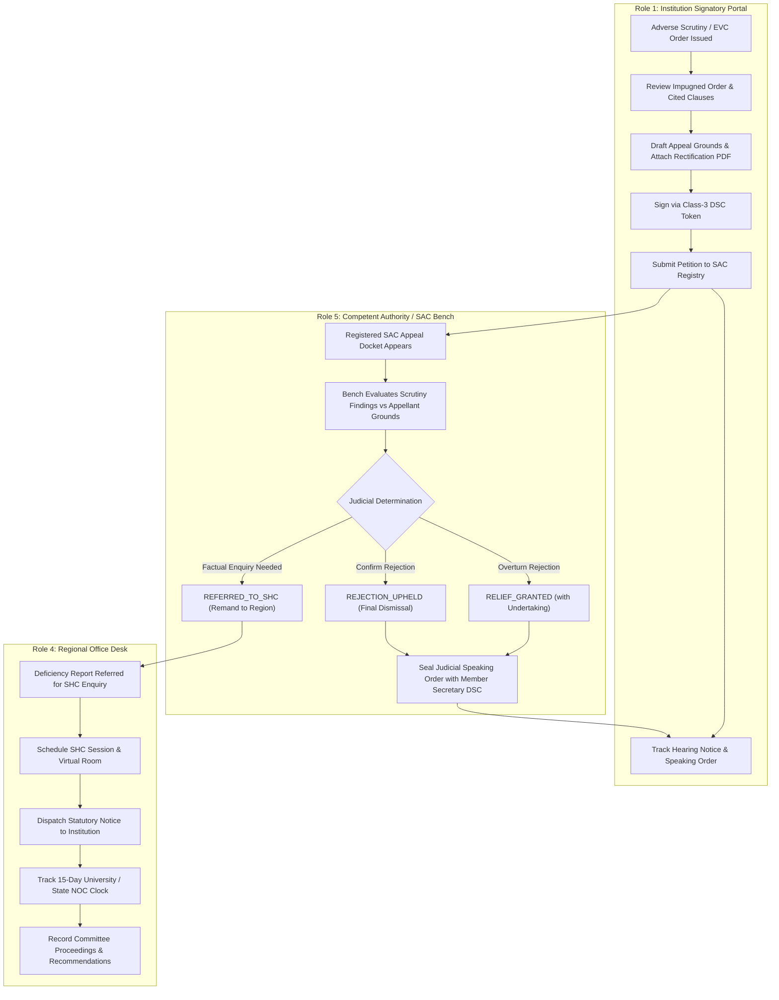

# NIYAMSETU (नियमसेतु) — APPLICANT VS AUTHORITY WORKFLOW SEPARATION
## Demarcation of Legal Recourse, Regional Hearing Coordination & Judicial Adjudication

**Project:** NIYAMSETU — The Bridge of Rules  
**SIH 2026 Problem Statement ID:** 26262  
**Target Branch:** Local `dev`  
**Phase:** Phase 6 Final Validation

---

## 1. The Core Architectural Defect Remedied

In earlier prototype iterations, a single generic component (`AppealsAndHearingsView.tsx`) was mapped to three completely different roles:
1. Role 1: Technical Institution Signatory Portal
2. Role 4: Regional Office Desk
3. Role 5: Approval Bureau & Council Chamber

This created serious procedural violations:
- Institutional applicants had access to authority adjudication tabs, allowing an institution to theoretically "grant relief" to its own appeal or issue a judicial speaking order.
- Regional Officers were shown applicant filing forms instead of hearing coordination and notice scheduling controls.
- Approval Bureau officers lacked a dedicated judicial bench docket with statutory disposition options (`RELIEF_GRANTED`, `REJECTION_UPHELD`, `REFERRED_TO_SHC`).

In Phase 6, this generic component was eliminated and replaced with three distinct, role-tailored components.

---

## 2. Comparison Matrix of Separated Roles

| Dimension | Role 1: Applicant Portal (`ApplicantAppealsView.tsx`) | Role 4: Regional Office (`RegionalHearingCoordinationView.tsx`) | Role 5: Approval Bureau (`CouncilSACAppealsView.tsx`) |
| :--- | :--- | :--- | :--- |
| **Statutory Role** | Aggrieved Appellant / Complainant | Hearing Coordinator / Investigating Authority | Appellate Judicial Bench / Determination Authority |
| **Legal Basis** | APH 2024–27 Chapter I §1.11 & §2.18 | APH 2024–27 Chapter I §1.8 & §2.15 | AICTE Act §11(2) & APH Chapter I §1.11 |
| **Primary Task** | File appeal petition, attach proof, track hearing notices & speaking orders | Coordinate Standing Hearing Committee (SHC), dispatch notices, track 15-day NOC | Review appellate petitions, evaluate bench evidence, execute Speaking Orders |
| **Data Scope** | Tenant-isolated to the institution's own adverse cases only | All applications within the regional jurisdiction (e.g. Western Region) | All registered national appellate petitions across all regions |
| **Permitted Mutations** | `POST /api/v1/appeals-hearings/appeal`, `POST /api/v1/appeals-hearings/complaint` | `POST /api/v1/appeals-hearings/schedule-hearing` (SHC sessions) | `POST /api/v1/appeals-hearings/appeals/:id/dispose` (Binding orders) |
| **Forbidden Capabilities** | **STRICTLY BLOCKED:** Cannot adjudicate, cannot grant relief, cannot schedule hearings | **STRICTLY BLOCKED:** Cannot dispose SAC appeals, cannot overturn Council orders | **STRICTLY BLOCKED:** Does not submit appeals; does not impersonate applicants |
| **Verified Screenshot** | `07_r1_applicant_appeals_desk.png` | `08_r4_ro_shc_hearings_desk.png` | `09_r5_ca_sac_appeals_chamber.png` |

---

## 3. Workflow Flowchart of Legal Recourse

---

## 4. Key Verification Findings

1. **Role 1 Applicant Appeals Desk:**
   - Evaluated live in `07_r1_applicant_appeals_desk.png`.
   - Verified that the institution view contains only tabs for *My Appellate Matters*, *File New SAC Appeal*, *Scheduled Hearings & Notices*, and *Lodge Grievance / Clarification*.
   - Verified that zero administrative disposal buttons exist.
2. **Role 4 Regional SHC Hearing Desk:**
   - Evaluated live in `08_r4_ro_shc_hearings_desk.png`.
   - Features the active Regional SHC Hearings Register alongside the **15-Day University & State NOC Concurrence Tracker** committed in PPT Engineering Pillar 1.
3. **Role 5 SAC Appeals Bench:**
   - Evaluated live in `09_r5_ca_sac_appeals_chamber.png`.
   - Features the national appellate docket with interactive *Adjudicate* modal enabling the Bench to select `Relief Granted`, `Rejection Upheld`, or `Remand to SHC`, with mandatory reasoning and digital Speaking Order generation.
