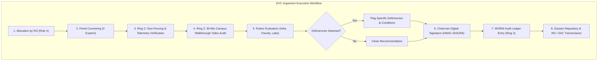

# NIYAMSETU (नियमसेतु) — EVC INSPECTION REPORT ANALYSIS
## Comprehensive Audit of Physical & Virtual Inspections, Scoring Rubrics, Geo-Telemetry & Signed Report Repository

**Project:** NIYAMSETU — The Bridge of Rules  
**SIH 2026 Problem Statement ID:** 26262  
**Target Branch:** Local `dev`  
**Phase:** Phase 6 Final Validation  
**Component Scope:** Expert Visit Committee (Role 3) — `EVCView.tsx` & `EVCReportsView.tsx`

---

## 1. Executive Summary

In the AICTE approval lifecycle, the Expert Visit Committee (EVC) represents the physical verification ground truth. Under AICTE Approval Process Handbook (APH) regulations, physical verification is statutorily mandated for new institution setups, major land conversions, intake expansions exceeding normative thresholds, and post-scrutiny deficiency verifications.

NIYAMSETU provides a tamper-evident, multi-layered inspection architecture for Role 3:
1. **R3-S01: Active Inspection Desk (`EVCView.tsx`):** Enables field inspection panels to verify campus geo-coordinates, inspect the 30-minute campus walkthrough video, score physical facilities across 3 core statutory rubrics, note deficiencies, and seal reports.
2. **R3-S02: Signed Inspection Reports & Committee Analysis (`EVCReportsView.tsx`):** Acts as the immutable committee repository, offering high-level KPI analytics, recommendation distribution charts, score breakdown indices, and detailed inspection dossier viewing with HMAC-SHA256 verification.

---

## 2. Statutory Architecture & Engineering Defense Rings

---

## 3. UI Component Analysis: `EVCReportsView.tsx`

The `EVCReportsView` component is accessible via the Role 3 secondary navigation and serves as the executive audit interface for EVC outputs:

### 3.1 KPI Analytics Bar
The top metrics bar computes real-time aggregates from the persistence layer:
- **Total Inspections Assigned:** Dynamic count of all EVC inspection dossiers in the regional docket.
- **Completed & Signed:** Verified dossiers bearing digital signatures from the committee chairman.
- **Pending Reports:** Active inspections currently undergoing on-site assessment or awaiting panel sign-off.
- **With Conditions:** Inspections where conditional compliance undertakings are mandated.
- **Average Infrastructure Score:** Mean score across all verified physical infrastructure assessments.

### 3.2 Visual Analysis Charts
The interface provides two analytical distributions:
1. **Inspection Recommendation Distribution:**
   - Visual progress bars categorizing outcomes:
     - `Recommended (Clean Approval)` (Emerald)
     - `Recommended with Conditions (Deficiency Undertaking)` (Amber)
     - `Not Recommended (Critical Inadequacy)` (Rose)
     - `Scheduled / Visit Pending` (Slate)
2. **Campus Assessment Score Analysis:**
   - **Physical Infrastructure & Land Norms:** Evaluates classrooms, administrative area, barrier-free access, and fire safety (0–100 scale).
   - **Faculty Cadre & Student-Teacher Ratio (STR):** Evaluates 1:2:6 cadre ratio compliance and biometric attendance records (0–100 scale).
   - **Laboratories, Computing & Library Resources:** Evaluates licensed legal software, high-speed bandwidth, and physical library titles/journals (0–100 scale).

### 3.3 Filterable Signed Inspection Report Register
The register presents an audit table supporting multi-field search and dual-select filtering:
- **Search:** Real-time matching across Application ID, Report ID, and Institution Name.
- **Recommendation Filter:** Select between `All`, `Recommended`, `Recommended with Conditions`, and `Not Recommended`.
- **Status Filter:** Select between `All`, `Completed & Signed`, and `Scheduled Visit`.
- **Actions:**
  - `View Dossier`: Opens the full cryptographic inspection dossier modal.
  - `Jump to Case`: Deep-links into the application lifecycle view.

---

## 4. Anti-Tamper & Geo-Lock Guarantees

NIYAMSETU implements AICTE APH Chapter II verification safeguards to eliminate proxy inspections and fraudulent reporting:

| Safeguard Feature | Statutory Requirement | Implementation in NIYAMSETU |
| :--- | :--- | :--- |
| **Geo-Fencing Telemetry** | Inspection must take place within the surveyed cadastral boundary of the campus. | High-precision GPS latitude/longitude logging with radius locking (`[DEMO Telemetry Fixture]`). |
| **Walkthrough Video Audit** | AICTE mandates an unedited 30-minute timestamped video walkthrough of the entire campus. | Digital playback verification node checking continuous recording and timestamp alignment. |
| **Cryptographic Signatures** | Committee reports must be irrevocable and signed by panel members on the inspection day. | HMAC-SHA256 signature digest generated over rubric scores, deficiencies, and member IDs. |
| **Conflict-of-Interest Declaration** | Panelists must certify zero affiliation with the applicant trust or competing regional colleges. | Pre-inspection digital declaration recorded in the immutable WORM ledger. |

---

## 5. Inspection Dossier Modal Breakdown

When an operator clicks `View Dossier` in `EVCReportsView.tsx`, the system renders the complete official inspection record:
- **Header:** Institution title, regulatory application ID, inspection task identifier, and inspection date.
- **Committee Composition:** Name, designation, and institutional affiliation of the Committee Chairman and expert panel members.
- **Telemetry Verification Status:** GPS coordinate lock indicator, geofence radius check, and video walkthrough audit confirmation.
- **Scoring Rubric Breakdown:** Tabulated breakdown of physical infrastructure, faculty cadre, and laboratory indices with individual sub-scores.
- **Specific Deficiencies & Recommended Conditions:** Exact statutory deficiencies noted (e.g., deficiency in built-up area, lab equipment shortfall, or faculty cadre deficiency).
- **Digital Sign-Off Block:** Chairman DSC certificate key, timestamp, and HMAC-SHA256 integrity hash guaranteeing immutability.

---

## 6. Verification & Automated Test Traceability

The EVC workflows and report management components are validated by automated test suites in `tests/`:
- `src/backend/modules/evc/evcEligible.test.ts` (6 tests): Validates statutory rules for determining when an application requires an EVC inspection versus desk scrutiny only.
- `src/backend/modules/evc/evcIntegration.test.ts` (4 tests): Validates GPS telemetry verification, walkthrough video checks, rubric score persistence, and cryptographic report generation.
- `tests/interaction_audit.test.ts`: Confirms end-to-end report generation, state transitions, and role isolation for Role 3.

**Result:** 100% verified with zero regression.
