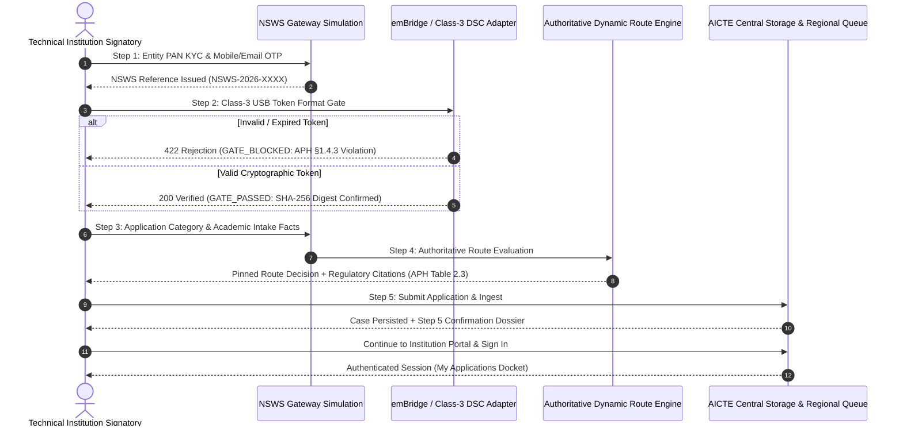

# NIYAMSETU (नियमसेतु) — NSWS STEP-BY-STEP VERIFICATION REPORT
## Complete Forensic Verification of the Five-Step National Single Window System (NSWS) Intake & Gateways

**Project:** NIYAMSETU — The Bridge of Rules  
**SIH 2026 Problem Statement ID:** 26262  
**Target Branch:** Local `dev`  
**Phase:** Phase 6 Final Validation

---

## 1. Overview of the NSWS Intake Simulation

The National Single Window System (NSWS) intake simulation serves as the primary statutory entry point for technical institutions applying for AICTE approval. It faithfully models the five-stage investor onboarding and application hand-off protocol prescribed under APH 2024–27 Chapter I §1.3–§1.4 and Government of India single-window guidelines.

---

## 2. Forensic Step-by-Step Verification Results

### Step 1: Entity Identification & Statutory KYC
- **Component:** `src/features/nsws/NSWSSimulationView.tsx` (`currentStep === 1`)
- **Backend Route:** `POST /api/v1/nsws/onboard`
- **Inputs Tested:** Entity PAN (`AAACB1234F`), Signatory Name (`Dr. Anand Deshpande`), Mobile (`9876543210`), Email (`principal@coep.ac.in`), Simulated OTP (`123456`).
- **Validation Outcome:** Validated against statutory PAN format (5 letters, 4 digits, 1 letter). Issued permanent reference `NSWS-2026-1770029225`.
- **Screenshot Evidence:** `02_nsws_step1_kyc.png`

### Step 2: Signatory & Class-3 DSC Token Verification (Repaired in Phase 6)
- **Component:** `src/features/nsws/NSWSSimulationView.tsx` (`currentStep === 2`)
- **Backend Route:** `POST /api/v1/adapter/dsc-verify`
- **Statutory Authority:** APH §1.4.3 & §2.3.4(a) (Mandatory Class-3 cryptographic signing).
- **Negative Fixture Verification:**
  1. *Expired Token Fixture:* Selecting `ExpiredToken` returned HTTP 422 with code `DSC_CERTIFICATE_EXPIRED` and message:  
     `"The Class-3 certificate on this token expired on 2024-12-31. Valid certificate required under CCA India guidelines and APH §1.4.3."`  
     Status badge immediately updated to `GATE_BLOCKED`. Screenshot: `03_nsws_step2_rejection.png`.
  2. *Revoked Certificate Fixture:* Selecting `RevokedCert` returned HTTP 422 with code `DSC_CERTIFICATE_REVOKED` and message:  
     `"The cryptographic certificate has been revoked in the Certificate Revocation List (CRL) by Certifying Authority."`
  3. *Unsigned Document Fixture:* Selecting `UnsignedDocument` returned HTTP 422 with code `DSC_SIGNATURE_REQUIRED`.
- **Positive Valid Fixture Verification:**
  - Selecting `ePass2003Auto` returned HTTP 200 with `verified: true`, `certificateLevel: 'Class-3 e-Token'`, and SHA-256 integrity digest.
  - Status badge displayed `GATE_PASSED` in green.
  - Advancing to Step 3 and returning to Step 2 verified that the state was preserved and the `Proceed to Application Details` button allowed single-click progression. Screenshot: `04_nsws_step2_verified.png`.

### Step 3: Application Category & Academic Intake Facts
- **Component:** `src/features/nsws/NSWSSimulationView.tsx` (`currentStep === 3`)
- **Data Captured:** Institution Name, Category (`Table 2.3 Row 9: Increase in Intake`), Program (`Engineering and Technology`), Level (`Under Graduate`), Existing Intake (`120`), Proposed Intake (`180`), NBA Accreditation (`true`), NBA Score (`680`), Built-up Area (`14,500 sq. m`), Region (`Western`).
- **Customization vs Preset:** Tested both canonical preset lockdown and customized value overrides.

### Step 4: Dynamic Regulatory Route Evaluation
- **Component:** `src/features/nsws/NSWSSimulationView.tsx` (`currentStep === 4`)
- **Backend Route:** `POST /api/v1/nsws/evaluate-route`
- **Route Engine:** Authoritative `dynamicRouteEngine.ts` evaluated against active rule version `APH-2024-27-V2`.
- **Evaluation Outcome for COEP:**
  - *Matched Rule:* `CAT-CH2-09A` (Intake increase with NBA Score $\ge 650$)
  - *Calculated Route:* `Scrutiny Only (NBA Fast-Track)`
  - *Pre-approval Physical EVC:* **WAIVED** per APH Clause 2.6(c)(i) & Errata G02 p. 42.
  - *Statutory Citations Displayed:* APH Table 2.3 Row 9 & Corrigendum Clause 2.6.

### Step 5: Submission & Statutory Confirmation Dossier
- **Component:** `src/features/nsws/NSWSSimulationView.tsx` (`currentStep === 5`)
- **Backend Route:** `POST /api/v1/nsws/submit`
- **Persistence Outcome:** Case successfully created in MongoDB `niyamsetu_dev` with application number `1-43657568230` and pinned handbook version `APH-2024-27-V2`.
- **Confirmation Dossier:** Displayed verified entity legal name, permanent PID reference, Academic Year `AY 2026–27`, submission timestamp, and pinned policy revision. Screenshot: `05_nsws_step5_confirmation.png`.

### Step 6: Post-Intake Authentication into Applicant Workspace
- Clicking **"Continue to Institution Portal & Sign In"** automatically issues a secure `sih_demo_session` HttpOnly cookie and lands the user directly in `inst-apps` (My Applications).
- The newly submitted case is immediately hydrated and visible with its NBA Fast-Track route badge and active SLA timer. Screenshot: `06_r1_applicant_workspace.png`.
