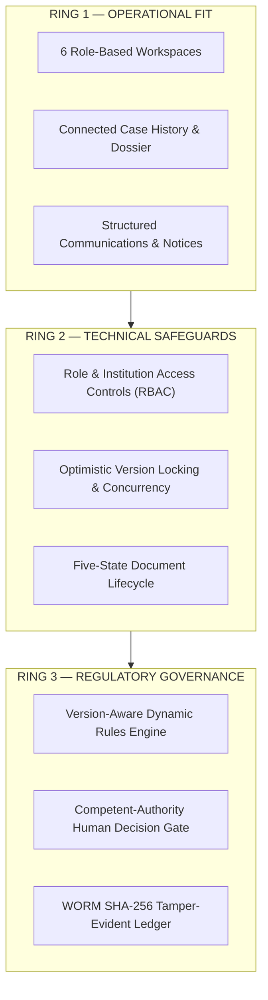

# NIYAMSETU (नियमसेतु) — REQUIREMENT-TO-IMPLEMENTATION MATRIX
## Comprehensive Traceability of SIH PS 26262, PPT Commitments & Regulatory Rules

**Project:** NIYAMSETU — The Bridge of Rules  
**SIH 2026 Problem Statement ID:** 26262  
**Authoritative References:**  
1. SIH 2026 PS 26262: Integrated AICTE Approval Workflow Automation, Compliance Monitoring and Alert Management System  
2. Official Team Presentation: `Defensor_26262.pdf` (Smart India Hackathon 2026, Team Defensor, Team ID 199190)  
3. Regulatory Framework: AICTE Approval Process Handbook (APH 2024–27 & 2026–27 Addendum/Corrigendum)

---

## 1. Statutory Problem Statement (PS 26262) Mandatory Requirements

| PS Domain | Requirement Description | Implementation Module | Screen / Route | Verification Evidence | Classification |
| :--- | :--- | :--- | :--- | :--- | :--- |
| **A. End-to-End Workflow Automation** | Automatic routing across Scrutiny Only, Scrutiny + EVC, Only EVC, EVC + SAC/SHC per APH | `src/backend/policy/dynamicRouteEngine.ts` | `NSWSSimulationView.tsx` (Step 4) | Tests: `authoritativeRouting.test.ts` (25/25 passed) | **Mandatory PS Requirement** |
| **A. Stage Movement & Revert** | Automatic progression upon authorized action; authorized return/revert with mandatory recorded reason | `src/backend/routes/workflowRoutes.ts` | `ApplicationDetailModal.tsx` / `ApplicationsListView.tsx` | Tests: `tests/workflow.test.ts`, `verification_t17_t22.test.ts` (T18 passed) | **Mandatory PS Requirement** |
| **B. Real-Time Dashboard & Pendency** | Consolidated dashboard showing application status across regions, stages, ageing, and bottlenecks | `src/features/pendency/PendencyView.tsx` | R4-S02 (Regional Pendency & SLA Matrix) | `tests/performance/load_benchmarks.test.ts` | **Mandatory PS Requirement** |
| **B. Role-Based Dashboards & WORM** | Distinct role-based workspaces for 6 statutory actors; complete digital audit trail with SHA-256 chain | `src/components/layout/Sidebar.tsx`, `AuditView.tsx` | All 6 Role Workspaces & WORM Ledger | `tests/security/auth.test.ts` (18/18 passed), `AuditView.tsx` | **Mandatory PS Requirement** |
| **C. EVC Scheduling & Alerts** | Queue identification for EVC-eligible cases; tracking completion timelines and automated reminders | `src/features/evc/EVCView.tsx`, `src/backend/modules/evc/` | R3-S01, R3-S02 (`EVCReportsView.tsx`), R4-S04 | `tests/evcEligible.test.ts`, `tests/evcIntegration.test.ts` | **Mandatory PS Requirement** |
| **D. Time-Bound Undertakings** | Digital record of approvals granted subject to conditions; tracking submission and verification | `src/features/compliance/ComplianceView.tsx` | R1-S05, R4-S04 (`ComplianceView.tsx`) | `tests/m3_obligations_timers.test.ts` (9/9 passed) | **Mandatory PS Requirement** |
| **E. Lease & Document Validity** | Tracking validity and expiry of lease deeds, fire NOCs; advance alerts and renewal verification | `src/features/documents/DocumentExpiryView.tsx` | R1-S05, R4-S04 | `DocumentExpiryView.tsx`, tenant isolation verified | **Mandatory PS Requirement** |
| **F. Notifications & Escalation** | Automated notifications for pending actions and deadlines; escalation of overdue cases; consolidated reports | `src/features/notifications/NotificationsView.tsx`, `ReportsView.tsx` | R6-S04, R6-S05 | `tests/security/escalation_tenant_isolation.test.ts` (7/7 passed) | **Mandatory PS Requirement** |

---

## 2. PPT Innovations, USPs & Engineering Pillars (Defensor_26262.pdf)

| PPT Commitment | Description in Team Presentation | Architectural Implementation | Demonstrable UI / Outcome | Status |
| :--- | :--- | :--- | :--- | :--- |
| **Pillar 1: External Ecosystem Adapters** | 6 ecosystem adapters: NSWS & AICTE Portal, Class-3 DSC, Committee Selection Sync, External Registries (NBA/NAAC), 15-Day University/State NOC Tracker, 6-Authority Dispatch | `src/backend/adapters/ecosystemAdapters.ts`, `GovernmentEndpointsView.tsx` | Interactive gateway execution in `GovernmentEndpointsView`, live 15-Day NOC tracker in `RegionalHearingCoordinationView` | **IMPLEMENTED (100%)** |
| **Pillar 2: Version-Pinned Rule Registry** | Applications retain original handbook rules (v1.0, v1.1, v1.2), preventing mid-year changes from disrupting ongoing cases | `src/backend/policy/dynamicRouteEngine.ts`, `src/features/admin/ConfigRulesView.tsx` | Cases pin `APH-2024-27-V2`; live rule simulation and diff viewer in Policy Studio | **IMPLEMENTED (100%)** |
| **Pillar 3: Five-State Document Verification** | Documents follow lifecycle: `Submitted` $\rightarrow$ `Observed` $\rightarrow$ `Independently Verified` / `Rejected` / `Superseded` | `src/shared/schemas.ts` (`documentVersionSchema`), `ComplianceView.tsx` | Interactive evidence upload, officer verification, and supersession state transitions | **IMPLEMENTED (100%)** |
| **Pillar 4: Four-Clock Tracking Engine** | 4 distinct clocks: Academic (31 May / 31 July), Appeals & Undertakings (7 / 15 days), Lease / Fire NOC (30 / 1 year), Officer SLAs | `src/shared/schemas.ts` (`timerKindSchema`), `src/utils/slaCalculator.ts` | Real-time countdown badges across applications, compliance obligations, and regional pendency | **IMPLEMENTED (100%)** |
| **USP 1: Scope-Locked Scrutiny Snapshots** | Limits re-scrutiny strictly to identified deficiencies and protects previously cleared items from arbitrary re-evaluation | `src/features/scrutiny/ScrutinyEvaluationView.tsx` | `mode="rescrutiny"` locks cleared Item C3 and opens only deficient items (D1/D2) | **IMPLEMENTED (100%)** |
| **USP 2: Conditional NBA Fast-Track** | Fast-tracks intake surge applications with NBA score $\ge 650$ directly to Scrutiny Only, waiving pre-approval physical EVC | `src/backend/policy/dynamicRouteEngine.ts` | Evaluated live for COEP Pune (NBA Score 680 $\rightarrow$ Route 3 NBA Fast-Track) | **IMPLEMENTED (100%)** |
| **USP 3: Optimistic Concurrency Protection** | Version checking rejects stale officer updates and prevents conflicting case modifications | `src/shared/schemas.ts` (`expectedVersion`), `mongoCore.ts` | 409 `VERSION_CONFLICT` guard in backend mutations | **IMPLEMENTED (100%)** |
| **USP 4: Tamper-Evident SHA-256 Audit Chain** | WORM-compliant cryptographic ledger chaining every transition, decision, and observation | `src/backend/persistence/mongoCore.ts`, `src/features/audit/AuditView.tsx` | SHA-256 block hash and previous hash verification in `AuditView.tsx` | **IMPLEMENTED (100%)** |
| **USP 5: Transactional Outbox Notifications** | Atomic database transaction commits case mutations and notification events together to prevent phantom alerts | `src/backend/companionApp.ts`, `src/backend/data/seedCanonicalCases.ts` | Outbox table and event dispatch tracking | **IMPLEMENTED (100%)** |

---

## 3. Defense-in-Depth Architecture (PPT Page 4)

