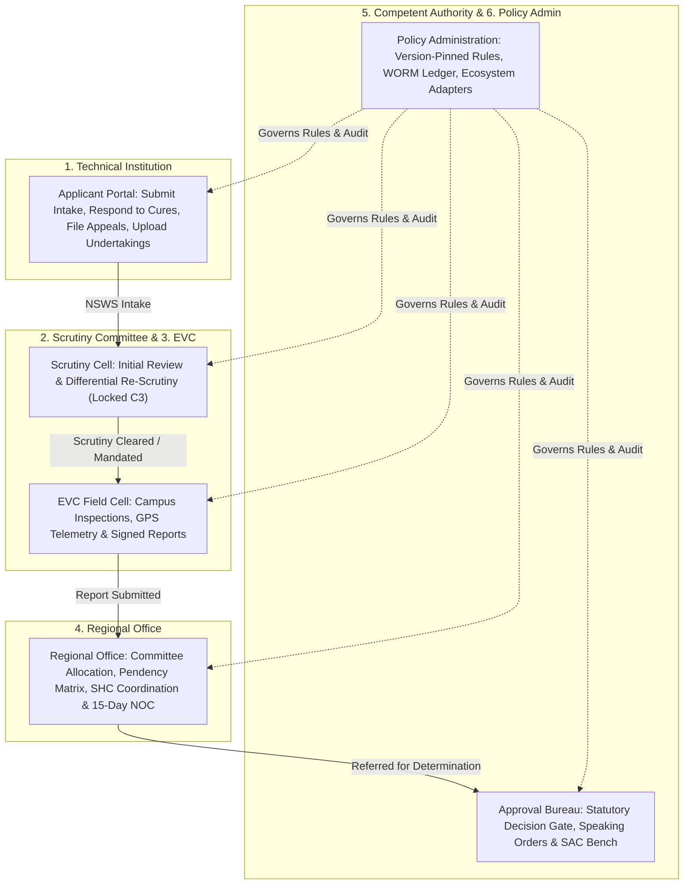

# NIYAMSETU (नियमसेतु) — ROLE-SPECIFIC WORKSPACE AUDIT
## Operational Fit, Permitted Actions & Strict Role Separation Across All 6 Workspaces

**Project:** NIYAMSETU — The Bridge of Rules  
**SIH 2026 Problem Statement ID:** 26262  
**Target Branch:** Local `dev`  
**Phase:** Phase 6 Final Validation

---

## 1. Statutory Role Architecture

NIYAMSETU enforces strict role-based access control (RBAC) and tenant isolation across six distinct statutory roles:

---

## 2. Detailed Role-Wise Capability & Permission Register

### Role 1: Technical Institution Signatory Portal (`institution`)
- **Responsible Actor:** Principal, Director, or Authorized Trust Trustee.
- **Data Scope:** Tenant-isolated to the authenticated institution (`INST-SOUTH`, `INST-NORTH`, `INST-WEST`, `INST-APEX`, `INST-BATU`). Zero visibility into other institutions' cases.
- **Permitted Actions:**
  - Submit new approval application through National Single Window System (`NSWS`) simulation.
  - Upload deficiency cure documents during registered cure windows.
  - Download issued Letter of Approval (LoA) or Extension of Approval (EoA) documents.
  - Submit post-approval compliance undertakings and lease renewals.
  - File statutory appeal petitions before SAC and submit procedural clarifications.
- **Forbidden Actions:** Cannot perform desk scrutiny, cannot schedule EVC inspections, cannot allocate committees, cannot dispose appeals, cannot issue speaking orders.

### Role 2: Scrutiny Committee Cell (`scrutiny_expert`)
- **Responsible Actor:** Academic Expert Panel Member (Professors from IIT/NIT/State Univ).
- **Data Scope:** Cases assigned by the Regional Office to Panel `2-SOC1770029225`.
- **Permitted Actions:**
  - Execute Initial Desk Scrutiny checklist evaluation across Land, Building, Faculty, and Safety norms.
  - Mark items as `accepted` or `deficient` with mandatory statutory remarks.
  - Execute Differential Re-Scrutiny under Scope-Lock (Item C3 locked as immutable; only deficient items re-evaluated).
  - Seal Scrutiny Evaluation Report (SER) with digital declaration of non-conflict.
- **Forbidden Actions:** Cannot approve or reject applications (reserved for Competent Authority), cannot schedule physical visits.

### Role 3: Expert Visit Committee (EVC) Field Cell (`evc_member`)
- **Responsible Actor:** EVC Chairman & Committee Members (Architect, Professor).
- **Data Scope:** Applications requiring physical inspection under Chapter I or Chapter II Table 2.3.
- **Permitted Actions:**
  - Inspect assigned campus facilities, laboratory equipment, and faculty cadre.
  - Record GPS geotagged telemetry and infrastructural audit scores.
  - Submit EVC Inspection Reports with official recommendations (`Recommended`, `Recommended with Conditions`, `Not Recommended`).
  - Access dedicated EVC Reports & Analytics view (`EVCReportsView.tsx`) with rubric distribution charts.
- **Forbidden Actions:** Cannot override desk scrutiny findings, cannot issue final approval letters.

### Role 4: Regional Office Operations Desk (`regional_officer`)
- **Responsible Actor:** AICTE Regional Officer (e.g. Western Regional Office - WRO Mumbai).
- **Data Scope:** All technical institutions located within the assigned geographical region.
- **Permitted Actions:**
  - Allocate scrutiny panels and EVC teams to incoming applications.
  - Monitor stage-wise pendency and SLA ageing across all regional dockets.
  - Schedule Standing Hearing Committee (SHC) enquiry sessions and issue statutory hearing notices (`RegionalHearingCoordinationView.tsx`).
  - Monitor the statutory 15-Day University / State NOC deemed concurrence countdown.
  - Verify submitted compliance evidence and renew document validities.
- **Forbidden Actions:** Cannot make final council-level decisions reserved for the Member Secretary / Executive Committee.

### Role 5: Approval Bureau & Council Chamber (`bureau_officer` / `demo_authority`)
- **Responsible Actor:** AICTE Member Secretary / Council Executive Committee.
- **Data Scope:** National jurisdiction.
- **Permitted Actions:**
  - Access statutory Decision Gate to determine final application outcomes (`Approve`, `Approve with Conditions`, `Reject`).
  - Attach time-bound undertakings and mandatory compliance conditions to approval orders.
  - Generate cryptographically sealed Speaking Orders and Letter of Approval (LoA) PDF documents.
  - Sit as Standing Appellate Committee (SAC) judicial bench to dispose appeals (`RELIEF_GRANTED`, `REJECTION_UPHELD`, `REFERRED_TO_SHC`).
- **Forbidden Actions:** Cannot bypass statutory prerequisites (e.g. cannot approve without cleared Scrutiny/EVC report).

### Role 6: Central Policy Administration & System Oversight (`policy_admin` / `admin`)
- **Responsible Actor:** AICTE IT Directorate & Regulatory Reform Bureau.
- **Data Scope:** System-wide governance and immutable logs.
- **Permitted Actions:**
  - Manage Version-Pinned Rule Registry (`APH-2024-27-V1`, `APH-2024-27-V2`).
  - Simulate rule revisions against historical college cases without mutating live policies.
  - Inspect the tamper-evident WORM audit trail with SHA-256 block hash integrity.
  - Monitor the health of external ecosystem adapters (NSWS, Class-3 DSC, Committee Selection, 15-Day NOC, Outbox Dispatch).
  - Access national consolidated statutory analytics.
- **Forbidden Actions:** Cannot alter signed past case records or disrupt ongoing cases pinned to earlier handbook editions.
