# NIYAMSETU — CHAPTER II: EXISTING INSTITUTIONS WORKFLOW
**Approval Procedures for Existing Technical Institutions & Table 2.3 Categories**
**Smart India Hackathon 2026 | AICTE Problem Statement 26262 | Team Defensor**

---

## 1. STATUTORY FRAMEWORK (APH CHAPTER II & ADDENDUM 2026–27)

Chapter II governs annual approvals, alterations, and intake modifications for existing technical institutions across **21 distinct categories defined in Table 2.3**.

---

## 2. THREE PRIMARY ROUTING PATHS IN CHAPTER II

```mermaid
flowchart TD
    subgraph PathA["PATH A: Fast-Track Self-Disclosure (Categories 1 & 2)"]
        A_Sub[Online Self-Disclosure Application] --> A_Aff[Affidavit 2 Verification]
        A_Aff --> A_EoA[Automated EoA Generation]
        A_EoA --> A_Surprise[Random 5% Post-Approval Check Clause 2.3.5]
    end

    subgraph PathB["PATH B: Desk Scrutiny Only (Categories 4, 8, 9A, 12, 15, 16, 17, 18, 19)"]
        B_Sub[Application Submitted] --> B_Scrutiny[Desk Scrutiny Committee Clause 1.8]
        B_Scrutiny -->|Compliant| B_Council[Council Approval]
        B_Scrutiny -->|Deficiencies| B_Cure[15-Day Differential Cure Clause 1.8g]
        B_Cure --> B_Council
    end

    subgraph PathC["PATH C: Scrutiny + Mandatory EVC (Categories 3, 5, 6, 7, 9B, 10, 11, 13, 14, 20, 21)"]
        C_Sub[Application Submitted] --> C_Scrutiny[Desk Scrutiny Committee]
        C_Scrutiny --> C_EVC[Physical Expert Visit Committee Clause 1.9]
        C_EVC --> C_Exec[Executive Committee]
        C_Exec --> C_Council[Council Decision]
    end
```

---

## 3. SPECIAL STATUTORY MECHANISMS IN CHAPTER II

### A. Increase in Intake / Additional Course (Clause 2.6(c) & Errata p. 42)
1. **Core Branch Prerequisite:** Institution must offer at least three (3) core branch courses, with at least two (2) from non-Computer Science disciplines (Annexure 11). Regional language courses exempted.
2. **Accredited vs Non-Accredited Branching:**
   - Valid NBA Accreditation: Fast-Track Scrutiny/Re-Scrutiny only (Physical EVC waived).
   - Non-NBA: Scrutiny + Mandatory Physical EVC.
3. **Intake Formulas:**
   - $X < 360$: Up to $360 + 60 (+ n	ext{ divisions for NBA})$.
   - $X > 360$: $X + 60 (+ n	ext{ divisions for NBA})$.
   - $X = 360$: Omitted from Errata table -> Flagged as `POLICY_REVIEW_REQUIRED`.

### B. Standing Hearing Committee (SHC) — Clause 2.23.3
Addendum Item 27 explicitly adds *"wherever applicable"*. SHC is NOT a universal stage; it is triggered ONLY when shortcomings identified in Scrutiny or EVC are referred for personal compliance hearing.

### C. Standing Appellate Committee (SAC) — Clause 2.24
Any applicant aggrieved by the decision of the Executive Committee has the right to appeal once to the Council **within 7 days from the date of uploading of the decision on the Web-Portal**.

### D. The 4-Clock Post-Approval Compliance Suite — Clause 2.25(f)
1. **Clock 1 (Security Deposit FDR):** Submit payment proof and Affidavit 3 within **15 days of intimation**. Penalties: 10% up to 31 May, 20% up to 31 July.
2. **Clock 2 (Land Use Certificate):** 60 days.
3. **Clock 3 (Faculty Cadre Ratio):** 90 days.
4. **Clock 4 (Building Completion & Fire NOC):** 180 days.
