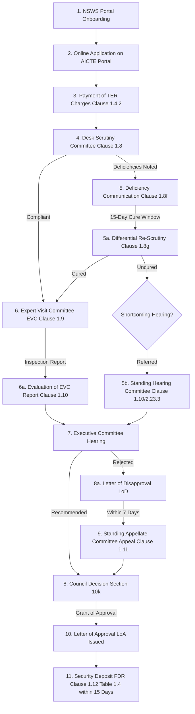

# NIYAMSETU — CHAPTER I: NEW INSTITUTIONS WORKFLOW
**Statutory Procedures for the Establishment of New Technical Institutions**
**Smart India Hackathon 2026 | AICTE Problem Statement 26262 | Team Defensor**

---

## 1. STATUTORY FRAMEWORK (APH CHAPTER I & ADDENDUM 2026–27)

Establishment of a new technical institution is governed strictly by **Chapter I of APH 2024–27 (Clauses 1.1 to 1.13)** as amended by **Addendum 2026–27 Items 1–10** and the **Public Notice dated 26.11.2025 (`DOC-06`)**.

---

## 2. STATUTORY STAGES PIPELINE

---

## 3. KEY REGULATORY MANDATES IN CHAPTER I

1. **National Single Window System (NSWS) Mandate:**
   - Under `DOC-06` (Public Notice 26.11.2025), all applicants seeking to establish a new technical institution **MUST submit their applications through the National Single Window System (NSWS)** at `https://www.nsws.gov.in`.
   - The engine validates that Chapter I cases originate from verified NSWS onboarding.

2. **Scrutiny and Differential Re-Scrutiny (Clause 1.8 & 1.8(g)):**
   - Initial Scrutiny examines land documents, building plans, financial viability, and trust registrations.
   - If deficiencies are identified, a formal communication is issued, initiating a **15-day cure window** under Clause 1.8(f).
   - Under Clause 1.8(g), the Re-Scrutiny Committee verifies **ONLY the deficiencies pointed out by the earlier Scrutiny Committee**. Approved parameters remain locked.

3. **Mandatory Physical EVC (Clause 1.9):**
   - Every new technical institution must undergo physical on-site verification by an Expert Visit Committee to confirm land boundaries, building completion, laboratories, and library equipment.

4. **Security Deposit (Clause 1.12 & Table 1.4):**
   - Upon grant of approval, the applicant must create a Joint Fixed Deposit Receipt (FDR) in the name of the Trust and Regional Officer AICTE for a period of 10 years, as specified in Addendum Item 10 Table 1.4.
