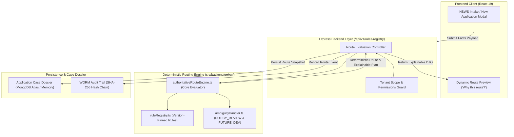

# NIYAMSETU — ROUTING ENGINE ARCHITECTURE
**Technical Specification of the Authoritative Server-Side Routing Foundation**
**Smart India Hackathon 2026 | AICTE Problem Statement 26262 | Team Defensor**

---

## 1. SYSTEM ARCHITECTURE



---

## 2. EXPLAINABLE ROUTING DTO SCHEMA

The engine produces a structured, tamper-evident evaluation output:

```typescript
export interface ExplainableRouteResult {
  policyRevisionId: string;           // e.g. "POL-2026.2-FINAL-ERRATA-P42"
  ruleVersion: string;                 // e.g. "v2026.2"
  session: string;                     // "2026-27"
  category: string;                    // Official Category Code
  categoryName: string;                // Official Regulatory Title
  aphChapter: string;                  // "Chapter I", "Chapter II", etc.
  result: 'selected' | 'review_required';
  eligibilityStatus: 'ELIGIBLE' | 'INELIGIBLE' | 'POLICY_REVIEW_REQUIRED';
  stages: CaseState[];                 // Ordered statutory sequence
  conditionalStages: {
    reScrutiny?: string;               // Activated if deficiencies found
    shcReview?: string;                // Activated if shortcomings referred
    sacAppeal?: string;                // Activated if aggrieved within 7 days
  };
  skippedStages: Array<{
    stage: CaseState;
    ruleId: string;
    sourceLocator: string;
    reason: string;
  }>;
  matchedRules: Array<{
    ruleId: string;
    title: string;
    clause: string;
    sourceDocument: string;
    physicalPdfPage: number;
    printedPage: number;
    rationale: string;
  }>;
  evaluatedFacts: Record<string, unknown>;
  unresolvedFlags: string[];           // POLICY_REVIEW_REQUIRED items
  futureDevelopmentDependencies: string[]; // FUTURE_DEVELOPMENT items
  evaluatedAt: string;
}
```
