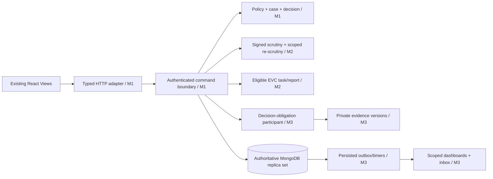

# Parallel work without waiting or diverging

## Architecture diagram

## Work independently in the first hours
- **M1** prepares/merges shared contracts and core stubs, identity and DB foundation. Publishes a small fake actor/case/policy provider so M2 and M3 can compile/test domain modules now.
- **M2** writes signed checklist model, deficiency-set validator, server-side correction guard and EVC eligibility/task uniqueness against `fakeCorePort`. Builds dossier/EVC UI on injected typed test adapters. Do not wait for Mongo DB or complete auth.
- **M3** writes obligation decision participant, versioned evidence rules, reminder-generation/dedupe logic, dashboard projection on **synthetic `DecisionRecorded` event fixtures** and fake transaction port. Do not wait for an actual decision endpoint.
- Once PR0 lands, all three realign branch bases and run compile checks against **exact same exported contracts**. No duplicated case enums.

## Synchronous vs asynchronous boundaries
1. M1 receives authorized case command and opens one DB transaction with expectedVersion/idempotency validation.
2. M2 supplies scrutiny/EVC validation and staged writes called with `TransactionContext` (same session), not an HTTP callback into a separate service.
3. M1 records human demo decision; M3's `DecisionObligationParticipant` materializes conditions and obligations **before commit**. Unique `(decisionEventId, conditionKey)`.
4. M1 writes event/outbox in same commit. M3 worker consumes committed outbox, creates eligible timer/notification generation with unique dedupe key, rechecks current obligation state **at send time**.
5. M3 query projection reads committed scoped records, never counts local fixtures or stale browser state.

## Minimum integration interface changes to avoid circular dependencies
- Core module defines type `TransactionContext` (opaque session holder, actor, case, policy, `emit()`) and passes to domain hooks.
- M2 module exports `assertScrutinyComplete()`, `signSnapshot()`, `applyScopedCorrections()`, `ensureEligibleEvcTask()` (server checks, no UI-only guards).
- M3 module exports `materializeDecisionObligations(tx,...)` and `scheduleDueJobsFromCommittedEvent(...)` separately; timer worker is *after* commit.
- M1 owns router registration and merges route modules from M2/M3 after code review. M2/M3 never rewrite monolithic router registration on their own branches.

## Anti-conflict file ownership
| Shared file | Who edits | How members 2/3 request changes |
|---|---|---|
| `server.ts`, `src/backend/routes/index.js` | M1 | Submit exported route module and small proposed registration diff |
| `src/types/index.ts`, proposed `src/shared/contracts.ts` | M1 | Send schema change request + fixture + test |
| `src/services/api.ts`, `src/context/AppContext.tsx` | M1 | Supply typed hook/adapter and intended caller contract |
| `package.json`, `bun.lock`, Vite config | M1 after consensus | Isolated change PR, no runner churn |
| Dossier/workflow/EVC view files | M2 | M1/D3 avoid editing |
| Compliance/document/notification/dashboard/report views | M3 | M1/M2 avoid editing |

## Integration gates
- G0 contract snapshot/fixtures approved by all three; mock consumers compile independently.
- G1 M1 core real endpoints + auth/scoping + Mongo transaction + API adapter; negative tests fail closed.
- G2 M2 API commands tested with M1 authenticated test actor and stored cases; route-eligibility EVC.
- G3 M1+M3 one decision -> one obligation atomically; uploaded file private; reviewer verifies.
- G4 timer/idempotency/dedupe after changes; dashboard committed counts; merged tests/scripts pass.
- G5 end-to-end tests T01–T28 MVP subset, 5-minute live demo and fallback recording.

## Merge order
PR0 shared contracts → PR1 identity/storage/core → PR2 intake/policy → PR3 scrutiny/EVC → PR4 decision/obligation/docs → PR5 timer/dashboard → PR6 regression/demo. Module feature branches may be developed concurrently but **merge by integration gate**. Do not falsely claim all builds will merge without conflicts.

## Standard daily handoff
Each member posts: branch, base SHA, contract version, endpoints and events exported, changed files, test command + result, mock-vs-real status, decisions needed, next integration dependency. Template: `01_SHARED/INTER_MEMBER_HANDOFF_TEMPLATE.md`.
