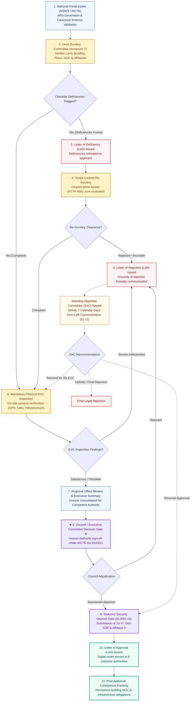

# NIYAMSETU — CHAPTER I: GRANT OF APPROVAL FOR NEW TECHNICAL INSTITUTION
## Statutory Regulatory Workflow Specification

**Authoritative Source:** AICTE Approval Process Handbook (APH 2024–25 to 2026–27) Chapter I (§1.1–§1.11, pp. 1–14) & Annexure 7  
**Category Scope:** Setting up a New Technical Institution (Diploma / Degree / Post-Graduate / Standalone)  
**Excluded Scope:** Existing technical institutions applying for Extension of Approval (EoA) or intake variations (governed strictly by Chapter II)

---

## 1. Regulatory Context & Procedural Rules

Under Chapter I of the AICTE Approval Process Handbook, establishing a new technical institution is a multi-tier statutory process with mandatory sequential stages:
1. **Intake & Verification:** Applications submitted through the National Single Window System (NSWS) or AICTE Web Portal are verified for permanent Land, Registered Trust/Society deeds, Bank Guarantees, and NOC from State Government and Affiliating University.
2. **Desk Scrutiny:** Evaluated by a Scrutiny Committee comprising senior academic experts and an advocate. Evaluates Land area, Land use certificate, Building plans, Barrier-free environment, and Financial stability.
3. **Deficiency Communication (LoD):** If deficiencies are identified, an official **Letter of Deficiency (LoD)** is issued. The applicant is granted an opportunity to submit rectifications during **Differential Re-Scrutiny**, where previously cleared items are strictly scope-locked.
4. **Mandatory Physical EVC:** Unlike existing institutions where EVC may be waived for accredited programs, **all new institutions must undergo an on-site physical inspection by an Expert Visit Committee (EVC)** to verify infrastructure, laboratories, and physical readiness.
5. **Council Adjudication:** Recommendations of Scrutiny and EVC are placed before the Executive Committee / Council for final determination under Sections 10 and 11 of the AICTE Act, 1987.
6. **Decision Outcomes:**
   - **Letter of Approval (LoA):** Issued only after Council decision and verified deposit of the prescribed Joint Fixed Deposit Receipt (FDR) in favor of AICTE and Society for 10 years, accompanied by Affidavit-3 (§1.9/§1.10).
   - **Letter of Rejection (LoR):** If rejected, the applicant has a statutory right to appeal before the Standing Appellate Committee (SAC) within **7 calendar days** of communication (§1.11).

---

## 2. Chapter I Regulatory Workflow Diagram

---

## 3. Key Distinctions from Chapter II

| Distinction Category | Chapter I (New Institutions) | Chapter II (Existing Institutions) |
|---|---|---|
| **EVC Requirement** | **Mandatory 100% on-site physical inspection** for all applications; no exceptions. | Conditional under Table 2.3; **Fast-Track EVC waiver** for institutions with >=50% NBA-accredited courses. |
| **Decision Order** | **Letter of Approval (LoA)** granting initial establishment. | **Extension of Approval (EoA)** renewing operational approval for the academic year. |
| **Security Deposit** | Joint FDR for **10 years** in favor of AICTE and Society (§1.9/§1.10). | Joint FDR required only for new programs or intake expansion (§2.25(f)). |
| **Deficiency Intimation** | Formally issued as a **Letter of Deficiency (LoD)** under Annexure 7. | Deficiency notice issued online through portal dashboard under §2.14. |
| **Appellate Statutory Trigger** | 7 calendar days from the date of communication of rejection letter (§1.11). | 7 calendar days from the date the rejection decision is uploaded to the AICTE portal (§2.24). |
