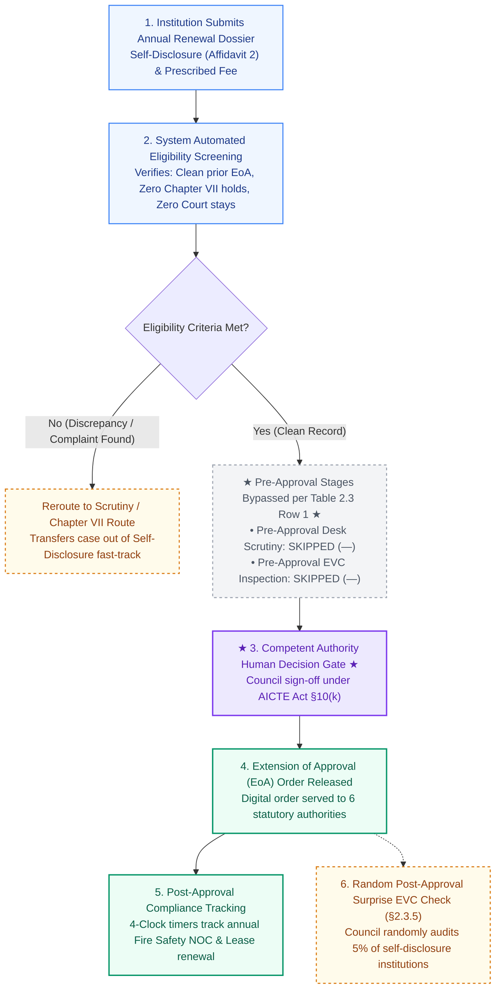

# NIYAMSETU — CHAPTER II: EXTENSION OF APPROVAL (EoA) BASED ON SELF-DISCLOSURE
## Statutory Regulatory Workflow Specification

**Authoritative Source:** AICTE Approval Process Handbook (APH 2024–25 to 2026–27) Chapter II (§2.3–§2.5, pp. 15–20) & Table 2.3 Row 1 (p. 30)  
**Category Scope:** Existing Technical Institutions seeking annual Extension of Approval (EoA) without intake variations or structural alterations  
**Eligibility Baseline:** Institutions having valid AICTE approval in preceding academic year with Nil Deficiencies and clean compliance records

---

## 1. Regulatory Context & Procedural Rules

Under Chapter II §2.5 and Table 2.3 Row 1 of the AICTE Approval Process Handbook:
1. **Self-Disclosure Exemption:** Existing institutions that do not request increase in intake, additional programs, campus relocation, or administrative restructuring are evaluated based on **Self-Disclosure (Affidavit 2)**.
2. **Pre-Approval Scrutiny & EVC Skipped:** In Table 2.3 Row 1, both Scrutiny and EVC columns are marked with a dash (`—`). The system does not route these routine renewals through desk scrutiny committees or physical inspections prior to approval.
3. **Automated Verification:** The platform verifies the validity of the preceding year's approval order, checks for unresolved Chapter VII complaints or pending court orders, and confirms payment of the annual regulatory fee.
4. **Competent Authority Approval Gate:** In compliance with Section 10(k) of the AICTE Act, 1987, the approval order must still be formally authorized by the Competent Authority (AICTE Bureau / Council) and digitally signed.
5. **Post-Approval Surprise Inspection Clause (§2.3.5):** Approval granted on self-disclosure is subject to random surprise on-site verification by an Expert Visit Committee (EVC) at any point during the academic year to audit factual disclosures.

---

## 2. Self-Disclosure EoA Regulatory Workflow Diagram

---

## 3. Statutory Safeguards

1. **No Automated Self-Approval:** While pre-approval inspection stages are skipped, the final EoA letter cannot be generated without an authenticated human Council decision record (Role 5).
2. **Deficiency Rerouting:** If an existing institution has unrectified deficiencies from the preceding academic year, the system automatically disallows Table 2.3 Row 1 routing and transfers the application to Scrutiny.
3. **Surprise EVC Audit Trail:** Random checks under §2.3.5 are scheduled through the EVC module with timestamped geo-coordinates and tamper-evident audit logging.
