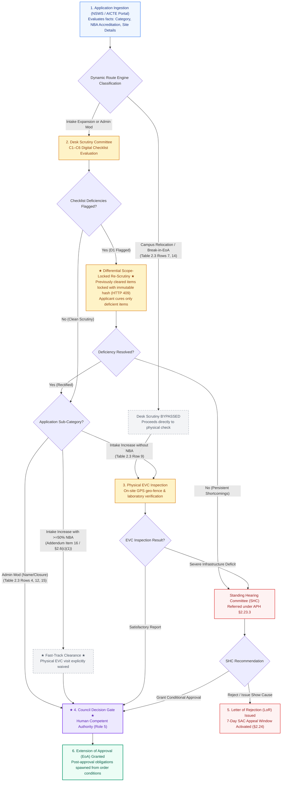

# NIYAMSETU — CHAPTER II: SCRUTINY & EVC REGULATORY ROUTES
## Statutory Workflow Specification for Variations, Expansions & Relocations

**Authoritative Source:** AICTE Approval Process Handbook (APH 2024–25 to 2026–27) Chapter II (§2.6–§2.20, pp. 20–30), Table 2.3 & AY 2026–27 Addendum Item 16  
**Category Scope:** Existing Technical Institutions applying for Increase in Intake, Additional Courses, Campus Relocation, Break-in-EoA Restoration, or Administrative Restructuring  
**Governing Code Module:** [`src/backend/policy/dynamicRouteEngine.ts`](file:///c:/Users/parth/Documents/SIH-26-AICTE/src/backend/policy/dynamicRouteEngine.ts)

---

## 1. Regulatory Route Classification Matrix

Applications under Chapter II require distinct evaluation pathways depending on the statutory risk profile of the request:

```
┌────────────────────────────────────────────────────────────────────────────────────────┐
│ CHAPTER II VARIATION PATHWAYS (Table 2.3 & Addendum 2026–27)                           │
├────────────────────────────────────────────────────────────────────────────────────────┤
│ PATH A: INTAKE EXPANSION WITH VALID NBA ACCREDITATION (>=50% Courses)                  │
│ • Statutory Basis: Addendum 2026–27 Item 16 / Clause 2.6(c)(1) & Table 2.3 Row 9       │
│ • Processing: Desk Scrutiny Only (Fast-Track); Physical EVC is EXPLICITLY WAIVED       │
├────────────────────────────────────────────────────────────────────────────────────────┤
│ PATH B: INTAKE EXPANSION WITHOUT VALID NBA ACCREDITATION                               │
│ • Statutory Basis: APH 2024–27 Table 2.3 Row 9 & Clause 2.6(c)(1)(e)-(f)               │
│ • Processing: Sequential Desk Scrutiny followed by mandatory Physical EVC Inspection   │
├────────────────────────────────────────────────────────────────────────────────────────┤
│ PATH C: CAMPUS SITE RELOCATION OR BREAK-IN-EOA RESTORATION                             │
│ • Statutory Basis: APH 2024–27 Table 2.3 Rows 7 & 14, Clauses 2.16.1(c) & 2.17(e)      │
│ • Processing: Bypasses Desk Scrutiny; Proceeds DIRECTLY to On-Site Physical EVC        │
├────────────────────────────────────────────────────────────────────────────────────────┤
│ PATH D: ADMINISTRATIVE MODIFICATIONS (Name Change, Merger, Closure, Reduction)         │
│ • Statutory Basis: APH 2024–27 Table 2.3 Rows 4, 6, 12, 15, 17                         │
│ • Processing: Desk Scrutiny Only; Physical EVC is NOT APPLICABLE                       │
└────────────────────────────────────────────────────────────────────────────────────────┘
```

---

## 2. Integrated Scrutiny & EVC Workflow Diagram



---

## 3. Product Safeguards in Action

1. **Differential Scope-Lock Enforcement:**  
   Once Scrutiny clears an item (e.g. Land or Built-up Area), its state is cryptographically locked with an SHA-256 hash snapshot. During re-scrutiny, if an officer attempts to reopen a cleared item, [`validateCorrections()`](file:///c:/Users/parth/Documents/SIH-26-AICTE/src/backend/modules/scrutiny/validateCorrections.ts) rejects the request with **HTTP 409 Conflict**.
2. **Deterministic NBA Fast-Track Evaluation:**  
   The system queries verified accreditation records. If eligible courses have >=50% NBA accreditation valid through April 30 of the academic year, physical EVC scheduling is locked in bypassed state.
3. **Internal SLA Timers vs Statutory Windows:**  
   - Scrutiny turnaround: 10 working days (Internal Operational SLA).
   - Re-scrutiny cure turnaround: 10 working days (Internal Operational SLA).
   - Joint FDR submission: Strictly 15 calendar days from approval intimation (Statutory §2.25(f) requirement).
