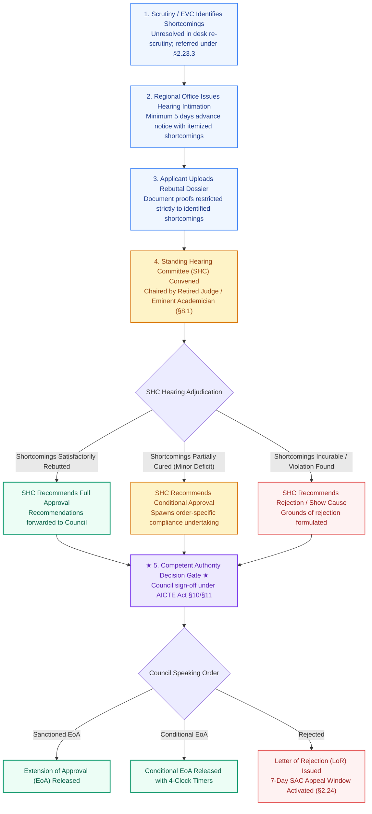

# NIYAMSETU — CHAPTER II: STANDING HEARING COMMITTEE (SHC) SHORTCOMINGS ROUTE
## Statutory Workflow Specification for Deficiency Rectification Hearings

**Authoritative Source:** AICTE Approval Process Handbook (APH 2024–25 to 2026–27) Chapter II §2.23.3 (p. 34) & Chapter VIII §8.1 (p. 68)  
**Category Scope:** Existing Technical Institutions whose applications under Chapter II reveal shortcomings during Scrutiny, Re-Scrutiny, or EVC that require personal hearing before a committee  
**Exclusion:** Public disciplinary complaints (Governed strictly by Chapter VII §7.10) and Final Rejection Appeals (Governed by Chapter VIII §8.2 SAC)

---

## 1. Regulatory Context & Procedural Rules

Under Chapter II §2.23.3 and Chapter VIII §8.1 of the Approval Process Handbook:
1. **Shortcomings Referral:** When a Scrutiny Committee, Re-Scrutiny Committee, or Expert Visit Committee (EVC) identifies infrastructure, cadre, or land shortcomings that the institution disputes or that require documentary substantiation beyond desk upload, the Regional Office refers the case to the **Standing Hearing Committee (SHC)**.
2. **Composition of Bench (§8.1):** The SHC bench is chaired by a Retired High Court Judge or an eminent academician of Professor rank, accompanied by senior experts from academia and industry.
3. **Statutory Intimation Notice:** The Regional Office issues an official intimation providing **at least 5 calendar days advance notice** to the institution, specifying the date, time, and exact list of shortcomings to be heard.
4. **Natural Justice & Document Submission:** The institution's authorized representative presents oral arguments and resubmits verified government documents. In NIYAMSETU, the applicant interface allows secure document upload strictly mapped to the contested shortcomings.
5. **Recommendations to Council:** The SHC records speaking recommendations (Grant of EoA with specific conditions, Reduced Intake, or Issue of Show Cause). These recommendations are submitted to the Competent Approval Authority (Council / Executive Committee) for a final speaking order.

---

## 2. SHC Shortcomings Regulatory Workflow Diagram

---

## 3. UI/UX Interface Partitioning

To guarantee natural justice and prevent administrative prejudice, NIYAMSETU strictly separates role interfaces during SHC proceedings:
- **Applicant Persona (Role 1):** Views scheduled hearing date, download link for official hearing notice, and targeted upload slots for contested shortcomings. Cannot view internal committee deliberative scoring notes.
- **Regional Officer Persona (Role 4):** Manages bench roster, generates standardized hearing intimation notices, and logs attendance.
- **Council / Adjudicator Persona (Role 5):** Records formal speaking findings, tags conditional undertakings, and executes digital signature sign-off.
