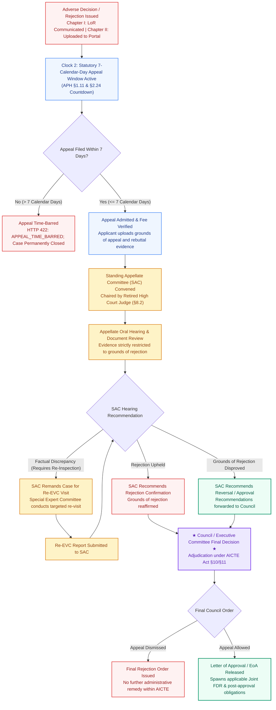

# NIYAMSETU — CHAPTER-SPECIFIC APPEALS (STANDING APPELLATE COMMITTEE)
## Statutory Appellate Workflow & 7-Day Statute of Limitations Specification

**Authoritative Sources:**  
1. AICTE Approval Process Handbook (APH 2024–25 to 2026–27) Chapter I §1.11 (p. 14)  
2. AICTE Approval Process Handbook (APH 2024–25 to 2026–27) Chapter II §2.24 (p. 34)  
3. AICTE Approval Process Handbook (APH 2024–25 to 2026–27) Chapter VIII §8.2 (p. 69)  
**Applicability:** Technical Institutions whose applications have been rejected by the Competent Authority under Chapter I or Chapter II

---

## 1. Statutory Grounding & Distinct Appellate Triggers

The right to appeal an adverse regulatory decision is established by statutory law. Chapter I and Chapter II maintain distinct procedural triggers and statutes of limitations:

```
┌────────────────────────────────────────────────────────────────────────────────────────┐
│ APPELLATE TRIGGER DISAMBIGUATION                                                       │
├────────────────────────────────────────────────────────────────────────────────────────┤
│ CHAPTER I: NEW INSTITUTIONS (APH §1.11)                                                │
│ • Appellate Trigger: Communication of Letter of Rejection (LoR) or LoD via speed post /│
│   registered email.                                                                    │
│ • Statute of Limitations: Strictly 7 calendar days from the date of communication.     │
│ • Appellate Body: Standing Appellate Committee (SAC) chaired by a Retired High Court   │
│   Judge (§8.2).                                                                        │
├────────────────────────────────────────────────────────────────────────────────────────┤
│ CHAPTER II: EXISTING INSTITUTIONS (APH §2.24)                                          │
│ • Appellate Trigger: The date the adverse decision / rejection is uploaded on the       │
│   AICTE Web Portal.                                                                    │
│ • Statute of Limitations: Strictly 7 calendar days from the date of portal upload.      │
│ • Rejection of Time-Barred Appeals: Appeals submitted after 7 calendar days are         │
│   summarily rejected as time-barred (HTTP 422: APPEAL_TIME_BARRED).                    │
└────────────────────────────────────────────────────────────────────────────────────────┘
```

---

## 2. Standing Appellate Committee (SAC) Workflow Diagram



---

## 3. Strict Enforcement of the 7-Day Statute

In [`tests/production_persistence_idempotency.test.ts`](file:///c:/Users/parth/Documents/SIH-26-AICTE/tests/production_persistence_idempotency.test.ts) and [`server/routes/appealsAndHearingsRoutes.ts`](file:///c:/Users/parth/Documents/SIH-26-AICTE/server/routes/appealsAndHearingsRoutes.ts):
- When an applicant submits an appeal, the server calculates:
  `elapsedDays = (submissionTimestamp - rejectionUploadedTimestamp) / (1000 * 60 * 60 * 24)`
- If `elapsedDays > 7.0`, the API immediately rejects the request:
  ```json
  {
    "success": false,
    "error": {
      "code": "APPEAL_TIME_BARRED",
      "message": "Statutory appeal window has expired. Appeals must be filed within strictly 7 calendar days under APH §1.11 / §2.24."
    }
  }
  ```
- This prevents arbitrary administrative extensions and guarantees strict adherence to the Supreme Court mandated academic calendar cutoff.
