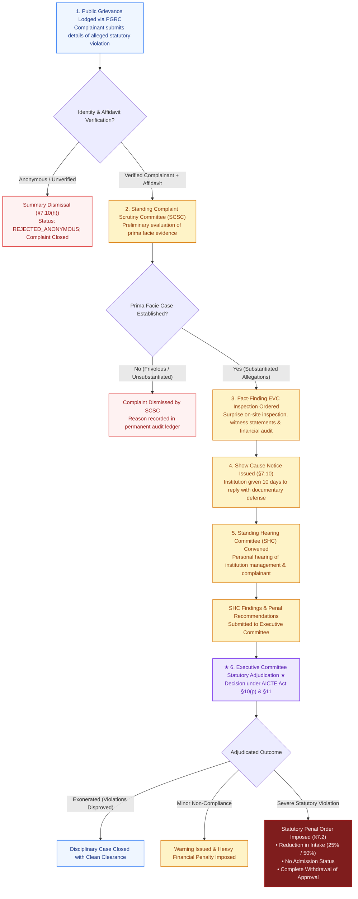

# NIYAMSETU — CHAPTER VII: COMPLAINTS & PENAL ACTION WORKFLOW
## Disciplinary & Public Grievance Procedure Specification

**Authoritative Source:** AICTE Approval Process Handbook (APH 2024–25 to 2026–27) Chapter VII (§7.1–§7.10, pp. 62–67)  
**Applicability:** Verified public, faculty, student, or institutional complaints alleging serious statutory violations against approved technical institutions  
**Core Distinction:** This is a **disciplinary and penal enforcement workflow**. It is **never** an ordinary stage in the approval happy path.

---

## 1. Regulatory Context & Procedural Safeguards

Under Chapter VII of the AICTE Approval Process Handbook:
1. **Intake via Public Grievance Redressal Cell (PGRC):** Complaints alleging ragging, capitation fee extortion, non-payment of prescribed faculty salaries, unapproved courses, or forged land records are received through the AICTE Central Grievance Portal.
2. **Mandatory Identity Verification (§7.10(h)):** In accordance with central vigilance guidelines, **anonymous or pseudonymous complaints are summarily dismissed**. A complainant must provide verified government identity (e.g. Aadhaar or verified email) and an affidavit under penalty of perjury.
3. **Standing Complaint Scrutiny Committee (SCSC):** A preliminary screening committee evaluates whether the complaint establishes a prima facie case. Frivolous or vexatious complaints are rejected at this gate.
4. **Fact-Finding EVC:** If a prima facie violation is established, the Council dispatches an unannounced **Fact-Finding Expert Visit Committee (EVC)** to inspect records, interview students/faculty, and document on-site evidence.
5. **Show Cause & Standing Hearing Committee (SHC):** The institution is issued a formal Show Cause Notice with at least 10 days to respond, followed by a personal hearing before the Standing Hearing Committee.
6. **Penal Actions by Executive Committee:** Based on SHC findings, the Executive Committee can impose statutory penalties under §7.2:
   - Penalty 1: No Admission Status for the subsequent academic year.
   - Penalty 2: Reduction in Approved Intake (25%, 50%, or 75%).
   - Penalty 3: Suspension of approval for specific courses.
   - Penalty 4: Complete Withdrawal of Approval and de-listing from AICTE directory.

---

## 2. Chapter VII Disciplinary Regulatory Workflow Diagram

---

## 3. Strict Architectural Isolation

1. **Separation from Routine Approvals:**  
   Chapter VII complaints are stored in a dedicated MongoDB collection (`chapter_vii_complaints`) and evaluated under isolated API routes (`/api/v1/complaints`). They do not mutate application processing states (`state: 'submitted'`, `'scrutiny_pending'`) into disciplinary states.
2. **Anonymous Complaint Dismissal Test:**  
   In [`tests/production_persistence_idempotency.test.ts`](file:///c:/Users/parth/Documents/SIH-26-AICTE/tests/production_persistence_idempotency.test.ts):
   Submitting a complaint with `isAnonymous: true` or missing verified identity returns `HTTP 400 Bad Request` with `error.code: 'REJECTED_ANONYMOUS'` pursuant to §7.10(h).
3. **Multi-Tenant Privacy:**  
   Institutions cannot inspect complaints lodged against other colleges. Council officers can only access complaints within their regional jurisdiction.
