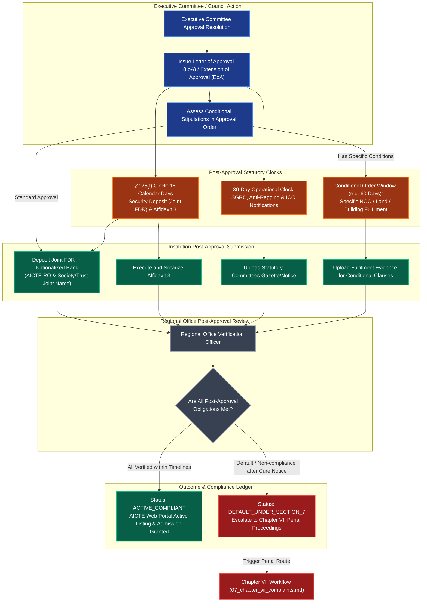

# NIYAMSETU Workflow 08: Post-Approval Conditional Obligations & Document Lifecycle

## 1. Overview and Statutory Foundation

Once an application is approved by the Competent Authority (AICTE Council / Executive Committee), statutory obligations do not end. Post-approval compliance enforces essential legal, financial, and operational requirements that institutions must fulfill before operating or admitting students.

Under AICTE Approval Process Handbook (APH 2024-27):
1. **§2.25(f) Security Deposit & Affidavit 3 Submission**:
   - The institution must submit the security deposit (Joint FDR in the joint name of the Regional Officer, AICTE and the applicant Society/Trust, or Bank Guarantee from a Nationalized Bank) and Affidavit 3 within **15 calendar days** from the date of receipt of the Council approval intimation / Letter of Approval (LoA) / Letter of Extension of Approval (EoA).
   - *Critical distinction*: This 15-day timeline is **strictly** post-approval financial/legal compliance (§2.25(f)). It must never be confused with pre-approval deficiency turnaround windows (which operate under an internal 10-day operational SLA).
2. **Post-Approval Operational Timers (30-day / 60-day / 90-day)**:
   - Mandatory establishment and notification of the Internal Complaint Committee (ICC) / Prevention of Sexual Harassment (POSH).
   - Notification and composition of Anti-Ragging Committee and Squad.
   - Student Grievance Redressal Committee (SGRC) and appointment of Ombudsperson.
   - Faculty recruitment adherence and registration on the AICTE portal.
3. **Order-Conditional Triggers**:
   - Approvals granted subject to specific stipulations (e.g. conditional on land conversion mutation certificate, fire safety NOC renewal within 60 days, building completion certificate).
   - Failure to fulfill order-conditional obligations triggers Chapter VII penal scrutiny under §7.1.

---

## 2. The 4 Statutory & Operational Clocks in NIYAMSETU

To prevent regulatory confusion and ensure compliance transparency, NIYAMSETU strictly disambiguates the operational and statutory clocks:

| Clock Identifier | Duration | Type | Authoritative Basis | Description / Guardrails |
| :--- | :--- | :--- | :--- | :--- |
| **Appeal Clock** | **7 Days** | Statutory Deadline | APH §1.11 / §2.24 | Strict statute of limitations for filing an appeal before SAC against SAC/SHC/Scrutiny rejection. |
| **Operational SLA** | **10 Days** | Internal SLA | AICTE Operational Norms | Target turnaround window for institutions to re-upload rectified documents following an initial Scrutiny deficiency intimation. |
| **FDR / Deposit Clock** | **15 Days** | Statutory Obligation | APH §2.25(f) | Mandatory timeline post-approval for creating Joint FDR / Bank Guarantee and submitting Affidavit 3. |
| **Essential Compliance Clock** | **30 Days** | Statutory / Normative | APH §2.25 / Chapter VII | Notification of mandatory statutory bodies (SGRC, ICC, Anti-Ragging, Board of Governors). |

---

## 3. The 5-State Document Lifecycle Engine

All uploaded regulatory evidence in NIYAMSETU passes through a deterministic state machine:

```
[ UPLOADED / DRAFT ]
        │
        ▼
[ PENDING_VERIFICATION ]
        │
   ┌────┴────────────────────────┬─────────────────────────┐
   ▼                             ▼                         ▼
[ VERIFIED ]             [ DEFICIENT ]             [ REJECTED ]
   │                             │                         │
   ▼                             ▼                         ▼
[ SCOPE_LOCKED ] ◄── Re-upload & SLA Timer ──────► [ SHC / SAC ROUTE ]
```

### Document States:
1. `DRAFT / UPLOADED`: The applicant institution has uploaded the binary (PDF/DWG/JPEG) and computed its SHA-256 hash.
2. `PENDING_VERIFICATION`: The document is in the worklist of Scrutiny / EVC experts.
3. `VERIFIED`: Verified and validated by the designated committee.
4. `DEFICIENT`: Marked deficient with specific standard rejection codes and narrative comments. Triggers operational SLA re-scrutiny clock.
5. `SCOPE_LOCKED`: Immutable snapshot. Under the NIYAMSETU Differential Scope-Lock safeguard, when an application transitions to SHC or SAC, all existing documents are frozen (`HTTP 409 Conflict` on update attempts) to preserve natural justice and evidentiary integrity.

---

## 4. Post-Approval Workflow Architecture



---

## 5. Implementation Safeguards & API Endpoints

1. **Security Deposit Verification Endpoint**:
   - `POST /api/v1/compliance/fdr-submission`
   - Validates FDR certificate number, bank branch, joint account name (`AICTE Regional Officer` + applicant), and date within 15-day window from `loa_issued_at`.
2. **Affidavit 3 Verification**:
   - `POST /api/v1/compliance/affidavit3-submission`
   - Verifies notary registration, stamp paper e-stamp certificate, and deponent authority.
3. **Automatic Escalation on Expiry**:
   - Scheduled cron job evaluates pending post-approval items against `T_15D` and `T_COND`.
   - Emits warning at Day 10, final cure intimation at Day 15, and transitions state to `DEFAULT_PENDING_EXPLANATION` if unfulfilled.
