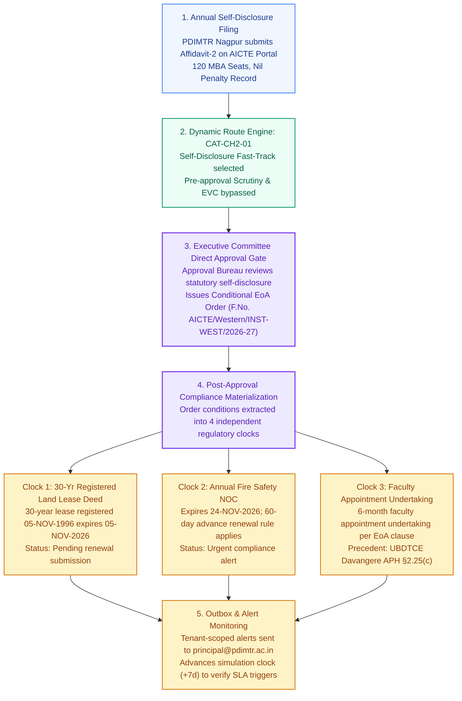
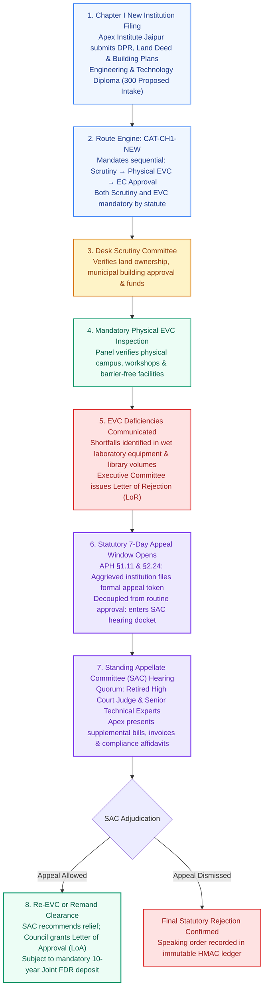
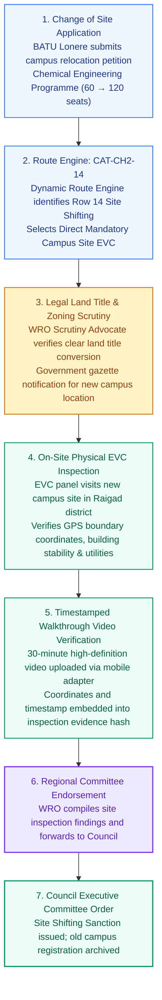
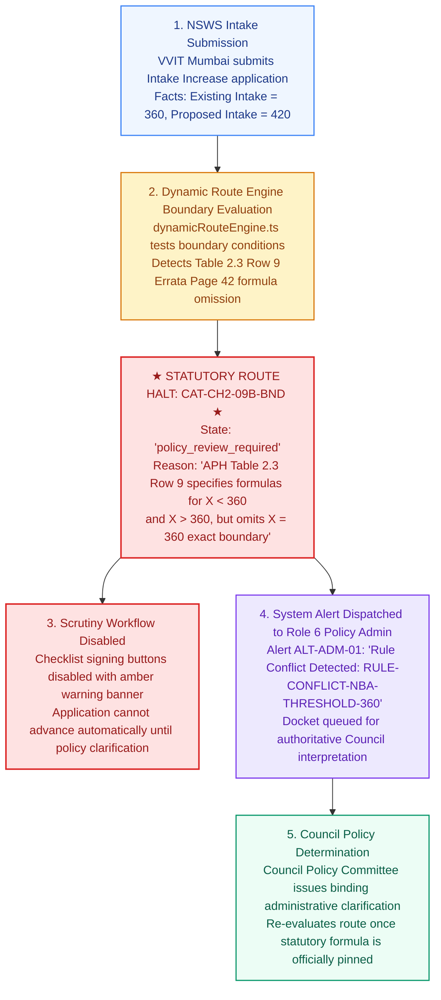

# NIYAMSETU (नियमसेतु) — CANONICAL INSTITUTION JOURNEYS
## End-to-End Regulatory Route Trajectories for All Six Canonical Test Institutions
**Smart India Hackathon 2026 | Problem Statement PS 26262 | Team DEFENSOR**  
**Authoritative Sources:** AICTE Approval Process Handbook (APH 2024–27 Chapter I & II Table 2.3) and AY 2026–27 Addendum Errata G02 Page 42

---

## 1. Overview & Canonical Institutional Archetypes

NIYAMSETU validates deterministic regulatory routing across six persistent canonical test tenants seeded in the database. Each institution represents a distinct statutory archetype under APH 2024–27 and the AY 2026–27 Addendum:

| # | Institution Name | Code / Permanent ID | Region | Application Category | Statutory Route Code | Primary Regulatory Trajectory Demonstrated |
|---|---|---|---|---|---|---|
| **1** | **College of Engineering Pune (COEP Technological University)** | `INST-SOUTH` `1-1437622971` | Western (WRO) | Increase in Intake (120 &rarr; 180 seats) | `CAT-CH2-09A` | **NBA Tier-1 Fast-Track:** Desk Scrutiny Only; Physical EVC Waived under Errata Page 42. |
| **2** | **Gonna Institute of Information Tech & Sciences (GIITS Visakhapatnam)** | `INST-NORTH` `1-6055691` | South-Central (SCRO) | Increase in Intake (180 &rarr; 240 seats) | `CAT-CH2-09B` | **Non-NBA Dual-Track:** Desk Scrutiny &rarr; LoD &rarr; Scope-Locked Re-Scrutiny &rarr; Mandatory Physical EVC. |
| **3** | **Prerna / Univ BDT College of Engineering (PDIMTR Nagpur)** | `INST-WEST` `1-447718433` | Western (WRO) | Extension of Approval (EoA) | `CAT-CH2-01` | **Standard EoA Self-Disclosure:** Fast-track administrative endorsement + 4-Clock Post-Approval Compliance. |
| **4** | **Apex Institute of Technology & Management (Jaipur)** | `INST-APEX` `1-33104928` | Northern (NRO) | Setting up New Institution | `CAT-CH1-NEW` | **Chapter I New Institution:** Sequential Scrutiny &rarr; Mandatory Site EVC &rarr; SAC/SHC Post-Rejection Hearing Loop. |
| **5** | **Dr. Babasaheb Ambedkar Technological University (BATU Lonere)** | `INST-BATU` `1-19201481` | Western (WRO) | Change of Site / Campus Shifting | `CAT-CH2-14` | **Campus Relocation:** Legal Land Title Scrutiny &rarr; Mandatory Physical Site EVC. |
| **6** | **Vidya Vardhini Institute of Technology (Boundary X=360)** | `INST-VVIT` `1-55449921` | Western (WRO) | Intake Increase at Boundary | `CAT-CH2-09B-BND`| **Statutory Boundary Gap:** Existing intake $X=360$; zero-hallucination safe halt into `policy_review_required`. |

---

## 2. Journey 1: COEP Technological University (`CAT-CH2-09A`)
### NBA Tier-1 Fast-Track Intake Increase (Physical EVC Waived)

COEP holds NBA accreditation for its Mechanical Engineering programme with a score $\ge 650$. Under **APH 2024–27 Chapter II Table 2.3 Row 9** and **AY 2026–27 Addendum Errata Page 42 Clause 2.6(c)(i)**, physical campus inspection by EVC is explicitly waived:

```mermaid
flowchart TD
    classDef intake fill:#EFF6FF,stroke:#3B82F6,stroke-width:1.5px,color:#1E3A8A;
    classDef scrutiny fill:#FEF3C7,stroke:#D97706,stroke-width:1.5px,color:#92400E;
    classDef waived fill:#F3F4F6,stroke:#9CA3AF,stroke-width:1.5px,stroke-dasharray: 4 4,color:#4B5563;
    classDef gate fill:#EDE9FE,stroke:#7C3AED,stroke-width:2px,color:#5B21B6;
    classDef terminal fill:#ECFDF5,stroke:#059669,stroke-width:2px,color:#065F46;

    A["1. NSWS Intake Simulation<br/>COEP Pune submits B.Tech Intake Expansion (120 &rarr; 180)<br/>Class-3 DSC Token & NBA Score 680 Verified"]:::intake
    --> B["2. Dynamic Route Engine Evaluation<br/>dynamicRouteEngine.ts selects CAT-CH2-09A<br/>Cites Addendum Errata p. 42 Clause 2.6(c)(i)"]:::intake

    B --> C["3. Desk Scrutiny Committee Allocation<br/>WRO allocates case to Scrutiny Group Alpha<br/>Examines Land, Building Plans, Faculty Cadre Ratio"]:::scrutiny

    C --> D{"Checklist Evaluation"}
    D -->|All Compliant C1-C6| E["4. Scrutiny Snapshot Cryptographically Sealed<br/>Signed by Scrutiny Lead with HMAC-SHA256 digest"]:::scrutiny

    E --> W["★ PHYSICAL EVC WAIVED ★<br/>Waived under Addendum Errata Page 42<br/>NBA Accredited Score 680 skips physical inspection"]:::waived

    W --> F["5. Regional Officer Docket Compilation<br/>RO Western reviews consolidated scrutiny dossier<br/>Prepares recommendation for Executive Committee"]:::gate

    F --> G["6. Executive Committee / Council Approval Gate<br/>Human Competent Authority signs Approval Order<br/>Letter of Extension of Approval (EoA) Dispatched"]:::gate

    G --> H["7. Post-Approval Compliance Engine<br/>Order conditions registered in 4-clock timer subsystem<br/>Strict tenant isolation: COEP views only COEP records"]:::terminal
```

---

## 3. Journey 2: GIITS Visakhapatnam (`CAT-CH2-09B`)
### Non-NBA Dual-Track Intake Increase with Deficiency Re-Scrutiny & EVC

GIITS lacks NBA accreditation for its Computer Science & Engineering intake surge (180 &rarr; 240). Under **APH Table 2.3 Row 9**, it must undergo mandatory Desk Scrutiny followed by an on-site physical inspection by an Expert Visit Committee (EVC):

```mermaid
flowchart TD
    classDef intake fill:#EFF6FF,stroke:#3B82F6,stroke-width:1.5px,color:#1E3A8A;
    classDef scrutiny fill:#FEF3C7,stroke:#D97706,stroke-width:1.5px,color:#92400E;
    classDef lod fill:#FEE2E2,stroke:#DC2626,stroke-width:1.5px,color:#991B1B;
    classDef lock fill:#F3E8FF,stroke:#7C3AED,stroke-width:1.5px,color:#4C1D95;
    classDef evc fill:#ECFDF5,stroke:#059669,stroke-width:1.5px,color:#065F46;
    classDef gate fill:#EDE9FE,stroke:#7C3AED,stroke-width:2px,color:#5B21B6;
    classDef terminal fill:#ECFDF5,stroke:#059669,stroke-width:2px,color:#065F46;

    A["1. NSWS Intake Simulation<br/>GIITS Visakhapatnam submits CSE Intake Surge (180 &rarr; 240)<br/>Non-Accredited Flagged in Facts"]:::intake
    --> B["2. Dynamic Route Engine: CAT-CH2-09B<br/>Mandates Dual-Track: Scrutiny + Physical EVC<br/>Cites APH 2024-27 Table 2.3 Row 9"]:::intake

    B --> C["3. Initial Desk Scrutiny Committee<br/>Examines 4 Statutory Evidence Documents<br/>C3 Land Deed, C4 Occupancy, D1 Cadre, D2 Fire NOC"]:::scrutiny

    C --> D["4. Deficiencies Flagged: D1 & D2<br/>D1: Cadre Ratio Deficit (Professor shortfall in CSE)<br/>D2: Fire NOC expires in 14 days (<60d renewal threshold)"]:::lod

    D --> E["5. Letter of Deficiency (LoD) Issued<br/>Clock T2 (Deficiency Cure) activates: 10-day SLA window"]:::lod

    E --> F["6. USP B06 Scope-Locked Re-Scrutiny<br/>APH §1.8(g) Guard: Passed C3 & C4 locked read-only<br/>GIITS uploads appointment orders & renewed Fire NOC"]:::lock

    F --> G{"Differential Re-Scrutiny Review"}
    G -->|Deficiencies Cured| H["7. Mandatory Physical EVC Inspection<br/>3-member expert panel conducts on-site campus verification<br/>500m GPS Geofence & 30-min walkthrough video verified"]:::evc

    H --> I["8. EVC Report Submitted & Recommended<br/>Infrastructure Score: 88/100, Labs: 90/100, Cadre: 82/100<br/>Chairman signs digitally stamped EVC proforma"]:::evc

    I --> J["9. Regional Office Compilation & Council Decision<br/>Executive Committee grants conditional approval order"]:::gate
```

---

## 4. Journey 3: PDIMTR Nagpur (`CAT-CH2-01`)
### Annual Extension of Approval (EoA) & Post-Approval 4-Clock Compliance

PDIMTR applies for routine annual Extension of Approval based on online self-disclosure under **APH Table 2.3 Row 1**. Pre-approval Scrutiny and EVC are waived; upon approval, specific time-bound conditions materialize into independent countdown clocks:

---

## 5. Journey 4: Apex Institute of Technology (`CAT-CH1-NEW`)
### Setting up New Institution with Post-Rejection SAC/SHC Hearing Loop

Apex Institute seeks approval to establish a new technical institution under **APH Chapter I §§1.1–1.11**. Both Desk Scrutiny and on-site physical EVC are statutory prerequisites. When deficiencies lead to an initial rejection, the institution exercises its statutory right to appeal before the Standing Appellate Committee (SAC):

---

## 6. Journey 5: BATU Lonere (`CAT-CH2-14`)
### Change of Site / Campus Relocation (Direct Mandatory Physical EVC)

Dr. Babasaheb Ambedkar Technological University (BATU Lonere) seeks relocation of campus facilities under **APH Table 2.3 Row 14 & Clause 2.17**. Because physical site inspection of the new campus is the primary regulatory requirement, routine desk scrutiny is bypassed in favor of direct legal land scrutiny and an on-site physical EVC:

---

## 7. Journey 6: Vidya Vardhini Institute of Technology (`CAT-CH2-09B-BND`)
### Statutory Boundary Gap: Existing Intake $X = 360$ (Zero-Hallucination Safe Halt)

VVIT (Palghar / Mumbai, Western Region) requests an intake increase where the existing approved intake equals exactly $X = 360$. Under **APH Table 2.3 Row 9 and Addendum Errata Page 42**, division expansion formulas are explicitly specified for $X < 360$ and $X > 360$, but the boundary condition $X = 360$ is omitted from the statutory text. Rather than guessing, hallucinating, or arbitrarily rejecting the application, NIYAMSETU executes a **zero-hallucination safe halt**:

