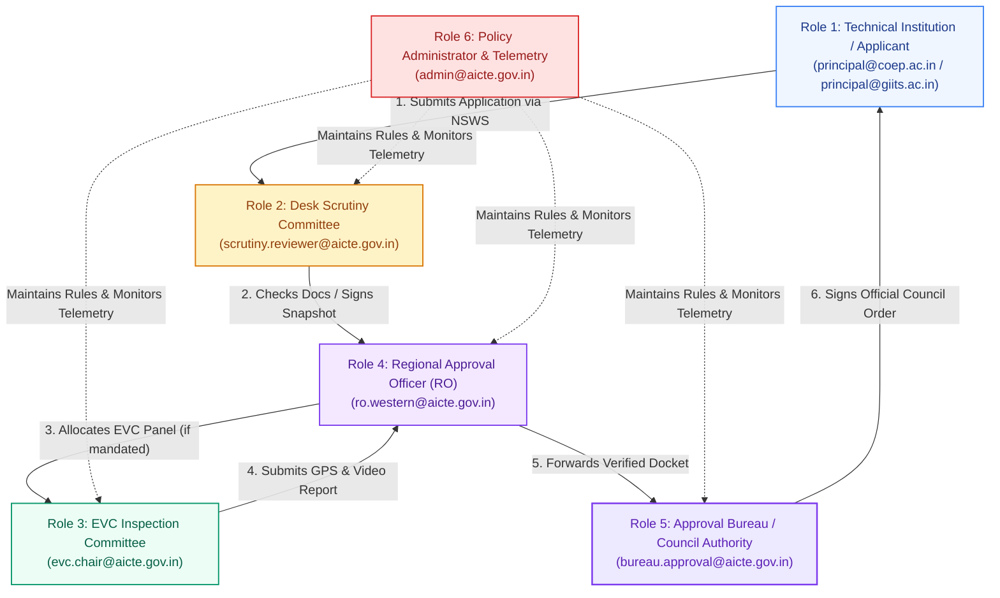
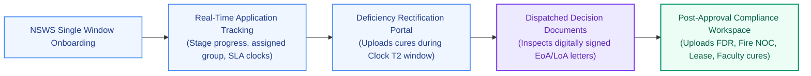
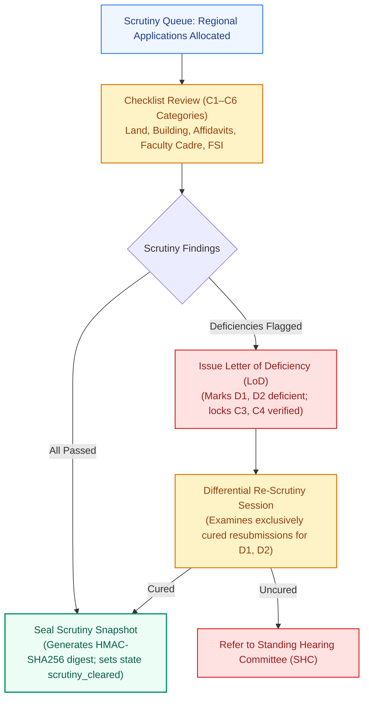
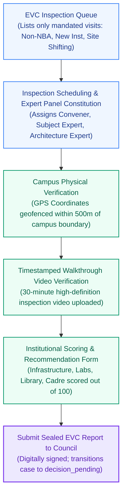
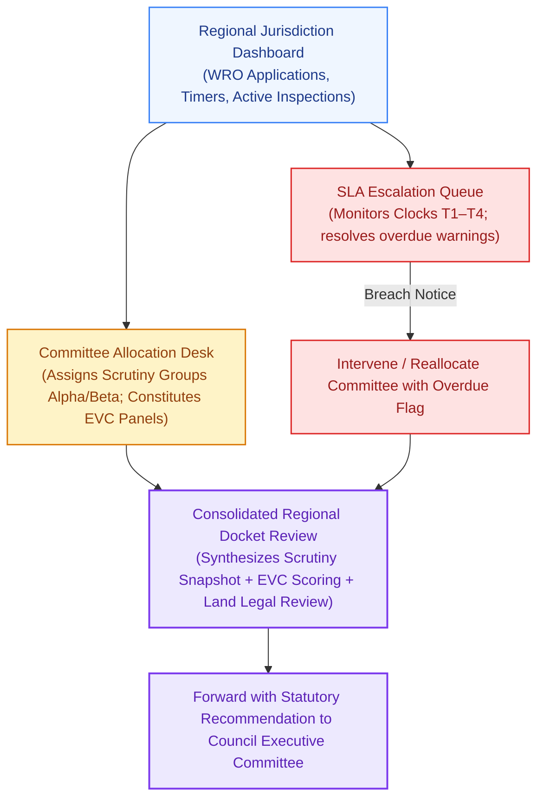
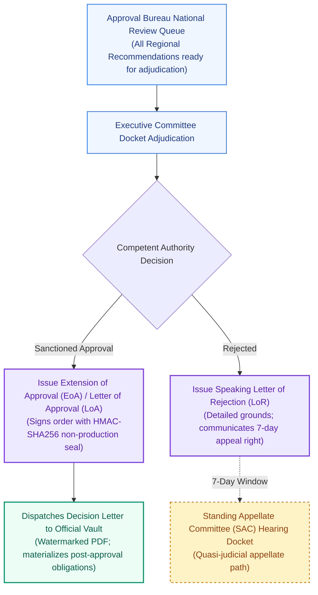
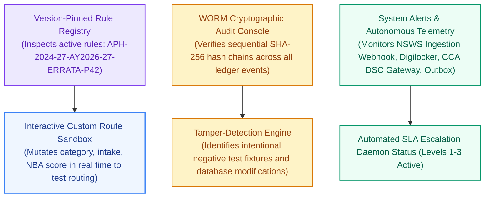

# NIYAMSETU (नियमसेतु) — SIX ROLE-BASED WORKSPACES
## Role-Based Access Control, Workflows, Permissions & Workspace Architecture
**Smart India Hackathon 2026 | Problem Statement PS 26262 | Team DEFENSOR**  
**Authoritative Standards:** AICTE Approval Process Handbook (APH 2024–27) & Statutory Delegation of Powers

---

## 1. Multi-Role RBAC Model & Responsibility Separation

NIYAMSETU enforces strict server-side Role-Based Access Control (RBAC). No single actor can execute actions outside their statutory domain:

---

## 2. Workspace 1: Role 1 — Technical Institution / Applicant
### Dedicated Portal for Heads of Institutions & Signatories

- **Assigned Personas:** `principal@coep.ac.in` (COEP), `principal@giits.ac.in` (GIITS), `principal@pdimtr.ac.in` (PDIMTR), `principal@apex.ac.in` (Apex), `principal@batu.ac.in` (BATU), `principal@vvit.ac.in` (VVIT).
- **Core Permissions:** `case.read`, `case.create`, `document.read`, `document.submit`, `scrutiny.correct`, `notification.read`.
- **Scope Restriction:** Strictly scoped to the actor's own institution (`scope: "scoped"`). Cannot read other institutions' cases or decision documents.

---

## 3. Workspace 2: Role 2 — Desk Scrutiny Committee Cell
### Standing Scrutiny Committee Review & Scope-Locked Re-Scrutiny

- **Assigned Persona:** `scrutiny.reviewer@aicte.gov.in`.
- **Core Permissions:** `case.read`, `document.read`, `document.review`, `scrutiny.sign`, `scrutiny.rescrutinize`.
- **Guaranteed Invariant:** **USP B06 Scope Lock**. The reviewer cannot edit, comment on, or reject documents that were previously verified (`State 1: VERIFIED`) in Round 1. Attempted mutation returns `HTTP 409 Conflict`.

---

## 4. Workspace 3: Role 3 — Expert Visit Committee (EVC) Portal
### On-Site Inspection Coordination & Video Evidence Verification

- **Assigned Persona:** `evc.chair@aicte.gov.in`.
- **Core Permissions:** `case.read`, `evc.read`, `evc.schedule`, `evc.report`, `document.read`.
- **Statutory Rules:** Only cases where the Dynamic Route Engine mandates an EVC (or cases referred by Regional Officer) appear in the EVC Inspection Queue. Accredited fast-track cases (COEP) are absent.

---

## 5. Workspace 4: Role 4 — Regional Approval Officer (RO)
### Regional Jurisdiction Oversight, Allocation & Escalations

- **Assigned Persona:** `ro.western@aicte.gov.in`.
- **Core Permissions:** `case.read`, `case.transition`, `scrutiny.sign`, `scrutiny.rescrutinize`, `evc.schedule`, `document.review`, `dashboard.read`, `history.read`.
- **Jurisdiction:** Western Region (Maharashtra, Goa, Gujarat, Daman & Diu).

---

## 6. Workspace 5: Role 5 — Approval Bureau / Council Competent Authority
### Statutory Approval Orders & Decision Letters

- **Assigned Persona:** `bureau.approval@aicte.gov.in`.
- **Core Permissions:** `case.read`, `case.transition`, `decision.record`, `document.read`, `document.review`, `policy.read`, `dashboard.read`.
- **Authority:** Exercises executive powers under **Sections 10 and 11 of the AICTE Act, 1987**. Digitally signs Extension of Approval (EoA), Letter of Approval (LoA), or Letter of Rejection (LoR).

---

## 7. Workspace 6: Role 6 — Policy Administration & Autonomous Telemetry Console
### Rule Registry, System Health & WORM Audit Verification

- **Assigned Persona:** `admin@aicte.gov.in`.
- **Core Permissions:** `case.read`, `policy.read`, `policy.manage`, `history.read`, `dashboard.read`, `notification.read`, `document.read`.
- **Overhauled Scope:** System telemetry console displaying exclusively administrative notifications: Rule Engine Conflicts, WORM Audit Ledger verifications, Ecosystem Adapters health, SLA Escalations, and Worker Outbox status.

