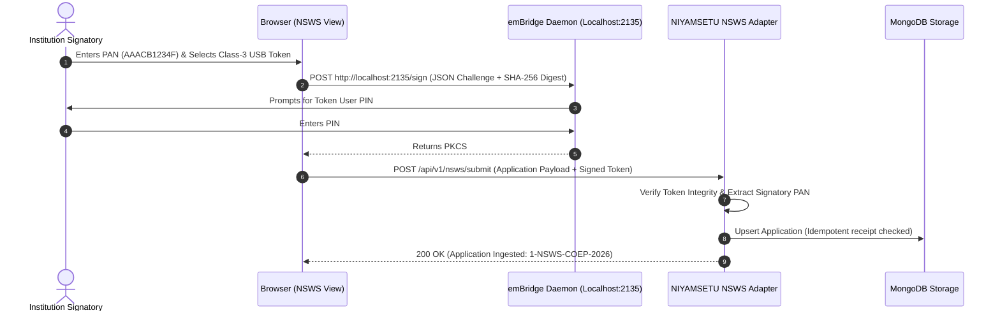
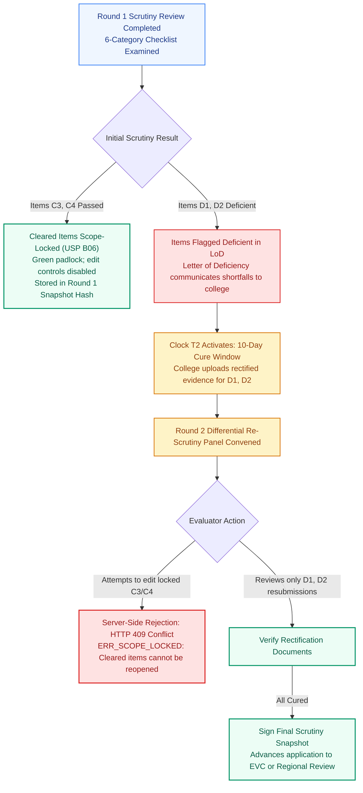
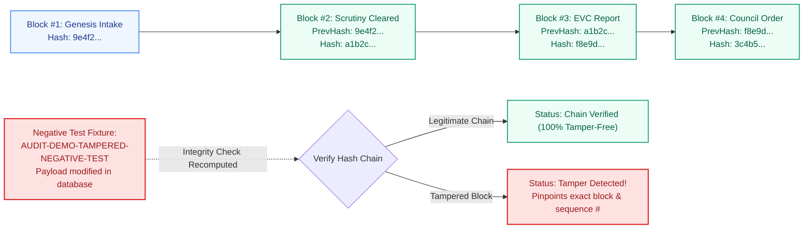

# NIYAMSETU (नियमसेतु) — IMPLEMENTED EXCEPTIONAL WORKFLOWS
## Specialized Workflows, Technical Safeguards & Cryptographic Protocols
**Smart India Hackathon 2026 | Problem Statement PS 26262 | Team DEFENSOR**  
**Authoritative Standards:** AICTE Approval Process Handbook (APH 2024–27), IT Act 2000 & CCA DSC Guidelines

---

## 1. Exceptional Workflows Summary

Beyond routine approval flows, NIYAMSETU implements five critical statutory safeguards and exceptional workflows:

| # | Workflow Name | Technical Safeguard / Statute | Implementation Source |
|---|---|---|---|
| **1** | **emBridge Class-3 DSC Token Challenge** | PKCS#7 digital signature verification on loopback port 2135 | `src/backend/modules/nsws/nswsRoutes.ts` |
| **2** | **USP B06 Scope-Locked Re-Scrutiny** | Cleared items locked read-only; HTTP 409 Conflict if modified | `src/backend/modules/scrutiny/` |
| **3** | **Four-Clock SLA & Auto-Escalation** | Independent countdown timers T1–T4 with 80% & 100% breach hooks | `src/backend/modules/compliance/complianceService.ts` |
| **4** | **WORM HMAC-SHA256 Cryptographic Audit Ledger** | Append-only chained cryptographic ledger with tamper detection | `src/backend/security/auditVerification.ts` |
| **5** | **Decoupled SAC / SHC Appellate Adjudication** | Quasi-judicial hearing loops separated from default approval path | `src/backend/modules/appealsAndHearings/` |

---

## 2. Workflow 1: emBridge Class-3 Hardware Token Challenge & NSWS Ingestion

Validates hardware cryptographic tokens via the emBridge desktop service operating on loopback ports:



---

## 3. Workflow 2: USP B06 Scope-Locked Differential Re-Scrutiny

Prevents the widespread issue of "moving-target scrutiny deficiencies" by permanently locking verified documents:



---

## 4. Workflow 3: Four-Clock Statutory Countdown & Auto-Escalation Engine

Enforces calendar discipline across all four regulatory intervals:

```mermaid
flowchart TD
    classDef intake fill:#EFF6FF,stroke:#3B82F6,stroke-width:1.5px,color:#1E3A8A;
    classDef clock fill:#FEF3C7,stroke:#D97706,stroke-width:1.5px,color:#92400E;
    classDef warn fill:#FEF9C3,stroke:#CA8A04,stroke-width:1.5px,color:#713F12;
    classDef breach fill:#FEE2E2,stroke:#DC2626,stroke-width:2px,color:#991B1B;

    A["Application Ingested"]:::intake
    --> B["Clock T1: Desk Scrutiny<br/>(10 Calendar Days)"]:::clock

    B -->|Deficiencies Flagged| C["Clock T2: Deficiency Cure<br/>(10 Calendar Days)"]:::clock
    C -->|Cures Uploaded| B

    B -->|Cleared (Dual-Track)| D["Clock T3: EVC Campus Inspection<br/>(15 Calendar Days)"]:::clock
    B -->|Cleared (Fast-Track)| E["Clock T4: Council Decision Gate<br/>(15 Calendar Days)"]:::clock
    D -->|Report Recommended| E

    B -.->|Day 8 (80% SLA)| W1["Amber Warning Dispatched to Scrutiny Lead"]:::warn
    B -.->|Day 10 (100% SLA Breach)| BR1["Breach Auto-Escalation to Regional Officer"]:::breach

    C -.->|Day 10 (Breach)| BR2["Overdue Notice: Docket Referred to SHC"]:::breach
    D -.->|Day 15 (Breach)| BR3["Breach Notice to AICTE Member Secretary"]:::breach
```

---

## 5. Workflow 4: Cryptographic WORM Audit Trail & Tamper Detection

Guarantees non-repudiation and detects historical database tampering:



---

## 6. Workflow 5: Decoupled SAC / SHC Post-Rejection Appellate Adjudication

Standing Hearing Committee (SHC) and Standing Appellate Committee (SAC) are strictly decoupled from routine approval paths:

```mermaid
flowchart TD
    classDef reject fill:#FEE2E2,stroke:#DC2626,stroke-width:1.5px,color:#991B1B;
    classDef check fill:#FEF3C7,stroke:#D97706,stroke-width:1.5px,color:#92400E;
    classDef bench fill:#EDE9FE,stroke:#7C3AED,stroke-width:2px,color:#5B21B6;
    classDef success fill:#ECFDF5,stroke:#059669,stroke-width:2px,color:#065F46;

    A["Council / Executive Committee Issues Letter of Rejection (LoR)<br/>Speaking order communicated with exact statutory reasons"]:::reject
    --> B{"Appeal Lodged within 7 Calendar Days?"}

    B -->|No (Day 8 or later)| C["Appeal Time-Barred by Statute<br/>Server rejection: SAC_APPEAL_TIME_BARRED"]:::reject
    B -->|Yes (Within 7 days)| D["Quasi-Judicial Standing Appellate Committee (SAC) Docket"]:::bench

    D --> E["Independent SAC Bench Convened<br/>Chaired by Retired High Court Judge + Senior Academics"]:::bench
    --> F["Personal Hearing & Re-Examination of Disputed Evidence"]:::bench

    F --> G{"SAC Quasi-Judicial Determination"}
    G -->|Relief Granted / Remand Ordered| H["Council Reverses Decision or Mandates Re-EVC<br/>Approval issued upon fulfillment of conditions"]:::success
    G -->|Rejection Upheld| I["Final Statutory Rejection Confirmed<br/>No further administrative appeal available"]:::reject
```
